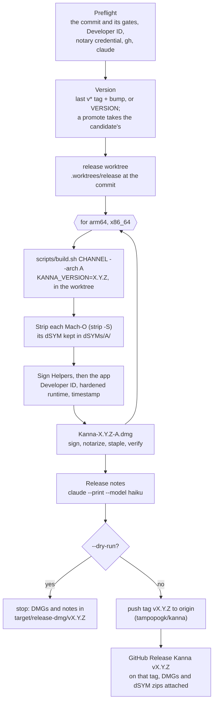
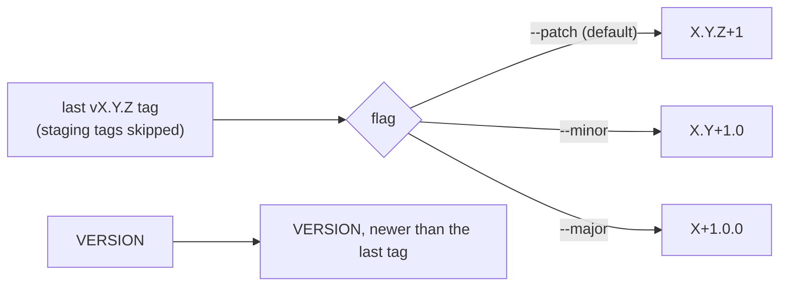
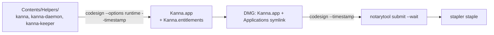

# Release

**Status:** built · **Builds on:** [build channels](build-channels.md), [build architectures](build-architectures.md) · **Why:** people download Kanna as a signed, notarized DMG from GitHub, so one script has to take a commit to a published release

`scripts/release.sh` builds Kanna for arm64 and x86_64, signs and notarizes one DMG per architecture, tags the source and publishes a GitHub Release on **tampopogk/kanna**, the repo that holds both the source and the downloads. It also signs the DMGs for the updater and publishes the update feeds last ([auto update](auto-update.md#7-publishing)).

It makes two kinds of release, and this spec is what they share: `--staging` builds a **candidate** (Kanna Staging, a pre-release), and `--promote` builds the production release from a candidate's commit once it has soaked. Which commit is built, the release branch, the soak gate, failing a candidate and `--status` are in [release candidates](release-candidates.md).

- [The flow](#the-flow)
- [Preflight](#preflight)
- [Versions](#versions)
- [Stripping](#stripping)
- [Signing and the DMG](#signing-and-the-dmg)
- [Publishing](#publishing)
- [The staging channel](#the-staging-channel)
- [Glossary](#glossary)

## The flow

- **The build runs in the release worktree,** `.worktrees/release` in the main checkout, detached at the commit being released ([release candidates §8](release-candidates.md#8-same-source-two-builds)). The checkout the script is run from keeps its branch and its dev build.
- **Nothing is launched:** the script never opens the app it builds, and never touches `/Applications`.
- **Its output** is `target/release-dmg/vX.Y.Z/` in the checkout it's run from: the DMGs, the dSYM zips, `notes.md`, `verification.txt` and `dSYMs/`.

## Preflight

Every check runs before any build, and each failure says what to do.

| Check | How |
|---|---|
| origin is tampopogk/kanna | `git remote get-url origin` |
| The commit and its gates | a version's first candidate: the working tree is clean, HEAD is an ancestor of `origin/main` after a fetch, and the last release's tag is behind it; later candidates and a promote: [release candidates](release-candidates.md) |
| A Developer ID identity | `security find-identity -v -p codesigning` has a "Developer ID Application" identity; it signs by its hash |
| The notary credential works | `~/.kanna/.env.release.local` (shared with Kanna v2) names `APPLE_KEYCHAIN_PROFILE` and `APPLE_KEYCHAIN_PATH`; `xcrun notarytool history` with them succeeds |
| gh and claude | `gh auth status` succeeds; `claude` is on PATH |
| The update key and feeds | the update key file is there and matches the public key in `scripts/env.sh`; gh can push to `tampopogk/kanna-web`; the build number is above each published feed's |

- **`--dry-run` only warns** about the commit's gates, so an unmerged branch can be dry-run as a first candidate. It builds the branch's commits, never uncommitted changes.
- **No secrets:** the env file is read for those two keys only, never sourced or printed; the credential stays in its keychain.

## Versions

The last `v*` tag is the one source of the version: there are no version-bump commits, and nothing reads `Cargo.toml`'s `version`, which stays only because Cargo needs one.

- **The flags go with `--staging`:** they choose the version a candidate is for. With candidates already soaking, a plain `--staging` keeps their version, and `--promote` releases it.
- **The first release is explicit:** with no `v*` tag yet, a bump flag is an error; `4.0.0` was given for Kanna's first.
- **Into a release build:** release.sh sets `KANNA_VERSION` to the exact version; `crates/kanna-build` checks it (`X.Y.Z` or `X.Y.Z-PRERELEASE`) and bakes it in, so `kanna --version` prints it. The Info.plist's `CFBundleShortVersionString` is its `X.Y.Z` part, and `KannaVersion` is all of it, which the About panel shows.
- **Into every other build:** without `KANNA_VERSION`, `crates/kanna-build/build.rs` reads the repo's highest `vX.Y.Z` tag, skipping staging tags as release.sh does, and the build is `X.Y.Z-dev`. A plain `cargo build` gets it too. The tag need not be an ancestor of HEAD, so every checkout of a repo agrees. It rebuilds when a tag lands, from any worktree: it watches `refs/tags` and `packed-refs` in the repo's common git folder.
- **Scripts ask `kanna-build`:** whatever can't read the baked-in version runs the `kanna-build` binary, which prints `version=`: `scripts/build-kanna-app.sh`, `scripts/build-linux.sh` and `scripts/ios-version.sh` (the last two through `kanna_version` in `scripts/env.sh`), and `scripts/server-setup.sh`.
- **No tag, no build:** with no `vX.Y.Z` tag to read (a shallow clone, say) the build fails and says to run `git fetch --tags` or set `KANNA_VERSION`, rather than show a made-up number. `kanna build` sends the version with its job, since a build Mac's mirror has no tags.
- **The build number** (`CFBundleVersion`) is `git rev-list --count HEAD`, in every build: a candidate and the production release promoted from it have the same one.
- **Re-running after a failed publish:** if the tag is already on origin at the commit and has no GitHub Release, release.sh carries on with it; at another commit it stops.

## Stripping

The workspace's release profile keeps line tables (`debug = "line-tables-only"`, [build speed §3](build-speed.md#3-line-tables-in-release)), so a built binary carries a debug map: a list of the `.o` files under `target/` that hold them, with this Mac's paths. Before signing, the release copies each Mach-O's line tables into a dSYM, then strips the map:

| Step | For each of `Contents/MacOS/Kanna` and `Contents/Helpers/*` |
|---|---|
| `dsymutil BINARY -o dSYMs/ARCH/<path in Contents>.dSYM` | file:line for that exact build, not in the DMG |
| `strip -S BINARY` | drops the debug map; the symbol table stays, so crash reports name functions as before; a failure stops the release with strip's message |
| `dsymutil -s` lists no entry of stab type `N_OSO` | or the release stops; the check reads the `n_type` column, since a C++ symbol name can contain the letters `N_OSO` |

Each architecture's dSYMs are zipped as `Kanna-X.Y.Z-ARCH-dSYMs.zip` and attached to the GitHub Release beside its DMG, so a crash report can be symbolicated after `target/` is gone. They add line numbers only: the shipped binaries already carry the symbol names.

A user's crash report symbolicates to file:line with the release's zip unpacked: `atos -o Helpers/kanna-daemon.dSYM -arch ARCH -l LOAD-ADDRESS ADDRESS`. Before line tables, cargo's release default (`strip = "debuginfo"` when there is no debug info) gave the Rust helpers no debug map and the release stripped nothing itself.

## Signing and the DMG

- **Inside out, no `--deep`:** every Mach-O in `Contents/Helpers` first, then Sparkle.framework's `Autoupdate`, `Updater.app` and the framework, then the app, through `kanna_sign_app` (`scripts/env.sh`), which dev builds use too ([privacy prompts](privacy-prompts.md#4-how-dev-builds-are-signed)); a Mach-O outside those stops the release, since it would go unsigned.
- **Explicit identifiers:** the app is its bundle ID (`dev.kanna.app`), each helper `BUNDLE_ID.HELPER` (`dev.kanna.app.kanna-keeper`), not what codesign makes up from the file name.
- **Entitlements** (`apps/kanna/Resources/Kanna.entitlements`), on the app only. Programs in Kanna's terminals are attributed to Kanna by macOS privacy controls, and under the hardened runtime they're refused without an entitlement:

  | Entitlement | For |
  |---|---|
  | `com.apple.security.automation.apple-events` | `osascript` and other AppleScript from terminal programs and agents |
  | `com.apple.security.device.audio-input` | an agent's voice input |

  The Info.plist has the matching usage strings. SimBridge's `dlopen` of Xcode's simulator frameworks needs nothing: they're Apple-signed.
- **Checks:** each app's binaries are the one architecture (`lipo -archs`); the app passes `codesign --verify --strict --deep`; each DMG passes `codesign --verify --strict`, `spctl -a -t open --context context:primary-signature` and `stapler validate`, all saved to `verification.txt`.
- **A rejection** prints `notarytool log` for the submission and stops.

## Publishing

The tag and the release are both on **tampopogk/kanna**, which origin must point at:

1. the annotated tag `vX.Y.Z` at the released commit, pushed to origin;
2. the GitHub Release `vX.Y.Z` on that tag (`gh release create --verify-tag`), titled "Kanna vX.Y.Z", with `Kanna-X.Y.Z-arm64.dmg`, `Kanna-X.Y.Z-x86_64.dmg` and their `Kanna-X.Y.Z-ARCH-dSYMs.zip`.

- **The repo's history:** Kanna v2's repo was tampopogk/kanna until it was renamed tampopogk/kanna2; this source repo (first jemdiggity/kanna-v4) then took the name. Preflight checks the name resolves to itself, not a redirect, and that no release `vX.Y.Z` exists yet.
- **Release notes,** as in v2's `mirror-release.sh`: the merge commit subjects since the last tag (all of main's for the first) go to `claude --print --model haiku`, which writes short user-facing bullets under `### Added` and `### Fixed`, with no internal names or paths. They're printed before anything is published.

## The staging channel

`--staging` builds the staging channel (Kanna Staging, [build channels](build-channels.md)) and publishes a GitHub **pre-release** `vX.Y.Z-staging.N`: `X.Y.Z` is the version as above, and `N` is one past the highest `vX.Y.Z-staging.*` tag. The DMGs are `Kanna-Staging-X.Y.Z-staging.N-arm64.dmg` and `…-x86_64.dmg`. Each one is a candidate for production `X.Y.Z` ([release candidates](release-candidates.md)).

## Glossary

- **Notarization:** Apple scans a signed build and issues a ticket; Gatekeeper opens notarized apps without a warning.
- **Stapling:** attaching that ticket to the DMG, so it verifies offline.
- **Hardened runtime:** a signing option (`--options runtime`) that notarization requires; it blocks code injection and gates privacy-sensitive resources behind entitlements.
