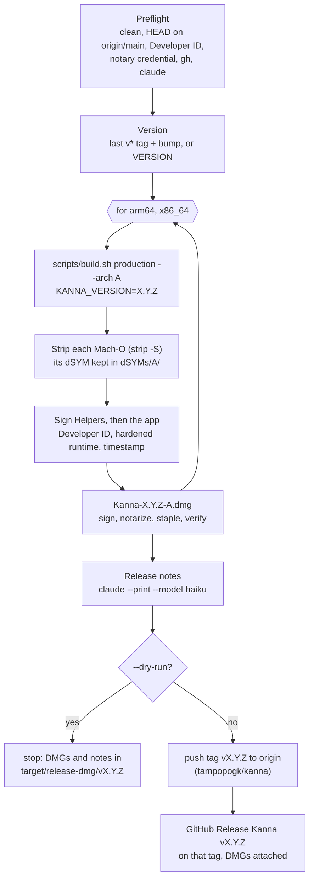
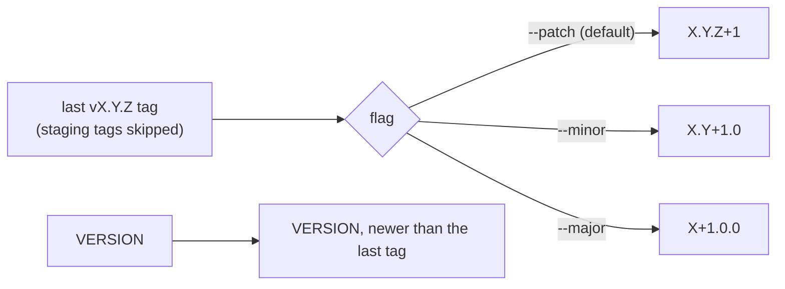
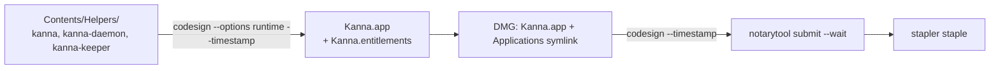

# Release

**Status:** built · **Builds on:** [build channels](build-channels.md), [build architectures](build-architectures.md) · **Why:** people download Kanna as a signed, notarized DMG from GitHub, so one command has to take main to a published release

`scripts/release.sh [--major|--minor|--patch | VERSION] [--staging] [--dry-run]` builds Kanna for arm64 and x86_64, signs and notarizes one DMG per architecture, tags the source and publishes a GitHub Release on **tampopogk/kanna**, the repo that holds both the source and the downloads. It's Kanna v2's `ship.sh` and `mirror-release.sh` without the updater, the appcast or the soak and promote gates.

- [The flow](#the-flow)
- [Preflight](#preflight)
- [Versions](#versions)
- [Stripping](#stripping)
- [Signing and the DMG](#signing-and-the-dmg)
- [Publishing](#publishing)
- [The staging channel](#the-staging-channel)
- [Never latest.json](#never-latestjson)
- [Glossary](#glossary)

## The flow

- **The build runs in this checkout:** `target/Kanna.app` and `target/x86_64-apple-darwin/Kanna.app` become the production (or staging) apps, replacing the dev builds there.
- **Nothing is launched:** the script never opens the app it builds, and never touches `/Applications`.
- **Its output** is `target/release-dmg/vX.Y.Z/`: the DMGs, `notes.md`, `verification.txt` and `dSYMs/`.

## Preflight

Every check runs before any build, and each failure says what to do.

| Check | How |
|---|---|
| origin is tampopogk/kanna | `git remote get-url origin` |
| The working tree is clean | `git status --porcelain` is empty |
| HEAD is on main, already pushed | HEAD is an ancestor of `origin/main` after a fetch, in any checkout or worktree |
| A Developer ID identity | `security find-identity -v -p codesigning` has a "Developer ID Application" identity; it signs by its hash |
| The notary credential works | `~/.kanna/.env.release.local` (shared with Kanna v2) names `APPLE_KEYCHAIN_PROFILE` and `APPLE_KEYCHAIN_PATH`; `xcrun notarytool history` with them succeeds |
| gh and claude | `gh auth status` succeeds; `claude` is on PATH |

- **`--dry-run` only warns** about the first two, so an unmerged branch can be dry-run.
- **No secrets:** the env file is read for those two keys only, never sourced or printed; the credential stays in its keychain.

## Versions

The version comes from the tag: there are no version-bump commits.

- **The first release is explicit:** with no `v*` tag yet, a bump flag is an error; `scripts/release.sh 4.0.0` cut Kanna's first.
- **Into the build:** release.sh sets `KANNA_VERSION`; `crates/kanna-build` checks it (`X.Y.Z` or `X.Y.Z-PRERELEASE`) and bakes it in, so `kanna --version` prints it. The Info.plist's `CFBundleShortVersionString` is its `X.Y.Z` part.
- **The build number** (`CFBundleVersion`) is `git rev-list --count HEAD`, in every build.
- **Without `KANNA_VERSION`** a build is the workspace's version, 0.1.0, as before.
- **Re-running after a failed publish:** if the tag is already on origin at HEAD, release.sh carries on with that tag's release; at another commit it stops.

## Stripping

The workspace's release profile keeps line tables (`debug = "line-tables-only"`, [build speed §3](build-speed.md#3-line-tables-in-release)), so a built binary carries a debug map: a list of the `.o` files under `target/` that hold them, with this Mac's paths. Before signing, the release copies each Mach-O's line tables into a dSYM, then strips the map:

| Step | For each of `Contents/MacOS/Kanna` and `Contents/Helpers/*` |
|---|---|
| `dsymutil BINARY -o dSYMs/ARCH/<path in Contents>.dSYM` | file:line for that exact build, kept in `target/release-dmg/vX.Y.Z/`, not in the DMG |
| `strip -S BINARY` | drops the debug map; the symbol table stays, so crash reports name functions as before |
| `dsymutil -s` has no `N_OSO` | or the release stops |

A user's crash report symbolicates to file:line with `atos -o dSYMs/ARCH/Helpers/kanna-daemon.dSYM -arch ARCH -l LOAD-ADDRESS ADDRESS`. Before line tables, cargo's release default (`strip = "debuginfo"` when there is no debug info) gave the Rust helpers no debug map and the release stripped nothing itself.

## Signing and the DMG

- **Inside out, no `--deep`:** every Mach-O in `Contents/Helpers` first, then the app; a Mach-O anywhere else stops the release, since it would go unsigned.
- **Entitlements** (`apps/kanna/Resources/Kanna.entitlements`), on the app only. Programs in Kanna's terminals are attributed to Kanna by macOS privacy controls, and under the hardened runtime they're refused without an entitlement:

  | Entitlement | For |
  |---|---|
  | `com.apple.security.automation.apple-events` | `osascript` and other AppleScript from terminal programs and agents |
  | `com.apple.security.device.audio-input` | an agent's voice input |

  The Info.plist has the matching usage strings. SimBridge's `dlopen` of Xcode's simulator frameworks needs nothing: they're Apple-signed.
- **Checks:** each app's binaries are the one architecture (`lipo -archs`); the app passes `codesign --verify --strict --deep`; each DMG passes `codesign --verify --strict`, `spctl -a -t open --context context:primary-signature` and `stapler validate`, all saved to `verification.txt`.
- **A rejection** prints `notarytool log` for the submission and stops.

## Publishing

The tag and the release are both on **tampopogk/kanna**, which origin must point at:

1. the annotated tag `vX.Y.Z` at HEAD, pushed to origin;
2. the GitHub Release `vX.Y.Z` on that tag (`gh release create --verify-tag`), titled "Kanna vX.Y.Z", with `Kanna-X.Y.Z-arm64.dmg` and `Kanna-X.Y.Z-x86_64.dmg`.

- **The repo's history:** Kanna v2's repo was tampopogk/kanna until it was renamed tampopogk/kanna2; this source repo (first jemdiggity/kanna-v4) then took the name. Preflight checks the name resolves to itself, not a redirect, and that no release `vX.Y.Z` exists yet.
- **Release notes,** as in v2's `mirror-release.sh`: the merge commit subjects since the last tag (all of main's for the first) go to `claude --print --model haiku`, which writes short user-facing bullets under `### Added` and `### Fixed`, with no internal names or paths. They're printed before anything is published.

## The staging channel

`--staging` builds the staging channel (Kanna Staging, [build channels](build-channels.md)) and publishes a GitHub **pre-release** `vX.Y.Z-staging.N`: `X.Y.Z` is the version as above, and `N` is one past the highest `vX.Y.Z-staging.*` tag on origin. The DMGs are `Kanna-Staging-X.Y.Z-staging.N-arm64.dmg` and `…-x86_64.dmg`. There are no soak or promote gates: a production release is its own run.

## Never latest.json

Kanna v2 installs check `tampopogk/kanna/releases/latest/download/latest.json` for updates. That path now lands on Kanna v4's releases, so **no release may ever have an asset named `latest.json`**: v2 would install whatever it pointed at. release.sh refuses one before publishing and checks the published release's assets after.

## Glossary

- **Notarization:** Apple scans a signed build and issues a ticket; Gatekeeper opens notarized apps without a warning.
- **Stapling:** attaching that ticket to the DMG, so it verifies offline.
- **Hardened runtime:** a signing option (`--options runtime`) that notarization requires; it blocks code injection and gates privacy-sensitive resources behind entitlements.
