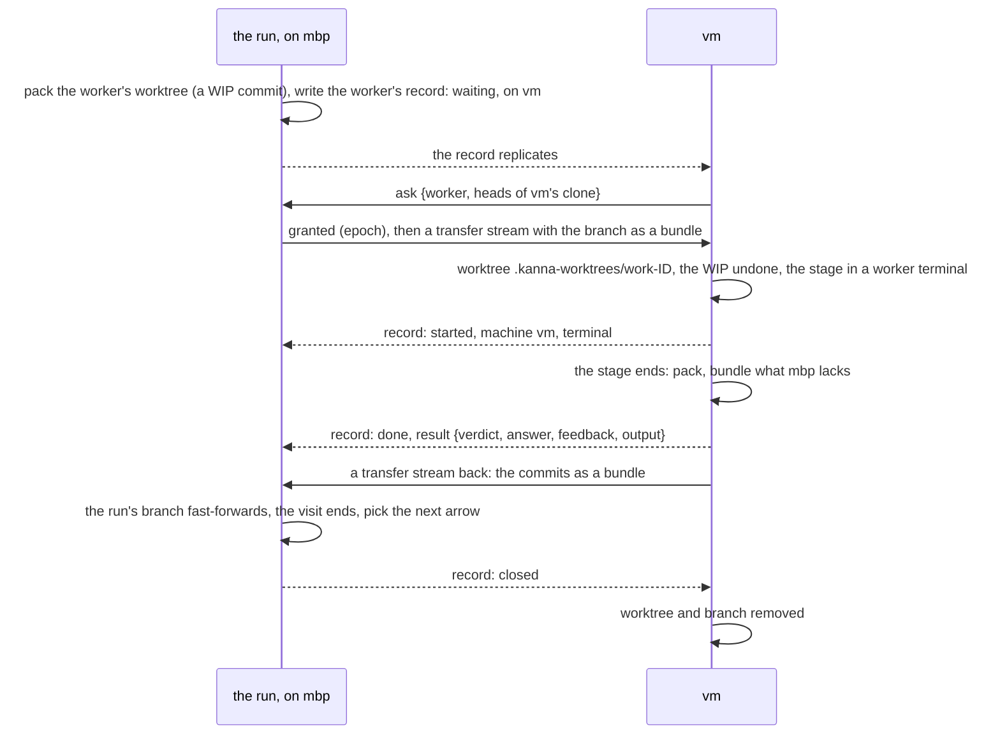

# Remote stages

**Status:** built in the daemon; the app's tab over the link isn't exercised by a test yet ([§6](#6-seeing-it)) · **Part of:** [software factory §3](software-factory.md#3-workers-fan-out-join-and-other-machines), [Kojo §3](kojo.md#3-attributes) · **Builds on:** [run fan-out](run-fan-out.md), [tasks across machines](machine-tasks.md), [task transfer](task-transfer.md) · **Code:** `crates/kanna-daemon/src/tasks/workers.rs`, `runs.rs` · **Tested:** `cargo test -p kanna --test pipeline_remote` (two paired daemons, mock agent), `-p kanna-daemon workers::`

A stage with `on PLACEMENT` runs on another of your machines as a **worker** of the run. The run stays on its own machine: the worker's branch goes over as a git bundle, the stage runs there in a worker terminal, and its verdict, answer and commits come back.

## Contents

1. [Placement](#1-placement)
2. [A worker's visit](#2-a-workers-visit)
3. [What travels](#3-what-travels)
4. [On the peer](#4-on-the-peer)
5. [Waiting and ending](#5-waiting-and-ending)
6. [Seeing it](#6-seeing-it)
7. [Interfaces](#7-interfaces)
8. [Limits](#8-limits)

## 1. Placement

| `on` | Runs on |
|---|---|
| none, `here`, this machine's name | this machine, as before |
| another machine's name (its name in the [peer log](machine-identity.md#3-the-peer-log)) | that machine |
| a role (`e2e`, `mac`, `linux`) | a machine that declares it: this one while one of its runners is free, else the first other one to ask |
| `any` | this machine while one of its runners is free, else the first other one to ask |

- **Roles a machine declares:** `machine.roles` in its own `~/.kanna-v4/config.json` ([settings](settings.md#3-keys)), a list of names (`a-z`, digits, `-`, `_`), plus `mac` or `linux` from its system. Each daemon writes its name and roles as its `machine` record on the [replicated Shelf](machine-tasks.md#1-the-replicated-shelf), so every machine knows them.
- **A name wins over a role** of the same word.
- **Checked at start:** `kanna run start` refuses a pipeline with a placement none of your machines answers to: `FILE:LINE: far is on gpu: no such machine: none of your machines is named gpu or declares the role gpu (machines: mbp, vm; roles: e2e, mac)`.
- **A free runner** is one of the machine's `shelf.runners` not taken by a running Shelf task or a worker it hosts. A worker on another machine takes one of that machine's runners; a worker here takes none, as before.
- **Scorers stay:** the `run` stage a `guard` or `xN by` names scores in the worker of the stage it scores, on the run's machine, whatever its own `on` says.

## 2. A worker's visit

- **The record** is a record of the replicated Shelf with an ID of its own kind (`work-` and 8 hex digits), never a task: `kind`, `project`, `on`, `state` (`waiting`, `started`, `done`), `owner`, `spec` (the stage: its kind, command or agent with effort, model and prompt, `within`, the run, task, stage, instance and visit number, the branch and commits), then from the peer `machine`, `terminal` and `result`, and from the run's machine `closed` or `cancelled`.
- **Granted as a task is:** the run's machine holds the permission to grant the worker; a machine the placement admits, with a clone of the project and a free runner, asks for it, and exactly one is granted, at the next epoch ([tasks §2](machine-tasks.md#2-owners-and-grants)). The bundle on the transfer stream is the grant's delivery: it is sent again every 3 s until the peer answers.
- **The visit's row** (`run_stages`) is made when the worker is offered, with `remote: {worker, on}` in its doc; its `machine` is the placement until a machine takes it, then that machine's name, and its `terminal` is the peer's (`term-4@vm`).

## 3. What travels

| Way | What | How |
|---|---|---|
| over | the worker's branch at the visit's start, with what the worktree holds uncommitted | [transfer's](task-transfer.md#2-what-moves) `pack` (a WIP commit) and `bundle`, less the commits the peer's clone has; the peer's `unbundle` makes the worktree and undoes the WIP, its changes staged |
| back | the verdict, the answer, the feedback, a command's failing lines and the last 64 KB of its output | the worker's record |
| back | the stage's commits, and what it left uncommitted | `pack` and `bundle` again, less the commit it started from; the run's worktree moves to them and the WIP is undone |

- **The same bundle path as a task's move:** a `transfer` stream, whose `args` name a `worker` instead of a task; `back: true` marks a result.
- **While the stage is away** the run's worktree sits at the WIP commit, clean, and nothing else of the run uses it. A result lands only if the worktree is still there and unchanged, and its commits follow the visit's start; then the run's branch is a fast-forward of what it was.
- **Called off** (stopped, timed out, retried, skipped), the WIP commit comes off and the worktree is as it was.
- **A merge in progress can't travel:** a stage placed elsewhere right after a conflicting `merge` stops the run, saying so.

## 4. On the peer

- **Its own clone, its own paths:** the worktree is `.kanna-worktrees/work-ID` of the peer's clone of the project, on the run's branch name; `KANNA_REPO`, `KANNA_WORKTREE` and the scratch files are the peer's.
- **A command stage** needs only the clone. It runs under the task scripts' wrapper with `within` as its limit, its output in `.kanna/tmp/stage-N.log` there.
- **An agent stage** needs the machine able to run that agent: signed in for it ([agent sign-in](agent-sign-in.md)), or with a command for it in its own `pipelines.agents`. A machine that can't doesn't ask for the worker. Its prompt is composed on the run's machine; it reports with `kanna run done`, as any stage's agent.
- **The terminal** is the docked terminal of a workspace of its own on the peer, placed as a Shelf task's is. It belongs to no task, so it is on no machine's Shelf, Desk or `kanna task list`; it is closed when the stage ends.
- **Durable:** both ends keep the worker in the `transfers` table (`work-out`, `work-in`, `work-back`), so a daemon restart on either end carries on: an installed worker starts, a result is sent again until taken, and a worker whose terminal was lost is recorded `interrupted` and runs again.

## 5. Waiting and ending

- **Nobody has taken it:** the run stays `running` and says why: `e2e waits for vm, which is offline`, `e2e waits for a machine with the role e2e to take it`, `… , all offline`.
- **`within`** counts from the offer, so it bounds the wait too: a command stage or a `verdict` stage fails as `timed out`, any other stops the run, and the worker is called off.
- **The peer goes away mid-stage:** the run says `e2e runs on vm, which is offline` and waits; the stage carries on in the peer's keeper, and its result comes when the machines meet again.
- **The run stops, or the task is closed:** its workers elsewhere are called off; the peer ends the terminal and removes the worktree and branch.

## 6. Seeing it

- **`kanna run show`** lists the worker with its `machine` and `terminal`; the Run tab's notice carries the same on each worker.
- **Watch** (`kanna open run --watch`): for a worker elsewhere the daemon replies with the terminal and its machine and asks the app to focus `term-N@machine`, which the app routes over that machine's link ([one link per machine](machine-links.md)). The daemon's part is tested; the tab the app draws for it isn't yet.

## 7. Interfaces

| Between daemons | |
|---|---|
| `replica {action: "ask", task: "work-…", birth, heads}` on a `sync` stream | `{epoch}`, or `not_owner` (taken or called off), `not_there` (the placement doesn't admit the asker) |
| a `transfer` stream, `args {worker, birth, epoch, project, branch, pre, wip}` | `{folder}` once the worktree is in place; `no_clone`, `failed` |
| a `transfer` stream, `args {worker, back: true, birth, branch, pre, wip}` | `{}` once the run's branch has the commits |

| Setting | |
|---|---|
| `machine.roles` | the roles this machine declares, in your own file |

## 8. Limits

- A stage on another machine can't `kanna run need` or `kanna run command`: both are refused there, and the agent is told to report instead. An agent that exits unreported stops the run.
- Stopping the task doesn't park a stage that runs elsewhere; it carries on, and the next stage waits for the task.
- A placement that could run here but found no free runner stays offered to the other machines; this machine doesn't take it back when a runner frees.
- Ignored files, Git LFS objects and submodules don't travel, as with a task's move; the repo's `tasks.setup` doesn't run for a worker.
- A peer that finished a worker whose run's machine never comes back keeps the worker's worktree.
