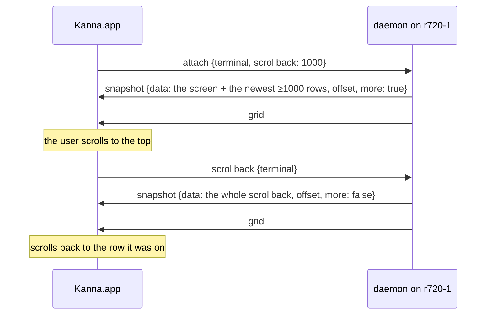

# Remote Terminals

**Status:** built, measuring · **Part of:** [your machines §7](machines.md#7-terminals-and-panes) · **Slice:** [build order, slice 8](machines-build-order.md#your-machines) · **Builds on:** [app link](app-link.md), [one link per machine](machine-links.md) · **Model:** [fleet-net](../../references/prototypes/fleet-net/README.md)

A terminal on another machine keeps the app link's byte stream: a snapshot, then output. What slice 8 changes are the units: an attach sends the screen and a page of scrollback instead of up to 10 MB, a reconnect sends only the bytes the app missed, and your own relay carries the link when you're away. The echo-delay table below decides whether Kanna needs mosh-style local echo.

## Contents

1. [Bounded snapshots](#1-bounded-snapshots)
2. [Reconnect by offset](#2-reconnect-by-offset)
3. [Your relay](#3-your-relay)
4. [Echo delay](#4-echo-delay)
5. [Local echo](#5-local-echo)

## 1. Bounded snapshots

- **`attach {terminal, scrollback: N}`** sends the screen and at least the newest N rows of history. Without `scrollback` it sends everything, as before; this Mac's own daemon is attached that way.
- **How it's cut:** a GHOSTSNP snapshot has the renderable screen first (through READY), then history pages newest first. The daemon encodes the whole screen, decodes the prefix and history pages until it has N rows, and encodes that terminal again (`Terminal::snapshot_with_history`). No Ghostty fork change. A page holds many rows, so N is a floor, and the prefix already carries the active page's resident rows.
- **`more`** is true when the cut left pages out, including the primary screen's history while a full-screen program has the alternate screen.
- **Older scrollback on demand:** when Ghostty's scrollbar reaches the top of a terminal whose snapshot said `more`, the app sends `scrollback {terminal}` once; the daemon sends the whole snapshot, in order with the output like any attach, and from then on that terminal's resyncs are whole. The app then scrolls to the row the reader was on (`scroll_to_row`, the rows added above).
- **The app bounds remote terminals to 1000 rows** (`DaemonLink.remoteScrollback`).
- **The whole scrollback goes over the control stream,** so a keystroke sent while it loads waits behind it. It happens once per terminal, when the reader asks.

## 2. Reconnect by offset

- **`output {terminal, data, offset}`** and **`snapshot {…, offset}`** carry the running count of bytes the terminal has written since this daemon started it; `offset` is where the message ends.
- **`app.hello`'s reply has `daemon.run`,** a token for this run of the daemon. Offsets mean nothing across runs: a restarted daemon numbers adopted terminals from zero.
- **`attach {terminal, from, run}`:** when `run` is this daemon's and `from` is within the terminal's **512 KiB replay ring**, the daemon sends the bytes from `from` as `output`, with each `grid` at the offset where the screen changed size, and nothing else. Otherwise it sends a snapshot.
- **The app** remembers each terminal's last offset and the run per link, sends them on reconnect, and forgets them when the run changes, or the terminal is closed.
- **A resize sends pending output before its `grid`,** so the stream is in the order the daemon's screen saw it, and a replay matches it.

| Event | What crosses the link |
|---|---|
| attach, local | the whole snapshot |
| attach, remote | the screen and ≥1000 rows |
| reconnect, within 512 KiB | the missed bytes |
| reconnect, further behind, or another run | the bounded snapshot |
| scrolled to the top | the whole snapshot, once |

## 3. Your relay

- **`kanna machine relay URL [--token-file FILE]`** names the iroh-relay this machine meets the others through; `none` turns it off. It takes effect at once (`Endpoint::insert_relay`), is kept with the machine state in kanna.db, goes in this machine's descriptor, and shows in `kanna machine list` with whether the machine is connected to it.
- **Endpoints start with an empty relay map,** not n0's: no third party's relay, as before.
- **Peers are dialed with the relay set now and the one in their peer-log entry,** so moving every machine to a new relay works without pairing again.
- **The app's endpoint** gets the relay from the local daemon's peer list and adds it before dialing; port tunnels use it too.
- **Only your machines use it:** the relay admits clients that present its shared token (iroh-relay's `access.shared_token`), a 256-bit secret, rather than a list of keys that would need editing for every machine and app. A relay forwards only ciphertext and can't add a device; the token keeps strangers from using its bandwidth.
- **The token is local:** it's kept with the relay setting in kanna.db and sent to the relay by the daemon's endpoint, the app's and every tunnel. It never goes in the peer log; `kanna machine list` says only whether one is set; the app asks for it with `machine.relay_token`, which the daemon answers only on its own socket, never on a remote app's link or for `kanna --host`.

**Setting one up:** `sudo scripts/machines/relay-setup.sh --cert FILE --key FILE` on any Linux server with a stable address and a TLS certificate:

| | |
|---|---|
| Binary | iroh-relay 1.4.1, checked against its release SHA-256, as `/usr/local/bin/kanna-iroh-relay` |
| Ports | TCP 8444 (the relay over HTTPS) and UDP 7843 (QUIC address discovery); open those two, nothing else |
| Secrets | `/etc/kanna-relay/token` and the config holding it, root-only (0600); the unit gets them, the certificate and its key as systemd credentials, never in its environment or command line |
| Sandbox | a dynamic unprivileged user, no capabilities, read-only system, no home, private devices and /tmp, syscall filter, 256 MB memory cap; `systemd-analyze security` scores it 1.3 ("OK") |
| Renewal | a path unit restarts it when the certificate changes |
| Metrics | off |

**Yours:** `https://relay.kanna.build:8444` on the GCP e2-micro `kanna-relay-vm` (project `kanna-build`, us-central1-a), using Caddy's Let's Encrypt certificate for relay.kanna.build; firewall rule `kanna-iroh-relay` opens TCP 8444 and UDP 7843 to the instance's `kanna-relay` tag. The model's relay (`fleet-net-relay`, 8443/7842, allowlisted to the model's two keys) is untouched beside it. The token is read with `sudo cat /etc/kanna-relay/token` there; each machine then runs `kanna machine relay https://relay.kanna.build:8444 --token-file FILE`.

## 4. Echo delay

**Method:** `crates/kanna-net/examples/terminal-echo.rs`, run by `scripts/machines/terminal-echo.sh DIR LABEL [--remote HOST [--lan-proxy]] [--relay URL [--relay-token-file FILE] [--relay-only]]`. Two private daemons are paired; the tool is an app-link client certified by the first and dials the second over kanna-net, like Kanna.app. On a `cat` terminal it sends one key and times until that key comes back as `output`: keystroke → link → pty → the daemon's screen → link. Ten warm-ups, then 100 samples 10 ms apart, idle and while another terminal on the same link floods output (`seq` in a loop). The link round trip is a `capabilities` request. The app's drawing is the same on every path and isn't in these numbers (at most a frame, 8 ms at 120 Hz). Raw reports: `references/measurements/remote-terminals/`.

**Rig, 2 November 2026:** the M5 MacBook Pro on Wi-Fi; r720-1 (Ubuntu 26.04.1, x86_64, 172.16.0.11) on the same LAN, running this branch's Linux build in a private daemon beside its own; the relay in Iowa, measured from Japan. macOS Local Network privacy refuses LAN sends from a binary built in an agent's shell ("No route to host"), so LAN runs 1 and 3 went through a python UDP forwarder on loopback (`--lan-proxy`); run 2's iroh found the direct LAN address. Relayed runs are relay-only on the Mac's side (no IP transports), the floor for when hole punching fails.

| Path (3 runs each) | Link RTT p50 / p95 ms | Echo idle p50 / p95 ms | Echo while flooding p50 / p95 ms | Full attach | Bounded attach | Reconnect |
|---|---:|---:|---:|---:|---:|---:|
| Loopback (this Mac, 1 run) | 0.4 / 1.5 | 0.5 / 1.9 | 0.5 / 1.7 | 169 KB, 21 ms | 19 KB, 14 ms | 121 B, 0.6 ms |
| LAN, MBP → r720-1 | 4.7–21.6 / 25–127 | 5.3–5.5 / 24–30 | 6.5–7.5 / 32–40 | 162 KB, 23–58 ms | 23 KB, 17–19 ms | 121 B, 4–5 ms |
| Relayed, your relay (Iowa) | RELAY_RTT | RELAY_IDLE | RELAY_LOADED | 162 KB, RELAY_FULL | 23 KB, RELAY_BOUNDED | 121 B, RELAY_RECONNECT |

The full attach is `seq 1 200000` (1.5 MB written); the reconnect is after 36 bytes typed while detached. The model's transport-only echo on the same machines was 5.4–7.9 ms p50 on the LAN and 332–340 ms p50 relayed, and 39–40 ms p50 direct from away after hole punching ([fleet-net](../../references/prototypes/fleet-net/README.md#results-and-slice-contract)).

**What it says:**

- **The terminal adds nothing measurable** over the transport: echo idle equals the link round trip on every path, and both match the model's transport echo. The pty, the daemon's screen and the JSON lines cost under a millisecond.
- **Bounded snapshots and offsets work over distance:** relayed, a reconnect costs one round trip and 121 bytes instead of a snapshot, and an attach sends 23 KB instead of 162 KB here (10 MB on a full scrollback).
- **The relay's idle round trip is distance:** ~320 ms is Japan to Iowa and back twice through the relay. A relay in the user's region (GCP asia-northeast1, Tokyo) would cut it to roughly the 40 ms the model measured direct from away.
- **Under load, keystrokes wait behind output.** While another terminal floods, relayed echo is RELAY_LOADED_SHORT: the flood fills the path's buffers (relayed throughput was 14–20 Mbps in the model) and a keystroke's echo queues behind up to 16 MiB of output on the same control stream before the daemon gives up and resnapshots. On the LAN the same flood costs 1–2 ms.

## 5. Local echo

**Recommendation: don't build mosh-style local echo now.** Ask before building it.

- **On the paths you use it isn't needed:** LAN echo is 5 ms; direct from away (hole punching, the usual case) the model measured 40 ms, under the ~100 ms where typing starts to feel late.
- **Where it would help, the cause is elsewhere:** relayed idle echo (320 ms) is the relay's distance, fixed by putting your relay near you; relayed echo under load (seconds) is a queue, which prediction would only paint over, since a full-screen program's echo can't be predicted and the screen would still lag.
- **What to build instead, in this order:**
  1. **Your relay near you:** a second `relay-setup.sh` on a small VM in asia-northeast1, and `kanna machine relay` pointing at it. No code.
  2. **Bounded output on remote links:** keep a remote link's unsent output to about one bandwidth-delay product (a few hundred KB, not 16 MiB) and, past it, send the screen instead of the bytes, as mosh's state sync does and as the daemon already does at 16 MiB. A keystroke then waits behind at most one screen. This is the part of mosh that matters here, and it's a daemon change only.
  3. **Then measure again;** local echo only if relayed use turns out common and still feels slow.
