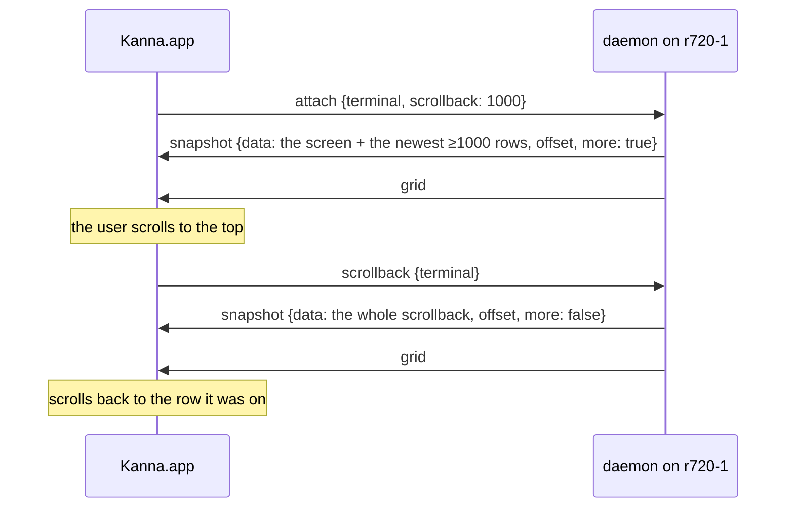

# Remote Terminals

**Status:** built, measuring · **Part of:** [your machines §7](machines.md#7-terminals-and-panes) · **Slice:** [build order, slice 8](machines-build-order.md#your-machines) · **Builds on:** [app link](app-link.md), [one link per machine](machine-links.md) · **Model:** [fleet-net](../../references/prototypes/fleet-net/README.md)

A terminal on another machine keeps the app link's byte stream: a snapshot, then output. What slice 8 changes are the units: an attach sends the screen and a page of scrollback instead of up to 10 MB, a reconnect sends only the bytes the app missed, and your own relay carries the link when you're away. The echo-delay table below decides whether Kanna needs mosh-style local echo.

## Contents

1. [Bounded snapshots](#1-bounded-snapshots)
2. [Reconnect by offset](#2-reconnect-by-offset)
3. [Your relay](#3-your-relay)
4. [Echo delay](#4-echo-delay)
5. [Local echo](#5-local-echo)

## 1. Bounded snapshots

- **`attach {terminal, scrollback: N}`** sends the screen and at least the newest N rows of history. Without `scrollback` it sends everything, as before; this Mac's own daemon is attached that way.
- **How it's cut:** a GHOSTSNP snapshot has the renderable screen first (through READY), then history pages newest first. The daemon encodes the whole screen, decodes the prefix and history pages until it has N rows, and encodes that terminal again (`Terminal::snapshot_with_history`). No Ghostty fork change. A page holds many rows, so N is a floor, and the prefix already carries the active page's resident rows.
- **`more`** is true when the cut left pages out, including the primary screen's history while a full-screen program has the alternate screen.
- **Older scrollback on demand:** when Ghostty's scrollbar reaches the top of a terminal whose snapshot said `more`, the app sends `scrollback {terminal}` once; the daemon sends the whole snapshot, in order with the output like any attach, and from then on that terminal's resyncs are whole. The app then scrolls to the row the reader was on (`scroll_to_row`, the rows added above).
- **The app bounds remote terminals to 1000 rows** (`DaemonLink.remoteScrollback`).
- **The whole scrollback goes over the control stream,** so a keystroke sent while it loads waits behind it. It happens once per terminal, when the reader asks.

## 2. Reconnect by offset

- **`output {terminal, data, offset}`** and **`snapshot {…, offset}`** carry the running count of bytes the terminal has written since this daemon started it; `offset` is where the message ends.
- **`app.hello`'s reply has `daemon.run`,** a token for this run of the daemon. Offsets mean nothing across runs: a restarted daemon numbers adopted terminals from zero.
- **`attach {terminal, from, run}`:** when `run` is this daemon's and `from` is within the terminal's **512 KiB replay ring**, the daemon sends the bytes from `from` as `output`, with each `grid` at the offset where the screen changed size, and nothing else. Otherwise it sends a snapshot.
- **The app** remembers each terminal's last offset and the run per link, sends them on reconnect, and forgets them when the run changes, or the terminal is closed.
- **A resize sends pending output before its `grid`,** so the stream is in the order the daemon's screen saw it, and a replay matches it.

| Event | What crosses the link |
|---|---|
| attach, local | the whole snapshot |
| attach, remote | the screen and ≥1000 rows |
| reconnect, within 512 KiB | the missed bytes |
| reconnect, further behind, or another run | the bounded snapshot |
| scrolled to the top | the whole snapshot, once |

## 3. Your relay

- **`kanna fleet relay URL`** (`kanna machine relay` after the rename) names the iroh-relay this machine meets the others through; `none` turns it off. It takes effect at once (`Endpoint::insert_relay`), is kept with the fleet state in kanna.db, goes in this machine's descriptor, and shows in `kanna fleet` status with whether the machine is connected to it.
- **Endpoints start with an empty relay map,** not n0's: no third party's relay, as before.
- **Peers are dialed with the relay set now and the one in their peer-log entry,** so moving every machine to a new relay works without pairing again.
- **The app's endpoint** gets the relay from the local daemon's peer list and adds it before dialing.
- **Open to any key:** your relay forwards only ciphertext and can't add a device, so it admits any endpoint. Restricting a relay to its users is [Kanna Cloud's](kanna-cloud.md#5-directory-and-relays).
- **The user's relay:** *to be set up on the GCP e2-micro (`kanna-relay-vm`), next to the model's.*

## 4. Echo delay

**Method:** `crates/kanna-net/examples/terminal-echo.rs`, run by `scripts/fleet/terminal-echo.sh DIR LABEL [--remote HOST] [--relay URL [--relay-only]]`. Two private daemons are paired; the tool is an app-link client certified by the first and dials the second over kanna-net, like Kanna.app. On a `cat` terminal it sends one key and times until that key comes back as `output`: keystroke → link → pty → the daemon's screen → link. Ten warm-ups, then 100 samples 10 ms apart, idle and while another terminal on the same link floods output (`seq` in a loop). The link round trip is a `capabilities` request. The app's drawing is the same on every path and isn't in these numbers (at most a frame, 8 ms at 120 Hz).

| Path | Link RTT p50 / p95 ms | Echo idle p50 / p95 ms | Echo while flooding p50 / p95 ms | Full attach | Bounded attach | Reconnect |
|---|---:|---:|---:|---:|---:|---:|
| Loopback (this Mac) | 0.28 / 0.43 | 0.30 / 0.43 | 0.64 / 1.12 | 169 KB, 2.9 ms | 19 KB, 1.7 ms | 121 B, 0.5 ms |
| LAN, MBP → r720-1 | *pending* | | | | | |
| Relayed (e2-micro, Iowa) | *pending* | | | | | |

The full attach is `seq 1 200000` (1.5 MB written); the reconnect is after 36 bytes typed while detached. The model's transport-only echo on the same pair of machines was 5.4–7.9 ms p50 on the LAN (Wi-Fi) and 332–340 ms p50 relayed ([fleet-net](../../references/prototypes/fleet-net/README.md#results-and-slice-contract)).

## 5. Local echo

*Recommendation after the LAN and relay rows.*
