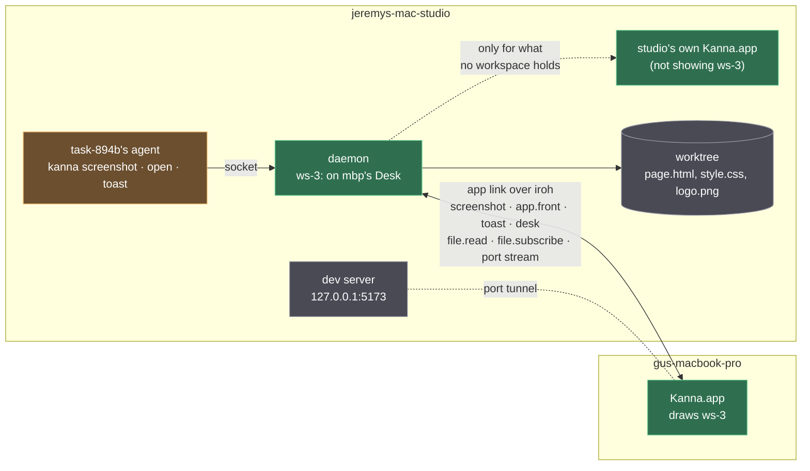
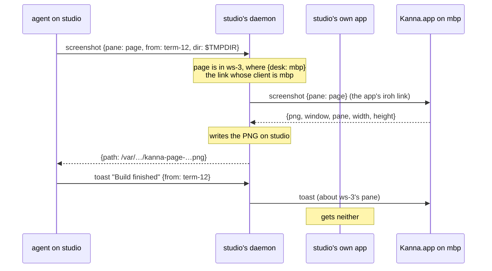
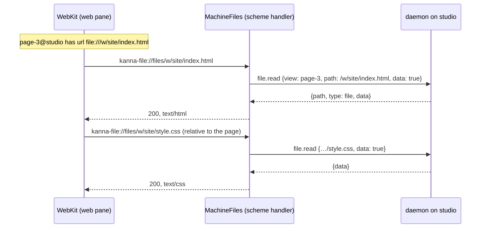

# Remote Workspaces

**Status:** built (2026-11-08) · **Builds on:** [presentation layers](presentation-layers.md), [one link per machine](machine-links.md), [files and threads](files-and-threads.md), [port tunnels](port-tunnels.md) · **Tested:** e2e `remote_workspace`, `cargo test -p kanna --test machine`

An agent's calls to `kanna` are the same whether the app showing its task runs on its own machine or on another. The agent acts only on its own workspace, which its daemon keeps (the logical layer); whichever app has the task on its Desk, on this machine or another, draws it. The agent never knows or names where the user is looking: there is no `--app` or machine argument for it.

## Contents

1. [The rule](#1-the-rule)
2. [Which app answers](#2-which-app-answers)
3. [Pages from another machine's files](#3-pages-from-another-machines-files)
4. [The audit](#4-the-audit)
5. [Tests](#5-tests)
6. [Not in this change](#6-not-in-this-change)

## 1. The rule

- **The agent talks to its own daemon only**, on `$KANNA_SOCKET`, with the same commands and replies on any machine.
- **The daemon knows who shows the workspace:** the workspace's place (`{desk: mbp}`, `{planner: mbp}`, `{quiz: …}`), which names the app by the `client` of its hello ([links §4](machine-links.md#4-projects-desks-and-claims)).
- **Everything the app draws comes over the link:** terminals, files, diffs, logs, threads, a page's files, and a dev server on the agent's loopback through a port tunnel. The app reads nothing of a pane's from its own disk or network for another machine's task.
- **No view, said plainly.** A command that needs a view, with no app showing the workspace, fails as it does locally: `not_shown` when the workspace is on the Shelf or its tab isn't showing, `no_app` when no app is attached.

## 2. Which app answers

A request for "the app" (`screenshot`, `app.front` after a `focus`, a `toast`, `desk` for a task's `activate` or `park`, `app.snap`, `debug.*`) goes to the **viewer**:

1. **The app holding the workspace.** The daemon finds the workspace from the request's `workspace`, its `window`, or its pane (`pane`, `from`, `task`), and the attached app whose `client` its place names. `mac`, this machine's own app's client, matches only the app on the local socket, so a remote app can't pass for it by naming itself `mac`.
2. **Else the target app**, as before ([app link §3](app-link.md#3-rules)): this machine's own app; on a machine that has never had one, the remote app last used. That covers free windows, the Shelf (the target answers `not_shown`), and requests about no workspace (`kanna PATH`, a toast from outside any terminal).
3. **The viewing app closed, its daemon running:** the place still names it, so the target app answers. With this machine's own app open, `screenshot` is `not_shown` (that app doesn't hold the Desk) and a toast shows there; with no app attached, `screenshot` is `no_app` and a toast is held for up to a minute for the next app to attach. The app becomes the viewer again when it reopens.
4. **`app.snap` needs no view:** snapping a comment to its scope works from the file's text, which the daemon sends, so with no viewer and no target it goes to the app last used, else the last attached.

- **The request goes to the app itself**, on the iroh link it holds to studio's daemon ([links §1](machine-links.md)); mbp's own daemon is not in the path.

- **`kanna toast` sends its caller** (`from`, as other commands do), so a toast from an agent shows where its workspace is, not on its machine's own screen. A toast about a `--pane` or `--task` goes to the app showing that pane's workspace.
- **`kanna capabilities`** says `Kanna.app: attached` when any app is attached to the daemon, this machine's or another's.
- **Why the place, not the last app used:** the place is the logical layer's own record of who presents the workspace ([presentation layers §1](presentation-layers.md#1-the-three-layers)); the app last used is a physical accident, and on a machine with its own app it was always that app, which shows nothing of a task on another Mac's Desk.

## 3. Pages from another machine's files

`kanna open web page.html` (or a `file:` URL) from a task on another machine used to be refused ("a page from studio opens only over http or https"), so an agent served the folder itself and opened `http://172.16.0.102:8765/…` on the LAN. Now the page comes through the daemon as markdown and code do.

- **A scheme of the app's own,** `kanna-file://files/PATH`, served by a `WKURLSchemeHandler` (`MachineFiles`) with `file.read` on the pane's link. Relative images, stylesheets, scripts and fetches resolve against it, so they come from the same machine's folder.
- **The URL both ways.** The daemon, `kanna` and the agent only ever see `file:///PATH`; the app maps it to the scheme to load and back when the page navigates (`MachineFileURL`).
- **Only the page's folder.** Each pane's handler serves files under the folder of the page it opened, checked on the path's text (`.` and `..` resolved without touching this Mac's disk, components compared byte for byte) and on the real path the daemon reports, against the page's real folder learned from the page's own load (nothing else loads before it), so a symlink can't lead out; anything else fails to load. A page could otherwise read any file of its machine through `file.read` (`~/.ssh`) and send it anywhere, which a `file:` page on this Mac can't: WebKit keeps it from reading other files. A page that uses files above its folder (`../shared.css`) is opened from that higher folder instead.
- **A data store per machine,** the one its tunnelled pages use, so another machine's file pages share no storage with this Mac's.
- **Types** from the file's extension (`text/html`, `text/css`, `text/javascript`, images, `application/wasm`, …); `Cache-Control: no-store`, so a reload reads the file again.
- **A dev server is not a file page.** `vite` (or any server on the machine's loopback) opens as `http://localhost:5173`, through the [port tunnel](port-tunnels.md), HMR included. A built app opens from its `dist/index.html` here only when its asset paths are relative (Vite's `base: './'`): the default `base: '/'` writes `/assets/…`, which is above the page's folder and refused, as it fails from a `file:` URL on this Mac too.
- **Limits** are `file.read`'s: a file over 8 MiB, a folder or a network path fails that load. A page on this Mac still loads from its `file:` URL directly (§6).

## 4. The audit

Every command an agent uses on its workspace, run from a task on another machine whose workspace this Mac's app shows, with that machine's own app also running (the case that leaked: task-894b on jeremys-mac-studio, shown on gus-macbook-pro).

| Command | Works with a remote app? | What differs |
|---|---|---|
| `open` (terminal), `send`, `send-key`, `read`, `restart` | yes | nothing: terminals live in the daemon and keeper, and the app attaches over its link |
| `open md`, `open code`, `navigate` to a doc | yes | nothing: `file.subscribe` and `file.read` on the link ([files and threads](files-and-threads.md)) |
| `open diff`, `open log` | yes | nothing: `diff.subscribe`, `log.subscribe` on the link |
| `open md --diff` | yes | nothing: the daemon sends the base |
| `open web FILE.html`, `open web file:///…` | **fixed** | was refused unless served over http; now loaded through the daemon with its relative files (§3) |
| `open web http://localhost:PORT` | yes | nothing: a [port tunnel](port-tunnels.md) carries it; the daemon keeps `localhost:PORT`, the agent never needs a LAN address (e2e `machine_remote_web`) |
| `open web https://…` (a public page) | yes | loaded by the app over its own network, as any page is |
| `open serial` | yes | nothing: the daemon reads the port on the agent's machine |
| `open ios` | **no** | refused: the simulator runs in the app, on its Mac. Running it for a task on another machine is the Shelf task "Cloud 12: Build jobs and iOS from remote tasks" (§6) |
| `comment`, `tour` | **fixed** | `app.snap` needed this machine's own app, `no_app` without it; now any attached app snaps (§2) |
| `markup` (a doc), `markup reply` | yes | nothing: threads are kept by the daemon |
| `markup` (an HTML page) | **fixed** | had no page to mark up; the pane now takes comments on another machine's page and sends them to the agent, its threads kept by the daemon as a doc's are |
| `screenshot` | **fixed** | asked only this machine's own app, which doesn't show the workspace (`not_shown`, or `no_app` with it closed); now the app showing the workspace, and the PNG is written on the agent's machine |
| `focus` | **fixed** | the window was brought forward by this machine's own app; now by the app showing the workspace |
| `zoom`, `close`, `rename-tab`, `move`, `move-tab`, `resize`, `arrange` | yes | nothing: logical, in the daemon |
| `workspace list` | yes | nothing: the daemon's view |
| `toast` | **fixed** | showed on this machine's own screen; now where the workspace is (§2) |
| `capabilities` | **fixed** | said not attached while only another machine's app was; now any attached app counts |
| `task activate`, `task park` | **fixed** | acted on this machine's own app; now on the app that has the task on its Desk (only when the user asks, as before) |
| `task ready`, `task send`, `task messages`, `task subscribe`, `task events`, `task list`, `task new`, `status`, `schedule …` | yes | nothing: work, in the daemon |
| `task pick`, `task shelve` | as before | claim for the daemon's claimant, this machine's own app while it's attached; choosing a Desk across machines is the planner's and the user's ([machine tasks](machine-tasks.md)), not an agent's |
| `diagrams check`, `pipeline check` | yes | nothing: the CLI alone |
| `phone …` | yes | nothing: the phone has [a stream of its own](mobile-link.md#3-the-phone-stream) |

## 5. Tests

- **`cargo test -p kanna --test machine`**, `a_request_for_a_view_goes_to_the_app_that_shows_the_workspace_on_this_machine_or_another`: vm with its own app and a remote app `mbp` attached; a screenshot of a workspace placed `{planner: mbp}` reaches `mbp` and is written on vm; a pane in a free window reaches vm's own app; a toast about the workspace reaches `mbp`; with vm's own app gone the screenshot still reaches `mbp`, `debug.app` is still `no_app`, and a comment is snapped by `mbp`.
- **e2e `remote_workspace`**: this Mac's daemon and a second private instance, vm, paired over iroh loopback, vm with its own app attached beside this Mac's. One task on each, both on this Mac's Desks. The same command set runs from each task's agent (`open md`, `open code`, `open diff`, `open web` of an HTML file with a stylesheet, an image and a script, refused a file outside its folder, `markup` on the doc and on the page, `comment`, `focus`, `zoom`, `screenshot` with and without `--force` over a file, `toast`, `read`, `close`, `workspace list`) and the two transcripts must be the same as each other and as the one written in the scenario; vm's own app gets no toast; with vm's app gone the screenshot still works; parked, the pane is refused as not showing.
- **`KannaLinksTests` `MachineFileURLTests`**: the mapping both ways, relative files, only the page's folder, other URLs left alone, the types.
- `machine_two_apps`, `machine_remote_task`, `machine_remote_files`, `machine_remote_web`, `screenshot`, `web_md_ios_panes`, `code_tour`, `cli_caller`, `path_last_in_front` and `file_panes` pass unchanged; `toasts`, `page_comments` and `md_comments` fail at the same step with and without this change (2026-11-08, main at c58fcde0).

## 6. Not in this change

- **iOS panes for a task on another machine:** the Shelf task "Cloud 12: Build jobs and iOS from remote tasks".
- **This Mac's file pages through the daemon too.** A page from this Mac's disk still loads from `file:` directly; moving it onto `kanna-file:` makes one path for every machine, at the cost of a page's origin changing from `file://` (its `localStorage`, and what page comments key on): the Shelf task "File pages on this Mac through the daemon".
- **Reaching another machine's task by ID** from the user or planner (task-6ac8), and machine-qualified pane IDs on the CLI (`term-21@studio`).
