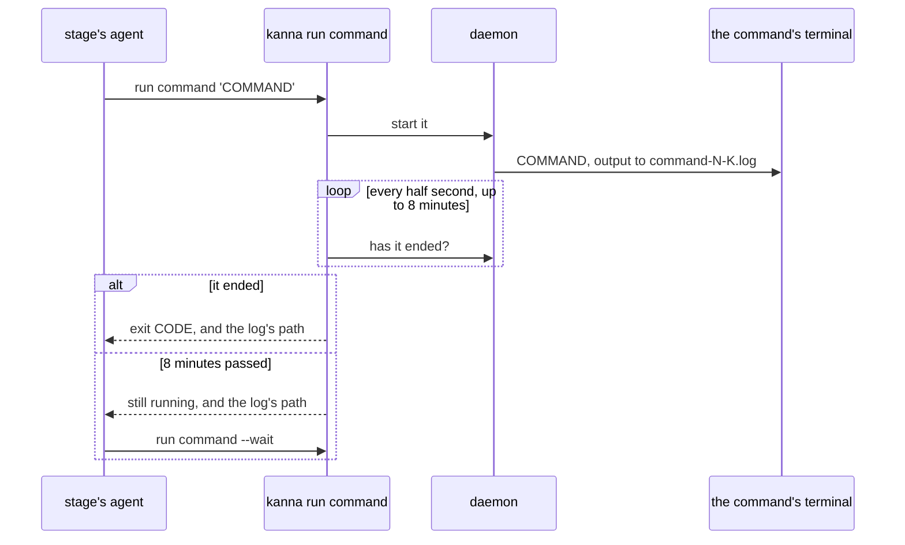
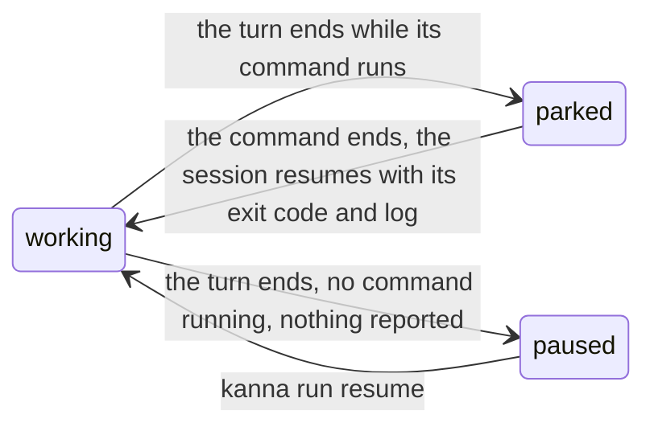

# Run commands

**Status:** built · **Tested:** `cargo test -p kanna-daemon runs::`, e2e `merge_queue` · **Part of:** [software factory](software-factory.md) · **Used by:** the [merge queue's judge](merge-queue.md#32-the-tests-and-the-judge)

**A stage's agent asks Kanna to run a command that takes minutes, and Kanna runs it and waits with the agent.** An agent's own shell stops a command after about ten minutes, and whatever the agent leaves running in the background ends when its turn does, because Kanna quits an agent whose turn ends. A build or a whole test suite can outlast both. `kanna run command` hands the command to the daemon, which runs it as it runs a [`run` stage](kojo.md#2-stages), so it depends on neither the agent's shell nor its turn.

## Contents

1. [Asking for a command](#1-asking-for-a-command)
2. [Waiting](#2-waiting)
3. [A turn that ends first](#3-a-turn-that-ends-first)
4. [How it's built](#4-how-its-built)
5. [Tests](#5-tests)
6. [Rejected](#6-rejected)

## 1. Asking for a command

```sh
"$KANNA_CLI" run command 'cargo test --workspace'
```

- **Who:** an agent stage's agent, from its worker's terminal, as `kanna run done` and `need` are. Any run's agent stage can, a task's run or the merge queue's.
- **Where it runs:** in the run's worktree, in a background terminal of its own that the keeper holds, with your login shell and the stage's variables (`KANNA_RUN`, `KANNA_STAGE`, `KANNA_WORKTREE`, …).
- **Output:** all of it in `.kanna/tmp/command-N-K.log` in the worktree, N the stage's visit and K the command's number in it. The exit code is in `command-N-K.exit`.
- **One at a time:** a second command while one runs is refused, naming the one that runs.
- **No time limit of its own:** the stage's `within` bounds it, as it bounds the stage.
- **Ends with the stage:** when the stage reports, times out, or is skipped, retried or stopped, a command still running is killed.

## 2. Waiting



- **The call waits** for the command, up to 8 minutes, which is under an agent shell's limit. `KANNA_RUN_WAIT` sets another number of seconds.
- **It prints** `exit CODE` on its first line when the command has ended, or `still running`, then the command, how long it has run and the log's path.
- **`kanna run command --wait`** waits again for the same command, as often as it takes. After the command has ended it prints the same `exit CODE` again.
- **The agent's turn goes on** through every wait, since each is a shell call that returns.

## 3. A turn that ends first

An agent may still end its turn while its command runs, to wait for it. Kanna then keeps the command and carries the agent on when it ends.



- **Parked:** the agent is quit and its session kept, as at a pause, and the run stays `running` (`STAGE waits for its command`). Nobody is told, since nothing is needed.
- **Carried on:** when the command ends, the session starts again with a message naming the command, its exit code and its log. It isn't counted as an intervention.
- **A job in the agent's own shell** gets none of this: Kanna can't see it, the turn's end pauses the run (`STAGE stopped without reporting`), and the job ends with the agent. The pause's message says so.

## 4. How it's built

- **`runs.rs`:** the `run` command's `command` action starts the command with the same wrapper a `run` stage uses (`task_scripts::stage_command`, no timeout) and keeps it on the visit as `job` in `run_stages.doc`: its number, text, log, exit file, terminal, whether the agent's turn ended on it, and its exit code once known. Without a command the action reports on the one kept.
- **The wait is the CLI's:** `kanna run command` asks the daemon again every half second, so the daemon holds no request open.
- **Ended:** the exit file is there, or the terminal has ended without one, whose exit code is then written to it. The terminal's end steps the run.
- **Turn end:** `Runs::status` parks the stage when its command is running; `Runs::step` carries it on with `carry_on`, by `daemon`, once the command has ended. A daemon restart keeps both, since the job is in the visit's row.
- **Feedback's log:** a stage that follows a failed `run` stage is given, after the feedback, the path of the file with all of that stage's output.

## 5. Tests

- **Unit (`runs::`):** a command round-trips through its visit's row, the message that carries an agent on names the command, its exit code and its log, and a prompt's feedback names the file with all the output.
- **E2E `merge_queue`:** the mock judge runs a test on main through `kanna run command` with a 1-second wait, and has to wait again. Another ends its turn while a 4-second command runs: the command runs to its end, and the judge is carried on with `It exited 0` and the log's path ([merge queue §8](merge-queue.md#8-tests)).

## 6. Rejected

Telling the agent to run it in the background and wait is what the merge queue's first prompt did. The agent ended its turn to wait, Kanna quit it, and the build died with it.

A long timeout on the agent's shell call can't exceed the shell's own limit, about ten minutes.

Leaving an agent alone while its own background job runs would need Kanna to know the job exists. An agent's process tree always has children (its tools' servers), so a child process says nothing, and a turn that ended for good would hold its run until someone looked.

`kanna run need` for a long command would stop the run for you each time, for something that needs no decision.

A stage the agent adds to its run's pipeline, by `emits`, would end the agent's session and start a fresh one after the command, which then has to rebuild what the first one knew.
