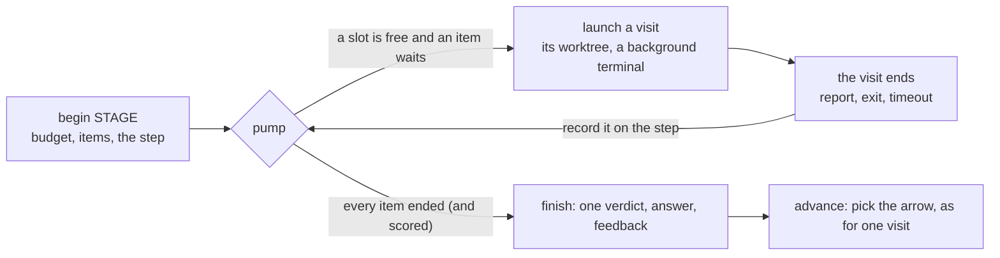
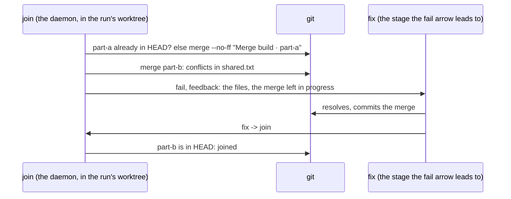

# Run fan-out

**Status:** built · **Part of:** [software factory §3](software-factory.md#3-workers-fan-out-join-and-other-machines), [Kojo §3](kojo.md#3-attributes) · **Code:** `crates/kanna-daemon/src/runs.rs` · **Tested:** `cargo test -p kanna-daemon runs::`, e2e `pipeline_fanout`

How a run's stage becomes several workers at once and comes back as one result: `each STAGE.KEY` (one worker per item of a list), `merge STAGE` (their branches joined into the run's), `xN by STAGE` (N attempts, the best-scored kept) and `guard STAGE` (a worse result rolled back). On top of [sequential runs](software-factory.md#61-sequential-runs-as-built), with `on PLACEMENT` resolved to this machine only.

## 1. A stage is a step of visits



- **Step:** what a run keeps while a stage is under way (`doc.step` on the run's row): the stage, its visit number, the run's commit when it began, and its items, each with its worktree, branch, result and score. It survives a daemon restart: the visits still open carry on in the keeper, and any the step still needs are launched again.
- **Visits:** a run has any number open at once, each its own terminal and `run_stages` row; `n`, its number in the run, names its files (`stage-N.md`, `answer-N.md`). A plain stage is a step of one visit, so a sequential run is unchanged.
- **Rows:** an instance's row has the stage's name and visit, its `instance` (`part-a`, `attempt-2`, `before`, `after`), its `worktree` and `branch`, and `machine`, this machine's name. `kind` is `agent`, `run`, `merge`, or `score` for a scorer's visit.
- **Events:** a `stage` event per visit opened, and one `verdict` per step, when it finishes.

## 2. `each STAGE.KEY`

| From the answer | The worker |
|---|---|
| ```` ```json name=parts ```` holding `["Part a\n…", {"name": "Part B", …}]`, or any `json` block when the stage has one `each` consumer | one per item, in order: `build · part-a`, `build · part-b` |
| a string item | its first line names it; the whole string is `# Your part` |
| an object item | its `name` names it; its JSON is `# Your part` |
| a nameless item | its position (`3`); a repeated name gets `-2` |

- **Worker:** `.kanna-worktrees/<task>-run-N-<item>` on `run/<task>-N-<item>`, from the run's branch at the step's start commit, made as the item starts, with a background terminal of the task's workspace. Its terminal has `KANNA_WORKTREE` and `KANNA_BRANCH` of its own and `KANNA_INSTANCE`, the item's name.
- **At once:** `pipelines.workers` (default 3, 1 to 10, the repo's `.kanna/config.json` then yours), read as the step fills its slots; the others wait their turn, in order.
- **Budget:** once the list is read, the worst case is checked again with its real length, and the stage's cost (its length) against the sessions left; either over waits on you before any worker starts. A missing block or a list that isn't one stops the run, saying why.
- **One that needs you:** pauses the run; the others carry on to their ends, no new one starts until `kanna run resume` carries it on, and the run is `running` again once none is held.
- **Result:** at a `verdict` stage, `fail` if any item failed, else `pass`. The answer is each item's under `## build · part-a`; the feedback, the failed items'. The items' worktrees stay, as the stage's **parts**, for a `merge`.
- **Again:** a later visit of the stage first removes the parts it left unjoined.

## 3. `merge STAGE`



- **Order:** the parts in item order, one merge commit each; a part whose branch is already in the run's branch counts as joined.
- **Conflict:** the verdict is `fail`, feedback `Merging build · part-b into run/… conflicts in:` with the files, and the merge is left in progress in the run's worktree for the next stage to resolve and commit. A merge still in progress when `merge` runs again fails, saying so; a merge that fails for another reason is aborted and fails with git's error.
- **Joined:** the part's worktree and branch are removed at once; its record stays. Parts not yet joined are tried on the next visit.
- **No terminal:** a `merge` runs in the daemon, a visit of kind `merge` with `joined` and `conflicts` on its row.

## 4. `xN by STAGE`

- **Attempts:** N workers `attempt-1` … `attempt-N`, as `each`'s, with no `# Your part`, all from the same commit, `pipelines.workers` at once.
- **Scoring:** when an attempt's agent is done, the `run` stage named runs in that attempt's worktree (a `score` visit): its output's last line `score: X`, else 1 if it exits 0 and 0 if not.
- **Winner:** the highest score, ties to the first. The run's branch fast-forwards to it; every attempt's worktree and branch is removed; each attempt's row keeps its `score` and `won`. The stage's result is the winner's, noted `attempt-2 won: attempt-1 3, attempt-2 7`.

## 5. `guard STAGE`

- **Before and after:** the `run` stage named scores the run's worktree before the agent starts and after it's done (`score` visits `before` and `after`), as `xN`'s scorer does.
- **Worse:** a lower score after resets the run's worktree to the stage's start commit, keeping the agent's work on `run/<task>-N-guard-V`; the agent's row records `guard: {stage, before, after, rolledBack}`, and the step's verdict is the agent's.
- **Not with `each` or `xN`:** refused at start (`runs can't do yet`), as is `each` with `xN`.

## 6. `on PLACEMENT`

- **This machine only** until [machines](software-factory.md#3-workers-fan-out-join-and-other-machines) run stages: `on here` and `on` this machine's name (its host name to the first dot) run here; anything else refuses the run at start, `FILE:LINE: far is on mini: no such machine: stages run on this machine (here, or mbp) until machines are built`. Every visit's `machine` is this machine's name.

## 7. Gates and steering during a step

- **Pause:** finishes the whole step, every instance and scorer, and starts no stage after it ([software factory §6.2](software-factory.md#62-gates-and-steering-as-built)).
- **The task stopped:** every working agent of the step is parked and every command stops, to run again; started again, each parked agent carries on and the step fills its slots.
- **Skip and retry:** take a run with one worker open; with several, they refuse, naming them. A retried instance or scorer runs again in its own worktree.
- **Ask:** an `ask` stage is a step of one visit, with no terminal.
- **The Run tab** ([run tab](run-tab.md)): lists every open worker with its `instance`. `kanna open run --watch` shows the first, `--worker` any of them. A worker's terminal is kept for the next one to take its tab only when it was the run's one open worker; one of several closes when it ends.

## 8. One row for the task

Workers are background terminals of the task's workspace ([software factory §6.1](software-factory.md#61-sequential-runs-as-built)), so however many run, the task is one row on the Shelf, in the Desk view and in `kanna task list`, one item in the strip while another task is active, and one Shelf runner slot. e2e `pipeline_fanout` checks all four on the Shelf while two parts build at once, and on the Desk until the run hands back.

## 9. Rejected

- **Instances as visits in one terminal, one after another:** no parallelism, and an instance's worktree would carry the last one's work.
- **A merge in a terminal, as a `run` command:** nothing to show and a slower turn; git's merge is quick and its conflicts are the stage's feedback.
- **Aborting a conflicting merge:** the stage after would have to redo it; leaving it in progress hands the fix exactly the conflict.
