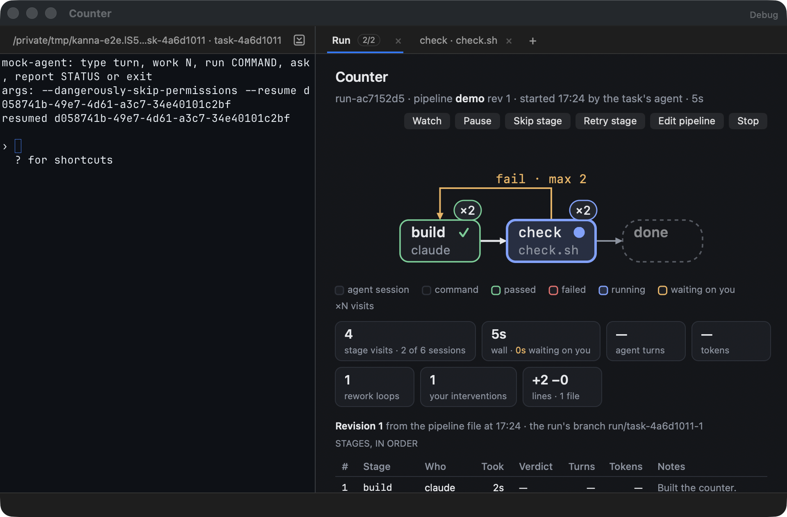
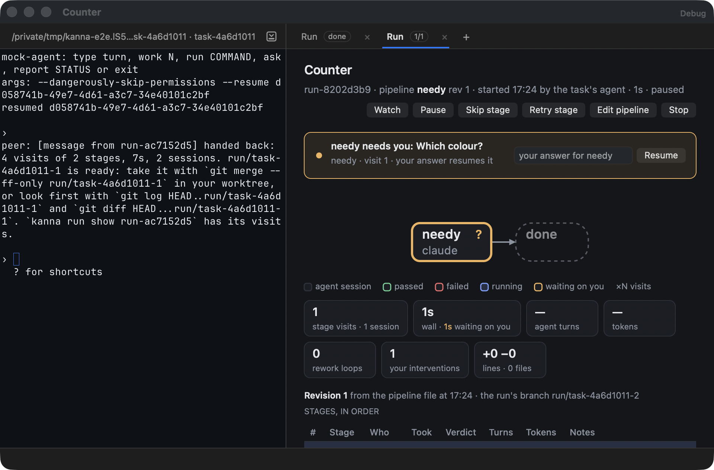
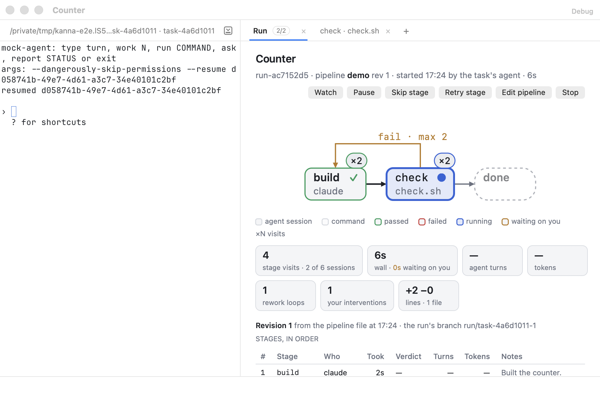
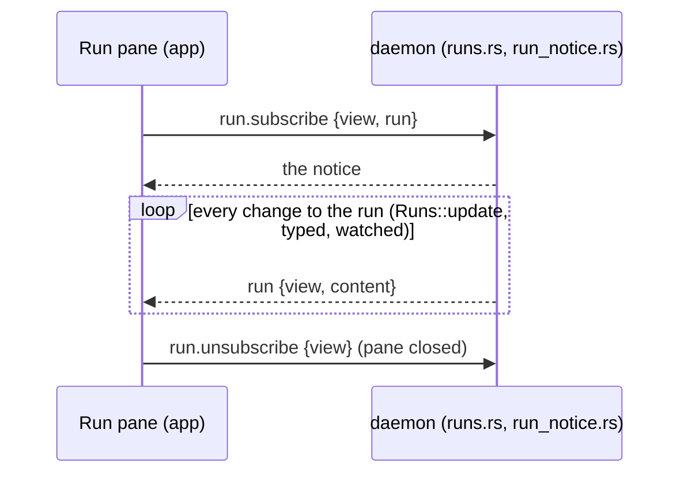

# Run tab

**Status:** built: `kanna open run [RUN]`, the run notice, the Run tab and its badge, `kanna open run --watch [WORKER]`, typing as an intervention, the run's stage in `kanna task list` · **Part of:** [software factory §4](software-factory.md#4-seeing-and-steering-a-run) · **Mockup:** [`references/mockups/pipeline.html`](../../references/mockups/pipeline.html) (`#run`, `#gate`, `#watch`; `#light`) · **Tested:** `cargo test -p kanna-pipe --test graph`, `cargo test -p kanna-daemon run_notice`, `swift test --filter KannaRunTests`, e2e `pipeline_tab`

A run's tab in its task's window: the pipeline as a graph, the run's numbers, its revision, the visits in the order they ran and the workers running now, with buttons that call `kanna run`'s verbs. The daemon draws nothing: it publishes a **run notice** and the app paints it.

| Running | Waiting on you |
|---|---|
|  |  |

## 1. Opening it

- **`kanna open run [RUN]`:** a `run` pane (`runview-N`, tab name `Run`) in a new tab of the run's task's workspace, wherever the command is run from. RUN defaults to the task the terminal is in, its latest run. The pane's record keeps the run's ID, so it survives a restart and shows a finished run as it ended.
- **Placement:** the daemon fills in the workspace before the core opens the pane (`Core::on_open`), so `--window`, `--split` and the other placement options work as for any pane.

## 2. The run notice

A notice is one JSON object, built from the run's rows, its revision's parsed pipeline and its events:

| Field | Holds |
|---|---|
| `run`, `task`, `name`, `pipeline`, `branch`, `state`, `outcome`, `why` | Who and where; `name` is the task's |
| `startedAt`, `endedAt`, `now`, `startedBy` | `startedBy` is `the task's agent` when its terminal started the run, else `you` |
| `revision` | `n`, `by`, `at`, `hash` of the current revision |
| `revisions` | Every revision and refusal, oldest first ([pipeline revisions §5](pipeline-revisions.md#5-how-its-built)) |
| `place` | `stage`, `at`, `of`: the current stage's place in the file's stage order |
| `graph` | `kanna_pipe::layout` of the revision ([§3](#3-the-graph)), each node with its `state` and `visits`, each edge with `taken` |
| `numbers` | `visits`, `sessions`, `budget`, `waited`, `waitingSince`, `turns`, `tokens`, `cost`, `rework`, `interventions`, `lines` |
| `visits` | Each visit but those `interrupted`: stage, visit, kind, who, times, verdict, turns, tokens, note, terminal |
| `workers` | Each open visit with a terminal, unless paused |
| `card` | What waits on you: an `ask` (`Yes`, `No`, a note) or a stage's `need` (an answer and `Resume`) |

- **Node state:** an open visit is `now` (`wait` when the run waits or is paused); a stage's last ended visit is `pass` (`pass`, `done`, `yes`, `skipped`) or `fail`; `done` passes once the run is handed back.
- **Rework loops:** fail arrows taken, as the mockup counts them.
- **Interventions:** events `answered`, `paused`, `resumed`, `skipped`, `retried`, `typed`, `stopped`, `revision` not made by the daemon or a stage.
- **Lines:** `git diff --shortstat` of the run's branch from its base.
- **Not recorded yet:** turns and tokens come with Factory 7; until then they're `null`, `cost` is `null` unless every agent visit has them, and the tab shows a dash.

## 3. The graph

`kanna_pipe::layout` lays a parsed pipeline out on a grid, the same for every app:

- **Main line:** row 0, from the first stage, following each stage's first arrow that isn't a `fail`, to `done`.
- **Off the line:** a stage not on it sits on row 1 under the median column of its main-line neighbours, the next ones stacked below.
- **Routes:** `next` (to the next column on the same row), `down` (to a lower row), `up` (back to a higher row) and `over` (back along row 0, above it). Arrows into one stage get lanes, so they fan out instead of overlapping. Labels are the arrow's options (`fail · max 3 · progress`).
- **Who:** an agent's name (`claude ×3` with attempts), a command's program (`check.sh`, past `sh`), `git` for a merge, `you` for an ask.

The app turns the grid into points (`RunGraph.lay`) with the mockup's sizes and draws the mockup's node and arrow styles: state colours, ×N visit pills, ✓ ✕ ● ? marks, dashed `done`, fail arrows in amber. The graph scales up to 1.5× to fill the tab's width.

## 4. The rest of the tab

- **Header:** the task's name; run, pipeline, revision, when and by whom it started, how long. Too wide for one line, the subtitle wraps under the title.
- **Buttons:** each sends `run {action, run, by: "user"}`, and a refusal flashes in the subtitle. Enabled while the run is live; Watch needs a running worker.

| Button | Sends |
|---|---|
| Watch | `kanna open run --watch` ([§5](#5-watching-a-worker)) |
| Pause · Skip stage · Retry stage · Stop | `pause`, `skip`, `retry`, `stop` |
| Edit pipeline | `edit` ([pipeline revisions §2](pipeline-revisions.md#2-your-edit)) |
| Yes · No (ask card) | `answer` with `answer: yes\|no` and the note |
| Resume (need card) | `resume` with the answer as its text |

- **Tiles:** visits · sessions of the budget, wall time · time waiting on you, agent turns, tokens · cost, rework loops, your interventions, lines · files.
- **Revisions** ([pipeline revisions §4](pipeline-revisions.md#4-on-the-run-tab)), then **Stages, in order** (#, stage, who, took, verdict, turns, tokens, notes; an open visit says running or waiting) and **Workers now running** (stage, visit, who, terminal, since).
- **Badge:** the Run tab's tab shows `at/of` (`5/7`) while the run is live and `done` once handed back. It's the run's only sign: the Shelf, the Desk view and the strip don't change.
- **Ticking:** while live, the times redraw every second from the notice's `now`.

## 5. Watching a worker

`kanna open run --watch [WORKER]` (and the Watch button) shows the current worker's own terminal in a tab of the task's workspace:

- **The tab:** the worker's background terminal moved into a new tab (`move {tab: "new"}`), focused, named `STAGE · WHO` (`review · codex`). WORKER, if given, must be the run's current worker.
- **Following the run:** a finished worker's terminal is kept until the next one opens. If it was shown in a tab, the next worker opens beside it in that tab and the old one closes, so the tab keeps its place and focus and takes the new stage's name. A worker that was never shown opens in the background as before. Stopping or handing back closes the kept one.
- **Typing:** the first keystroke into a worker's terminal per visit records a `typed` intervention by `user` (the wire reports input to a terminal the run heeds).
- **Put back:** `kanna move TERMINAL --background`, as before.

## 6. Elsewhere

- **`kanna task list`:** a task with a live run adds the run's stage after its state: `idle · run: review 5/9`.
- **`debug.run {pane, press?, note?}`:** what the tab shows (badge, subtitle, buttons, card, tiles, rows, workers, legend, node frames, edges), and presses a button; e2e uses it.
- **e2e `pipeline_tab`:** a two-stage fixture with the mock agent whose check fails once: the tab, its badge and the task list line; `--watch` and the tab passing to the next worker; a keystroke counted; the screenshots above checked against the mockup; a `need` card answered with Resume; an `ask` card answered Yes with a note, recorded as yours; Pause and Stop pressed and recorded as yours.

## 7. Not built yet

- **The watch scene's header bar** (`watch · review · codex · 2nd visit · 4m … follows the run`) above the shown terminal.
- **A visit opening to its answer, output or diff.**
