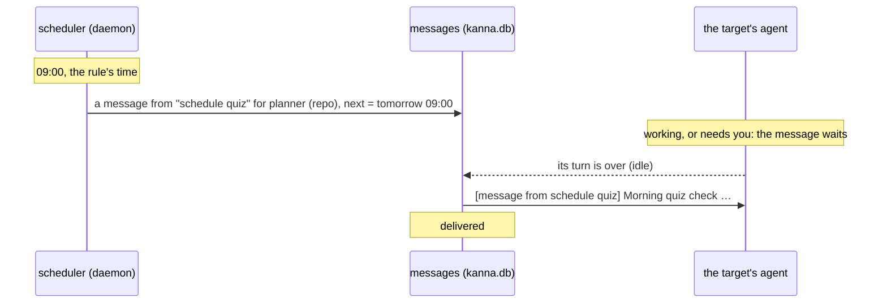
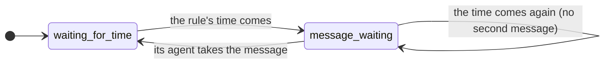
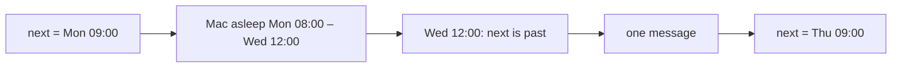

# Scheduler

**Status:** built · **Tested:** `cargo test -p kanna-daemon` (schedule), e2e `scheduler` · **Builds on:** [database](database.md), [agent messaging](agent-messaging.md) · **First use:** the [quiz](quiz.md)'s morning offer

**A schedule prompts an agent at set times.** At each time its rule gives, the daemon leaves a task or a repo's planning agent a message, as `kanna task send` does, from `schedule NAME`. [Agent messaging](agent-messaging.md) does the rest: the agent gets `[message from schedule NAME] PROMPT` when its turn is over, never mid-turn, through its own door. That's all a schedule does: no shell commands, no task starts of its own, no notifications.

The daemon runs it, since it's always running, and keeps schedules in [its database](database.md), so they survive restarts. There's no window for them: `kanna schedule` makes, lists and removes them, and agents make them when you ask in words.

## Contents

1. [A schedule firing](#1-a-schedule-firing)
2. [Rules](#2-rules)
3. [Targets](#3-targets)
4. [Missed runs](#4-missed-runs)
5. [Commands](#5-commands)
6. [The quiz schedule](#6-the-quiz-schedule)
7. [How it's built](#7-how-its-built)

## 1. A schedule firing





- **Delivered like any message:** at the agent's turn's end, never mid-turn or into your draft; a stopped Shelf task runs for it; with no planner open, it waits for one ([agent messaging](agent-messaging.md#2-delivery)). Only Claude and Codex take messages.
- **One message waiting, never a pile.** A time that comes while the schedule's last message is still waiting leaves no second one.
- **A schedule's message is yours:** it carries your permissions, as one you send yourself, since you made the schedule (or asked an agent to).

## 2. Rules

Rules are a few words in local time. A rule that doesn't parse is refused, with an example.

| Rule | Fires |
|---|---|
| `daily 09:00` | every day at 09:00 |
| `weekdays 18:00` | Monday to Friday at 18:00 |
| `weekends 10:00` | Saturday and Sunday at 10:00 |
| `mon,thu 10:30` | those days at 10:30 (`mon tue wed thu fri sat sun`, comma-separated) |
| `every 2h`, `every 30m` | every 2 hours, every 30 minutes, from when it's made or last fired (at least `1m`) |

- **Times are 24-hour** `HH:MM`, in the Mac's time zone, read at each firing: change the zone and the next firing follows.
- **Clocks going forward:** a time that doesn't happen that night (02:30 when 02:00 jumps to 03:00) fires an hour later, at 03:30.
- **Clocks going back:** a time that happens twice (01:30) fires once, the first time.
- **`every`** counts real time, so it's unaffected by the clocks changing.

## 3. Targets

| Target | Is |
|---|---|
| a task (`71af`, `task-71af`, any form `kanna task list` takes) | that task's agent, kept by its task ID, which outlives its terminal |
| `planner` | the repo's planning agent: the planning terminal of a Desk on that repo, whichever is open when the message goes |

A `planner` schedule needs a repo: `--repo DIR`, else the repo you run `kanna schedule add` in. A task that's done takes no messages: adding a schedule for it is refused, and a firing for one that's since been done is logged and skipped.

## 4. Missed runs

**A time missed while the Mac slept or Kanna wasn't running fires once when Kanna is back, not once per missed time,** as launchd and anacron do. The daemon keeps each schedule's next time in the database and checks it against the clock at least once a minute, so a firing missed during sleep happens within a minute of waking.



## 5. Commands

| Command | Does |
|---|---|
| `kanna schedule add RULE TARGET PROMPT… [--name NAME] [--repo DIR]` | Make a schedule; prints its ID (`s3`), its name and when it next fires. RULE is two words, quoted or not (`daily 09:00`) |
| `kanna schedule list` | Every schedule: ID, name, repo, rule, target, next time, whether its message is waiting, prompt |
| `kanna schedule remove NAME\|ID` | Remove one; a NAME is looked up in this repo first |

```sh
kanna schedule add 'weekdays 17:30' planner "Summarise what landed today." --name evening
kanna schedule add every 2h 71af "Pull main and run the tests."
kanna schedule remove evening
```

- **A name** is unique within its repo. Without `--name`, the schedule is known by its ID, and its messages come from `schedule s3`.
- **Agents make schedules** when you ask in words ("remind the planner every weekday at 5 to…"): the `kanna-planning` and `kanna-tasks` skills say how. Tab completion covers `schedule`'s actions, the rule's first word, `planner` and the tasks, and the schedules to remove.

## 6. The quiz schedule

**Every repo gets a built-in schedule named `quiz`:** `daily 09:00`, target `planner`, prompting it to offer a round if anything landed on main since the last round (`kanna quiz history`), and to say nothing if nothing has ([quiz](quiz.md#4-the-skill)). It's added once per repo, the first time the daemon sees the repo (a task, a recent project, or a `kanna schedule` run in it), and is removable like any other: once removed, it doesn't come back.

## 7. How it's built

- **`schedule.rs` in the daemon:** rule parsing and next times (pure, with the time zone behind a trait so tests can use a zone with DST without touching the process's `TZ`), and the scheduler, which leaves a due schedule's message through a `Mailbox`: the tasks' messaging (`Tasks::recipient`, `post`, `waiting`), faked in its tests.
- **Fire:** the daemon's loop asks the scheduler for its next deadline (at most a minute away, since the monotonic clock stops while the Mac sleeps) and calls it; a due schedule leaves its message, unless its last is still waiting, and gets its next time and the message's ID in one write.
- **`schedules` table**, in [the database](database.md): `id`, `repo`, `name` (unique per repo), `target` (a task ID or `planner`), `rule`, `prompt`, `next`, `message` (→ `messages.id`, the last one left), `made_at`, and a JSON `doc` for the rest (who made it). `meta` keeps which repos have had the quiz schedule added.
- **Messages from a schedule** are from `schedule NAME`, and the recipient's permission class is used for them, as for yours (`messages::yours`).
- **A test clock:** with `KANNA_DEBUG=1`, `debug.clock {"advance": SECONDS}` moves the scheduler's clock forward, for the e2e scenario.

**Checked by** `schedule.rs`'s tests (rules good and bad; next times across DST, both ways; a missed run leaves one message on start; a firing while the last message waits leaves no second; a `planner` schedule's message is for the repo's planner; schedules survive a restart; the quiz schedule once per repo) and e2e `scheduler` (a schedule fires on a moved clock and its message reaches a busy mock agent only at its turn's end, once).
