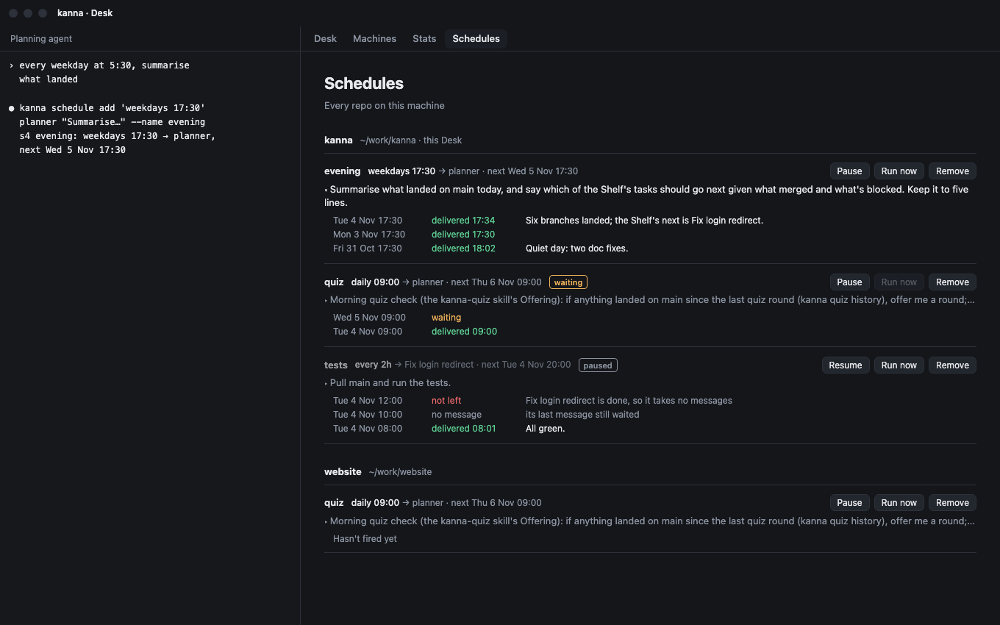
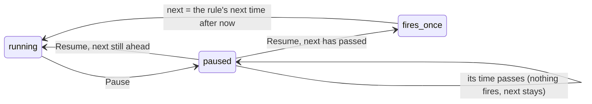
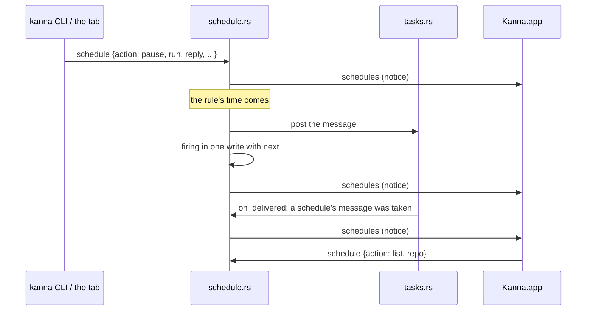

# Schedules tab

**Status:** built · **Tested:** `cargo test -p kanna-daemon` (schedule, db), `ScheduleOrderTests`, e2e `schedules_tab` · **Mockup:** [`references/mockups/schedules.html`](../../references/mockups/schedules.html) · **Builds on:** [scheduler](scheduler.md), [database](database.md), [agent messaging](agent-messaging.md)

**The Desk view's fourth fixed tab shows a machine's schedules and what each last did.** Schedules used to be visible only through `kanna schedule list`, so you couldn't see whether a morning prompt had reached its agent or what came of it. The tab lists them, keeps a log of their firings, and lets you pause, run or remove one. Making a schedule stays with `kanna schedule add` and agents.

## Contents

1. [The tab](#1-the-tab)
2. [Firings](#2-firings)
3. [Replies](#3-replies)
4. [Pause and resume](#4-pause-and-resume)
5. [Run now](#5-run-now)
6. [Commands](#6-commands)
7. [How it's built](#7-how-its-built)

## 1. The tab

- **Which schedules:** every repo's on the Desk's machine, grouped by repo. The Desk's repo comes first, then the others by name, then schedules with no repo.
- **A row:** name (or ID), rule, target (`planner`, or the task by name), next time, `waiting` while its message waits, `paused`, the prompt's start, and its last three firings. Clicking the prompt expands it to the whole prompt, and long replies with it.
- **Actions:** Pause or Resume, Run now and Remove. Run now is off while its message waits. Remove asks once on the button (`Remove?`) and takes it back after 3s, since a removed `quiz` schedule doesn't return.
- **Live:** the page follows any change, from the tab, the CLI, an agent or a firing, while it's showing. Expanded rows and the scroll position stay. Opening the tab loads the list again.

## 2. Firings

**Each time a schedule's rule or Run now comes up, the daemon writes one firing,** whether or not a message was left. Each schedule keeps its last 20; the list carries its last 3. Removing a schedule removes its firings.

| State | Tab | Means |
|---|---|---|
| `delivered` | `delivered 17:34` | Its agent took the message then |
| `waiting` | `waiting` | The message is left and its agent hasn't taken it |
| `skipped` | `no message` | The schedule's last message still waited, so this firing left none |
| `failed` | `not left` | Leaving it failed, and the firing says why (the task is done, say) |
| `undelivered` | `not delivered` | The message was left, but it no longer waits and never arrived: its task ended first |

## 3. Replies

**An agent reports back with `kanna schedule reply NAME|ID TEXT`:** the text shows beside the firing. A schedule's prompt is a turn the user doesn't watch, so its chat isn't where a result gets seen.

- **Which firing:** the newest whose message was delivered, the one the agent has read. A later reply to it replaces the earlier one.
- **Only the target replies:** the caller must be the schedule's task, or a planning terminal of its repo. Anyone else is refused, as is a reply when no message has been delivered.

## 4. Pause and resume

- **Paused:** the schedule doesn't fire, writes no firing, and its next time stays as it was, in the list too.
- **Resume** leaves the next time alone, so a time missed while paused fires once within a minute, as a [missed run](scheduler.md#4-missed-runs) does after sleep.
- **Pausing a paused schedule, or resuming a running one,** changes nothing and isn't refused.
- **A message already left** stays: pausing doesn't take it back.

## 5. Run now

Run now leaves the schedule's message now, under the [one-waiting rule](scheduler.md#1-a-schedule-firing): if its last still waits, the firing is `skipped` and the CLI says so. It leaves `next` alone, and works on a paused schedule without resuming it.

## 6. Commands

| Command | Does |
|---|---|
| `kanna schedule pause NAME\|ID` | Pause it |
| `kanna schedule resume NAME\|ID` | Resume it |
| `kanna schedule run NAME\|ID` | Leave its message now, or say the last still waits |
| `kanna schedule reply NAME\|ID TEXT` | From the target's agent: put TEXT beside the firing it was last delivered |

`kanna schedule list` adds `paused` beside `waiting`, and the last firing, as `last Tue 4 Nov 17:30 delivered`. A NAME is looked up as `remove` does: this repo first.

## 7. How it's built

- **`schedule_firings` table** (migration 22), in [the database](database.md#schedules): `schedule` (→ `schedules.id`, cascading), `at`, `how` (`rule` or `run`), `state` (`left`, `skipped` or `failed`), `message` (→ `messages.id`), `detail`, `reply`, `replied_at`. A `left` firing's shown state comes from its message: delivered, still waiting, or neither.
- **`schedules.paused`:** when it was paused, or null. `Schedules::fire` and `next_due` skip paused schedules, so the daemon's loop doesn't spin on a passed `next`.
- **`Schedules::leave`** is the one path for the rule and Run now: it applies the one-waiting rule, posts, and writes the firing and the new `next` in one transaction (`Db::schedule_fired`).
- **The notice:** `schedules`, with nothing in it, goes to the attached app (`AppLink::connect_schedules`) after any change. `Tasks::on_delivered` raises it when a message from a schedule is taken. The app asks for the list again on each machine's notice, for each window showing the tab.
- **The app:** `SchedulesPage` draws the reply to `schedule {action: "list"}`, whose rows now carry `paused` and `firings`; `ScheduleOrder` (`KannaWindows`) orders the groups. An older daemon's list has neither and shows as running with no firings.

**Checked by** `schedule.rs`'s tests (pause stops firing and keeps `next`; resume fires a missed time once and an unmissed one not at all; run under the one-waiting rule, and on a paused schedule; the firing log's states, its limit and its removal; replies), `db.rs`'s migration test, `ScheduleOrderTests` and e2e `schedules_tab` (rows in order; a firing appears and is delivered, live; pause stops a fire, resume fires once; Run now and Remove from the tab; a reply).
