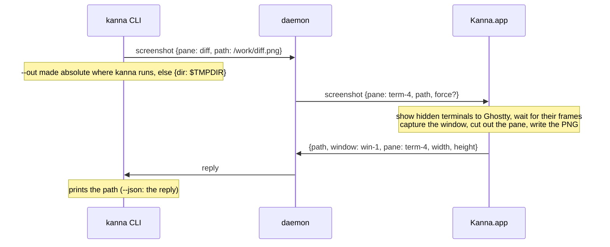

# Screenshot

**Status:** built (2026-10-12), in Kanna · **Builds on:** [the kanna CLI](cli.md), [the app link](app-link.md) · **Why:** an agent checks its UI work (a diff, a web or markdown pane) by looking at it

`kanna screenshot` saves a PNG of a pane or a whole window as it's drawn now, at the screen's resolution, and prints its path. It's an ordinary command: it works without `KANNA_DEBUG`, for every pane type.

| `kanna screenshot --window win-1` | `kanna screenshot agent` |
|---|---|
|  |  |

Both pictures were taken by the command, of a window in the background (`--bg`).

## Contents

1. [Rules](#1-rules)
2. [CLI](#2-cli)
3. [How it's built](#3-how-its-built)

## 1. Rules

- **A pane** is that pane alone, cut from its window's capture by its frame. It must be showing, else `not_shown` ("term-4 is in tab-2, which isn't showing"): the command never changes what's on screen.
- **A window** (`--window`) is all of it: title bar, tab bar, every pane showing and the gaps between them.
- **No target:** the window of the terminal it's run in (`$KANNA_TERMINAL`), else the key window.
- **`--out FILE`** (`-o`) is made absolute against the folder kanna runs in. An existing file is refused (`exists`) unless `--force`.
- **No `--out`:** a new file in the caller's `$TMPDIR`, named for the pane or window and the time, `kanna-w1-20261012-142301.png`, with `-2`, `-3` … if taken.
- **Readable only by you** (mode 0600), since a terminal can show anything.
- **Every pane type:** terminal, web, markdown, code and iOS panes are all layers of the window, so one capture has them all. An iOS pane's shot is the simulator's screen in its frame, as the pane shows it:

  

- **A window behind others comes out legible**, terminals included (below).

## 2. CLI

| Command | Does |
|---|---|
| `kanna screenshot` | The caller's window (or the key window) to `$TMPDIR`; prints the path |
| `kanna screenshot PANE` | That pane alone |
| `kanna screenshot --window WINDOW` | That whole window |
| `-o FILE`, `--out FILE` | Write to FILE; with `--force`, replace it |
| `--json` | The reply: `path`, `window`, `pane` (for a pane), `width`, `height` |

Like any command that needs the app, it starts Kanna.app if it isn't running (exit 6 with `KANNA_SOCKET` set). It's in `kanna help screenshot`, `kanna commands --json` and the tab completion.

## 3. How it's built

- **The daemon passes it on** as it passes `debug.*`, with the pane's name turned into its ID (`crates/kanna-daemon/src/main.rs`); with no app attached it's `no_app`. The app always answers it, `KANNA_DEBUG` or not (`apps/kanna/Sources/Kanna/Screenshot.swift`).
- **The app writes the file**, so the image never crosses the socket, whose lines stop at 16 MiB.
- **Capture is `CGWindowListCreateImage`**, looked up at run time: obsoleted in the macOS 15 SDK but still exported, and an app may capture its own windows without the screen-recording permission ScreenCaptureKit needs. It copies what the window server has.
- **Hidden terminals are drawn first.** A window behind others (every `--bg` window, or one you've covered) is occluded, so its terminals are hidden from Ghostty, which stops drawing them: one resized while hidden (by a split) holds a frame never drawn, and comes out as blocks of colour. Before capturing, each such terminal is shown to Ghostty until its layer has a new frame (at most 1 s), and hidden again after.
- **`debug.snapshot` shares the capture** (`Snapshot.swift`), for the tests: every pane of a window as its own PNG.
- **Checked by** `crates/kanna/tests/cli.rs` (the request each form sends, usage errors, `capabilities`), the kmux conformance test (a Kanna-only command), and e2e `screenshot`: with the app started without `KANNA_DEBUG` or `KANNA_IGNORE_OCCLUSION`, a pane and a window shot and their PNG sizes, a legible terminal, `exists` and `--force`, a hidden pane, and the caller's window.
