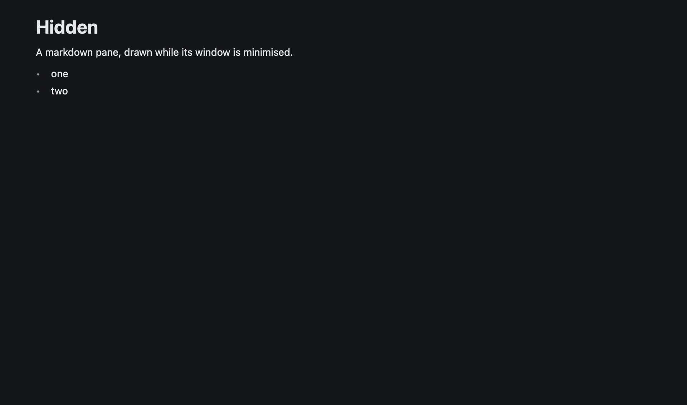
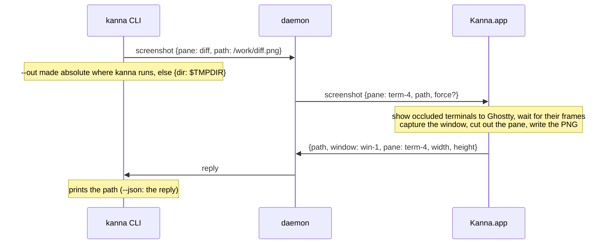
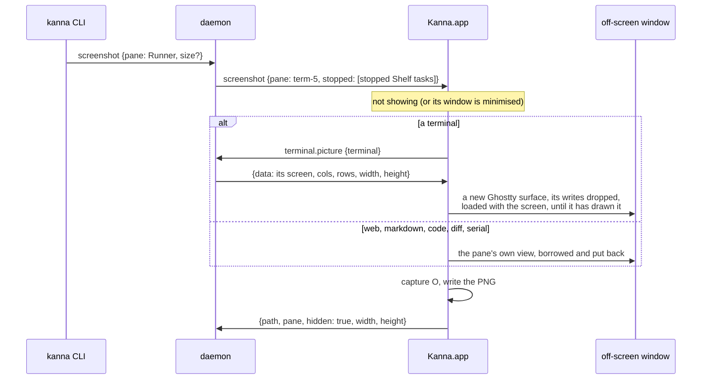

# Screenshot

**Status:** built (2026-10-12), in Kanna; hidden panes built (2026-11-01) · **Builds on:** [the kanna CLI](cli.md), [the app link](app-link.md) · **Why:** an agent checks its UI work (a diff, a web or markdown pane) by looking at it

`kanna screenshot` saves a PNG of a pane or a whole window as it's drawn now, at the screen's resolution, and prints its path. It's an ordinary command: it works without `KANNA_DEBUG`, for every pane type, and for a pane that isn't on screen.

| `kanna screenshot --window win-1` | `kanna screenshot agent` |
|---|---|
|  |  |

Both pictures were taken by the command, of a window in the background (`--bg`).

## Contents

1. [Rules](#1-rules)
2. [CLI](#2-cli)
3. [How it's built](#3-how-its-built)

## 1. Rules

- **A pane that's showing** is that pane alone, cut from its window's capture by its frame.
- **A pane that's hidden** is drawn off-screen, as it would look shown: one in a tab behind another, in a Desk task that isn't active (parked, or waiting in the strip), in a running Shelf task, or in a minimised window. The reply says `"hidden": true`. A markdown pane shot while its window was minimised:

  

- **Shooting a hidden pane changes nothing:** no focus, zoom or tab change, no window brought forward or out of the Dock, and no focus-in or focus-out reported to the pane's program (mode 1004).
- **Its size** is the one it last had on screen (or, for a running Shelf task's agent, the one its Desk gives it). `--size WxH` (points) draws it at another; a pane never shown gets a new window's, 960 × 566. `--size` is refused for a pane that's showing, which is drawn as it is.
- **A stopped Shelf task's panes are refused** (`stopped`: "pane term-5 is in task-5bcd4ed6 "Runner", which is stopped on the Shelf: nothing is running to draw"), and so is a terminal whose program has exited, unless it's showing.
- **Text without the app:** `kanna read` gives a terminal's text with no app; a picture needs the app, which the command starts in the background if it isn't running.
- **A window** (`--window`) is all of it: title bar, tab bar, every pane showing and the gaps between them.
- **No target:** the window of the terminal it's run in (`$KANNA_TERMINAL`), if it's showing (else `not_shown`). Run outside a Kanna terminal, it's refused: `say PANE or --window WINDOW`; it never shoots the key window ([the CLI acts on its caller](cli-caller.md)).
- **`--out FILE`** (`-o`) is made absolute against the folder kanna runs in. An existing file is refused (`exists`) unless `--force`.
- **No `--out`:** a new file in the caller's `$TMPDIR`, named for the pane or window and the time, `kanna-w1-20261012-142301.png`, with `-2`, `-3` … if taken.
- **Readable only by you** (mode 0600), since a terminal can show anything.
- **Every pane type:** terminal, web, markdown, code and iOS panes are all layers of the window, so one capture has them all. An iOS pane's shot is the simulator's screen in its frame, as the pane shows it:

  

- **A window behind others comes out legible**, terminals included (below).

## 2. CLI

| Command | Does |
|---|---|
| `kanna screenshot` | The caller's window to `$TMPDIR`; prints the path (refused outside a Kanna terminal) |
| `kanna screenshot PANE` | That pane alone, showing or hidden |
| `--size WxH` | A hidden PANE drawn at W×H points, e.g. `800x500` |
| `kanna screenshot --window WINDOW` | That whole window |
| `-o FILE`, `--out FILE` | Write to FILE; with `--force`, replace it |
| `--json` | The reply: `path`, `window`, `pane` (for a pane), `hidden` (for one drawn off-screen), `width`, `height` |

Like any command that needs the app, it starts Kanna.app if it isn't running (exit 6 with `KANNA_SOCKET` set). It's in `kanna help screenshot`, `kanna commands --json` and the tab completion.

## 3. How it's built

- **The daemon passes it on** as it passes `debug.*`, with the pane's name turned into its ID (`crates/kanna-daemon/src/main.rs`); with no app attached it's `no_app`. The app always answers it, `KANNA_DEBUG` or not (`apps/kanna/Sources/Kanna/Screenshot.swift`).
- **The app writes the file**, so the image never crosses the socket, whose lines stop at 16 MiB.
- **Capture is `CGWindowListCreateImage`**, looked up at run time: obsoleted in the macOS 15 SDK but still exported, and an app may capture its own windows without the screen-recording permission ScreenCaptureKit needs. It copies what the window server has.
- **Occluded terminals are drawn first.** A window behind others (every `--bg` window, or one you've covered) is occluded, so its terminals are hidden from Ghostty, which stops drawing them: one resized while hidden (by a split) holds a frame never drawn, and comes out as blocks of colour. Before capturing, each such terminal is shown to Ghostty until its layer has a new frame (at most 1 s), and hidden again after.
- **`debug.snapshot` shares the capture** (`Snapshot.swift`), for the tests: every pane of a window as its own PNG.
- **Checked by** `crates/kanna/tests/cli.rs` (the request each form sends, `--size`, usage errors, `capabilities`), the kmux conformance test (a Kanna-only command), and e2e `screenshot`: with the app started without `KANNA_DEBUG` or `KANNA_IGNORE_OCCLUSION`, a pane and a window shot and their PNG sizes, a legible terminal, `exists` and `--force`, a pane in a hidden tab, the caller's window while another window is in front, and the refusals with no target outside Kanna and from an unknown terminal.

### A hidden pane

- **Shown or hidden** is the app's call: a pane is showing when its window has it in the shown tab (or docked) and isn't minimised.
- **Stopped tasks are the daemon's call:** it adds its stopped Shelf tasks (`workspace`, `task`, `name`) to the request, since the app's Shelf can lag a `kanna task stop` that just returned.
- **The off-screen window** is borderless, ordered behind the app's others, beyond every screen's corner, ignores the mouse, never becomes key and isn't in the Window menu (`Offstage` in `apps/kanna/Sources/Kanna/HiddenShot.swift`). It takes the pane's window's appearance, so a dark window gives a dark picture.
- **A terminal is never moved.** Its own surface keeps its size and focus; moving it would resize the program's PTY and report focus. Instead the daemon gives the screen it keeps for each terminal (`terminal.picture`: the VT snapshot it would send on attach, the grid and the last pixel size; it neither attaches nor resizes), and the app loads it into a temporary surface in external I/O mode whose writes and resize requests go nowhere. The capture waits until the surface has presented three frames after the load (at most 2 s): its first frame is drawn before the screen lands.
- **Other panes are borrowed.** Web, markdown, code, diff and serial views keep running while hidden, so the app moves the pane's view into the off-screen window, lays it out at the size, captures, and puts it back in its pane (and gives first responder back, if it had it). A web view is asked for a snapshot first, which waits until WebKit has painted at the new size.
- **Checked by** e2e `screenshot_hidden`, on a private instance: a terminal in a hidden tab, a markdown pane in a minimised window, a web page in a hidden tab, a parked task's agent (a probe with mode 1004 on, which logs every focus report) and a running Shelf task's agent, each compared pixel by pixel with the same pane shot while shown; `workspace list`'s windows, tabs, focus and zoom unchanged by every shot; the minimised window still minimised; no focus report from the shots; `--size`; and the stopped Shelf task's refusal.
