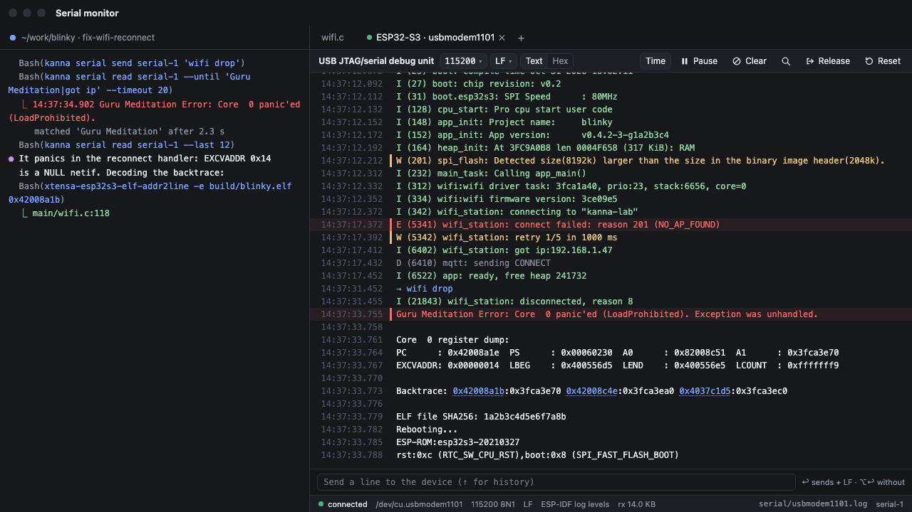
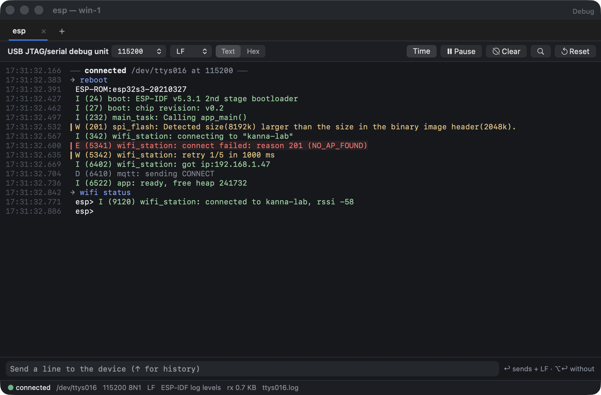
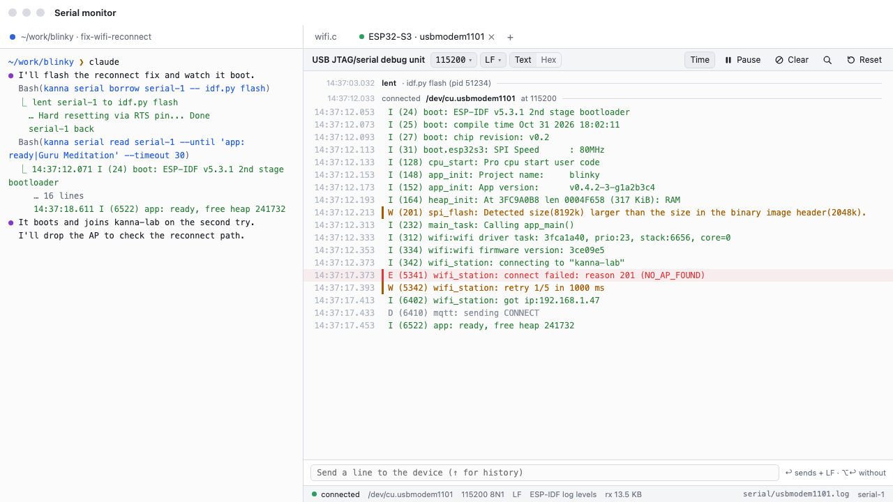
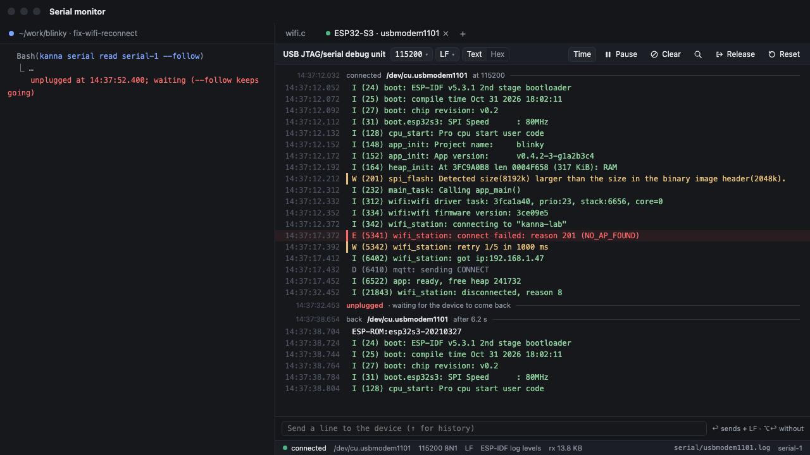
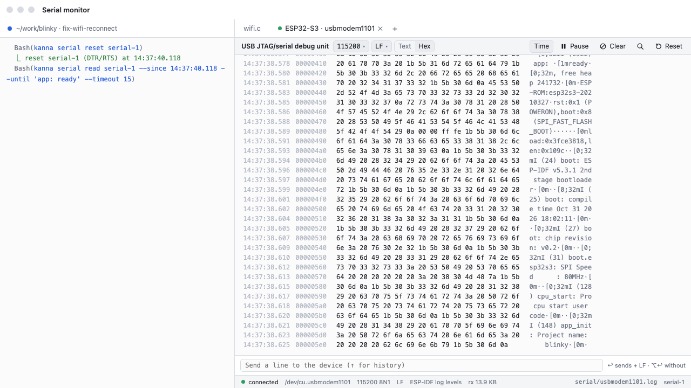
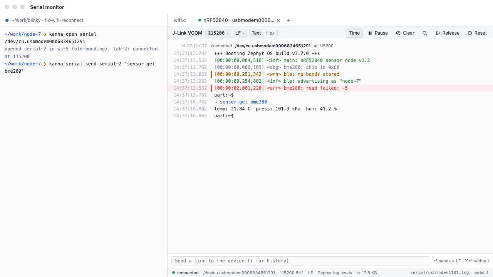
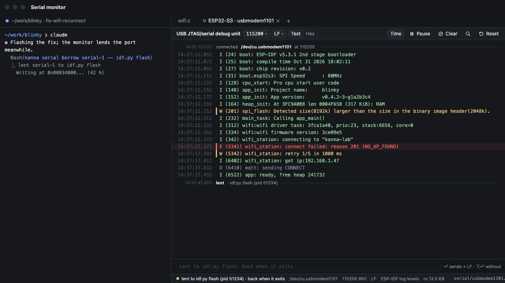
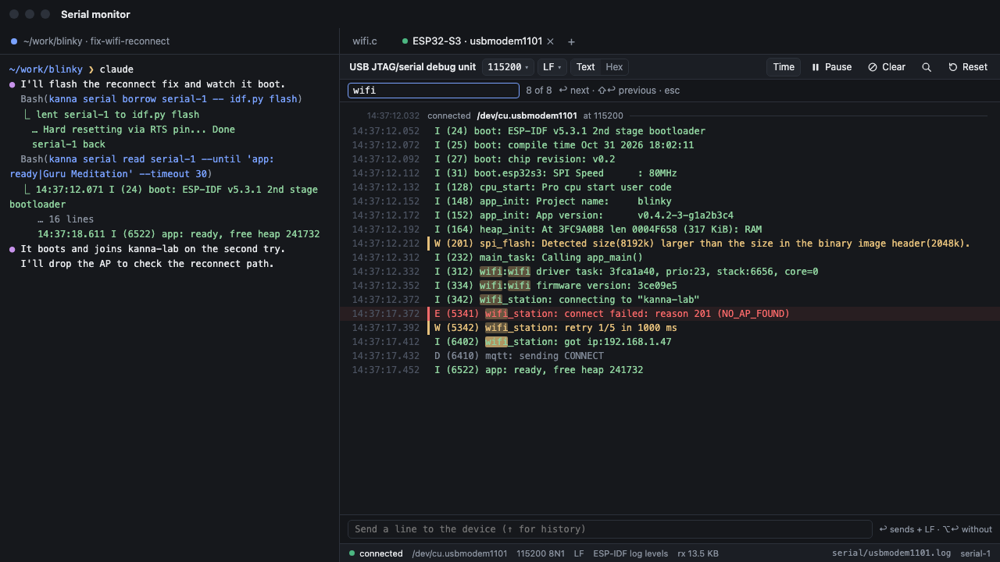
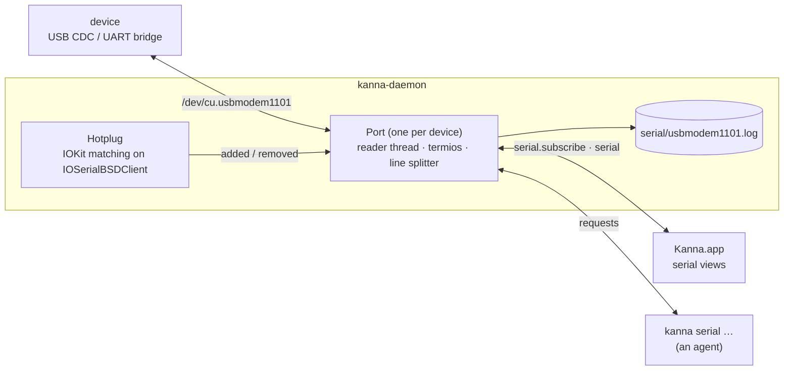
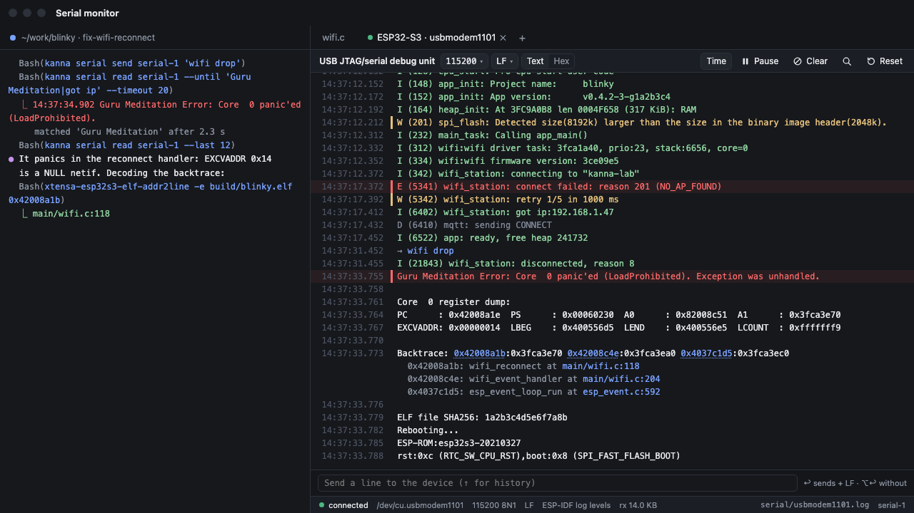

# Serial Monitor

**Status:** built, not yet tried on hardware (§7) · **Tested:** `crates/kanna-daemon/tests/serial.rs`, e2e `serial_pane`, `KannaSerialTests` · **Mockup:** [`references/mockups/serial.html`](../../references/mockups/serial.html) · **Builds on:** [app panes](app-panes.md), [file panes](file-panes.md) (the subscribe pattern), [the app link](app-link.md)

A **serial pane** shows a serial port (`/dev/cu.*`) for debugging embedded firmware: what the device sends, timestamped and coloured by log level, and a line to send to it. The **daemon** owns the port, not the app, so the pane, the CLI and an agent share one connection and one log, and the connection lives through the app restarting. An agent drives the same port from its terminal: `kanna serial read --until 'Guru Meditation'` waits for a crash the way a person watches for one.

**Why:** firmware work is a loop of flash, boot, read the log, poke the device. Today that's `idf.py monitor` or `tio` in a terminal: the agent can't read it without scraping a terminal, two tools can't share the port, and a replug or a flash ends the session.



## Contents

1. [Prior art](#1-prior-art)
2. [The pane](#2-the-pane)
3. [The CLI](#3-the-cli)
4. [The daemon owns the port](#4-the-daemon-owns-the-port)
5. [The log](#5-the-log)
6. [Messages](#6-messages)
7. [Tests](#7-tests)
8. [Later: decoding backtraces](#8-later-decoding-backtraces)
9. [Glossary](#9-glossary)

## 1. Prior art

| Tool | What we take | What we leave |
|---|---|---|
| **tio** | reconnects by itself when the device comes back; names ports by USB ID; timestamps per line; hex mode | its key-prefix menu (the pane has buttons) |
| **pyserial-miniterm** | line ending choice (LF, CRLF, CR); `\xNN` for bytes that aren't text | asserting DTR/RTS on open, which holds an ESP32 in reset |
| **idf.py monitor** | ESP-IDF levels; backtrace decoding with the project's ELF (§8); reset by toggling RTS with DTR clear; DTR and RTS left clear on open | owning the flash step: a flash borrows the port instead (§4) |
| **Arduino IDE / PlatformIO** | ports listed by board name; letting go of the port for an upload and taking it back after | one monitor per IDE window |

## 2. The pane



The mockup's scenes:

| Light | Unplugged, then back |
|---|---|
|  |  |
| **Hex view** | **Zephyr shell** |
|  |  |
| **Lent to a flash** (`kanna serial borrow`) | **Find** |
|  |  |

- **Rows** are lines the device sent (`rx`), lines sent to it (`tx`, shown with `→`), and events from Kanna (connected, unplugged, back, reset, lent, baud). Each has the host time its first byte arrived.
- **Levels:** a line that matches ESP-IDF (`E (5341) tag: …`), Zephyr (`[00:00:02.001,220] <err> tag: …`) or Arduino-ESP32 (`[E][file.cpp:12] fn(): …`) takes its level's colour (E, W, I, D/V), and an E or W line a mark in the gutter; a level colour replaces the line's own ANSI colours. ESP-IDF panics (`Guru Meditation`, `abort()`, `assert failed`) count as E. The status line names the format it has seen most.
- **ANSI:** SGR colours and bold show; other escape sequences are dropped. A control byte, a C1 control or a byte that isn't UTF-8 shows as a faint `\xNN`. A line with no end is cut at 16 KiB.
- **A partial line** (a shell prompt like `uart:~$ `) shows as soon as it arrives, with the time of its first byte, and grows until its newline.
- **Text / Hex** shows the same bytes as lines or as a hex dump (offset, 16 bytes, ASCII).
- **Pause** stops the view following, not the recording; a pill counts new lines and resumes on click. Scrolling up pauses the same way.
- **Clear** empties this view only; the log and other views keep everything.
- **Find** (⌘F, or the magnifier) is the text view's find bar: it marks every match; Return and ⇧Return step.
- **Send line:** Return sends the text plus the line ending, ⌥Return without it; ↑ and ↓ walk this port's history (kept in the state folder, shared by the CLI's `send`). Disabled while the port is unplugged or lent.
- **Baud and line ending** change from their pickers, for every pane on the port; a baud change applies at once, without closing the port.
- **Reset** pulses the device's reset (§4).
- **The tab** is named after the device (`USB JTAG/serial debug unit · usbmodem1101`), unless the pane has a `--name`.

## 3. The CLI

| Command | Does |
|---|---|
| `kanna open serial PORT [--baud N] [--line-ending lf\|crlf\|cr] [--tab\|--split …]` | open a serial pane on PORT (a path, a name like `usbmodem1101`, or a USB `vid:pid[:serial]`). `kanna serial list` shows the ports plugged in. Baud defaults to 115200. A port already open in another pane is shared: both panes show it |
| `kanna serial list` | ports plugged in: path, USB vid:pid, name (product, vendor), serial number, and the pane that has it open |
| `kanna serial read PANE [--since T\|--last N] [--follow] [--until REGEX --timeout S] [--raw]` | print rows as `HH:MM:SS.mmm TEXT` (`→` for sent, `#` for events). Default: the rows in memory (the last 10,000). `--follow` keeps printing; `--until` follows until a line the device sent matches, prints it and exits 0, or exits 1 after `S` seconds (default 30). With `--follow` or `--until` and no `--since` or `--last`, it starts from now, so an old boot banner doesn't match: to catch a boot right after a `send` or `reset`, pass the time it printed as `--since`. `--since` takes a time today (`14:37:40.118`) or a duration (`10s`); `--raw` prints only the device's bytes. In a terminal it keeps the device's colours and drops every other escape |
| `kanna serial send PANE TEXT [--hex] [--no-ending]` | send TEXT plus the pane's line ending, or bytes from hex (`--hex '1b 5b 41'`); prints the time it went, for a later `--since` |
| `kanna serial reset PANE [--hold MS]` | pulse reset; prints the time |
| `kanna serial borrow PANE\|PORT -- CMD…` | lend the port to CMD (a flash script): close it, run CMD, reopen it when CMD exits, and exit with CMD's code. By PORT, a script needn't know the pane; with no pane open on the port it just runs CMD |
| `kanna serial set PANE [--baud N] [--line-ending lf\|crlf\|cr]` | change the port's baud or line ending, as the pickers do |
| `kanna serial log PANE` | the path of the port's log file, to grep |

`send`, `reset` and `set` fail (exit 1) with `[unplugged]` or `[lent]` while the port isn't there to use; `read` works throughout, and `--follow` and `--until` keep waiting through an unplug. `kanna serial` on any other pane fails with `[wrong_type]`.

## 4. The daemon owns the port



- **One Port per device,** shared by every pane open on it; the record (`{id, name, type: "serial", path, device, title, baud, lineEnding}`) lives in the layout like a web pane's ([app panes](app-panes.md)), with IDs `serial-N`. The Port closes when its last pane closes.
- **Opening:** `O_RDWR | O_NOCTTY | O_NONBLOCK`, then `TIOCEXCL` so another program gets `Resource busy` instead of stealing half the bytes; raw mode, 8N1, no flow control, the baud set with `IOSSIOSPEED` (any rate). On Espressif's own USB and on UART bridges (Silicon Labs, WCH, FTDI, Prolific) DTR and RTS are cleared right after open, as `idf.py monitor` does, so an ESP32's auto-reset circuit doesn't hold it in reset or the bootloader. On any other USB device DTR is held and RTS cleared, since Zephyr's and TinyUSB's CDC consoles wait for DTR before they print.
- **Identity:** a Port remembers its device's USB vendor, product, serial number and location (from IOKit), not just its path, so it finds the device again under a new `cu.` name.
- **Unplug and replug:** a read error or IOKit's removal closes the fd; the pane shows `unplugged` and the Port waits for IOKit to announce a matching device, then reopens it with the same settings (trying again every 300 ms, ten times, while the new device node settles) and logs `back`. No polling on macOS; Linux scans `/dev` once a second.
- **Reset:** DTR clear, RTS set for `--hold` (100 ms default), then RTS clear: esptool's hard reset, which pulls EN low on boards with the ESP auto-reset circuit. On boards that don't wire RTS to reset it does nothing.
- **Borrowing:** `borrow` asks the daemon to lend the Port, which closes the fd (the pane shows `lent to idf.py flash`), runs CMD from the CLI with the caller's environment and terminal, and tells the daemon when CMD exits; the daemon then reopens the port, or, if the flash's reset made the device go away, waits for it as for an unplug. The daemon also watches the CLI's PID, so a borrow that's killed gives the port back. A second `borrow` of a lent port waits for the first. While lent, IOKit events are ignored.
- **The app restarting** changes nothing: the views resubscribe after `app.hello` and get the backlog. A **daemon restart** reopens every Port from the layout, logging `connected` again.
- **Remote machines:** a pane on a task on another machine opens that machine's ports, since its daemon is the one with the device; not tried yet.

## 5. The log

Each Port appends to `<state folder>/serial/<port name>.log` (`usbmodem1101.log`), one row per line, so an agent can grep a whole session:

```text
2026-11-01T14:37:33.755 < Guru Meditation Error: Core  0 panic'ed (LoadProhibited). Exception was unhandled.
2026-11-01T14:37:31.452 > wifi drop
2026-11-01T14:37:52.400 # unplugged
```

- `<` received, `>` sent, `#` event. The text is the line without its `\r\n`, ANSI kept, every other byte that isn't printable UTF-8 written `\xNN` and `\` as `\\`, so the file is text and the bytes come back exactly (the hex view and `read --raw` use it).
- A partial line is written when its newline comes, or after 1 s with nothing more (it then continues on a new row).
- What the send line and `kanna serial send` sent is kept per port in `serial/<port name>.history` (the last 200), for ↑ in every pane on it.
- At 64 MiB the file is renamed `.1.log` (one kept). The daemon keeps the last 10,000 rows in memory for views and `read`.

## 6. Messages

| Message (app link) | From | What it says |
|---|---|---|
| `serial.subscribe {view, pane}` (with an `id`) | app | this view shows the pane's Port; the reply has the last rows (up to 10,000), the partial line, the state and settings |
| `serial {content, rows, partial, rx, state}` | daemon | the rows since the last push (the reader gathers bytes for 8 ms), the partial line, and the port's state: connected, unplugged or lent (with the borrowing command), the settings, bytes received, the log format seen most |
| `serial.unsubscribe {view}` | app | the view closed |
| requests: `serial {action: send\|reset\|set, pane, …}` | app | the pane's controls, the same command the CLI sends |

## 7. Tests

A pty pair stands in for the device. `KANNA_SERIAL_PORTS` names a JSON file of ports (path, vid, pid, serial, product, vendor) that the daemon lists instead of asking IOKit, and watches for hotplug; a test writes the pty's path there, writes to and reads from the master, closes it to unplug and writes a new pty under the same identity to plug back in. [`tools/fake-serial`](../../tools/fake-serial/fake-serial.py) is such a device that boots like an ESP32 and answers `reboot`, `crash`, `binary` and `wifi status`.

- **Unit:** line splitting (LF, CRLF, a lone CR, across chunks, the 16 KiB cut), `\xNN` and C1 round trips, levels of the three formats (`serial::lines`); `--since` times, `borrow`'s argv, colours-only output (`kanna::serial`); ANSI, levels, escapes, the hex dump, history and appending (`KannaSerialTests`).
- **Daemon** (`crates/kanna-daemon/tests/serial.rs`): list, open by USB ID, a missing port refused, rows with levels and escapes, the partial line, a long-poll read, send with each ending and `--hex`, `--since` and `--last`, the log file, lending by command and by a PID that exits, the app's subscribe and pushes, unplug and replug under a new path; two panes sharing a port; a daemon restart reopening it.
- **E2e** (`serial_pane` in `scripts/e2e/panes.sh`, the real app on a private instance): the pane opens and shows the boot, the send line reaches the device with history, the status names ESP-IDF, bytes as escapes and in hex, pause counts new lines, a crash, unplug and back, an app relaunch keeping the backlog; light and dark snapshots.
- **Still to do by hand:** an ESP32-S3 (USB JTAG/serial), an ESP32 on a CP2102 (the auto-reset circuit: open doesn't reset it, Reset does) and a Zephyr board (DTR held), each unplugged and plugged back in, and a real flash with `borrow`.

## 8. Later: decoding backtraces



With an ELF named in the pane (`--elf build/blinky.elf`, or found as `build/<project>.elf` for an ESP-IDF project in the worktree), the daemon runs the toolchain's `addr2line` on each `Backtrace:` address and adds the function and `file:line` under it; a click opens a code pane there ([code viewer](code-viewer.md)). Core dumps (`espcoredump`) after that. Neither is in the first build.

## 9. Glossary

| Term | Meaning |
|---|---|
| **Port** | The daemon's open connection to one device, shared by its panes |
| **cu. / tty.** | macOS's two device files per serial port; `cu.` opens without waiting for carrier, so Kanna uses it |
| **DTR / RTS** | Modem control lines; USB-serial boards wire them to the chip's reset (EN) and boot pin (IO0) |
| **IOKit** | macOS's driver framework: it names USB devices and announces them plugged in or out |
| **termios** | The POSIX API for a serial line's speed, framing and raw mode |
| **8N1** | 8 data bits, no parity, 1 stop bit |
