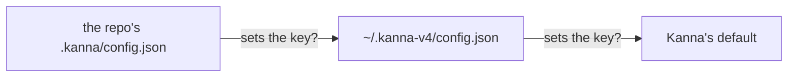
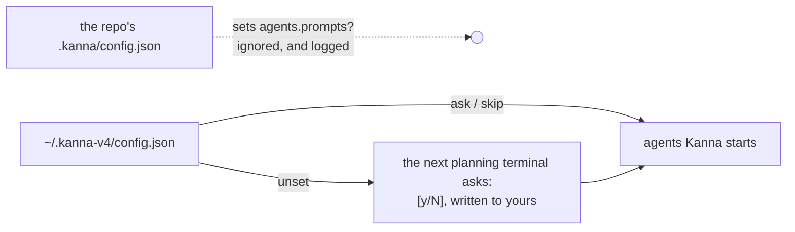

# Settings

**Status:** built · **Builds on:** [planning terminal](planning-agent.md) · **Tests:** `crates/kanna-daemon/src/tasks.rs` (unit), `scripts/e2e-kanna.sh` `desk_shelf`, `desk_by_path`, `planner_choice`, `shelf_runners`, `task_scripts`, `codex_task`

Kanna's own settings, in two JSON files: yours, and a repo's override. They're defined by a versioned JSON Schema, [`schemas/config.schema.json`](../../schemas/config.schema.json), that agents read with `kanna config schema`. For now: which agent plans, which agent a task runs, how big a planning agent's context gets, how many Shelf tasks run at once, what a task runs as it's set up and torn down, and whether Kanna's agents skip their permission prompts.

## Contents

1. [Where they live](#1-where-they-live)
2. [Schema and version](#2-schema-and-version)
3. [Keys](#3-keys)
4. [Agent prompts](#agent-prompts)
5. [How it's built](#5-how-its-built)
6. [Rejected](#6-rejected)
7. [Glossary](#7-glossary)

## 1. Where they live



- **Yours:** `~/.kanna-v4/config.json`.
- **A repo's:** `.kanna/config.json` at the repo's root, beside its other Kanna files. It wins over yours, key by key: a key it doesn't set comes from yours, then from Kanna's default. The exception is `agents.prompts`, which only yours sets ([4](#agent-prompts)).
- **Read when they're used,** not watched: a change applies to the next thing that reads it (for `planning.context`, the next planning terminal).
- **A bad value is ignored** for the next file down, and the daemon's log says which file and key.

```json
{ "version": 1, "planning": { "context": 300000 } }
```

## 2. Schema and version

- **The schema is the definition:** [`schemas/config.schema.json`](../../schemas/config.schema.json) (JSON Schema 2020-12) lists every key with its type, bounds, default and what it does. An agent asked to change a setting reads it first: `kanna config schema` prints it, from any folder, with or without Kanna running.
- **A file may name it** with `"$schema"`, so editors check and complete it.
- **`version`** says which settings format a file is written for; without one, it's 1. Kanna skips a file written for a newer version than it knows, and its log says so, so an older Kanna never misreads a newer file. The schema's `$id` carries the same version (`…/config/v1.schema.json`).
- **The daemon and the schema can't drift:** a test reads the schema and checks its keys, bounds, defaults and version against the daemon's.

## 3. Keys

| Key | Default | Does |
|---|---|---|
| `version` | `1` | The settings format the file is written for |
| `planning.agent` | none: asked | The agent a new Desk's planning terminal starts as a [planning agent](planning-agent.md#2-what-it-is), a name from the agents Kanna knows (`claude`, `codex`, …). Unset, each [new Desk](new-desk.md) asks (unless one agent is installed), and your answer is written to the repo's file straight away. |
| `tasks.agent` | `claude` | The agent a new task runs when `kanna task new` has no `--agent` ([choosing the agent](tasks.md#6-choosing-the-agent)). In your file, an agent or any command that starts one (`"codex"`, `"claude --model opus"`); in a repo's, only one of [Kanna's agents](agent-status.md#2-kannas-agents) (`claude`, `codex`, `opencode`, `agy`), so a cloned repo can't make Kanna run a command. A task keeps the agent it was made with. |
| `shelf.runners` | `3` | How many of a repo's Shelf tasks run at once, from 0 to 10: they start by themselves, oldest first, and Kanna stops each when its agent's turn ends ([Shelf runners](shelf-runners.md)). `0` turns it off. `backlog.runners`, its old name, is still read; `shelf.runners` wins when a file has both. |
| `agents.prompts` | `"ask"` | Whether the agents Kanna starts (task agents, the quiz agent, planning agents) ask permission before they run commands and edit files (`"ask"`), or skip their permission prompts (`"skip"`). Only `~/.kanna-v4/config.json` sets it ([4](#agent-prompts)). Unset, agents ask, and the next planning terminal asks you once. |
| `planning.context` | `300000` | Tokens a claude agent's context grows to in a [planning terminal](planning-agent.md) before it compacts, from 100000 to 1000000, or `"auto"` for claude's own. A long-lived agent works better kept small (context rot). Claude gets it as `CLAUDE_CODE_AUTO_COMPACT_WINDOW`, set by the terminal unless your environment already does; codex as `-c model_auto_compact_token_limit=N` (its window is 272K to 500K tokens, by model). Other agents keep their own limit. |
| `tasks.setup` | none | A shell command run in a new task's worktree before its agent starts, once per worktree ([task scripts](task-scripts.md#2-setup)) |
| `tasks.teardown` | none | A shell command run in a task's agent pane, in its worktree, when it's Done: the task is Done once it succeeds, and Kanna cleans it up ([task scripts](task-scripts.md#3-teardown-and-cleanup)) |
| `tasks.timeout` | `600` | Seconds `tasks.setup` and `tasks.teardown` each get, from 1 to 86400, before Kanna stops them |
| `pipelines.agents` | none | The command each agent a [pipeline](software-factory.md)'s stages name runs as, when it isn't the agent's own name on your PATH: `{"claude": "~/bin/claude-wrapper"}`. Only `~/.kanna-v4/config.json` sets it: a repo's file that sets it is ignored and logged, so a cloned repo's pipeline can't make a run start a command. |
| `pipelines.workers` | `3` | How many of a run's workers run at once (1 to 10): a fan-out's instances (`each`) and attempts (`xN by`) start as others end ([software factory §3](software-factory.md#3-workers-fan-out-join-and-other-machines)). |

<a id="agent-prompts"></a>
## 4. Agent prompts

`agents.prompts` decides whether the agents Kanna starts skip their permission prompts: `claude --dangerously-skip-permissions`, `codex --yolo`, `agy --dangerously-skip-permissions` (opencode has no flag). With prompts off, an agent runs commands and edits files without asking, so it's your choice, asked once.



- **Only yours sets it.** A repo's `.kanna/config.json` comes with the repo: a repo you clone could otherwise turn your prompts off, and its agents would then run whatever its files talk them into. A repo's file that sets it is ignored, and the daemon's log names the file.
- **Unset means `"ask"`:** agents keep their prompts until you say otherwise. A bad value, or a file for a newer Kanna, is unset too.
- **Asked once,** by the planning terminal of a [new Desk](new-desk.md#2-its-planning-terminal), after the agent is chosen and before it starts: `Let Kanna's agents work without permission prompts? They'll run commands and edit files without asking. [y/N]`. Yes writes `"skip"`, anything else `"ask"`, to `~/.kanna-v4/config.json`, keeping the file's other keys; then that planning agent starts to match. It's never asked again while the key is set; change it by editing the file.
- **An agent command that picks its own mode keeps it** (`claude --permission-mode plan`, `codex -a untrusted`, `agy --mode plan`, or one that already has the skipping flag), whatever the setting.
- **Why `agents.prompts`:** it's about every agent Kanna starts, so it's in its own `agents` section rather than `planning` or `shelf`; it names what you see, the permission prompts, and its values read as what they do (`ask`, `skip`). A word rather than a boolean leaves no doubt which way `true` goes, and none of the agents' own names for it (`yolo`, `dangerously-skip-permissions`) fits them all.

## 5. How it's built

- **The daemon reads them** when it needs a setting, for a folder: the repo of that folder's `.kanna/config.json`, then `~/.kanna-v4/config.json` (each at most 64 KB; `~` is `$KANNA_AGENTS_HOME` when it's set, as for agent setup, so tests keep their own).
- **`planning.agent`** is read as the daemon builds a planning terminal's command, for the folder it opens in, and passed to `planner.sh`, which writes your choice to the repo's file as you make it.
- **`tasks.agent`** is read as `kanna task new` adds a task without `--agent`, for the task's repo, and stored with the task; a repo's file is read with a stricter check than yours (an agent's name only), and a value it may not have falls through to yours.
- **`shelf.runners`** is read for each repo with Shelf tasks every 2s, and as a task's turn ends, so a change applies within seconds.
- **`tasks.setup`, `tasks.teardown` and `tasks.timeout`** are read as a task's worktree is set up and as it's Done, for its repo.
- **`planning.context`** is read as the daemon builds a planning terminal's command, for the folder it opens in, and becomes an `export` in that command, and a `-c model_auto_compact_token_limit` in codex's start (the `compact` flag in `AGENTS`, `tasks.rs`), which Kanna's codex wrapper hands to codex's app-server, where compaction happens, as it does every `-c`. Checked against the mock model through the wrapper: with a limit below a turn, codex compacts before its next one.
- **`pipelines.agents`** is read (`pipeline_agent` in `tasks.rs`) as a run's agent stage starts, from your file only, as `agents.prompts` is. e2e `pipeline_run` sets it in its private home to run `tools/mock-agent` as `claude`, which a daemon the app restarts reads as the first one did.
- **`pipelines.workers`** is read (`pipeline_workers` in `tasks.rs`) whenever a fan-out starts a worker, from the repo's file and then yours; out of range is logged and the default used. e2e `pipeline_fanout` sets it to 2.
- **`agents.prompts`** is read (`prompts` in `tasks.rs`) from the last of a folder's settings files, yours; the repo's file is only checked so its setting can be logged as ignored. A task's agent reads it each time its command is built: as it starts or starts again. The quiz agent reads it as `kanna quiz open` builds its command. `planner.sh` asks and saves your answer before it asks the daemon for the planner's command (`backlog` `planner`, which starts or resumes the project's conversation), and the daemon reads the setting then, and again for the command that resumes it after you quit. The commands passed to the script on its command line, for when the daemon doesn't answer, come in both forms for each agent: a name, the program, the command that asks and the command that skips. The script reads `~/.kanna-v4/config.json` (with `jq`) and writes it as it writes a repo's `planning.agent`: refusing a symlinked `~/.kanna-v4` or `config.json`, and a file for a newer Kanna (then the answer holds for that agent, and the next terminal asks again).

## 6. Rejected

- **`~/.config/kanna/`:** `~/.kanna-v4/` and a repo's `.kanna/` keep Kanna's files together, with a repo override beside the repo's other Kanna files.
- **One file per feature** (`planning.json`): one `config.json` with a section per feature has room for the settings to come.
- **Settings without a schema** (documented only in this spec): an agent in another repo can't read this spec, but it can run `kanna config schema`.
- **`$KANNA_AGENT` beside `tasks.agent`:** it was the daemon's environment, not the shell's that runs `kanna task new`, so you couldn't set it per terminal; the setting replaces it.
- **An environment variable pointing a pipeline's agents elsewhere** (`KANNA_PIPELINE_AGENTS`, for tests): a daemon the app restarts doesn't have it, so a run started the real agent; the setting is read by every daemon.
- **Passing claude `--autocompact`:** an environment variable in the planning terminal also reaches a claude you start there yourself.
- **Agents always skipping prompts** (as Kanna did from 5d721dcb): with prompts off an agent in a cloned repo runs commands and edits files unasked, so it has to be your choice.
- **A repo setting `agents.prompts`,** like every other key: the repo would decide how much its own agents may do on your machine.
- **Asking in each new Desk until answered,** or per repo: the answer is about you, not a project, so it's asked once and kept in your file.

## 7. Glossary

| Term | Meaning |
|---|---|
| **JSON Schema** | A standard JSON description of what a JSON file may contain, read by editors and agents |
| **Compact** | An agent summarising its conversation to shrink its context, keeping what matters |
| **Permission prompt** | An agent stopping to ask before it runs a command or edits a file |
| **Context rot** | A long conversation's older turns crowding out what matters, so the agent works worse |
