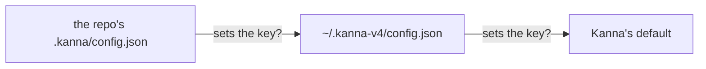

# Settings

**Status:** built · **Builds on:** [planning terminal](planning-agent.md) · **Tests:** `crates/kanna-daemon/src/backlog.rs` (unit), `scripts/e2e-kanna.sh` `desk_backlog`, `desk_by_path`, `planner_choice`, `backlog_runners`, `task_scripts`, `codex_task`

Kanna's own settings, in two JSON files: yours, and a repo's override. They're defined by a versioned JSON Schema, [`schemas/config.schema.json`](../../schemas/config.schema.json), that agents read with `kanna config schema`. For now: which agent plans, which agent a task runs, how big a planning agent's context gets, how many backlog tasks run at once, where task worktrees build, and what a task runs as it's set up and torn down.

## Contents

1. [Where they live](#1-where-they-live)
2. [Schema and version](#2-schema-and-version)
3. [Keys](#3-keys)
4. [How it's built](#4-how-its-built)
5. [Rejected](#5-rejected)
6. [Glossary](#6-glossary)

## 1. Where they live



- **Yours:** `~/.kanna-v4/config.json`.
- **A repo's:** `.kanna/config.json` at the repo's root, beside its other Kanna files. It wins over yours, key by key: a key it doesn't set comes from yours, then from Kanna's default.
- **Read when they're used,** not watched: a change applies to the next thing that reads it (for `planning.context`, the next planning terminal).
- **A bad value is ignored** for the next file down, and the daemon's log says which file and key.

```json
{ "version": 1, "planning": { "context": 300000 } }
```

## 2. Schema and version

- **The schema is the definition:** [`schemas/config.schema.json`](../../schemas/config.schema.json) (JSON Schema 2020-12) lists every key with its type, bounds, default and what it does. An agent asked to change a setting reads it first: `kanna config schema` prints it, from any folder, with or without Kanna running.
- **A file may name it** with `"$schema"`, so editors check and complete it.
- **`version`** says which settings format a file is written for; without one, it's 1. Kanna skips a file written for a newer version than it knows, and its log says so, so an older Kanna never misreads a newer file. The schema's `$id` carries the same version (`…/config/v1.schema.json`).
- **The daemon and the schema can't drift:** a test reads the schema and checks its keys, bounds, defaults and version against the daemon's.

## 3. Keys

| Key | Default | Does |
|---|---|---|
| `version` | `1` | The settings format the file is written for |
| `planning.agent` | none: asked | The agent a new Desk's planning terminal starts as a [planning agent](planning-agent.md#2-what-it-is), a name from the agents Kanna knows (`claude`, `codex`, …). Unset, each [new Desk](new-desk.md) asks (unless one agent is installed) and offers to write your answer to the repo's file. |
| `tasks.agent` | `claude` | The agent a new task runs when `kanna task new` has no `--agent` ([choosing the agent](tasks.md#6-choosing-the-agent)). In your file, an agent or any command that starts one (`"codex"`, `"claude --model opus"`); in a repo's, only an agent Kanna knows (`claude`, `codex`, `copilot`, `opencode`, `agy`), so a cloned repo can't make Kanna run a command. A task keeps the agent it was made with. |
| `backlog.runners` | `3` | How many of a repo's backlog tasks run at once, from 0 to 10: they start by themselves, oldest first, and Kanna stops each when its agent's turn ends ([backlog runners](backlog-runners.md)). `0` turns it off. |
| `planning.context` | `300000` | Tokens a claude agent's context grows to in a [planning terminal](planning-agent.md) before it compacts, from 100000 to 1000000, or `"auto"` for claude's own. A long-lived agent works better kept small (context rot). Claude gets it as `CLAUDE_CODE_AUTO_COMPACT_WINDOW`, set by the terminal unless your environment already does; codex as `-c model_auto_compact_token_limit=N` (its window is 272K to 500K tokens, by model). Other agents keep their own limit. |
| `build.targets` | none: in the worktree | A folder where build outputs live, so builds stay off the internal disk: each task worktree's `target/` links to `ROOT/REPO/WORKTREE`, and most folders in the main checkout's `target/` link to `ROOT/REPO/_main/`, keeping the app, built Ghostty and a copy of its dependencies internal. Only yours: a repo's file can't set it. Read by `scripts/build.sh`; while the folder's volume isn't mounted, checkouts build on the internal disk and move over on the next build with it ([build targets](build-targets.md)). |
| `tasks.setup` | none | A shell command run in a new task's worktree before its agent starts, once per worktree ([task scripts](task-scripts.md#2-setup)) |
| `tasks.teardown` | none | A shell command run in a task's agent pane, in its worktree, when it's Done: the task is Done once it succeeds, and Kanna cleans it up ([task scripts](task-scripts.md#3-teardown-and-cleanup)) |
| `tasks.timeout` | `600` | Seconds `tasks.setup` and `tasks.teardown` each get, from 1 to 86400, before Kanna stops them |

## 4. How it's built

- **The daemon reads them** when it needs a setting, for a folder: the repo of that folder's `.kanna/config.json`, then `~/.kanna-v4/config.json` (each at most 64 KB; `~` is `$KANNA_AGENTS_HOME` when it's set, as for agent setup, so tests keep their own).
- **`planning.agent`** is read as the daemon builds a planning terminal's command, for the folder it opens in, and passed to `planner.sh`, which writes it to the repo's file when you say yes.
- **`tasks.agent`** is read as `kanna task new` adds a task without `--agent`, for the task's repo, and stored with the task; a repo's file is read with a stricter check than yours (an agent's name only), and a value it may not have falls through to yours.
- **`backlog.runners`** is read for each repo with backlog tasks every 2s, and as a task's turn ends, so a change applies within seconds.
- **`build.targets`** isn't read by the daemon: `kanna_targets` in `scripts/env.sh` reads it from your file with `plutil` each time a build script runs.
- **`tasks.setup`, `tasks.teardown` and `tasks.timeout`** are read as a task's worktree is set up and as it's Done, for its repo.
- **`planning.context`** is read as the daemon builds a planning terminal's command, for the folder it opens in, and becomes an `export` in that command, and a `-c model_auto_compact_token_limit` in codex's start (the `compact` flag in `AGENTS`, `backlog.rs`). Checked against the mock model: with a limit below a turn, codex compacts before its next one.

## 5. Rejected

- **`~/.config/kanna/`:** `~/.kanna-v4/` and a repo's `.kanna/` keep Kanna's files together, with a repo override beside the repo's other Kanna files.
- **One file per feature** (`planning.json`): one `config.json` with a section per feature has room for the settings to come.
- **Settings without a schema** (documented only in this spec): an agent in another repo can't read this spec, but it can run `kanna config schema`.
- **`$KANNA_AGENT` beside `tasks.agent`:** it was the daemon's environment, not the shell's that runs `kanna task new`, so you couldn't set it per terminal; the setting replaces it.
- **Passing claude `--autocompact`:** an environment variable in the planning terminal also reaches a claude you start there yourself.

## 6. Glossary

| Term | Meaning |
|---|---|
| **JSON Schema** | A standard JSON description of what a JSON file may contain, read by editors and agents |
| **Compact** | An agent summarising its conversation to shrink its context, keeping what matters |
| **Context rot** | A long conversation's older turns crowding out what matters, so the agent works worse |
