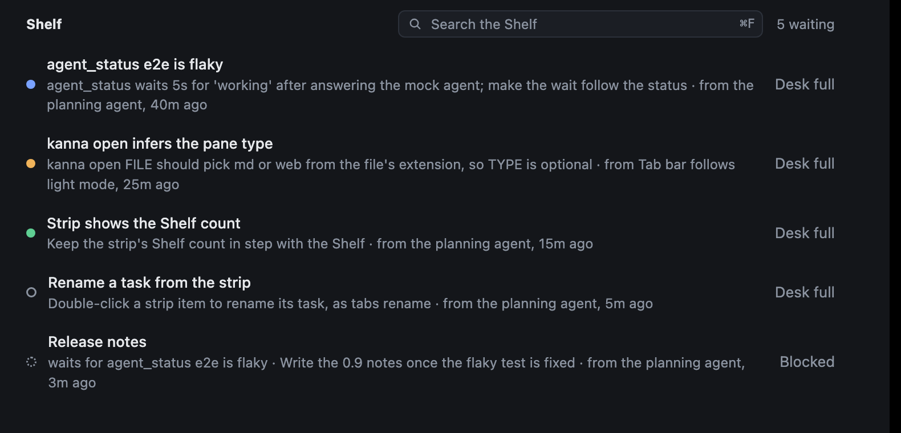

# Shelf row status

**Status:** built · **Mockup:** [`references/mockups/desk-view.html`](../../references/mockups/desk-view.html) · **Part of:** [Desk view](desk-view.md) · **Builds on:** [agent status](agent-status.md) · **Tested:** e2e `shelf_row_status`

In the Desk view, a Shelf task's row shows its status with the same dot as a Desk row, whether it's running or paused, so you can see what the Shelf is doing and what waits for you without opening a task. A paused task shows the status it had when it stopped.

*(From the mockup: `#picture&desk`.)*

## Rules

| The task | Its row shows |
|---|---|
| Running, working | the working dot |
| Running, needs you | the needs-you dot |
| Running, idle | the idle dot |
| Stopped, its last status needs you | the needs-you dot |
| Stopped, its last status idle | the idle dot |
| Never started, stopped mid-turn, or running with no status yet | the circle |
| Blocked, or its blockers' branches conflict | the dashed circle, running or not |
| On a machine that's offline | the circle: Kanna can't tell what it's doing |

- **Same statuses as a Desk row:** they come from the agent's report ([agent status](agent-status.md)), by the task's held pane.
- **Only the dot changes:** the row's text and its Move to Desk stay as they are; its keys show on hover ([Desk view keys](desk-keys.md)).
- **The dot follows the status:** a status change on a held pane refreshes the Desk view.
- **The strip doesn't change:** it shows how many are on the Shelf and no needs-you count.
- **Paused tasks keep their status:** Kanna pauses a [Shelf runner](shelf-runners.md) when its turn ends, as needs you or finished, and `kanna task stop` on a Shelf task records the same. The dot lasts through a restart and goes with the live status when the task starts again.
- **Stopped mid-turn:** a task stopped while working shows the circle, since it isn't working any more.

## Interface

`debug.desk` lists each Shelf row under `scroll.dots`: `task`, and `dot` as `working`, `needs-you`, `idle`, `circle` or `dashed`.
