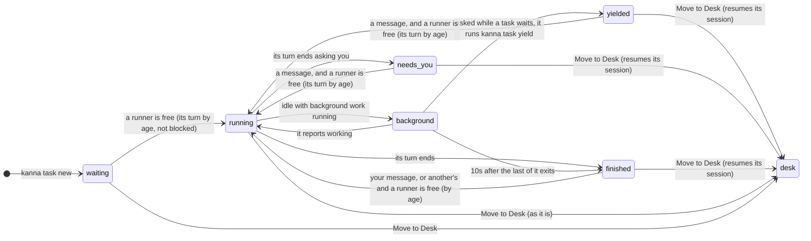
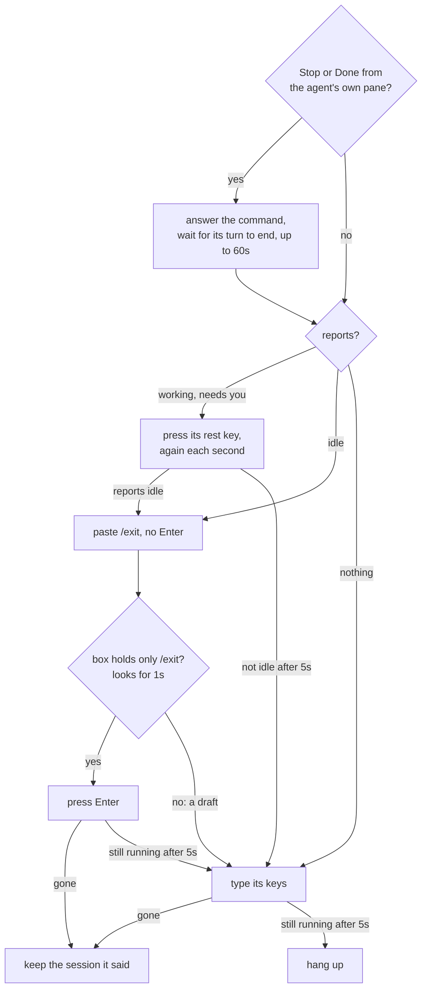
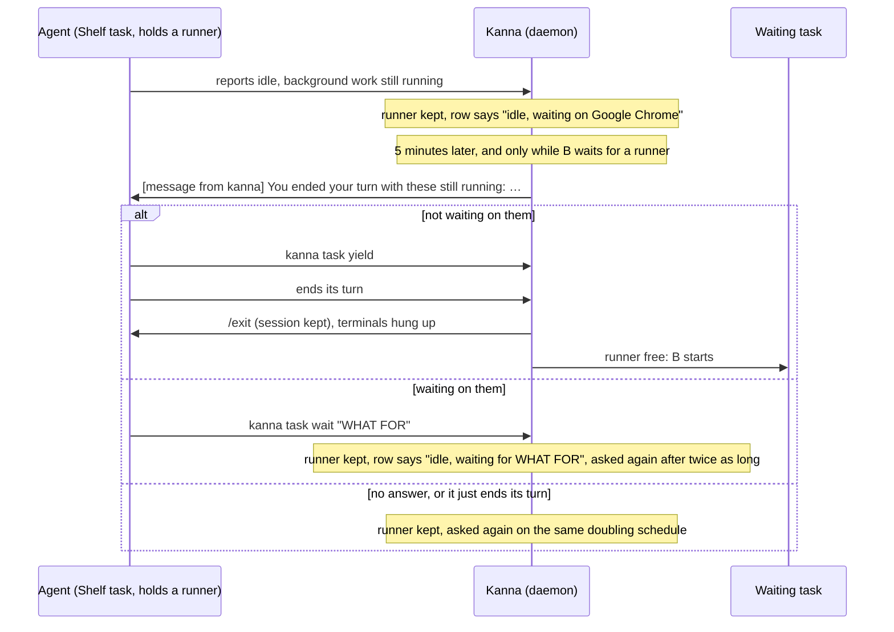

# Shelf runners

**Status:** built · **Tested:** e2e `shelf_runners`, `shelf_runner_ask`, `shelf_stop_pick`, `task_quit_at_rest`, `real_agent_tasks`, `real_agent_program_status`, `cargo test -p kanna-detect` (turn, background work, quit files), `-p kanna-daemon` (settings, a turn's end, asking for a runner back), `-p kanna --test machines_shelf` (asks and the machine's total) · **Builds on:** [tasks](tasks.md), [presenting](presenting.md), [blocked tasks](task-dependencies.md), [agent status](agent-status.md), [which agents resume](tasks.md#which-agents-resume)

Shelf tasks start by themselves, a few at a time, and work until they're blocked or done; then Kanna stops them. By the time you move one to the Desk, it has already done what it could, and it resumes there.

The Shelf looks the same as before: rows show nothing about how far a task got, so you pick what to move to the Desk by what matters, not by progress. A task that's done when you pick it is a happy surprise.

## Contents

1. [What runs](#1-what-runs)
2. [How it's built](#2-how-its-built)
3. [Asking for a runner back](#3-asking-for-a-runner-back)
4. [Glossary](#4-glossary)

## 1. What runs

- **Runners are the machine's:** agents use a machine's CPU, memory and builds, so `shelf.runners` in `~/.kanna-v4/config.json` ([settings](settings.md#3-keys), default 3) is how many Shelf tasks run at once on this machine, across all its repos. That file isn't synced, so each machine has its own number. 0 turns it off for the machine: Kanna starts and stops none. The old name `backlog.runners` is still read; when a file has both, `shelf.runners` wins.
- **A repo can only lower it:** `shelf.runners` in a repo's `.kanna/config.json` is a cap for that repo, and a value above the machine's changes nothing, so a number committed to a repo can't ask more of every machine that clones it. 0 turns runners off for that repo: Kanna starts and stops none of its tasks, and its running ones still count towards the machine's total.
- **Desk tasks don't count:** only Shelf tasks are limited.
- **One queue, oldest first:** all the machine's repos share it. A free runner takes the task made longest ago, in any repo, that has something to do: one that hasn't started, or a stopped one with a [message](agent-messaging.md#3-stopped-tasks) waiting. A [blocked](task-dependencies.md) task is skipped until what it waits for is Done, and so is a task whose repo is at its cap, whose place goes to the next task in the queue.
- **A busy repo can hold up a quiet one, for now:** with one queue, a repo with many old tasks runs before a repo with a new one. Taking turns between repos was considered and is the next step if this starves a repo in practice; it isn't built.
- **Every Shelf task runs.** A task that needs you (a mockup to discuss, a question) runs until it asks.
- **So tasks are written to be done in one go:** the [planning agent](planning-agent.md#2-what-it-is) reads the code, asks you until the outcome, scope, decisions and how to judge it done are settled, writes a first message that says all of it and what to do when stuck, and reads it back to you before it makes the task (the `kanna-planning` skill).
- **A runner frees when a turn ends:** the agent's [report](agent-status.md#3-the-report-osc-7501) goes from working to idle or done (finished) or to blocked (needs you), and it has no [background work](#background-work) running. Kanna quits the agent, keeps its session, and starts the next.
- **An agent too old to report isn't run:** Kanna [quits it](agent-status.md#2-kannas-agents) as it starts, stops the task as `too-old`, and runners skip it until you start it yourself.
- **Nothing shows it:** Shelf rows and `kanna task list` show a runner's status as they do for any running Shelf task ([Shelf row status](shelf-row-status.md)), apart from a runner held by background work and a task that yielded its runner ([asking for a runner back](#3-asking-for-a-runner-back)), and the Desk's tasks aren't re-sorted. Why a task stopped (needs you, finished), and what it waited for before it did, is kept in its events (`tasks events`, the socket command), and its row keeps the status it stopped with.
- **Moved to the Shelf running, a task counts as a runner,** and Kanna stops it when its turn ends, at once if it arrives idle. That can leave more running than `shelf.runners` for a while: Kanna stops none to make room, and starts no more until fewer run.
- **A message wakes a stopped task:** it runs for it as a runner, taking its turn by age: a message doesn't put it ahead of an older task that hasn't started, so messaging many tasks at once ([task events](task-events.md), say) doesn't hold up new work. A message you typed doesn't queue: the task runs at once, past `shelf.runners`, as `kanna task start` does, unless `shelf.runners` is 0 on the machine or for its repo. A running one with a message waiting gets it instead of being stopped ([agent messaging](agent-messaging.md#3-stopped-tasks)).
- **A task whose agent ended with the keeper** is started again by a runner, in its turn by age, resuming its session ([agents after the keeper is lost](keeper-loss.md)).
- **Resume on the Desk:** Move to Desk (or `kanna task start`) resumes a stopped task's session where it stopped.
- **A pick wins over a runner's stop, whichever comes first:** you never find an exited agent on the Desk.
  - **Before the stop starts** (its turn has ended, or its grace is running, when you pick it): the pick cancels it. The task is the Desk's from then on, and its agent stays running at the end of its turn, as Desk agents do.
  - **While the stop is under way** (Kanna has typed `/exit` or its keys): what's typed can't be taken back, so the agent quits, and the pick starts it again on the Desk at once, resuming its session and the tabs the stop hung up. The daemon log says so (`… is on …'s Desk while its agent quits, so it starts again once it has`).
  - **After the stop:** the pick starts the stopped task, as it always does.

### A parked Claude

A claude that moved its conversation into a background job ([agent messaging](agent-messaging.md#6-a-parked-claude)) reports nothing for the job's turns from its terminal, so a runner follows the job:

- **Its turn ends with the job's:** the job's status going from `busy` to `idle` or `waiting` ([agent status](agent-status.md#a-parked-claude)), so a parked Shelf task frees its runner as any other does, instead of holding it until stopped.
- **The job's background work counts:** the job runs under Claude's daemon, not under the terminal's claude, so its shells are looked for under the job's process as well as the pane's.
- **Stopping it stops the job first:** `claude stop JOB`, then `/exit` in the pane, keeping the job's session, so the next start resumes the conversation with everything the job did ([which agents resume](tasks.md#a-parked-claude)).

### Background work

Claude reports idle at the end of its turn while a command it started in the background (`run_in_background`, a Monitor) still runs. Quitting it then kills the command, and the resumed session says `Background shell command didn't finish before the previous session ended`. So a turn isn't over while its agent has background work:

- **Background work is a process under the agent outside its process group:** a live descendant of the agent's process whose group isn't the agent's, such as Claude's shells (each runs in a session of its own) and what they run (a build, a server). The agent's own helpers stay in its group and don't count: MCP servers, `caffeinate`, the `git` it runs to show the branch. A process that left the tree (a daemon that detached and was reparented) doesn't count, nor does one that has exited but isn't reaped yet.
- **The runner stays taken while it waits,** with no time limit: a real build or test is the load `shelf.runners` caps, so Kanna never takes a runner from an agent, and doesn't guess from the process list which processes matter. When another task waits for the runner, Kanna asks the agent ([asking for a runner back](#3-asking-for-a-runner-back)). Its Shelf row and `kanna task list` say it's idle and what it waits on (`idle, waiting on Google Chrome`); the task's events say it waits and for what (`waiting`, with `why: background` and each process's pid and command), and the daemon log names them.
- **Then a grace of 10s:** once the last of it exits, Kanna waits 10s before it stops the task, since the command finishing wakes the agent (Claude tells itself the command completed) and it starts a new turn. A working report in the grace cancels the stop; that turn ends as any other.
- **Asking you waits too:** a turn that ends blocked (needs you) with background work running waits for it the same way.
- **Only Claude is looked at** (and the mock agent named as it): codex reports working until its background terminals close ([agent status](agent-status.md#2-kannas-agents)), and runs two `app-server-daemon` processes in sessions of their own for as long as it runs, which would hold its runner for ever. Antigravity and opencode aren't measured, so Kanna takes their reports at their word.
- **`kanna task stop` and Done don't wait for background work:** from elsewhere they quit the agent at once; from the agent's own pane they wait only for its turn to end ([how](#2-how-its-built)).

## 2. How it's built

- **The runners are the daemon's** (`Tasks::fill` in `tasks.rs`, the Shelf's code): every 2s, and whenever a task is made, edited, done or stopped, `Tasks::candidates` lists each repo's tasks with something to do (never started and not blocked, or stopped with a message waiting), `fill` sorts them together by when they were made, and it starts them from the oldest until the machine's `shelf.runners` run, skipping a repo at its cap. Tasks you start on the Shelf, or move there running, count too, in every repo, including one that's off. With several machines, a runner also asks other machines for their waiting tasks in the same project, oldest first with its own, and an ask in flight counts as a running task ([machine tasks §2](machine-tasks.md#2-owners-and-grants)).
- **A turn's end is the agent's report:** `Turn` (`kanna-detect`) watches a running Shelf task's agent and says its turn is over when its root record goes from working to idle, done or blocked, counted by the terminal as the reports arrive, so a short turn between two looks isn't missed ([agent status](agent-status.md#3-the-report-osc-7501)).
- **And its background work:** while a turn is quiet, `Tasks::tick` looks at the agent's tree (and a parked claude's job's) every 0.5s (`program::background`: `proc_listchildpids` and each child's group from `proc_pidinfo` on macOS, `/proc` on Linux) for the agents in `agents::IDLE_WITH_BACKGROUND`, the agent being the program the terminal's status comes from. `Turn` keeps whether work runs or when it ended, and ends the turn only once it's quiet, nothing runs, and `turn::GRACE` (10s) has passed since the work ended.
- **Each agent says how it quits and where its session is**, in `agent-rules/quit/AGENT.json`: its exit command and what its input box looks like holding only that (`exit`), the key that brings it to rest (`rest`), the keys that quit it (`keys`), and a pattern that finds its session ID in what it prints as it exits (`session`). Checked with the real programs, each exit printing what its keys print:

| Agent | Exit | Rest | Keys | Its session |
|---|---|---|---|---|
| claude | `/exit` | `esc` | `ctrl+c ctrl+c` | `claude [FLAGS] --resume ID`, printed as it exits with the flags it started with |
| codex | `/exit` | `esc` | `ctrl+c ctrl+c` | `codex resume ID`, printed as it exits |
| antigravity | `/exit` | `esc` | `ctrl+c ctrl+c` | `agy --conversation=ID`, printed as it exits |
| opencode | `/exit` | `esc` | `ctrl+c ctrl+c` | found in its database, as it [resumes](tasks.md#which-agents-resume) |

- **What the rest key does, checked by hand** (November 2026, against the [mock model](../../tools/agent-harness/README.md) where the agent can use it): claude 2.1.319, codex and agy 1.5.1 report idle within half a second of one `esc`, from working and from a permission dialog (it declines it), and keep a draft in the box. Opencode 1.19.5 interrupts work on the second `esc` ("esc again to interrupt", still armed 2.6s later) and declines a permission dialog on the first; it keeps a draft too. At rest, `esc` isn't harmless: two clear claude's draft or open its rewind picker, and two open codex's on an empty box, while each still reports idle; agy and opencode ignore it. Agy at its folder-trust prompt exits on `esc`.

- **A pick during a stop:** `Tasks::pick` marks the task as being picked until it's answered, and `Tasks::tick` stops no task so marked: moving it to the Desk takes a few steps through the Desk's state, and a turn that ends between them would otherwise be stopped as the task leaves the Shelf. A pick that finds the agent already quitting (`quitting` or `finishing`) moves the task to the Desk at once and waits for the quit to finish (`Tasks::after_quit`), keeps the session the agent said, then restarts the agent and its tabs with its resume command, as a pick of a stopped task does.
- **Stopped means quit, not paused:** the agent's process exits; nothing is kept in memory. Its conversation is in the agent's own session files, and resuming starts a new process in the same pane with the agent's resume flag (`claude --resume UUID`, `codex resume ID`), as [Stop and Start](tasks.md#5-stop-done-or-back-to-the-shelf) do.
- **One way to end an agent** (`Tasks::end_agent`), for a turn's end, `kanna task stop` and Done, and it's the way you'd do it: bring it to rest, then `/exit`. Ctrl+C is the interrupt key, and codex can die on the second one before it says its session, so it's only the fallback:

- **From its own pane, its turn ends first:** an agent that runs `kanna task done` or `kanna task stop` on its own task is in the middle of a turn, so Kanna answers the command at once (`… is done when this turn ends: end your turn now, and its agent quits then`) and waits for the turn to end, as a [runner](#1-what-it-is) does (`Turn`, but with no wait for background work), from the next report: the status it had when the command arrived may be one the agent has already left, as reports land a moment late, so one that showed idle is given 5s. The agent reads the answer, finishes, reports idle, and `/exit` quits it with nothing interrupted. A turn still going after 60s is brought to rest, and an agent that reports nothing, whose turn's end Kanna can't see, is quit at once. A Stop or Done from elsewhere meanwhile quits it at once, and both are answered. The rest of Done (its teardown, closing its panes) runs once the agent has quit, and `kanna task list` says if its teardown fails, as for any Done.
- **`/exit` only at rest:** a permission or question dialog would take it as an answer, so an agent working or asking is first brought to rest with its rest key: Kanna presses it, looks at the agent's report a second later, and presses it again until it reports idle (opencode takes two), then pastes `/exit`. A working agent is interrupted only when you stop it from elsewhere; runners and its own Done wait for the turn to end. An agent that reports nothing gets its keys straight away: Kanna can't tell when it's at rest, and the rest key pressed at rest opens a dialog or clears a draft on some agents.
- **A draft is looked at, not cleared:** nothing can clear a box safely on every agent (Ctrl+U leaves the other lines of a draft of several, and they'd be sent; Ctrl+C is the key this avoids; the rest key leaves it). So Kanna pastes `/exit` and reads the screen before Enter, as you'd check the box. Each agent's `box` pattern matches only when `/exit` is alone in the box: a draft shows beside it or around it, and a placeholder or suggested prompt goes when text is typed. If it doesn't match within 1s Enter is never pressed, so the draft isn't sent, and the agent gets its keys, which discard it with the agent as they always did. A pattern that stops matching an agent's new look costs the `/exit`, never the draft. A screen with no box at all, like the read-only one codex shows after `kanna restart` (`This conversation is open in another app`), or a dialog the rest key opened at rest, goes the same way.
- **Keys are typed as you would,** one at a time, 0.5s apart, the next only while its terminal is still raw (the pty's `ICANON` is off). An idle codex quits on the first ctrl+c and leaves raw mode at once, but says its session only about 0.5s later; a second, reaching it in line mode, would be SIGINT and kill it before it says it. At a prompt, or with text typed, it takes both. Keys reach an agent as key presses: it runs its terminal raw, so the terminal doesn't turn them into SIGINT.
- **Its keys, then hanging up, are the fallback:** an agent not at rest 5s after its first rest key, or still running 5s after Enter on `/exit`, gets its keys. One still running 5s after its keys gets SIGHUP to its process group, SIGKILL a second later if it's still there, and the daemon log says so and which agent (`claude in term-4 didn't quit in 5s, so it's hung up`).
- **A task's own session wins:** one Kanna gave at start (claude's `--session-id`) is the one it resumes. Kanna reads the session an agent says from its screen once it exits, and keeps it only for a task without one: codex and antigravity, which take no ID, and a task Kanna didn't start. With neither, the task starts fresh from its first message, never the agent's own latest session ([tasks](tasks.md#which-agents-resume)).
- **Stopping one:** Kanna ends the agent, then hangs up the task's other terminals and closes nothing, so the layout its agent set up to [present its work](presenting.md) is what you see when you make it active, and saves the task stopped, with why (`stopped` and `why` in its events).
- **The quit files are bundled only:** nothing outside Kanna's build can change what Kanna types into an agent.
- **Tested** by `kanna-detect` tests of `Turn` (work holds the end with no limit, then the grace; a working report in the grace cancels it) and of `program::background` (a table: a child in the agent's group isn't work, one in its own is, with what it runs; a real `bash` agent with a child in its group and one with job control, found until it exits); by `tasks.rs` tests with a fake agent and child (idle with the child running doesn't quit it and logs `waiting` once; it stops as finished only after the child is gone and the grace passes; working within the grace keeps it; `kanna task stop` doesn't wait; a pick whose turn is over when it lands is never stopped and nothing is typed to it; a pick after `/exit` was pasted, and after Enter, gets the agent running on the Desk with its session; so does a pick while `kanna task stop` quits it; a pick after the stop starts it again); by e2e `shelf_stop_pick` (the mock agent as codex lingers 3s after it says its session, `KANNA_MOCK_EXIT_DELAY`; picked in that time, it's resumed on the Desk and still runs there); by e2e `real_agent_program_status` (real claude ends its turn idle with its background shell running, and reports working within the grace once it ends); by `kanna-detect` tests of each agent's `box` against its real screens (`/exit` alone matches; a draft before it, or of several lines, doesn't); by `tasks.rs` tests of each way, with a fake agent that rests on `esc`: idle uses `/exit` and keeps the session; working and needs you (a stop, a runner) get `esc` and then `/exit`; one that doesn't rest gets `esc` each second and its keys at the limit; one with no report gets its keys; a draft is never entered, idle or working, and gets the keys; `/exit` that doesn't work falls back to the keys and then a hang-up; Done and Stop from the agent's own pane answer at once, type nothing until its turn ends and then only `/exit`, bring a turn past the limit to rest, and don't wait for an agent with no report; a Done from elsewhere while one waits quits it at once; by e2e `task_start_stop` (`kanna task stop` quits the mock as claude by `/exit`), `task_quit_at_rest` (the mock agent as claude: its own `kanna task done` mid-turn quits it by `/exit` once its turn ends, with no `esc` or ctrl+c; stopped while working, and while asking, it gets `esc` and then `/exit`) and `real_agent_tasks` (real claude and codex quit by `/exit` with no interruption in their transcripts and resume their session: claude Kanna's, codex the one it said; with a draft they quit by keys and the draft never reaches the model; one that stops and then ends its own task mid-turn quits by `/exit` after its turn each time, with no interruption in its transcript, and resumes its session in between); and by e2e `shelf_runners` with the mock agent as codex: with runners 0 nothing runs; with 3, five tasks run three at a time in order, skipping a blocked one until its blocker is Done; one that asks is stopped as needs you (in its events), its session read from what it said as it quit; Move to Desk resumes it there; moved back to the Shelf idle, it's stopped as finished; one that presents its work keeps its tabs, focus and zoom through the stop ([presenting](presenting.md#3-how-its-built)); with one runner, tasks run by age whether stopped with a message or never started: a newer stopped task with a message waits behind an older new one, and an older one runs before a newer new one. With two repos on one instance, a repo's number can't raise a machine total of 0 or 2, four tasks made in turn run oldest first and two at a time; a repo capped at 1 runs one task at a time while its places go to the other repo's newer tasks, up to a total of 3; and a repo at 0 runs nothing and holds up nothing. `machines_shelf` checks that a machine whose one runner is taken by a task in one repo asks for no task in another until it's free. `tasks.rs` tests check the order of the queue and how the two files combine; with the mock as claude, one idle with a `sleep 4` it started running isn't stopped (its events say it waits for `sleep 4`) until the sleep exits and the grace passes, and one woken by its sleep's end within the grace finishes its new turn before it's stopped.

## 3. Asking for a runner back

Seen in Kanna Staging, 10 to 14 November 2026: runners held for days by a Playwright Chrome an agent never closed, a `python -m http.server` for a mockup, a hung `eza --icons` shell and a plugin's child `claude`, while new tasks in another repo waited. Kanna can't tell from a process list whether the agent still needs them; the agent can, so Kanna asks it, and the answer is a command, so Kanna reads no prose.

- **When:** the task holds a runner, its latest turn ended at least 5 minutes ago with [background work](#background-work) still running, and another task is waiting for a runner. Each turn that ends with the work still running starts the 5 minutes again, so an agent busy with messages isn't asked the moment one of its turns ends. Nobody waiting, nothing is asked. The 5 minutes is `ASK_AFTER` in `tasks/holding.rs` (`KANNA_ASK_AFTER`, in seconds, overrides it for tests).
- **Waiting for a runner** means a [candidate](#2-how-its-built) the last fill skipped for the limits, which freeing this task's runner would let start: under the machine's `shelf.runners` once one is freed, and under its repo's cap (a repo at its cap is helped only by a runner of its own). A message you typed starts its task past the limits, so it waits for nothing.
- **The question** is a message from `kanna` ([agent messaging](agent-messaging.md)) naming what Kanna sees, and what it wants: `You ended your turn with these still running: Google Chrome (pid 4242), python3 -m http.server 52688 (pid 4250). Another task is waiting for your runner. If you're waiting on them, run kanna task wait "WHAT FOR"; if not, run kanna task yield.` Shells are left out when anything else runs, and a program whose name starts with one already named (Chrome's helpers) is left out; a command up to 60 characters is shown with its arguments, a longer one by its program's name.
- **`kanna task yield`** stops the task as `kanna task stop` from its own pane does: Kanna answers at once, waits for the turn to end (not for its background work), quits the agent keeping its session, and hangs up its terminals, so its leftover processes end with them. The task stops as `yielded` (its row says `yielded its runner`, its events `stopped` with `why: yielded`), the runner is free, and the next candidate starts. It resumes as any stopped task does: for a message, or when you pick it. A question it hadn't read yet is withdrawn, so it doesn't wake the task again.
- **`kanna task wait TEXT`** keeps the runner. The row and `kanna task list` say `idle, waiting for TEXT`, its events `waits` with `for`, and Kanna asks again after twice as long.
- **No answer, or the agent just ends its turn again,** keeps the runner as before, and it's asked again on the same schedule. Kanna never stops an agent that hasn't yielded.
- **The schedule doubles:** asked 5 minutes after its turn ended, then 10, 20, 40… minutes after each ask, and never sooner than 5 minutes after its latest turn ended; a `wait` answer sets the next ask that far from the answer. A due ask that finds no task waiting is made as soon as one is.
- **Asks are deadlines, not polls:** the next ask is a time the daemon's tick wakes for, and a task starting to wait is seen by the runners' fill, which asks a holder that's due there and then. What feeds them still polls: the look at the agent's tree for background work (every 0.5s while a turn is quiet) and the fill (every 2s, besides the events that start it). The schedule lasts while the background work does: once it's gone (the turn then ends and the task stops), the next background work starts at 5 minutes again.
- **A pick wins:** a pick while a yield quits the agent starts it again on the Desk, resuming its session, as for any stop under way ([the race](#2-how-its-built)).
- **Only Claude is looked at,** as for background work: codex reports working until its background terminals close, so its turn doesn't end and it's never asked; Antigravity and opencode aren't measured. `kanna task yield` and `kanna task wait` work for any Shelf agent that runs them.
- **The holding isn't kept through a daemon restart,** like the turn it belongs to: a restarted daemon finds the background work again and starts the schedule at 5 minutes.
- **Only on the Shelf:** a Desk task holds no runner, and both commands refuse it (`not_on_shelf`).
- **Built** in `tasks/holding.rs`: `fill` records the candidates it skipped for the limits (`Contended`); `look_for_background` keeps what each quiet agent's tree holds (`Holding`: its processes, the next ask, the wait, the reason, the question's message ID); `tick` asks the due ones while the turn waits, the candidate still waits, and no message waits for the task. `described` gives a Shelf row `holding` (`on`, `for`, `asked`) while its turn waits on background work, which `kanna task list` and the Desk view's row phrase.
- **Tested** by `tasks.rs` tests with the fake agent and child: asked only once the delay passes while another task waits (and not with nobody waiting); a turn that ends again starts the delay again, and the tick wakes for the next ask; an ask due while nobody waits goes out from the fill that finds a task waiting; no answer keeps the runner and asks again after twice as long; `wait` keeps it, says what for and doubles; `yield` stops it at its turn's end as `yielded`, its background work still running, withdraws the unread question and the waiting task runs; a pick while a yield quits the agent starts it again on the Desk; a Desk task is refused; `holding.rs` tests of the names and of when a freed runner helps; a `kanna` CLI test of the rows and replies; and e2e `shelf_runner_ask` with the mock agent as claude and one runner (`KANNA_ASK_AFTER=3`): idle with `sleep 120` in the background, its row and `kanna task list` say `waiting on sleep`, it isn't asked with nobody waiting, it's asked once a second task waits, keeps the runner unanswered and is asked again, `kanna task wait` shows the reason, and `kanna task yield` stops it as `yielded` and the waiting task starts.

## 4. Glossary

| Term | Meaning |
|---|---|
| **Runner** | One of a machine's `shelf.runners` places, in which Shelf tasks from any of its repos run by themselves |
| **Turn** | An agent's work from your message (or its first) until it stops to wait for you, with no background work left running |
| **Background work** | A process under a task's agent outside the agent's own process group, such as a shell it runs a command in the background in |
| **Held runner** | A runner whose Shelf task is idle with background work running, which Kanna asks about while another task waits |
| **Yield** | `kanna task yield`: the agent gives its runner up, and its task stops as `yielded` |
| **Grace** | The 10s Kanna waits after the last background work exits before it stops the task, in case the agent starts a new turn for it |
