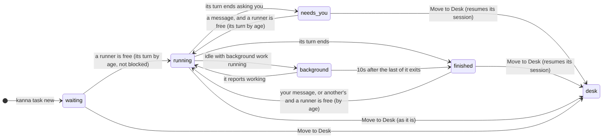
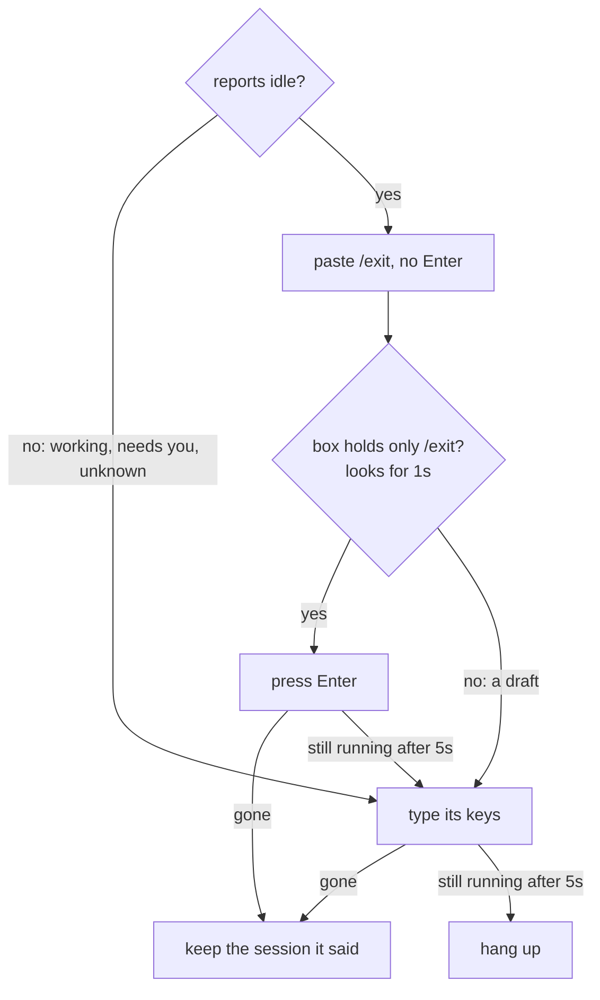

# Shelf runners

**Status:** built · **Tested:** e2e `shelf_runners`, `real_agent_program_status`, `cargo test -p kanna-detect` (turn, background work, quit files), `-p kanna-daemon` (settings, a turn's end), `-p kanna --test machines_shelf` (asks and the machine's total) · **Builds on:** [tasks](tasks.md), [presenting](presenting.md), [blocked tasks](task-dependencies.md), [agent status](agent-status.md), [which agents resume](tasks.md#which-agents-resume)

Shelf tasks start by themselves, a few at a time, and work until they're blocked or done; then Kanna stops them. By the time you move one to the Desk, it has already done what it could, and it resumes there.

The Shelf looks the same as before: rows show nothing about how far a task got, so you pick what to move to the Desk by what matters, not by progress. A task that's done when you pick it is a happy surprise.

## Contents

1. [What runs](#1-what-runs)
2. [How it's built](#2-how-its-built)
3. [Glossary](#3-glossary)

## 1. What runs

- **Runners are the machine's:** agents use a machine's CPU, memory and builds, so `shelf.runners` in `~/.kanna-v4/config.json` ([settings](settings.md#3-keys), default 3) is how many Shelf tasks run at once on this machine, across all its repos. That file isn't synced, so each machine has its own number. 0 turns it off for the machine: Kanna starts and stops none. The old name `backlog.runners` is still read; when a file has both, `shelf.runners` wins.
- **A repo can only lower it:** `shelf.runners` in a repo's `.kanna/config.json` is a cap for that repo, and a value above the machine's changes nothing, so a number committed to a repo can't ask more of every machine that clones it. 0 turns runners off for that repo: Kanna starts and stops none of its tasks, and its running ones still count towards the machine's total.
- **Desk tasks don't count:** only Shelf tasks are limited.
- **One queue, oldest first:** all the machine's repos share it. A free runner takes the task made longest ago, in any repo, that has something to do: one that hasn't started, or a stopped one with a [message](agent-messaging.md#3-stopped-tasks) waiting. A [blocked](task-dependencies.md) task is skipped until what it waits for is Done, and so is a task whose repo is at its cap, whose place goes to the next task in the queue.
- **A busy repo can hold up a quiet one, for now:** with one queue, a repo with many old tasks runs before a repo with a new one. Taking turns between repos was considered and is the next step if this starves a repo in practice; it isn't built.
- **Every Shelf task runs.** A task that needs you (a mockup to discuss, a question) runs until it asks.
- **So tasks are written to be done in one go:** the [planning agent](planning-agent.md#2-what-it-is) reads the code, asks you until the outcome, scope, decisions and how to judge it done are settled, writes a first message that says all of it and what to do when stuck, and reads it back to you before it makes the task (the `kanna-planning` skill).
- **A runner frees when a turn ends:** the agent's [report](agent-status.md#3-the-report-osc-7501) goes from working to idle or done (finished) or to blocked (needs you), and it has no [background work](#background-work) running. Kanna quits the agent, keeps its session, and starts the next.
- **An agent too old to report isn't run:** Kanna [quits it](agent-status.md#2-kannas-agents) as it starts, stops the task as `too-old`, and runners skip it until you start it yourself.
- **Nothing shows it:** Shelf rows and `kanna task list` show a runner's status as they do for any running Shelf task ([Shelf row status](shelf-row-status.md)), and the Desk's tasks aren't re-sorted. Why a task stopped (needs you, finished), and what it waited for before it did, is kept in its events (`tasks events`, the socket command), and its row keeps the status it stopped with.
- **Moved to the Shelf running, a task counts as a runner,** and Kanna stops it when its turn ends, at once if it arrives idle. That can leave more running than `shelf.runners` for a while: Kanna stops none to make room, and starts no more until fewer run.
- **A message wakes a stopped task:** it runs for it as a runner, taking its turn by age: a message doesn't put it ahead of an older task that hasn't started, so messaging many tasks at once ([task events](task-events.md), say) doesn't hold up new work. A message you typed doesn't queue: the task runs at once, past `shelf.runners`, as `kanna task start` does, unless `shelf.runners` is 0 on the machine or for its repo. A running one with a message waiting gets it instead of being stopped ([agent messaging](agent-messaging.md#3-stopped-tasks)).
- **Resume on the Desk:** Move to Desk (or `kanna task start`) resumes a stopped task's session where it stopped.

### Background work

Claude reports idle at the end of its turn while a command it started in the background (`run_in_background`, a Monitor) still runs. Quitting it then kills the command, and the resumed session says `Background shell command didn't finish before the previous session ended`. So a turn isn't over while its agent has background work:

- **Background work is a process under the agent outside its process group:** a live descendant of the agent's process whose group isn't the agent's, such as Claude's shells (each runs in a session of its own) and what they run (a build, a server). The agent's own helpers stay in its group and don't count: MCP servers, `caffeinate`, the `git` it runs to show the branch. A process that left the tree (a daemon that detached and was reparented) doesn't count, nor does one that has exited but isn't reaped yet.
- **The runner stays taken while it waits,** with no time limit: a command that never ends holds its runner until you stop the task. Its Shelf row shows it idle; the task's events say it waits and for what (`waiting`, with `why: background` and each process's pid and command), and the daemon log names them.
- **Then a grace of 10s:** once the last of it exits, Kanna waits 10s before it stops the task, since the command finishing wakes the agent (Claude tells itself the command completed) and it starts a new turn. A working report in the grace cancels the stop; that turn ends as any other.
- **Asking you waits too:** a turn that ends blocked (needs you) with background work running waits for it the same way.
- **Only Claude is looked at** (and the mock agent named as it): codex reports working until its background terminals close ([agent status](agent-status.md#2-kannas-agents)), and runs two `app-server-daemon` processes in sessions of their own for as long as it runs, which would hold its runner for ever. Antigravity and opencode aren't measured, so Kanna takes their reports at their word.
- **`kanna task stop` and Done are immediate:** they quit the agent at once, background work or not.

## 2. How it's built

- **The runners are the daemon's** (`Tasks::fill` in `tasks.rs`, the Shelf's code): every 2s, and whenever a task is made, edited, done or stopped, `Tasks::candidates` lists each repo's tasks with something to do (never started and not blocked, or stopped with a message waiting), `fill` sorts them together by when they were made, and it starts them from the oldest until the machine's `shelf.runners` run, skipping a repo at its cap. Tasks you start on the Shelf, or move there running, count too, in every repo, including one that's off. With several machines, a runner also asks other machines for their waiting tasks in the same project, oldest first with its own, and an ask in flight counts as a running task ([machine tasks §2](machine-tasks.md#2-owners-and-grants)).
- **A turn's end is the agent's report:** `Turn` (`kanna-detect`) watches a running Shelf task's agent and says its turn is over when its root record goes from working to idle, done or blocked, counted by the terminal as the reports arrive, so a short turn between two looks isn't missed ([agent status](agent-status.md#3-the-report-osc-7501)).
- **And its background work:** while a turn is quiet, `Tasks::tick` looks at the agent's tree every 0.5s (`program::background`: `proc_listchildpids` and each child's group from `proc_pidinfo` on macOS, `/proc` on Linux) for the agents in `agents::IDLE_WITH_BACKGROUND`, the agent being the program the terminal's status comes from. `Turn` keeps whether work runs or when it ended, and ends the turn only once it's quiet, nothing runs, and `turn::GRACE` (10s) has passed since the work ended.
- **Each agent says how it quits and where its session is**, in `agent-rules/quit/AGENT.json`: its exit command and what its input box looks like holding only that (`exit`), the keys that quit it (`keys`), and a pattern that finds its session ID in what it prints as it exits (`session`). Checked with the real programs, each exit printing what its keys print:

| Agent | Exit | Keys | Its session |
|---|---|---|---|
| claude | `/exit` | `ctrl+c ctrl+c` | `claude [FLAGS] --resume ID`, printed as it exits with the flags it started with |
| codex | `/exit` | `ctrl+c ctrl+c` | `codex resume ID`, printed as it exits |
| antigravity | `/exit` | `ctrl+c ctrl+c` | `agy --conversation=ID`, printed as it exits |
| opencode | `/exit` | `ctrl+c ctrl+c` | found in its database, as it [resumes](tasks.md#which-agents-resume) |

- **Stopped means quit, not paused:** the agent's process exits; nothing is kept in memory. Its conversation is in the agent's own session files, and resuming starts a new process in the same pane with the agent's resume flag (`claude --resume UUID`, `codex resume ID`), as [Stop and Start](tasks.md#5-stop-done-or-back-to-the-shelf) do.
- **One way to end an agent** (`Tasks::end_agent`), for a turn's end, `kanna task stop` and Done, and it's the way you'd do it. Ctrl+C is the interrupt key, and codex can die on the second one before it says its session, so it's only for an agent that isn't at rest:

- **`/exit` only at rest:** a permission or question dialog would take it as an answer, so any status but idle gets the keys. A working agent is interrupted, since that's what `kanna task stop` asked for; runners never get there, as they wait for the turn to end.
- **A draft is looked at, not cleared:** nothing can clear a box safely on every agent (Ctrl+U leaves the other lines of a draft of several, and they'd be sent; Ctrl+C is the key this avoids). So Kanna pastes `/exit` and reads the screen before Enter, as you'd check the box. Each agent's `box` pattern matches only when `/exit` is alone in the box: a draft shows beside it or around it, and a placeholder or suggested prompt goes when text is typed. If it doesn't match within 1s Enter is never pressed, so the draft isn't sent, and the agent gets its keys, which discard it with the agent as they always did. A pattern that stops matching an agent's new look costs the `/exit`, never the draft. A screen with no box at all, like the read-only one codex shows after `kanna restart` (`This conversation is open in another app`), goes the same way.
- **Keys are typed as you would,** one at a time, 0.5s apart, the next only while its terminal is still raw (the pty's `ICANON` is off). An idle codex quits on the first ctrl+c and leaves raw mode at once, but says its session only about 0.5s later; a second, reaching it in line mode, would be SIGINT and kill it before it says it. At a prompt, or with text typed, it takes both. Keys reach an agent as key presses: it runs its terminal raw, so the terminal doesn't turn them into SIGINT.
- **Hanging up is the fallback:** an agent still running 5s after its keys gets SIGHUP to its process group, SIGKILL a second later if it's still there, and the daemon log says so and which agent (`claude in term-4 didn't quit in 5s, so it's hung up`).
- **A task's own session wins:** one Kanna gave at start (claude's `--session-id`) is the one it resumes. Kanna reads the session an agent says from its screen once it exits, and keeps it only for a task without one: codex and antigravity, which take no ID, and a task Kanna didn't start. With neither, the task resumes the folder's latest (`codex resume --last`, `claude --continue`).
- **Stopping one:** Kanna ends the agent, then hangs up the task's other terminals and closes nothing, so the layout its agent set up to [present its work](presenting.md) is what you see when you make it active, and saves the task stopped, with why (`stopped` and `why` in its events).
- **The quit files are bundled only:** nothing outside Kanna's build can change what Kanna types into an agent.
- **Tested** by `kanna-detect` tests of `Turn` (work holds the end with no limit, then the grace; a working report in the grace cancels it) and of `program::background` (a table: a child in the agent's group isn't work, one in its own is, with what it runs; a real `bash` agent with a child in its group and one with job control, found until it exits); by `tasks.rs` tests with a fake agent and child (idle with the child running doesn't quit it and logs `waiting` once; it stops as finished only after the child is gone and the grace passes; working within the grace keeps it; `kanna task stop` doesn't wait); by e2e `real_agent_program_status` (real claude ends its turn idle with its background shell running, and reports working within the grace once it ends); by `kanna-detect` tests of each agent's `box` against its real screens (`/exit` alone matches; a draft before it, or of several lines, doesn't); by `tasks.rs` tests of each way, with a fake agent: idle uses `/exit` and keeps the session, working and needs you use the keys, a draft is never entered and gets the keys, `/exit` that doesn't work falls back to the keys and then a hang-up; by e2e `task_start_stop` (`kanna task stop` quits the mock as claude by `/exit`) and `real_agent_tasks` (real claude and codex quit by `/exit` with no interruption in their transcripts and resume their session: claude Kanna's, codex the one it said; with a draft they quit by keys and the draft never reaches the model); and by e2e `shelf_runners` with the mock agent as codex: with runners 0 nothing runs; with 3, five tasks run three at a time in order, skipping a blocked one until its blocker is Done; one that asks is stopped as needs you (in its events), its session read from what it said as it quit; Move to Desk resumes it there; moved back to the Shelf idle, it's stopped as finished; one that presents its work keeps its tabs, focus and zoom through the stop ([presenting](presenting.md#3-how-its-built)); with one runner, tasks run by age whether stopped with a message or never started: a newer stopped task with a message waits behind an older new one, and an older one runs before a newer new one. With two repos on one instance, a repo's number can't raise a machine total of 0 or 2, four tasks made in turn run oldest first and two at a time; a repo capped at 1 runs one task at a time while its places go to the other repo's newer tasks, up to a total of 3; and a repo at 0 runs nothing and holds up nothing. `machines_shelf` checks that a machine whose one runner is taken by a task in one repo asks for no task in another until it's free. `tasks.rs` tests check the order of the queue and how the two files combine; with the mock as claude, one idle with a `sleep 4` it started running isn't stopped (its events say it waits for `sleep 4`) until the sleep exits and the grace passes, and one woken by its sleep's end within the grace finishes its new turn before it's stopped.

## 3. Glossary

| Term | Meaning |
|---|---|
| **Runner** | One of a machine's `shelf.runners` places, in which Shelf tasks from any of its repos run by themselves |
| **Turn** | An agent's work from your message (or its first) until it stops to wait for you, with no background work left running |
| **Background work** | A process under a task's agent outside the agent's own process group, such as a shell it runs a command in the background in |
| **Grace** | The 10s Kanna waits after the last background work exits before it stops the task, in case the agent starts a new turn for it |
