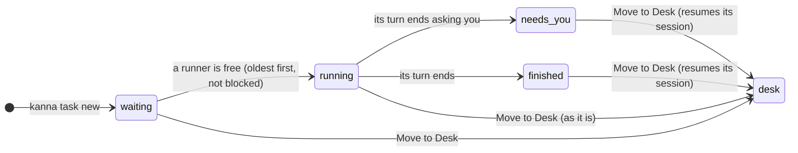

# Shelf runners

**Status:** built · **Tested:** e2e `shelf_runners`, `cargo test -p kanna-detect` (turn, quit files), `-p kanna-daemon` (settings) · **Builds on:** [tasks](tasks.md), [presenting](presenting.md), [blocked tasks](task-dependencies.md), [agent status](agent-status.md), [which agents resume](tasks.md#which-agents-resume)

Shelf tasks start by themselves, a few at a time, and work until they're blocked or done; then Kanna stops them. By the time you move one to the Desk, it has already done what it could, and it resumes there.

The Shelf looks the same as before: rows show nothing about how far a task got, so you pick what to move to the Desk by what matters, not by progress. A task that's done when you pick it is a happy surprise.

## Contents

1. [What runs](#1-what-runs)
2. [How it's built](#2-how-its-built)
3. [Glossary](#3-glossary)

## 1. What runs

- **Runners:** `shelf.runners` ([settings](settings.md#3-keys), default 3, the repo's file over yours) of a repo's Shelf tasks run at once. 0 turns it off: Kanna starts and stops none. The old name `backlog.runners` is still read; when a file has both, `shelf.runners` wins.
- **Oldest first,** skipping a [blocked](task-dependencies.md) task until what it waits for is Done.
- **Every Shelf task runs.** A task that needs you (a mockup to discuss, a question) runs until it asks.
- **So tasks are written to be done in one go:** the [planning agent](planning-agent.md#2-what-it-is) reads the code, asks you until the outcome, scope, decisions and how to judge it done are settled, writes a first message that says all of it and what to do when stuck, and reads it back to you before it makes the task (the `kanna-planning` skill).
- **A runner frees when a turn ends:** the agent's [status](agent-status.md) goes from working to needs you or idle and stays there 3s, or, for an agent that [reports its own status](agent-status.md#4-the-agents-own-report-osc-7501), its report goes from working to idle or done, which ends the turn at once. Kanna quits the agent, keeps its session, and starts the next.
- **Nothing shows it:** Shelf rows and `kanna task list` look as they do for any Shelf task, and the Desk's tasks aren't re-sorted. Why a task stopped (needs you, finished) is kept in its events only (`tasks events`, the socket command).
- **Moved to the Shelf running, a task counts as a runner,** and Kanna stops it when its turn ends, at once if it arrives idle. That can leave more running than `shelf.runners` for a while: Kanna stops none to make room, and starts no more until fewer run.
- **A message wakes a stopped task:** it runs for it as a runner, ahead of tasks that haven't started, and a running one with a message waiting gets it instead of being stopped ([agent messaging](agent-messaging.md#3-stopped-tasks)).
- **Resume on the Desk:** Move to Desk (or `kanna task start`) resumes a stopped task's session where it stopped.

## 2. How it's built

- **The runners are the daemon's** (`Tasks::tick` in `tasks.rs`, the Shelf's code): every 2s, and whenever a task is made, edited, done or stopped, it starts each repo's oldest waiting tasks (never started, not blocked) until `shelf.runners` of them run. Tasks you start on the Shelf, or move there running, count too.
- **A turn's end is code, not the agent's judgement:** `Turn` (`kanna-detect`) watches a running Shelf task's agent status and says its turn is over when, after working, it stays needs you or idle for 3s (the status tracker already holds idle 300 ms).
- **3s is tested against the corpus:** `kanna-corpus --turns` replays `tools/agent-harness` recordings through the rules and the tracker. Across 27 claude and codex recordings, no turn was judged over while its agent still worked, from 0.5s up; 3s leaves room for a real agent's pauses between tool calls.
- **Each agent says how it quits and where its session is**, in `agent-rules/quit/AGENT.json` beside its rules: the keys that quit it, and a pattern that finds its session ID in what it prints as it exits.

| Agent | Quit with | Its session |
|---|---|---|
| claude | `ctrl+c ctrl+c` | `claude --resume ID`, printed as it exits |
| codex | `ctrl+c ctrl+c` | `codex resume ID`, printed as it exits |
| copilot | `ctrl+c ctrl+c` | `copilot --resume=ID`, printed as it exits |
| antigravity | `ctrl+c ctrl+c` | `agy --conversation=ID`, printed as it exits (read from its binary: a run needs a sign-in) |
| opencode | `ctrl+c ctrl+c` (from its docs: it isn't installed here to try) | found in its database, as it [resumes](tasks.md#which-agents-resume) |
| any other | its terminal hung up | as it [resumes](tasks.md#which-agents-resume) |

- **Stopped means quit, not paused:** the agent's process exits; nothing is kept in memory. Its conversation is in the agent's own session files, and resuming starts a new process in the same pane with the agent's resume flag (`claude --resume UUID`, `codex resume ID`), as [Stop and Start](tasks.md#5-stop-done-or-back-to-the-shelf) do.
- **One way to end an agent** (`Tasks::end_agent`), for a turn's end, `kanna task stop` and Done: Kanna types its quit keys into its terminal, as you would, one at a time, 0.5s apart, the next only while its terminal is still raw (the pty's `ICANON` is off). An idle codex quits on the first ctrl+c and leaves raw mode at once, but says its session only about 0.5s later; a second, reaching it in line mode, would be SIGINT and kill it before it says it. At a prompt, or with text typed, it takes both. Keys reach an agent as key presses: it runs its terminal raw, so the terminal doesn't turn them into SIGINT.
- **Hanging up is the fallback:** an agent with no keys, or one still running 5s later, gets SIGHUP to its process group, SIGKILL a second later if it's still there, and the daemon log says so and which agent (`claude in term-4 didn't quit in 5s, so it's hung up`).
- **A task's own session wins:** one Kanna gave at start (claude's and copilot's `--session-id`) is the one it resumes. Kanna reads the session an agent says from its screen once it exits, and keeps it only for a task without one: codex and antigravity, which take no ID, and a task Kanna didn't start. With neither, the task resumes the folder's latest (`codex resume --last`, `claude --continue`).
- **Stopping one:** Kanna ends the agent, then hangs up the task's other terminals and closes nothing, so the layout its agent set up to [present its work](presenting.md) is what you see when you make it active, and saves the task stopped, with why (`stopped` and `why` in its events).
- **The quit files are bundled only:** the rules site and your overrides can't change which keys Kanna types into an agent.
- **Tested** by `tasks.rs` tests of each way, with a fake agent: the keys typed, the session kept, a hang-up only for no keys or a timeout; by e2e `task_start_stop` (`kanna task stop` quits the mock as claude by its keys) and `real_agent_tasks` (real claude and codex quit by keys and resume their session: claude Kanna's, codex the one it said); and by e2e `shelf_runners` with the mock agent as codex: with runners 0 nothing runs; with 3, five tasks run three at a time in order, skipping a blocked one until its blocker is Done; one that asks is stopped as needs you (in its events), its session read from what it said as it quit; Move to Desk resumes it there; moved back to the Shelf idle, it's stopped as finished; one that presents its work keeps its tabs, focus and zoom through the stop ([presenting](presenting.md#3-how-its-built)).

## 3. Glossary

| Term | Meaning |
|---|---|
| **Runner** | One of `shelf.runners` places in which a repo's Shelf tasks run by themselves |
| **Turn** | An agent's work from your message (or its first) until it stops to wait for you |
