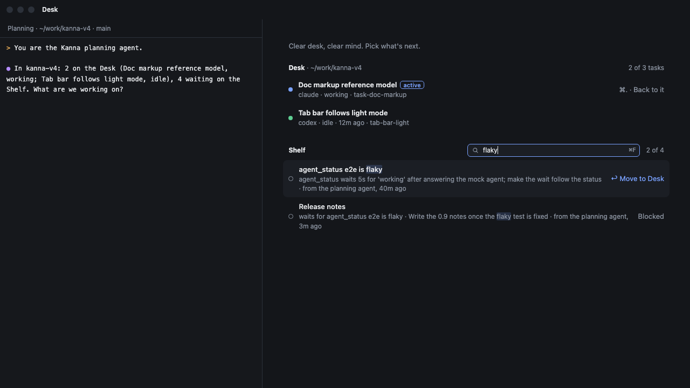
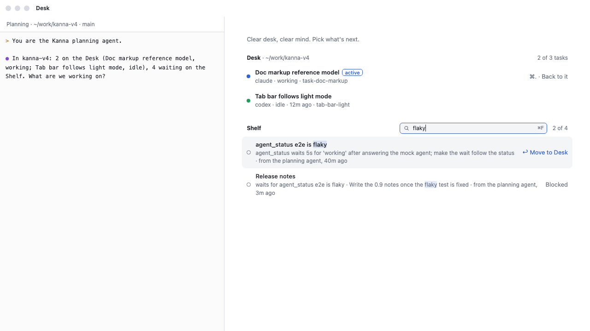

# Shelf search

**Status:** built · **Mockup:** [`references/mockups/desk.html`](../../references/mockups/desk.html) and [`desk-view.html`](../../references/mockups/desk-view.html) (`#desk&q=flaky`, the pictures) · **Builds on:** [tasks](tasks.md#3-the-shelf), [Desk](desk.md), [Desk view](desk-view.md)

Find a Shelf task by typing part of its name, first message or branch, or its ID, and start it from the keyboard. A task's ID is `task-` and 8 hex digits ([task IDs](task-ids.md)); `kanna task list` shows it for every task, and commands take any unique start of it.





## In the app

- **The field sits in the Shelf header** of the Desk view, between "Shelf" and the count, which reads "2 of 12" while you search. Its placeholder is "Search the Shelf". It shows only when the Shelf has tasks.
- **⌘F** (Edit › Find…) puts the cursor in it while the Desk view shows, from the planning terminal too; it scrolls the field into view.
- **It filters as you type.** A task matches when every word you type, ignoring case, in any order, starts its ID (`task-1dfb`, `TASK-1DFB12C2`, or 4 hex digits or more without `task-`: `1dfb`) or is its agent's pane ID (`term-12`), or appears in its name, first message or branch (`save-default`). Matches are marked in the name and first message. No match: "No Shelf task matches "…"."
- **The first match is selected.** ↑ ↓ move the selection, and ↩ moves the selected task to the Desk, as clicking it does (refused the same way when the Desk is full). Clicking any row still works.
- **esc** clears the search; with nothing typed, it goes back to the planning terminal. The field's **×** clears it too, and shows in place of the ⌘F hint once you've typed.
- **The search clears** when you start a task from it, and when the active task shows again.
- **Rows look as they do unfiltered,** whatever state they show (waiting, running on the Shelf, blocked): the search only hides the ones that don't match.

## CLI

`kanna task list QUERY` lists only the tasks that match QUERY the same way: every word starts the task's ID or is its agent's pane ID (`term-12`), or is in its name, first message or branch. `kanna task list` alone lists every task of the caller's repo ([task list](task-list.md#4-which-tasks)); `--json` is filtered too, and gives Desk tasks their `task` ID and `branch`. With `--include-done` it searches the done tasks as well, so an agent can see whether the work was done already before it makes a task.

```sh
kanna task list resume agent
kanna task list task-1dfb
kanna task list term-12 save-default
```

A done task leaves the list (`--include-done` brings done ones back, and they match the same way), so without it a query that is only a task ID and matches nothing says what happened to it rather than "no task matches" (`found` in `--json`):

```
$ kanna task list task-1dfb
task-1dfb "Planner save prompt defaults to yes" is done (2d ago); its branch planner-save-default-yes is still there
```

Only an ID that never existed gets `no task matches "task-1dfb"`. The daemon's `show` action gives the task by a start of its ID, done or not (done ones included, unlike `resolve`), with when it was done and its branch if the repo still has it; it records the branch when the task is done, since its worktree may go.

## Rejected

- **Matching IDs by any part:** `1df` in the middle of an ID means nothing to anyone. A word matches an ID only from its start, as commands take it ([task IDs](task-ids.md#naming-a-task-in-a-command)), and without `task-` only from 4 hex digits, so a short word like `add` doesn't pull in every task whose ID starts that way. Pane IDs match whole; branches by any part.
- **Matching the maker or the repo:** the Desk view's Shelf is already one repo's, and the maker is rarely what you remember.
- **Typing anywhere on the page to search:** the planning terminal has the keyboard in the Desk view; ⌘F is the one way in.

## Checked by

e2e `shelf_search`: ⌘F from the planning terminal, filtering by name and by a first message's words in any case, no match, esc twice, ↑↓ at the ends, ↩ starting the selected task and clearing the search, an ID alone and with a word in ⌘F, `kanna task list QUERY`, `kanna task list TASK` for a waiting task and a done one, and snapshots in light and dark; the CLI's own tests for QUERY and `--json`, and for an ID, a pane ID, a branch, an ID with a word, and a done task's ID with and without its branch, and for `--include-done` with QUERY and without (the 5 done last).
