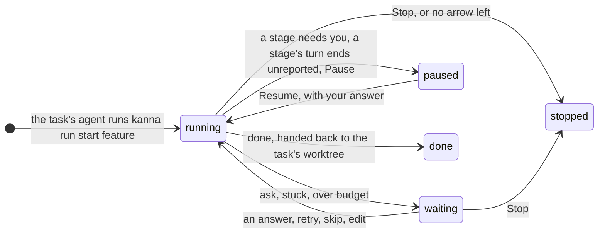
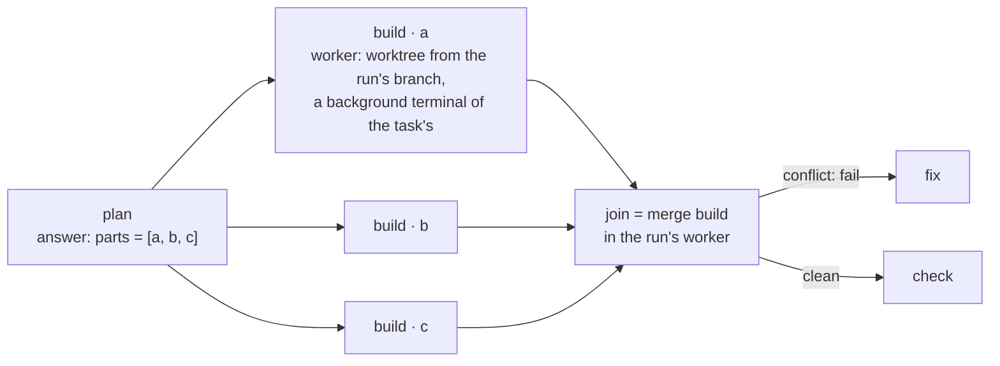
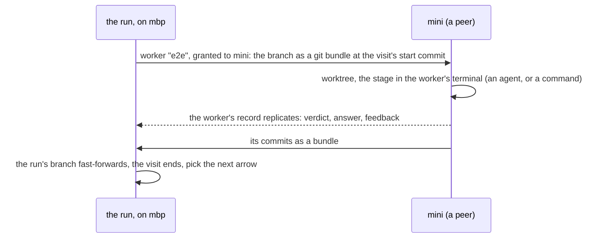
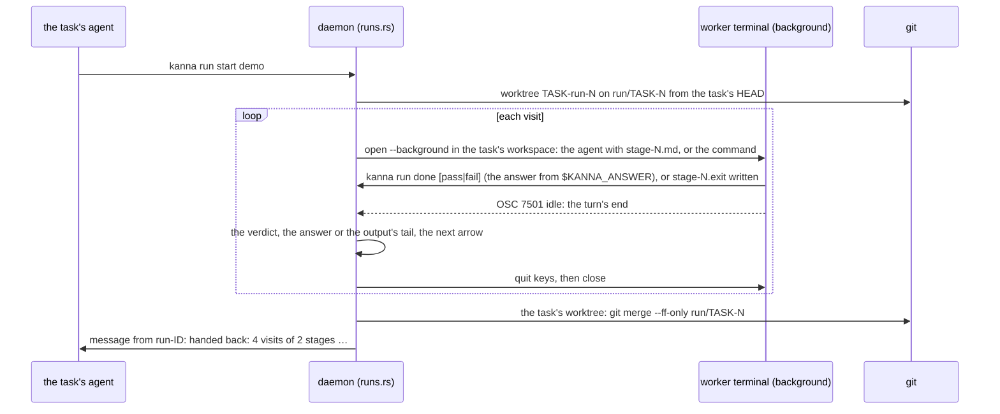

# Software factory

**Status:** sequential runs built ([§6.1](#61-sequential-runs-as-built): agent and `run` stages, loops, `progress`, `reset`, the budget, hand-back; `kanna run start`, `list`, `show`, `log`, `stop`); gates, fan-out, revisions, the Run tab and metrics not yet (the build tasks: [build order](software-factory-build-order.md)) · **Tested:** `cargo test -p kanna-daemon runs::`, e2e `pipeline_run` · **Mockup:** [`references/mockups/pipeline.html`](../../references/mockups/pipeline.html) (Definition, A run on the Desk, waiting on you, a stage's terminal shown, Runs compared; `#light`) · **Language:** [pipeline language](pipeline-language.md) · **Why this design:** [research](../research/software-factory.md) · **Builds on:** [tasks](tasks.md), [Shelf runners](shelf-runners.md), [task scripts](task-scripts.md), [agent messaging](agent-messaging.md), [database](database.md), the Stats tab (task "Stats tab on the Desk") and [code quality metrics](code-quality-metrics.md) (task "Code quality metrics")

A **pipeline** says how a change gets built once its spec and mockup are approved: which stages it goes through (plan, build, review, tests, your go-ahead, merge), who does each one (an agent, a command, you, git), and what happens when a stage fails (a bounded loop back to a fix). Any task's agent can **run** one: it stays the agent you talk to, docked on the left with its tabs on the right, and the pipeline builds the software under the hood, in agent sessions and commands you don't see unless you look. The daemon drives the run; a **Run** tab shows where it is. Each stage runs in one of the task's background terminals, which you can show in a tab of the task and put back. Every stage's time, turns, tokens, verdicts and your interventions are kept in `kanna.db`, so pipelines can be compared on the Stats tab and tuned.

## Contents

1. [What a run is](#1-what-a-run-is)
2. [Who drives it](#2-who-drives-it)
3. [Workers, fan-out, join and other machines](#3-workers-fan-out-join-and-other-machines)
4. [Seeing and steering a run](#4-seeing-and-steering-a-run)
5. [Metrics](#5-metrics)
6. [How it's built](#6-how-its-built)
7. [CLI](#7-cli)
8. [Rejected](#8-rejected)
9. [Build tasks](#9-build-tasks)
10. [Glossary](#10-glossary)

## 1. What a run is

- **Any task runs one.** A task is what it is ([tasks](tasks.md)): one agent in one worktree. The spec and mockup are made the way they are now: iterated in the task's chat until you approve them ([reference-driven design](../../.claude/skills/reference-driven-design/SKILL.md)). Then its agent starts a run (`kanna run start PIPELINE`, from its terminal), as the `kanna-tasks` skill says to for an approved spec or an understood bug; you ask the agent for the feature, and the agent builds it through the pipeline, or you tell it to. The pipeline starts at the plan, with the spec as its input, and ends by handing its branch back to the task's worktree: that's your gate. You review the change there, as any task's, and it merges to main from there.
- **The task looks the same:** its agent docked on the left, its tabs on the right, its dot its own agent's status. The run adds the Run tab; a stage's terminal shows in a tab when you ask for it ([4](#4-seeing-and-steering-a-run)).
- **The run works on a branch of its own,** `run/<task>-N`, from the task's branch as it is when the run starts, in **workers**: worktrees of the run's, each with a terminal in the task's workspace as a background member ([3](#3-workers-fan-out-join-and-other-machines)). The task's worktree and the agent's conversation are left alone while it runs, so you can keep talking to the agent, and each agent works in a worktree of its own.
- **The request** is what `kanna run start` is given (`--request FILE` or text), else the task's first message; every agent stage gets it.
- **The run ends by handing back:** when the flow reaches `done`, the task's branch is fast-forwarded to the run's and the task's worktree moved to it (left as it is, with a note, if it has changes), and the task's agent is told as a [message](agent-messaging.md): `[message from run-7f3a] handed back: 14 visits of 7 stages, 3h 02m …`. A run that stops anywhere else keeps its branch for the agent to look at, and says why.
- **A Shelf task's run outlives its agent's turn:** a [Shelf runner](shelf-runners.md) stops the agent when its turn ends, as it does now; the run goes on in its workers, which that stop leaves running, and the message at the end wakes the task as any message does. By the time you move the task to the Desk, the run may have handed back.
- **Closing the task ends its run:** Done (with its teardown) stops the task's live run first, as `stopped` with `the task was closed`, closes its workers' terminals and removes their worktrees; the run's branch stays. `kanna task stop` stops the agent and leaves the run going, as a Shelf runner's stop does; `kanna run stop` ends it.
- **One run at a time per task,** and the budget stops a run that would exceed its sessions or time, as waiting on you.

## 2. Who drives it

- **The daemon keeps the run, agents decide its gates.** The daemon moves a run along the pipeline's arrows; what picks an arrow is a gate, automatic or manual. An automatic gate is a stage's verdict (a command's exit code, a reviewer's `pass` or `fail`). A manual gate is an `ask`, answered by you or by the task's agent when you've let it (`kanna run answer`). The task's agent also starts, reads, resumes and stops runs. Moving a run outside its arrows (skip, retry, edit) is yours. A stage's agent gets only its own prompt: the stage's prompt file, the request, the last failure's feedback, and the earlier stages' named outputs its prompt asks for, as `{{STAGE.KEY}}` ([pipeline language §5](pipeline-language.md#5-inputs-and-outputs)). A stage marked `emits` may propose a change to the pipeline in its answer, which the daemon checks and adopts as the run's next revision ([pipeline language §7](pipeline-language.md#7-changing-a-pipeline-while-it-runs); not built yet).
- **Events drive it:** a stage ends when its agent reports it's done (`kanna run done`, with its verdict and answer; the daemon then quits the agent), its command exits (the keeper's exit code), you answer, or its `within` passes. A stage's agent that needs something from you says so (`kanna run need TEXT`), and the run pauses. Only its report ends a stage; Kanna reads no screen and times no idleness for it. Its agent's own status report (OSC 7501) says only when a turn ends, so Kanna knows when to quit an agent that reported, and when to pause a run whose stage stopped without reporting; so agent stages take agents that report (claude, codex). The daemon steps a run when one of these happens (a report, a turn's end, a worker's terminal exiting or closing, which the core announces, a visit opening or concluding, the daemon starting), and otherwise sleeps until the run's next deadline: a `within`, or the 10s it gives an agent that reported to end its turn.
- **Every visit runs in a worker,** and the run sees only visits ending: its verdict, answer and commits. The run's state machine, records and Run tab are the same wherever the worker is (here, or a peer); every visit records its `machine`.
- **A run survives a daemon restart:** the run's state is the rows; a stage mid-visit carries on (its agent still runs in the keeper's pty; a command too), and a visit whose terminal is gone is recorded `interrupted` and run again.
- **Several runs run at once** as their tasks do; within a run, one stage at a time, except a fan-out's instances.

## 3. Workers, fan-out, join and other machines

- **A worker** is a worktree of the run's (`.kanna-worktrees/<task>-run-N[-item]`) and a terminal in the task's workspace as a background member, running and drawn nowhere until you show it: an agent stage's session runs there with the stage's prompt as its first message; a `run` stage's command runs there as [setup](task-scripts.md#2-setup) runs; a `merge` runs git there. The run's first worker carries from stage to stage; `each` and `xN` add one per item or attempt, `pipelines.workers` of them running at once (default 3). A worker is part of its task: the Shelf, the Desk, the strip and `kanna task list` show the task as one row, and its Shelf runner's slot is the task's.
- **`each STAGE.KEY`** makes one worker per item, named `STAGE · ITEM`, branched from the run's branch at that commit, its agent given the stage's prompt, the request and its item as `# Your part`. A worker reporting done ends its instance; one that needs you makes the run wait on you, its terminal the one to show. **The next stage waits for every instance.** `merge STAGE` joins their branches into the run's (one merge commit per instance, in item order); a conflict is a `fail` with the conflicting files as feedback for a `fix` arrow, the run's worker left at the conflict. Joined workers' worktrees and branches go; what they said and did stays on the Run tab.
- **`xN by STAGE`** fans out the same way (`STAGE · attempt K`), scores each with the `run` stage named, keeps the winner's branch and ends the others, recording every score. **Budget:** each instance is a session; a list longer than the sessions left is refused before any worker starts, and the stage fails with that as feedback.

- **`on PLACEMENT`** ([pipeline language §3](pipeline-language.md#3-attributes)) runs one stage's worker on another of your machines: granted to that machine as a task is ([tasks across machines](machine-tasks.md)), its branch carried over as a git bundle as a transfer carries one, the stage run there, and the result back as the worker's replicated record and a bundle of its commits. A command stage needs only the repo's clone there; an agent stage needs the machine signed in to the agent ([agent sign-in](agent-sign-in.md)). The run itself stays on its machine. The worker's terminal is a background member of the task's workspace there too, and shows in a tab over the link as any remote terminal does.
- **The placement is a policy, as the machines spec says:** a name picks that machine, a role (`mac`, `e2e`) any machine declaring it with a free slot, `any` whichever asks first, `here` the run's own. Matching by capability beyond roles is [Kanna Cloud's](kanna-cloud.md#5-directory-and-relays). A stage whose placement is offline waits, and the run says so; `within` bounds the wait.
- **A whole stage travels:** a task runs whole on one machine and crosses only at a turn's end; a stage visit is exactly that unit, from a commit to its agent's report or an exit code, so it travels as a worker with the transfer protocol as it is.
- **Until machines are built,** every placement resolves to this machine and `on` with any other name fails the check. What's built now is the worker boundary and the `machine` column; the remote worker is a Machines task ([build order](software-factory-build-order.md)). The first use is `e2e` on a second Mac, so an e2e run's private Kanna instance never shares a machine with the dev Kanna.

## 4. Seeing and steering a run

| Waiting on you | A stage's terminal, shown |
|---|---|
|  |  |

- **The Run tab** (`kanna open run`, a tab the task's agent opens when it starts a run): the pipeline as a graph with each stage's state and visit count, the run's numbers, the current revision, the stages in the order they ran with their verdicts, times, turns and tokens, and the workers now running. Clicking a visit opens what it left: its answer, the command's output, the diff of its commits. It offers to show the current stage's terminal, and a terminal shown that way gives its tab to the next stage's terminal when the stage changes.
- **A stage's terminal** is one of the task's background terminals: `kanna move TERMINAL --tab` shows it in a new tab of the task's workspace, as any terminal, and `kanna move TERMINAL --background` puts it back. Its ID, its task and the run's records stay as they were, and the run carries on. You can type into it as into any agent; what you type is kept with the visit as an intervention.
- **An `ask` goes two ways:** the task's agent gets it as a message and asks you in its chat, where you answer in words and the agent runs `kanna run answer`; and the Run tab shows a card with **Yes**, **No** and a note. The task shows needs you either way. Which you use is yours; both are recorded as the answer, with who gave it.
- **The Run tab's buttons** are the CLI's verbs ([7](#7-cli)): **Pause** finishes the current stage and starts no other; **Skip stage** ends the current visit as `pass` by you; **Retry stage** runs it again; **Edit pipeline** opens the run's revision in a code pane; **Stop** ends the run where it is. Each is recorded as an intervention.
- **The Desk and the Shelf show one task:** its own agent's status, the Run tab's badge (`5/9`) the only sign. The strip, the Desk view and `kanna task list` show the task as they do now; `kanna task list` adds the run's stage after the state (`idle · run: review 5/9`).
- **The agent you talk to presents the result** as any task does ([presenting](presenting.md)): when the run hands back, it opens the spec, the diff and the mockup, and tells you in its chat what the run built and what it cost, for you to review before it merges.

## 5. Metrics

Every visit writes a row; everything below is a query over them, shown on the Run tab for one run and on the Stats tab's **Pipelines** section across runs, grouped by pipeline and revision (a pipeline's text hash), so a changed arrow is a new line to compare.

| Per visit | From |
|---|---|
| wall time, time waiting on you; the machine it ran on | the visit's events; its record |
| agent turns, tool calls, tokens in, out and cached, cost | the agent's session file at the visit's end (Claude's JSONL `usage`, Codex's `token_count` events); the cost from the agent when it reports one, else the pricing table in the repo's settings |
| verdict, feedback size, review findings by severity, failing tests | the verdict; the review's `findings` block; the command's failure lines |
| commits, files and lines changed | git, between the visit's start and end |
| your interventions | answers (yours or through the agent), pauses, skips, retries, edits, what you typed into a stage's terminal |
| guard before and after, rolled back; attempts and the winner | the stage's record |

| Per run | Is |
|---|---|
| time to hand back; active time | started to handed back; the sum of visits |
| sessions, turns, tokens, cost | sums |
| rework loops | visits of any stage beyond its first, by stage |
| review findings; test failures | sums; `run` visits that failed |
| interventions | the sum, by kind |
| outcome | handed back, stopped (why), stuck |
| bugs traced back; changed lines covered; quality delta | from [code quality metrics](code-quality-metrics.md): fix commits on main blamed to the run's commits (SZZ), lines the run changed that a test executes, erosion and verbosity before and after, each sampled later and joined by the run's commits once the task's branch merges |

- **Compared by pipeline and revision:** runs, handed-back share, medians of the rest, and a dot per run over time, so a change to the pipeline shows as a step. A stage's times split by machine, so `e2e` on `mini` and on `here` compare. The Code quality metrics task's noise caveats (SZZ at F1 about 0.6) are shown with the column.
- **`kanna run show RUN --json` and `kanna stats pipelines --json`** give the same numbers to agents, so the planning agent asked "which pipeline hands back faster" can answer.

## 6. How it's built

- **`crates/kanna-pipe`:** the language, a port of kojo's `factory_spec.py` ([research](../research/software-factory.md#1-kojo); kojo is MIT, and `NOTICE` records the port): parse, validate, `pick(stage, verdict, taken, stalled)`, `worst()` for the budget, revisions. Pure, tested on the example files and on every error.
- **`runs.rs` in the daemon** owns runs as `tasks.rs` owns tasks: `kanna run start` from a task's terminal makes the run's branch and first worker; a stage starts in a worker's terminal (an agent command built as a task's is, with the stage prompt written to the worker's `.kanna/tmp/stage-N.md` and passed as the first message; a command under the task-script timeout wrapper), the stage's agent reports its end (`kanna run done`) or need (`kanna run need`), the daemon picks the next arrow, starts workers, joins, hands back, and messages the task's agent through [agent messaging](agent-messaging.md) with the run as the sender.
- **A worker's terminal is a background member of the task's workspace** ([workspaces §1](workspaces.md#1-the-model)): content with no view until you show it ([architecture §2](architecture.md#2-what-the-daemon-keeps-what-the-apps-keep)), so it has agent status, quit keys and resume like any terminal. Shown in a tab, it's a pane of the task's workspace like any other. A Shelf runner's stop and `kanna task stop` leave it running; closing the task stops the run and closes it.
- **Tables** in `kanna.db` ([database](database.md)), the daemon the only writer:

| Table | Columns | Doc |
|---|---|---|
| `runs` | `id` (`run-7f3a1c2e`), `task`, `repo`, `pipeline`, `revision_hash`, `branch`, `state`, `started_at`, `ended_at`, `outcome` | request, budget, counts |
| `run_revisions` | `run`, `n`, `at`, `by` (`file`, `stage:NAME`, `user`), `hash` | the text, the diff |
| `run_stages` | `id`, `run`, `stage`, `visit`, `instance`, `kind`, `agent`, `machine`, `started_at`, `ended_at`, `verdict`, `session`, `terminal`, `worktree`, `branch` | answer path, feedback, tokens, turns, cost, lines, findings, failures, guard, score, interventions |
| `run_events` | `id`, `run`, `at`, `what` (`started`, `stage`, `verdict`, `revision`, `paused`, `resumed`, `answered`, `skipped`, `retried`, `typed`, `stopped`, `handed_back`), `by` | details |

- **Settings:** `pipelines.agents` (the command for each agent a stage names, in your own `~/.kanna-v4/config.json` only, as `tasks.agent` may name a command only there), `pipelines.workers` (how many of a run's workers run at once, default 3), `pipelines.pricing` (per-model token prices for agents that don't report cost), in the repo's `.kanna/config.json` ([settings](settings.md)). Pipelines and prompts in a cloned repo run only agents Kanna knows and commands in their worktrees, as `tasks.setup` does.
- **The skill:** `kanna-tasks` gets a section on building with the pipeline: start one once the spec and mockup are approved (or the bug reproduced); open the Run tab; relay an `ask`; present what the run handed back for review.
- **The app** draws the Run tab from a `run` message the daemon publishes (the graph from the revision's parsed form, the rows from `run_stages`), and the Stats section from `stats pipelines`.
- **Tested** by `kanna-pipe` unit tests (the parser against the two example files and each rule's error), `runs.rs` tests with the mock agent (a visit's answer read, the arrow picked, a loop bounded, a guard rolled back, a budget stopping a run), and e2e `pipeline_run` on a private instance: a fixture repo with a two-stage pipeline (mock agent, then a command that fails once and then passes), started from a task's terminal, the task's docked pane untouched and the Shelf showing one row throughout, the run landing and handing back, the message to the task's agent, the workers in the task's workspace's background, one shown in a tab mid-run and put back, a task with a live run marked Done and the run stopped with its worker closed and its worktree removed, the Run tab's data, a fan-out of two workers joined, an `ask` answered from the CLI and through the agent, a revision emitted and one edited, a daemon restart mid-stage.

### 6.1 Sequential runs, as built

- **A worker's terminal is `open` with `background` and the task's ID as its `workspace`:** the core turns the task into its workspace (the one docking its agent), and the layout adds the terminal to that workspace's `background` list ([workspaces §1](workspaces.md#1-the-model)). It's in no tab, so nothing draws it, no tab count includes it, and focus and zoom refuse it; the Shelf shows the task as one row. A Shelf runner's hang-up of the task's terminals leaves background members running. The saved layout keeps the list, so a worker stays in the background across a daemon restart. A task whose workspace is gone when a stage opens stops the run (`can't open a terminal for STAGE: … has no workspace yet`). The run closes the terminal when its visit ends.
- **Closing the task stops its run:** `kanna task done` (before its teardown runs) and a task whose agent's pane closes call `Runs::task_closed` through a hook `main.rs` sets on `Tasks`: the live run is stopped (`the task was closed`, outcome `stopped`, no message, since the task is going), its worker's terminal closed and its worktree removed with `git worktree remove --force`; the run's branch stays.
- **An agent stage** runs `export KANNA_TASK=… KANNA_RUN=… KANNA_STAGE=… (the task scripts' variables); AGENT … "$(cat .kanna/tmp/stage-N.md)"` in the worker, the agent command built as a task's (`agents.prompts`, Codex in its own terminal, `--session-id` for Claude and Copilot), with `--model` and Codex's `model_reasoning_effort` from the stage line. N counts the run's visits. The prompts are the ones beside the pipeline when the run started, kept with revision 1.
- **A visit ends when its agent reports it** with `kanna run done` (`kanna run done pass|fail` at a `verdict` stage), run from the worker's terminal. The stage's prompt ends with how: write the final answer to `$KANNA_ANSWER` (`.kanna/tmp/answer-N.md`), then run `"$KANNA_CLI" run done`. The daemon keeps the report on the visit's row, so a restart between the report and the quit loses nothing, and quits the agent with its quit keys (`Tasks::end_agent`) when its turn ends, or 10s after the report if no turn's end comes. `done` from any other terminal, or without a verdict at a `verdict` stage, is refused.
- **A stage that needs you** runs `kanna run need TEXT` and ends its turn. The run is `paused` at once, with `STAGE needs: TEXT` as its why, and the task's agent gets a message saying what and how to answer. When the agent's turn ends (or 10s on), Kanna quits it as a Shelf runner would, keeping its session: Claude's the one Kanna gave it, Codex's the one it prints as it exits, else the worker's latest. A paused run holds no process.
- **A turn that ends without a report** (the agent asked in its chat, or forgot to report) pauses the run the same way, as `STAGE stopped without reporting`, and the task's agent is told, with the last lines of the stage's screen. The turn's end is the agent's own report (working, then idle or done); the status watcher counts every such turn in the terminal's records as they arrive, so a turn shorter than its look is still seen ([agent status](agent-status.md#4-the-agents-own-report-osc-7501)).
- **`kanna run resume [RUN] [TEXT]`** carries a paused stage on: its session starts again in a new background terminal (`claude --resume ID`, `codex resume ID`) with TEXT as its next message (written to `.kanna/tmp/reply-N-K.md`; `Carry on.` without one), and the visit goes on as before. Time paused doesn't count against the stage's `within`. From you, or from the task's agent answering for you.
- **Only agents that report their status** take an agent stage: a stage naming copilot, opencode or agy is refused at start (`FILE:LINE: STAGE uses copilot, which doesn't report its status (OSC 7501), so a run can't tell when its turn ends: runs take claude or codex`). An older claude or codex that doesn't report runs, but a turn it ends unreported never pauses the run.
- **An agent that exits without reporting** stops the run (`STAGE's agent exited without reporting it was done`); `within` resets the worktree to the visit's start and fails it as `timed out` at a `verdict` stage, and stops the run at any other.
- **A `run` stage** runs under the task scripts' timeout wrapper (`within`, else `tasks.timeout`), its output in `.kanna/tmp/stage-N.log` and the exit code written to `stage-N.exit` when the command ends, so a restart of the daemon mid-command loses nothing: the keeper keeps the command running and the file says how it ended. `KANNA_FEEDBACK` is `feedback-N.txt`, the last failure's full output.
- **Feedback goes forward only after a fail** that takes an arrow without `reset`: a pass hands nothing to the next stage.
- **Hand-back:** the task's worktree is fast-forwarded (`git merge --ff-only`) when it has no changes to tracked files; with changes, or a branch that moved, it's left as it is and the message says how to merge. The worker's worktree is removed; the run's branch stays; the run is `done` (outcome `handed back`). Nothing reaches main: you review the change in the task's worktree and merge it as any task's work.
- **Messages from the run** (`[message from run-ID] …`) are sent when it hands back, is stuck, waits on you (the budget, a stage's agent needing you) or stops by itself; they carry the recipient's permissions, as yours do, since the run acts for whoever started it. A stopped Shelf task runs for the message.
- **The core announces a terminal's end** (`on_ended`, as it announces a rename): an exit, a failure to start, or a close. Runs watch it for their workers' terminals; a daemon that starts looks at every live run once, so a command that ended or a terminal the keeper lost while it was down is seen then.
- **Events** add `waiting` and `resumed` to §6's list, and a run in `done` is handed back; a lost terminal is a `verdict` of `interrupted`, and the stage runs again.
- **Not built yet, refused at start** by line (`FILE:LINE: STAGE uses each, which runs can't do yet`): `ask`, `each`, `xN by`, `guard`, `emits`, `resume`, `merge STAGE` and `on` anything but `here`. Pausing a running run, `skip`, `retry`, `answer` and `edit` come with them.
- **Tested with the mock agent:** e2e points `pipelines.agents.claude` at `tools/mock-agent` in its private home's config. With `KANNA_STAGE` set, the mock takes its first message as a stage prompt and runs each `mock: …` line, so a fixture prompt writes its answer and runs `kanna run done` or `kanna run need` itself, or ends its turn without either; resumed, it takes its message as the next prompt. With `KANNA_MOCK_REPORTS=1` it reports working and idle by OSC 7501, as claude does.

## 7. CLI

| Command | Does |
|---|---|
| `kanna run start PIPELINE [--request FILE\|TEXT]` | Start a run for the task the terminal is in (its agent's terminal, or any terminal in its worktree), on a branch from the task's; prints the run's ID |
| `kanna pipeline list` · `kanna pipeline check NAME\|FILE` | The repo's pipelines, with their worst case; validate one, errors as `FILE:LINE: message` |
| `kanna run list [--all]` | The repo's runs: task, state, stage, how far, how long, outcome |
| `kanna run show [RUN] [--json]` | The run: its revision, visits with their numbers, workers |
| `kanna open run [RUN]` | The Run tab |
| `kanna move TERMINAL --tab` · `kanna move TERMINAL --background` | Show a stage's terminal in a tab of the task's workspace; put it back in the background |
| `kanna run answer [RUN] yes\|no [NOTE]` | Answer the waiting `ask` |
| `kanna run done [pass\|fail] [--answer FILE]` | From a stage's worker: the visit is done, with its verdict at a `verdict` stage and its answer (`$KANNA_ANSWER` by default) |
| `kanna run need TEXT` | From a stage's worker: the stage needs something from you; the run pauses and tells the task's agent |
| `kanna run resume [RUN] [TEXT]` | Carry a paused run's stage on: its session resumes with TEXT as its next message |
| `kanna run pause\|skip\|retry\|stop [RUN]` | The Run tab's buttons |
| `kanna run edit [RUN]` | The run's current revision in a code pane; saving validates and applies it |
| `kanna run log [RUN]` | The run's events |
| `kanna stats pipelines [--json] [--days N]` | Runs compared by pipeline and revision |

RUN defaults to the run of the task the terminal is in.

## 8. Rejected

- **A pipeline task (`kanna task new --pipeline`) whose docked pane is the current stage:** the first design. It made two kinds of task, replaced the agent you talk to at every stage so there was no conversation to come back to, and showed the factory's insides as the task. The task's own agent using the pipeline keeps one kind of task, one conversation, and the factory behind a tab.
- **An agent as the orchestrator** (a planner that calls stages as subagents): the plan would live in one context window, nothing could be steered between stages, and every step's cost would be inside one session. The daemon keeps the graph, the records and the gates; agents do stages.
- **Headless agents** (`claude -p`, `codex exec`, as kojo runs them): nothing to show, no resume, no typing into a stage. A worker is an interactive session in a daemon terminal, which the rest of Kanna already handles.
- **Workers as hidden terminals in no workspace** (the first build): the run's records were their only link to the task, so nothing could show one, and closing the task left them running. As background members they're the task's terminals, shown on demand.
- **A watch tab** (a pane kind that follows the run from worker to worker): a stage's terminal shown in a tab is an ordinary terminal tab, and the Run tab offers to show the current one.
- **Fan-out instances as tasks on the Shelf:** one change would show as four rows, eat `shelf.runners` and the Desk's three places, and leave parts to tidy after the join.
- **A stage on another machine as a command over the link** (`kanna --host mini -- scripts/e2e-kanna.sh`): no terminal to watch, no worktree of its own, nothing to resume, and an agent stage couldn't run that way at all.
- **A `merge main` stage, with an `ask` before it as the gate:** the run would land on main from a branch you never had in your worktree. Handing back to the task's worktree makes the review the same as any task's, and main moves only from there.
- **YAML or JSON pipelines:** the arrows are the point; a flow line reads as the diagram. kojo's grammar is proven on 30 factories.
- **A run that rewrites its own file:** revisions by a declared `emits` stage or by you, validated and bounded ([pipeline language §7](pipeline-language.md#7-changing-a-pipeline-while-it-runs)).
- **Test count and pass rate as quality:** all tests must pass to land; the quality columns are the Code quality metrics task's.

## 9. Build tasks

The tasks for the planner, in order, are in [software factory build order](software-factory-build-order.md).

## 10. Glossary

| Term | Meaning |
|---|---|
| **Pipeline** | A `.pipe` file in `.kanna/pipelines/` ([pipeline language](pipeline-language.md)) |
| **Run** | A task's agent building one change through a pipeline, from request to handed back |
| **Stage, visit** | One step of a pipeline; one time it ran |
| **Worker** | A worktree of the run's and a background terminal of its task's, for a stage, a fan-out item, an attempt, or a stage on another machine |
| **Background terminal** | A terminal of a task's workspace in no tab: running, and drawn only when you show it |
| **Run tab** | The run's graph, numbers and log |
| **Revision** | One version of a run's pipeline |
| **Intervention** | Anything you did to a run: an answer, a pause, a skip, a retry, an edit, what you typed into a stage's terminal |
| **Handed back** | The task's branch fast-forwarded to the run's, and its agent told: the gate before main |
| **Placement** | Where a stage's worker runs (`on`): `here`, `any`, a machine, or a role |
