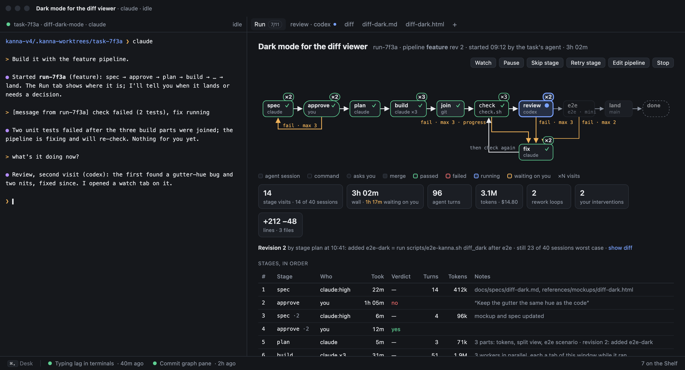
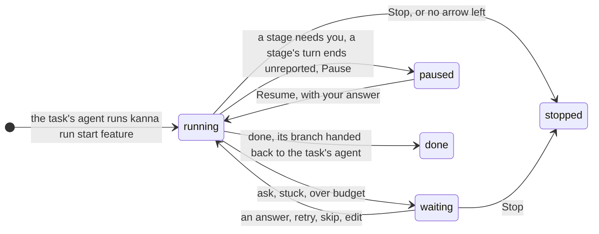
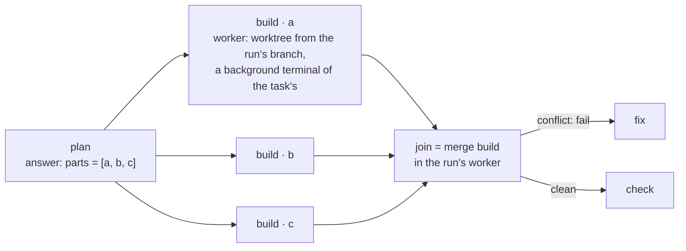
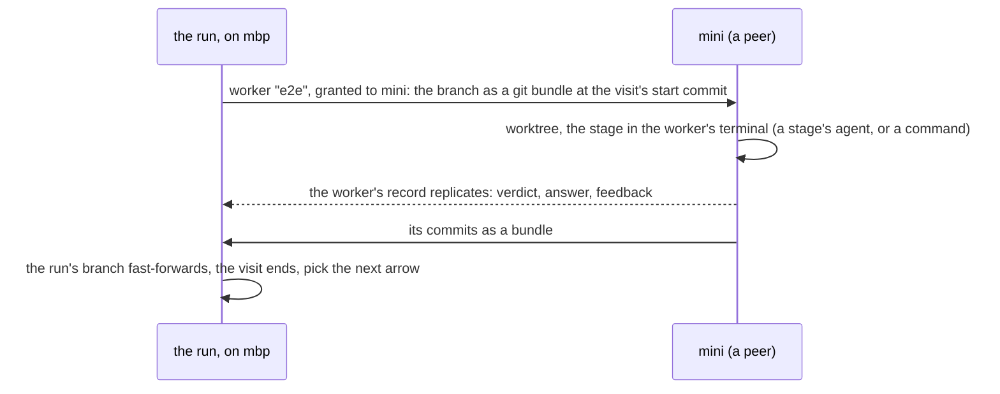
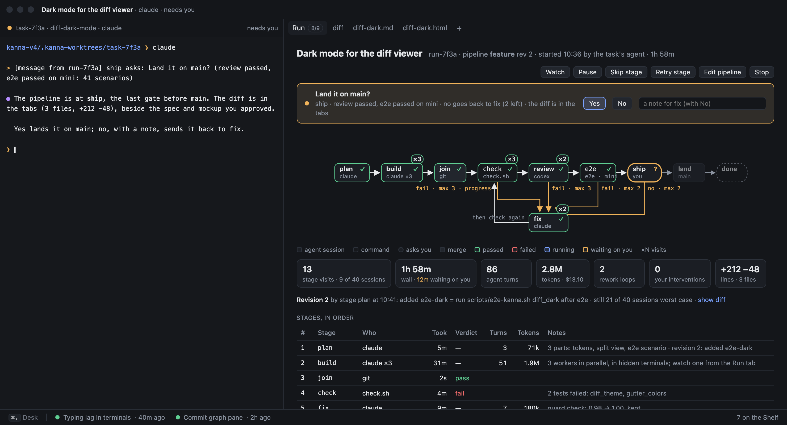
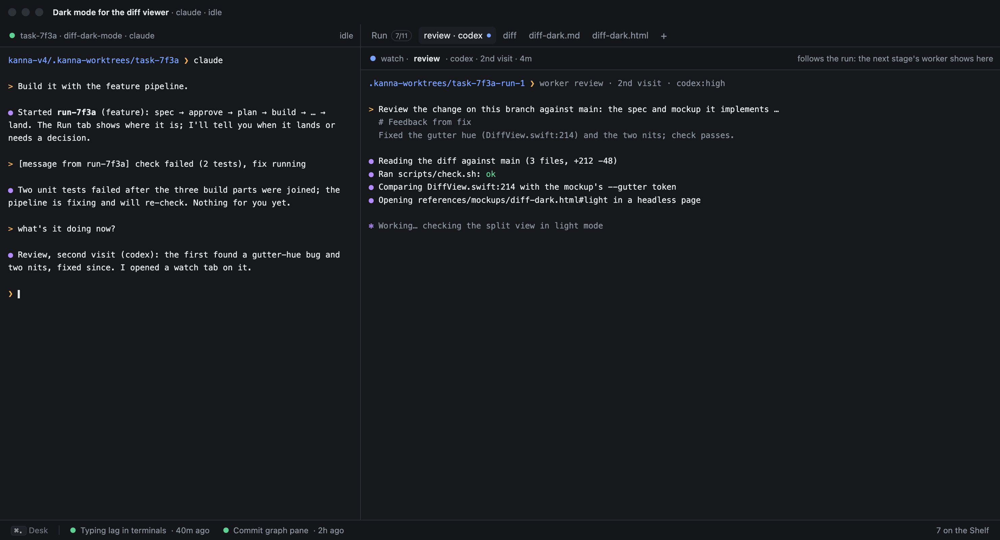
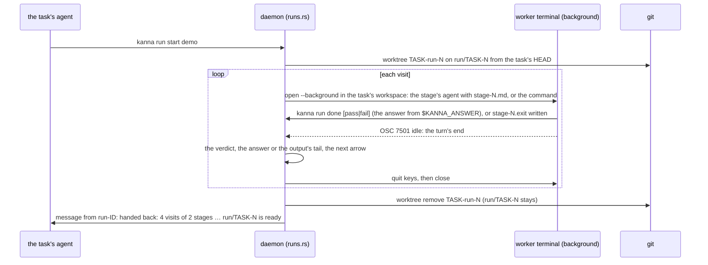
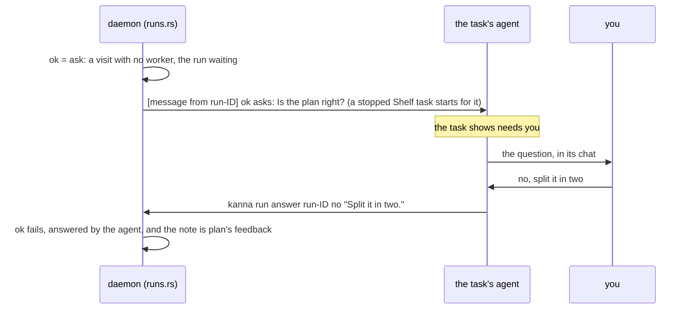

# Software factory

**Status:** sequential runs built ([§6.1](#61-sequential-runs-as-built): agent and `run` stages, loops, `progress`, `reset`, the budget, hand-back; `kanna run start`, `list`, `show`, `log`, `stop`); gates and steering built ([§6.2](#62-gates-and-steering-as-built): `ask`, `kanna run answer`, `pause`, `resume`, `skip`, `retry`, the task stopped and started mid-stage); fan-out, revisions, the Run tab and metrics not yet ([build order](software-factory-build-order.md)) · **Tested:** `cargo test -p kanna-daemon runs::`, e2e `pipeline_run` and `pipeline_gates` · **Mockup:** [`references/mockups/pipeline.html`](../../references/mockups/pipeline.html) (Definition, A run on the Desk, waiting on you, a stage's terminal shown, Runs compared; `#light`) · **Language:** [Kojo](kojo.md) · **Why this design:** [research](../research/software-factory.md) · **Builds on:** [tasks](tasks.md), [Shelf runners](shelf-runners.md), [task scripts](task-scripts.md), [agent messaging](agent-messaging.md), [database](database.md), the Stats tab (task "Stats tab on the Desk") and [code quality metrics](code-quality-metrics.md) (task "Code quality metrics")

A **pipeline** says how an approved change gets built: its stages (plan, build, review, tests), who does each (an agent or code), and where a failure goes (a bounded loop back to a fix). Any task's agent can **run** one; the daemon drives it in the task's background terminals, a **Run** tab shows where it is, and the finished branch is handed back to the task, where you review and merge it. Every stage's numbers and your interventions go in `kanna.db`, to compare and tune pipelines.

## Contents

1. [What a run is](#1-what-a-run-is)
2. [Who drives it](#2-who-drives-it)
3. [Workers, fan-out, join and other machines](#3-workers-fan-out-join-and-other-machines)
4. [Seeing and steering a run](#4-seeing-and-steering-a-run)
5. [Metrics](#5-metrics)
6. [How it's built](#6-how-its-built)
7. [CLI](#7-cli)
8. [Rejected](#8-rejected)
9. [Build tasks](#9-build-tasks)
10. [Glossary](#10-glossary)

## 1. What a run is

- **Agents:** **the task's agent**, the one you talk to, docked in the task ([tasks](tasks.md)), starts and reads runs. Each agent stage runs its own **stage's agent**, a fresh session in a background terminal of the run's, so a run involves any number of them.
- **Starting:** once you approve the spec and mockup in the task's chat ([reference-driven design](../../.claude/skills/reference-driven-design/SKILL.md)), or a bug is understood, the task's agent runs `kanna run start PIPELINE` from its terminal, as the `kanna-tasks` skill says, or when you tell it to. The pipeline starts at the plan, with the spec as input.
- **Request:** what `kanna run start` is given (`--request FILE` or text), else the task's first message; every stage's agent gets it.
- **Run branch:** `run/<task>-N`, from the task's branch at the start, built in workers ([3](#3-workers-fan-out-join-and-other-machines)). The task's worktree and conversation are left alone, so you can keep talking to the task's agent.
- **Hand-back:** at `done` the run tells the task's agent its branch is ready ([6.1](#61-sequential-runs-as-built)); the agent merges it into the task's worktree when you're both happy: your gate. It goes to main from there as any task's work. A run that stops elsewhere keeps its branch and says why.
- **Same task view:** the task looks as it did; the run adds the Run tab ([4](#4-seeing-and-steering-a-run)).
- **Shelf tasks:** a [Shelf runner](shelf-runners.md) stops the task's agent at its turn's end; the run goes on, and its message at the end wakes the task.
- **Closing the task:** Done stops each of the task's live runs and removes their workers ([6.1](#61-sequential-runs-as-built)). `kanna task stop` stops a run's stage with the task and starts no other until the task starts again ([6.2](#62-gates-and-steering-as-built)); `kanna run stop` ends one.
- **Several runs per task:** each with its own branch, workers and budget, messaging as `run-ID`. A run that would exceed its sessions or time waits on you and tells the task's agent.

## 2. Who drives it

- **Daemon owns runs:** it moves a run along the pipeline's arrows; a gate picks the arrow: a stage's verdict (an exit code, a reviewer's `pass` or `fail`), or an `ask`, answered by you or by the task's agent when you've let it (`kanna run answer`).
- **Roles:** the task's agent starts, reads, resumes and stops runs; skip, retry and edit are yours.
- **Stage inputs:** a stage's agent gets only the stage's prompt file, the request, the last failure's feedback, and the earlier stages' named outputs its prompt asks for, as `{{STAGE.KEY}}` ([Kojo §5](kojo.md#5-inputs-and-outputs)).
- **Revisions:** a stage marked `emits` may propose a pipeline change in its answer; the daemon checks it and adopts it as the run's next revision ([Kojo §7](kojo.md#7-changing-a-pipeline-while-it-runs); not built yet).
- **Stage end:** its agent reports done (`kanna run done`), its command exits, you answer, or its `within` passes; `kanna run need` pauses the run. Kanna reads no screen and times no idleness; the agent's own status report (OSC 7501) marks its turn's end, so agent stages take claude or codex ([6.1](#61-sequential-runs-as-built)).
- **Events:** the daemon steps a run on a report, a turn's end, a worker's terminal ending, a visit opening or concluding, or its own start, and otherwise sleeps until the next deadline: a `within`, or 10s for a reported agent to end its turn.
- **Workers:** every visit runs in a worker, here or on a peer; the run sees only its verdict, answer and commits, and records its `machine`.
- **Restarts:** a run's state is its rows. A stage mid-visit carries on in the keeper; one whose terminal is gone is recorded `interrupted` and run again.
- **Concurrency:** one stage at a time per run, except a fan-out's instances.

## 3. Workers, fan-out, join and other machines

- **Worker:** a worktree of the run's (`.kanna-worktrees/<task>-run-N[-item]`) and a background terminal of the task's workspace ([6.1](#61-sequential-runs-as-built)), where a stage's agent, a `run` command (as [setup](task-scripts.md#2-setup)) or a `merge` runs. The first worker carries from stage to stage; `each` and `xN` add one per item or attempt, `pipelines.workers` at once (default 3). Workers count as their task: one row everywhere, one Shelf runner slot.
- **Fan-out (`each STAGE.KEY`):** one worker per item, `STAGE · ITEM`, branched from the run's branch; its agent also gets its item as `# Your part`. One that needs you makes the run wait on you. The next stage waits for every instance.
- **Join (`merge STAGE`):** one merge commit per instance into the run's branch, in item order. A conflict is a `fail` with the conflicting files as feedback, the run's worker left at the conflict. Joined workers' worktrees and branches go; their record stays on the Run tab.
- **Attempts (`xN by STAGE`):** fans out as `STAGE · attempt K`, scores each with the named `run` stage, keeps the winner's branch and records every score.
- **Budget:** each instance is a session; a list longer than the sessions left fails the stage before any worker starts.

- **Other machines (`on PLACEMENT`, [Kojo §3](kojo.md#3-attributes)):** one stage's worker runs on another of your machines, granted as a task is ([tasks across machines](machine-tasks.md)): branch over as a git bundle, result back as the worker's replicated record and a bundle of commits; the run stays put. A command stage needs the repo cloned there, an agent stage the machine signed in ([agent sign-in](agent-sign-in.md)). Its terminal shows in a tab over the link as any remote terminal.
- **Placement:** a name picks that machine, a role (`mac`, `e2e`) any machine declaring it with a free slot, `any` whichever asks first, `here` the run's own. Matching by capability beyond roles is [Kanna Cloud's](kanna-cloud.md#7-directory-and-relays). A stage whose placement is offline waits, and the run says so; `within` bounds the wait.
- **Unit of travel:** a visit, from a commit to a report or exit code, like a task's turn, so the transfer protocol carries it as it is.
- **Until machines are built:** every placement is this machine and `on` with another name fails the check; the remote worker is a Machines task ([build order](software-factory-build-order.md)). First use: `e2e` on a second Mac, away from the dev Kanna.

## 4. Seeing and steering a run

| Waiting on you | A stage's terminal, shown |
|---|---|
|  |  |

- **Run tab:** `kanna open run`, opened by the task's agent when it starts a run: the pipeline graph with each stage's state and visits, the run's numbers and revision, the visits with their verdicts, times, turns and tokens, and the running workers. A visit opens to its answer, output or diff. It offers to show the current stage's terminal, whose tab then follows the run to the next stage.
- **Stage terminals:** `kanna move TERMINAL --tab` shows one in a tab, `--background` puts it back; the run carries on. What you type there is kept as an intervention.
- **Ask:** the task's agent relays it in its chat and runs `kanna run answer`; the Run tab shows a card with **Yes**, **No** and a note (with the Run tab, not built yet). The task shows needs you. Either answer is recorded with who gave it ([6.2](#62-gates-and-steering-as-built)).
- **Buttons:** the CLI's verbs ([7](#7-cli)). **Pause** finishes the current stage and starts no other; **Skip stage** ends the visit as `pass` by you; **Retry stage** runs it again; **Edit pipeline** opens the run's revision in a code pane; **Stop** ends the run. Each is recorded as an intervention.
- **Desk and Shelf:** one row, the task's agent's status; the Run tab's badge (`5/7`) is the run's only sign. `kanna task list` adds `run: review 5/7` after the state.
- **Result:** at hand-back the task's agent presents it ([presenting](presenting.md)): the spec, the diff, the mockup, what it built and what it cost.

## 5. Metrics

Every visit writes a row; everything below is a query over them, shown on the Run tab for one run and on the Stats tab's **Pipelines** section across runs, grouped by pipeline and revision (a pipeline's text hash), so a changed arrow is a new line to compare.

| Per visit | From |
|---|---|
| wall time, time waiting on you; the machine it ran on | the visit's events; its record |
| the stage's agent's turns, tool calls, tokens in, out and cached, cost | its session file at the visit's end (Claude's JSONL `usage`, Codex's `token_count` events); the cost from the stage's agent when it reports one, else the pricing table in the repo's settings |
| verdict, feedback size, review findings by severity, failing tests | the verdict; the review's `findings` block; the command's failure lines |
| commits, files and lines changed | git, between the visit's start and end |
| your interventions | answers (yours or through the task's agent), pauses, skips, retries, edits, what you typed into a stage's terminal |
| guard before and after, rolled back; attempts and the winner | the stage's record |

| Per run | Is |
|---|---|
| time to hand back; active time | started to handed back; the sum of visits |
| sessions, turns, tokens, cost | sums |
| rework loops | visits of any stage beyond its first, by stage |
| review findings; test failures | sums; `run` visits that failed |
| interventions | the sum, by kind |
| outcome | handed back, stopped (why), stuck |
| bugs traced back; changed lines covered; quality delta | from [code quality metrics](code-quality-metrics.md): fix commits on main blamed to the run's commits (SZZ), lines the run changed that a test executes, erosion and verbosity before and after, each sampled later and joined by the run's commits once the task's branch merges |

- **Comparison:** runs, handed-back share, medians of the rest, and a dot per run over time, so a pipeline change shows as a step; a stage's times split by machine. SZZ's noise caveat (F1 about 0.6) shows with its column.
- **For agents:** `kanna run show RUN --json` and `kanna stats pipelines --json` give the same numbers.

## 6. How it's built

- **`crates/kanna-pipe`:** the language, a port of kojo's `factory_spec.py` ([research](../research/software-factory.md#1-kojo); MIT, recorded in `NOTICE`): parse, validate, `pick(stage, verdict, taken, stalled)`, `worst()` for the budget, revisions. Pure, tested on the example files and every error.
- **`runs.rs` in the daemon:** owns runs as `tasks.rs` owns tasks: makes the branch and workers, starts stages, takes reports, picks arrows, joins, hands back, and messages the task's agent ([agent messaging](agent-messaging.md)) ([6.1](#61-sequential-runs-as-built)).
- **Tables** in `kanna.db` ([database](database.md)), the daemon the only writer:

| Table | Columns | Doc |
|---|---|---|
| `runs` | `id` (`run-7f3a1c2e`), `task`, `repo`, `pipeline`, `revision_hash`, `branch`, `state`, `started_at`, `ended_at`, `outcome` | request, budget, counts |
| `run_revisions` | `run`, `n`, `at`, `by` (`file`, `stage:NAME`, `user`), `hash` | the text, the diff |
| `run_stages` | `id`, `run`, `stage`, `visit`, `instance`, `kind`, `agent`, `machine`, `started_at`, `ended_at`, `verdict`, `session`, `terminal`, `worktree`, `branch` | answer path, feedback, tokens, turns, cost, lines, findings, failures, guard, score, interventions |
| `run_events` | `id`, `run`, `at`, `what` (`started`, `stage`, `verdict`, `revision`, `paused`, `resumed`, `answered`, `skipped`, `retried`, `typed`, `stopped`, `handed_back`), `by` | details |

- **Settings:** `pipelines.agents`, the command for each agent a stage names, only in your own `~/.kanna-v4/config.json` (as with `tasks.agent`). In the repo's `.kanna/config.json` ([settings](settings.md)): `pipelines.workers`, a run's workers running at once (default 3), and `pipelines.pricing`, per-model token prices for agents that don't report cost. Pipelines and prompts in a cloned repo run only agents Kanna knows and commands in their worktrees, as `tasks.setup` does.
- **Skill:** `kanna-tasks` says when to start a run, to open the Run tab, relay an `ask` and present the hand-back.
- **App:** draws the Run tab from a `run` message the daemon publishes (the graph from the revision's parsed form, the rows from `run_stages`), and the Stats section from `stats pipelines`.
- **Tests:** `kanna-pipe` unit tests (the two example files, each rule's error); `runs.rs` tests with the mock agent (answer read, arrow picked, loop bounded, guard rolled back, budget stop); e2e `pipeline_run` on a private instance, a two-stage fixture (mock agent, then a command that fails once): docked pane untouched and one Shelf row throughout, hand-back and its message, a worker shown mid-run and put back, Done on a live run stopping it and removing its worker, the Run tab's data, a two-worker fan-out joined, an `ask` answered both ways, a revision emitted and one edited, a daemon restart mid-stage.

### 6.1 Sequential runs, as built

- **Worker terminal:** `open` with `background` and the task's ID as `workspace`; the layout adds it to that workspace's `background` list ([workspaces §1](workspaces.md#1-the-model)), which the saved layout keeps across a restart. It is drawn nowhere and counted in no tab, focus and zoom refuse it, and it is content with no view until shown ([architecture §2](architecture.md#2-what-the-daemon-keeps-what-the-apps-keep)), with agent status, quit keys and resume like any terminal. A Shelf runner's or `kanna task stop`'s hang-up leaves it running; `kanna task stop` has the run stop it ([6.2](#62-gates-and-steering-as-built)). If the task's workspace is gone when a stage opens, the run stops (`can't open a terminal for STAGE: … has no workspace yet`). The run closes it when its visit ends.
- **Closing the task:** `kanna task done` (before teardown) and the task's agent's pane closing call `Runs::task_closed` (a hook `main.rs` sets on `Tasks`): each live run stops (`the task was closed`, outcome `stopped`, no message), its worker closed and its worktree removed (`git worktree remove --force`); the branch stays.
- **Stage's agent:** runs as `export KANNA_TASK=… KANNA_RUN=… KANNA_STAGE=… (the task scripts' variables); AGENT … "$(cat .kanna/tmp/stage-N.md)"` in the worker, built as the task's agent's command is (`agents.prompts`, Codex in its own terminal, `--session-id` for Claude), with `--model` and Codex's `model_reasoning_effort` from the stage line. N counts visits. Prompts are those beside the pipeline at the start, kept with revision 1.
- **Done:** the prompt ends with how: write the answer to `$KANNA_ANSWER` (`.kanna/tmp/answer-N.md`), then `"$KANNA_CLI" run done` (`pass|fail` at a `verdict` stage). The report is stored on the visit's row, so a restart loses nothing; the agent is quit (`Tasks::end_agent`: brought to rest, then `/exit`) at its turn's end, or 10s after. `done` from another terminal, or without a verdict where one is needed, is refused.
- **Need:** `kanna run need TEXT` pauses the run (`STAGE needs: TEXT`) and messages the task's agent what and how to answer. At the turn's end (or 10s on) the agent is quit as a Shelf runner quits one, keeping its session (Claude's as given, Codex's as printed on exit, else the worker's latest). A paused run holds no process.
- **Unreported turn:** pauses the run the same way (`STAGE stopped without reporting`), telling the task's agent with the screen's last lines. The terminal counts every reported turn as it arrives, so a short one is still seen ([agent status](agent-status.md#3-the-report-osc-7501)).
- **Resume:** `kanna run resume [RUN] [TEXT]` restarts the session in a new background terminal (`claude --resume ID`, `codex resume ID`) with TEXT (in `.kanna/tmp/reply-N-K.md`, default `Carry on.`) as its next message. Time paused doesn't count against `within`.
- **Kanna's agents only:** a stage names one of [Kanna's agents](agent-status.md#2-kannas-agents) (`FILE:LINE: unknown agent 'gemini'; use claude, codex, opencode, agy, or run, ask or merge` otherwise). One [too old to report](agent-status.md#2-kannas-agents) is quit when its stage starts, and the run stops with why.
- **Exit without report:** stops the run (`STAGE's agent exited without reporting it was done`). `within` passing resets the worktree to the visit's start and fails it as `timed out` at a `verdict` stage, and stops the run at any other.
- **`run` stage:** under the task scripts' timeout wrapper (`within`, else `tasks.timeout`), output in `.kanna/tmp/stage-N.log`, exit code in `stage-N.exit`, so a daemon restart loses nothing. `KANNA_FEEDBACK` is `feedback-N.txt`, the last failure's full output.
- **Feedback:** goes forward only after a fail that takes an arrow without `reset`; a pass hands nothing on, except an ask's note ([6.2](#62-gates-and-steering-as-built)).
- **Hand-back:** the worker's worktree is removed, the branch stays, and the run is `done` (outcome `handed back`, its `note` the message). The task's agent is told the summary (visits, stages, time, sessions) and how to take it: `git merge --ff-only run/TASK-N`, or `git log HEAD..run/TASK-N` and `git diff HEAD...run/TASK-N` to look first (`[message from run-7f3a] handed back: 14 visits of 7 stages, 3h 02m … run/task-1dfb-1 is ready …`). The task's worktree and branch are untouched.
- **Messages:** `[message from run-ID] …` when the run hands back, is stuck, waits on you or stops by itself, with the permissions of whoever started it. A stopped Shelf task runs for one.
- **Terminal end:** the core announces an exit, a failed start or a close (`on_ended`); a starting daemon checks every live run once, catching what ended while it was down.
- **Events:** add `waiting` and `resumed` to §6's list; a run in `done` is handed back; a lost terminal is a `verdict` of `interrupted`, and the stage runs again.
- **Not built yet,** refused at start by line (`FILE:LINE: STAGE uses each, which runs can't do yet`): `each`, `xN by`, `guard`, `emits`, `resume`, `merge STAGE` and `on` anything but `here`. `edit` comes with them.
- **Mock agent:** e2e points `pipelines.agents.claude` at `tools/mock-agent`. With `KANNA_STAGE` set it runs each `mock: …` line of its prompt, so a fixture writes its answer and runs `kanna run done` or `need`, or neither; resumed, it takes its message as the next prompt. `KANNA_MOCK_REPORTS=1` makes it report by OSC 7501 as claude does.

### 6.2 Gates and steering, as built

- **Ask:** a visit row of kind `ask` with its question, and no worker or session. The run is `waiting` (`ok asks: QUESTION`), and the task's agent is told the question and how to answer. A daemon restart keeps it waiting; `within` fails it as `timed out`.
- **Needs you:** while a run of the task waits on an ask, the task's agent's terminal is marked as waiting on you (`waits_on_you` on the pane), so its status reads needs you unless the agent is working, stopped or not: on the Desk, the Shelf, the app's dots and `kanna task list`. Turn ends and message delivery still see the agent's own status.
- **Answer:** `kanna run answer [RUN] yes|no [NOTE]` passes (yes) or fails (no) the ask; the note is the next stage's feedback whichever the answer, unlike other stages, whose pass hands nothing on. The visit keeps who answered (`by`: `agent` when it comes from the task's agent's terminal, else `user`).
- **Pause:** sets the run pausing: the current stage (or ask) finishes, and the next arrow leaves the run `paused` (`paused by you before NEXT`) instead of starting a stage. Between stages it pauses at once.
- **Resume:** carries on a paused stage in its session, as before; with no stage open it starts the next; on a pausing run it takes the pause back. An ask is answered, not resumed.
- **Skip:** stops the open visit (its agent quit, its command ended, or a paused or asking visit at once), records it `skipped` with who, and takes the arrows as a pass (as no verdict at an agent stage without `verdict`).
- **Retry:** stops the open visit the same way, records it `retried`, and runs the stage again from where its worktree is, with the same feedback; the new visit counts against the budget.
- **Interventions:** `answered`, `paused`, `resumed`, `skipped` and `retried` are run events with who (`user` or `agent`), and counted by kind on the run (`kanna run show`: `interventions: 2 answered, 1 skipped`).
- **Task stopped:** `kanna task stop` holds the task's running or waiting runs (`held`): an agent stage is quit keeping its session (as `need` parks one, marked as the task's), a command stage is ended and recorded `interrupted`, and no stage starts; the run is `paused` (`the task is stopped`), and the task's agent isn't told, since a message would start it. An ask keeps waiting.
- **Task started:** when the task's agent starts again (`kanna task start`, `pick`, or a message waking it), its held runs carry on: a stage parked by the stop resumes in its session with `Carry on.`, a run between stages starts the next. A run you paused stays paused.
- **Shelf runner:** quits only the task's agent, as before; the run goes on, and its next message (an ask, a need, the hand-back) starts the task.

## 7. CLI

| Command | Does |
|---|---|
| `kanna run start PIPELINE [--request FILE\|TEXT]` | Start a run for the task the terminal is in (the task's agent's terminal, or any terminal in its worktree), on a branch from the task's; prints the run's ID |
| `kanna pipeline list` · `kanna pipeline check NAME\|FILE` | The repo's pipelines, with their worst case; validate one, errors as `FILE:LINE: message` |
| `kanna run list [--all]` | The repo's runs: task, state, stage, how far, how long, outcome |
| `kanna run show [RUN] [--json]` | The run: its revision, visits with their numbers, workers |
| `kanna open run [RUN]` | The Run tab |
| `kanna move TERMINAL --tab` · `kanna move TERMINAL --background` | Show a stage's terminal in a tab of the task's workspace; put it back in the background |
| `kanna run answer [RUN] yes\|no [NOTE]` | Answer the waiting `ask`; the note goes to the next stage, and who answered is kept |
| `kanna run done [pass\|fail] [--answer FILE]` | From a stage's worker: the visit is done, with its verdict at a `verdict` stage and its answer (`$KANNA_ANSWER` by default) |
| `kanna run need TEXT` | From a stage's worker: the stage needs something from you; the run pauses and tells the task's agent |
| `kanna run resume [RUN] [TEXT]` | Carry a paused run's stage on: its session resumes with TEXT as its next message |
| `kanna run pause\|skip\|retry\|stop [RUN]` | The Run tab's buttons: pause once the stage ends; end the stage as a pass; run it again; end the run |
| `kanna run edit [RUN]` | The run's current revision in a code pane; saving validates and applies it |
| `kanna run log [RUN]` | The run's events |
| `kanna stats pipelines [--json] [--days N]` | Runs compared by pipeline and revision |

RUN defaults to the task the terminal is in: `show`, `log` and `open run` take its latest run, and `stop`, `resume`, `answer`, `pause`, `skip`, `retry` and `edit` its live run, refusing with the list of them when it has several.

## 8. Rejected

- **A pipeline task** (`kanna task new --pipeline`, docking the current stage; the first design): two kinds of task, no conversation to come back to, and the factory's insides shown as the task.
- **An agent as orchestrator** (a planner calling stages as subagents): the plan in one context window, no steering between stages, every step's cost inside one session.
- **Headless agents** (`claude -p`, `codex exec`, as kojo runs them): nothing to show, no resume, no typing into a stage.
- **Workers as terminals in no workspace** (the first build): linked to the task only by the run's records, so nothing could show one, and closing the task left them running.
- **A watch tab** following the run from worker to worker: a shown stage terminal is an ordinary tab, and the Run tab offers to show the current one.
- **Fan-out instances as Shelf tasks:** one change as many rows, eating `shelf.runners` and Desk places.
- **A remote stage as a command over the link** (`kanna --host mini -- scripts/e2e-kanna.sh`): no terminal to watch, no worktree, nothing to resume, and no way to run an agent stage.
- **A `merge main` stage gated by an `ask`:** the run would land on main from a branch you never had in your worktree.
- **The run fast-forwarding the task's worktree at hand-back** (the first build): it moved the task's branch under the task's agent and had to guess what to do with local changes.
- **YAML or JSON pipelines:** the arrows are the point, and a flow line reads as the diagram; kojo's grammar is proven on 30 factories.
- **A run that rewrites its own file:** revisions come from a declared `emits` stage or from you, validated and bounded ([Kojo §7](kojo.md#7-changing-a-pipeline-while-it-runs)).
- **Test count and pass rate as quality:** all tests must pass to land; the quality columns are the Code quality metrics task's.

## 9. Build tasks

The tasks for the planner, in order, are in [software factory build order](software-factory-build-order.md).

## 10. Glossary

| Term | Meaning |
|---|---|
| **Pipeline** | A `.kojo` file in `.kanna/pipelines/` ([Kojo](kojo.md)) |
| **Run** | The task's agent building one change through a pipeline, from request to handed back |
| **The task's agent** | The agent you talk to, docked in the task: it starts, reads, answers for and stops runs, and takes their branches |
| **A stage's agent** | The agent a stage runs in one of the run's background terminals, for one visit |
| **Stage, visit** | One step of a pipeline; one time it ran |
| **Worker** | A worktree of the run's and a background terminal of its task's, for a stage, a fan-out item, an attempt, or a stage on another machine |
| **Background terminal** | A terminal of a task's workspace in no tab: running, and drawn only when you show it |
| **Run tab** | The run's graph, numbers and log |
| **Revision** | One version of a run's pipeline |
| **Intervention** | Anything you did to a run: an answer, a pause, a skip, a retry, an edit, what you typed into a stage's terminal |
| **Handed back** | The run done, its branch kept and the task's agent told it's ready to merge: the gate before main |
| **Placement** | Where a stage's worker runs (`on`): `here`, `any`, a machine, or a role |
