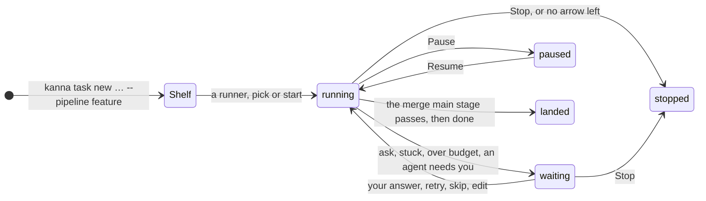
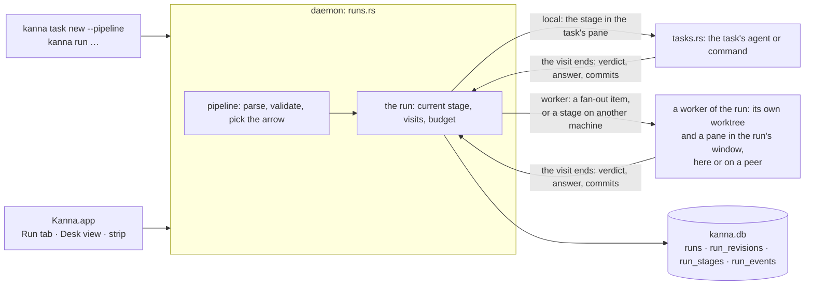
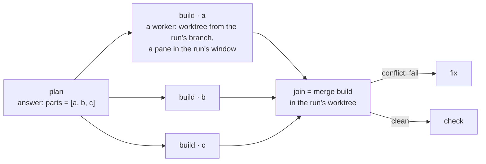
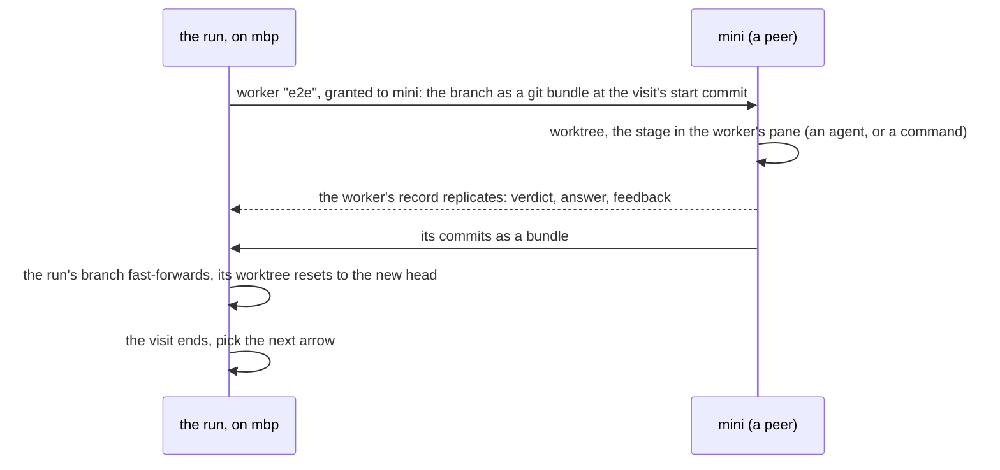

# Software factory

**Status:** designed, not built (the build tasks: [build order](software-factory-build-order.md)) · **Mockup:** [`references/mockups/pipeline.html`](../../references/mockups/pipeline.html) (Definition, A run on the Desk, waiting on you, Runs compared; `#light`) · **Language:** [pipeline language](pipeline-language.md) · **Why this design:** [research](../research/software-factory.md) · **Builds on:** [tasks](tasks.md), [Shelf runners](shelf-runners.md), [task scripts](task-scripts.md), [agent messaging](agent-messaging.md), [database](database.md), the Stats tab (task "Stats tab on the Desk") and [code quality metrics](code-quality-metrics.md) (task "Code quality metrics")

A **pipeline** says how a change gets built: which stages it goes through (spec, your approval, plan, build, review, tests, merge), who does each one (an agent, a command, you, git), and what happens when a stage fails (a bounded loop back to a fix). A task made with a pipeline is a **run**: the daemon drives it, stage by stage, in the task's worktree and docked pane, so you watch and steer it as you would any task. Every stage's time, turns, tokens, verdicts and your interventions are kept in `kanna.db`, so pipelines can be compared on the Stats tab and tuned.

## Contents

1. [What a run is](#1-what-a-run-is)
2. [Who drives it](#2-who-drives-it)
3. [Fan-out, join and other machines](#3-fan-out-join-and-other-machines)
4. [Seeing and steering a run](#4-seeing-and-steering-a-run)
5. [Metrics](#5-metrics)
6. [How it's built](#6-how-its-built)
7. [CLI](#7-cli)
8. [Rejected](#8-rejected)
9. [Build tasks](#9-build-tasks)
10. [Glossary](#10-glossary)

## 1. What a run is

- **A run is a task** ([tasks](tasks.md)) made with `--pipeline NAME`: the same row, worktree, branch, Desk place, Shelf runner, stop and start, messages and Done. What differs is what runs in its docked pane: not one agent for the task's life but **the current stage**, one after another. The task's first message is the run's **request**, given to every agent stage.
- **One run is one task, everywhere tasks show.** The Shelf has one row for it, the Desk one place, the strip one item, `kanna task list` one line, with the stage where the status goes (`build · 3 workers`). Its fanned-out parts and remote stages are **workers** inside the run ([3](#3-fan-out-join-and-other-machines)): worktrees and panes of the run's own, listed on the Run tab, never tasks. Nothing about the factory's insides leaks into the task views.
- **A stage visit runs in the task's pane:** an agent stage starts the agent there with the stage's prompt as its first message, in a fresh session (the pane's command becomes that session's resuming one, so stop and start bring it back, as [which agents resume](tasks.md#which-agents-resume) says); a `run` stage runs its command there, as [setup](task-scripts.md#2-setup) does; an `ask` prints the question there and waits; a `merge` runs git there. The pane's header says the run, the stage, how far along and how long.
- **The turn's end moves the run on.** For an agent stage, the agent's turn ending ([Shelf runners](shelf-runners.md#2-how-its-built): its own report, or idle for 3s) ends the visit: the daemon reads the answer, quits the agent as a runner would, records the visit and picks the next arrow. An agent that stops to ask you makes the run **waiting**; your answer in its pane resumes the stage, and counts as an intervention. On the Shelf, a run keeps its runner from stage to stage; it's stopped only when it waits for you or ends.
- **The budget stops a run** that would exceed its sessions or time before the next stage starts: it waits for you, saying so.
- **A landed run** (its `merge main` stage passed and the flow reached `done`) is Done as a merged task is: teardown, then cleanup ([task scripts](task-scripts.md#3-teardown-and-cleanup)). A run that ends anywhere else stays, stopped, with its branch, for you to pick up by hand: `kanna task start` on it starts a plain agent in the worktree with the run's history as its first message.

## 2. Who drives it

- **The daemon, not an agent.** The planning agent makes runs (`kanna task new … --pipeline`) and reads them (`kanna run list`); it never advances one. No agent sees the whole pipeline but through its stage's prompt and `{{STAGE.KEY}}` ([pipeline language §5](pipeline-language.md#5-inputs-and-outputs)); an `emits` stage proposes a revision that the daemon validates ([pipeline language §7](pipeline-language.md#7-changing-a-pipeline-while-it-runs)).
- **Driven by events, not a clock:** a stage ends when its agent's turn ends, its command exits (the keeper's exit code), you answer, or its `within` passes. The Shelf runners' tick (every 2s) is where a run's next stage is started, so a run that was waiting starts within 2s of your answer.
- **A restart of the daemon loses nothing:** the run's state is the rows; a stage mid-visit carries on (its agent still runs in the keeper's pty; a command too), and a visit whose pane is gone is recorded `interrupted` and run again.
- **Every visit runs through one of two executors,** and the run sees only visits ending: the **local** one, the stage in the task's own pane and worktree; and the **worker**, a worktree of its own branched from the run's with a pane in the run's window, that runs the stage and hands back its verdict, answer and commits. Fan-out uses workers here; a stage placed on another machine ([3](#3-fan-out-join-and-other-machines)) uses the same worker on a peer, so the run's state machine, records and Run tab never depend on where a stage ran. Every visit records its `machine`.
- **One stage at a time per run,** except a fan-out's instances. Several runs run at once as tasks do: `shelf.runners` bounds how many on the Shelf, the Desk's three on the Desk.

## 3. Fan-out, join and other machines

- **`each STAGE.KEY`** makes one **worker** per item, named `STAGE · ITEM`: a worktree branched from the run's branch at that commit (`.kanna-worktrees/<run>-<item>`), and its agent in a pane that is a tab of the run's window, given the stage's prompt, the request and its item as `# Your part`. `pipelines.workers` of a run's workers run at once (default 3; they take no Shelf runner and no Desk place). A worker's turn ending ends its instance; a worker that asks you makes the run wait on you, its tab the one to look at. When the join is done, the workers' panes close and their worktrees go; what they said and did stays on the Run tab.
- **The next stage after a fanned-out one waits for every instance.** `merge STAGE` joins their branches into the run's branch (one merge commit per instance, in item order); a conflict is a `fail` with the conflicting files as feedback, for a `fix` arrow to resolve, and the run's worktree is left at the conflict for it. Joined workers' branches are deleted; an unjoined one's (a stopped run) stays until the run is Done.
- **`xN by STAGE`** fans out the same way (N workers named `STAGE · attempt K`), scores each with the `run` stage named, keeps the winner's branch as the run's and ends the others, recording every score.
- **Budget:** each instance is a session; a list longer than the sessions left is refused before any worker starts, and the stage fails with that as feedback.

- **`on PLACEMENT`** ([pipeline language §3](pipeline-language.md#3-attributes)) sends one stage to another of your machines the same way: a worker granted to that machine as a task is ([tasks across machines](machine-tasks.md)), its branch carried over as a git bundle as a transfer carries one, the stage run there in the worker's pane, and the result back as the worker's replicated record and a bundle of its commits. The worker is a row of the run's, not a task: it shows on no machine's Shelf, and on the peer it has a pane and a worktree and nothing else. A command stage needs only the repo's clone there; an agent stage needs the machine signed in to the agent ([agent sign-in](agent-sign-in.md)). The run itself never moves: its records, Run tab and Desk place stay on its machine, and the stage shows there over the link as any remote task does.
- **The placement is a policy, as the machines spec says:** a name picks that machine, a role (`mac`, `e2e`) any machine declaring it with a free slot, `any` whichever asks first, `here` the run's own. Matching by capability beyond roles is [Kanna Cloud's](kanna-cloud.md#5-directory-and-relays). A stage whose placement is offline waits, and the run says so; `within` bounds the wait.
- **Why a whole stage, never a command over the link:** the machines spec's rule is that a task runs whole on one machine, and the boundary a task may cross is a turn's end. A stage visit is exactly that unit: it starts from a commit and ends at a turn's end or an exit code, so it travels as a worker with the transfer protocol as it is, gets a pane to watch and a worktree of its own there, and comes back as commits.
- **Until machines are built,** every placement resolves to this machine and `on` with any other name fails the check. What's built now is the executor boundary and the `machine` column; the remote executor is a Machines task ([build order](software-factory-build-order.md)). The first use is the one that prompted it: `e2e` on a second Mac, so an e2e run's private Kanna instance never shares a machine with the dev Kanna.

## 4. Seeing and steering a run

| The Run tab, waiting on you | Runs compared on the Stats tab |
|---|---|
|  |  |

- **The Run tab** is a fixed first tab of a run's task (`kanna open run`, opened when the run starts): the pipeline as a graph with each stage's state and visit count, the run's numbers, the current revision, and the stages in the order they ran with their verdicts, times, turns and tokens. Clicking a visit opens what it left: its answer, the command's output, the diff of its commits.
- **Its buttons** are the CLI's verbs ([7](#7-cli)): **Pause** finishes the current stage and starts no other; **Skip stage** ends the current visit as `pass` by you; **Retry stage** runs it again; **Edit pipeline** opens the run's revision in a code pane; **Stop** ends the run where it is. An `ask` shows as a card: **Yes**, **No** with a note. Each is recorded as an intervention.
- **On the Desk** a run is a task: its header says the stage (`review 7/11 · loop 2/3 · 4m`), its dot is the stage's agent's status (needs you while an `ask` waits), the Desk view's row and the strip item say the stage. Workers are tabs of the run's window while they run (`build · tokens`), listed on the Run tab with their state; the Shelf, the strip and the Desk view never show them. Nothing else changes.
- **You can type into the stage's agent** as into any task's; what you type is kept with the visit as an intervention, and a stopped agent's session is the visit's.
- **The agent's own view:** a stage's agent presents its work as any task does ([presenting](presenting.md)); its tabs stay through the next stages, so when the run waits for you the tabs show the latest spec, mockup and diff.

## 5. Metrics

Every visit writes a row; everything below is a query over them, shown on the Run tab for one run and on the Stats tab's **Pipelines** section across runs, grouped by pipeline and revision (a pipeline's text hash), so a changed arrow is a new line to compare.

| Per visit | From |
|---|---|
| wall time, time waiting on you; the machine it ran on | the visit's events; its record |
| agent turns, tool calls, tokens in, out and cached, cost | the agent's session file at the turn's end (Claude's JSONL `usage`, Codex's `token_count` events); the cost from the agent when it reports one, else the pricing table in the repo's settings |
| verdict, feedback size, review findings by severity, failing tests | the verdict; the review's `findings` block; the command's failure lines |
| commits, files and lines changed | git, between the visit's start and end |
| your interventions | answers, pauses, skips, retries, edits, messages, prompts typed into the stage's agent |
| guard before and after, rolled back; attempts and the winner | the stage's record |

| Per run | Is |
|---|---|
| time to land; active time | made to landed; the sum of visits |
| sessions, turns, tokens, cost | sums |
| rework loops | visits of any stage beyond its first, by stage |
| review findings; test failures | sums; `run` visits that failed |
| interventions | the sum, by kind |
| outcome | landed, stopped (why), stuck |
| bugs traced back; changed lines covered; quality delta | from [code quality metrics](code-quality-metrics.md): fix commits on main blamed to the run's merge (SZZ), lines its merge changed that a test executes, erosion and verbosity before and after, each sampled later and joined by the merge commit |

- **Compared by pipeline and revision:** runs, landed share, medians of the rest, and a dot per run over time, so a change to the pipeline shows as a step. A stage's times split by machine, so `e2e` on `mini` and on `here` compare. The Code quality metrics task's noise caveats (SZZ at F1 about 0.6) are shown with the column.
- **`kanna run show RUN --json` and `kanna stats pipelines --json`** give the same numbers to agents, so a planning agent asked "which pipeline lands faster" can answer.

## 6. How it's built

- **`crates/kanna-pipe`:** the language, a port of kojo's `factory_spec.py` ([research](../research/software-factory.md#1-kojo); kojo gets an MIT licence first, and the port's provenance goes in `NOTICE`): parse, validate, `pick(stage, verdict, taken, stalled)`, `worst()` for the budget, revisions (merge an emission or an edit, then validate). Pure, tested on the example files and on every error.
- **`runs.rs` in the daemon** owns runs as `tasks.rs` owns tasks: start a stage in the task's pane (an agent command built as a task's is, with the stage prompt written to `.kanna/tmp/stage-N.md` and passed as the first message; a command under the task-script timeout wrapper), watch for the visit's end, read the answer from the session file, pick the next arrow, start workers, join, land. A worker is a `run_stages` row with a worktree and a terminal, opened as a tab of the run's workspace (held with it on the Shelf, as [presenting](presenting.md#3-how-its-built) holds tabs): no `tasks` row, so the Shelf, the Desk view, the strip, the task limit and `kanna task list` never see it. Workers get the agent-status, turn's-end and quit code terminals already have.
- **Tables** in `kanna.db` ([database](database.md)), the daemon the only writer:

| Table | Columns | Doc |
|---|---|---|
| `runs` | `id` (`run-7f3a1c2e`), `task`, `repo`, `pipeline`, `revision_hash`, `state`, `started_at`, `ended_at`, `outcome` | request, budget, counts |
| `run_revisions` | `run`, `n`, `at`, `by` (`file`, `stage:NAME`, `user`), `hash` | the text, the diff |
| `run_stages` | `id`, `run`, `stage`, `visit`, `instance`, `kind`, `agent`, `machine`, `started_at`, `ended_at`, `verdict`, `session`, `terminal`, `worktree`, `branch` | answer path, feedback, tokens, turns, cost, lines, findings, failures, guard, score, interventions |
| `run_events` | `id`, `run`, `at`, `what` (`started`, `stage`, `verdict`, `revision`, `paused`, `resumed`, `answered`, `skipped`, `retried`, `typed`, `stopped`, `landed`), `by` | details |

- **Settings:** `pipelines.default` (a pipeline every `kanna task new` uses unless `--pipeline none`), `pipelines.workers` (how many of a run's workers run at once, default 3), `pipelines.pricing` (per-model token prices for agents that don't report cost), `tasks.land` (the command that lands a branch when a plain merge isn't the repo's way), in the repo's `.kanna/config.json` ([settings](settings.md)). Pipelines and prompts in a cloned repo run only agents Kanna knows and commands in its worktree, as `tasks.setup` does.
- **The app** draws the Run tab from a `run` message the daemon publishes (the graph from the revision's parsed form, the rows from `run_stages`), and the Stats section from `stats pipelines`.
- **Tested** by `kanna-pipe` unit tests (the parser against the three example files and each rule's error), `runs.rs` tests with the mock agent (a visit's answer read, the arrow picked, a loop bounded, a guard rolled back, a budget stopping a run), and e2e `pipeline_run` on a private instance: a fixture repo with a two-stage pipeline (mock agent, then a command that fails once and then passes), the run landing, its rows and the Run tab's data, a fan-out of two workers joined and the Shelf showing one row throughout, an `ask` answered from the CLI, a revision emitted and one edited, a daemon restart mid-stage.

## 7. CLI

| Command | Does |
|---|---|
| `kanna task new NAME [MSG] --pipeline NAME` | A task that runs the pipeline when it starts (`--pipeline none`: a plain task when `pipelines.default` is set) |
| `kanna pipeline list` · `kanna pipeline check NAME\|FILE` | The repo's pipelines, with their worst case; validate one, errors as `FILE:LINE: message` |
| `kanna run list [--all]` | The repo's runs: state, stage, how far, how long, outcome |
| `kanna run show RUN [--json]` | The run: its revision, visits with their numbers, workers |
| `kanna run answer [RUN] yes\|no [NOTE]` | Answer the waiting `ask` |
| `kanna run pause\|resume\|skip\|retry\|stop [RUN]` | The Run tab's buttons |
| `kanna run edit [RUN]` | The run's current revision in a code pane; saving validates and applies it |
| `kanna run log [RUN]` | The run's events |
| `kanna stats pipelines [--json] [--days N]` | Runs compared by pipeline and revision |

RUN is a run's ID, its task, or the terminal the command runs in.

## 8. Rejected

- **An agent as the orchestrator** (a planner that calls stages as subagents): the plan would live in one context window, the user couldn't see or steer between stages, and every step's cost would be inside one session. The daemon keeps the graph, the records and the gates; agents do stages.
- **Headless agents** (`claude -p`, `codex exec`, as kojo runs them): nothing to watch, no resume, no typing into a stage, no messages. A stage's agent runs in the task's pane like any task's agent, which the rest of Kanna already handles.
- **YAML or JSON pipelines:** the arrows are the point; a flow line reads as the diagram. kojo's grammar is proven on 30 factories.
- **A stage on another machine as a command over the link** (`kanna --host mini -- scripts/e2e-kanna.sh`): no pane to watch, no worktree of its own, nothing to resume, and an agent stage couldn't run that way at all. A worker gives all of that with the transfer protocol already designed.
- **Moving the whole run to a stage's machine:** the Run tab, the records and the Desk place stay put; only the stage travels.
- **A run that rewrites its own file:** revisions by a declared `emits` stage or by you, validated and bounded ([pipeline language §7](pipeline-language.md#7-changing-a-pipeline-while-it-runs)).
- **Fan-out instances as tasks on the Shelf:** one change would show as four rows, eat `shelf.runners` and the Desk's three places, and the parts would outlive the join as things to tidy. A run is one task; its workers are its own, seen on the Run tab.
- **Child runs for fan-out:** one change, one run, one graph and one set of numbers.
- **Test count and pass rate as quality:** all tests must pass to land; the quality columns are the Code quality metrics task's.

## 9. Build tasks

The tasks for the planner, in order, are in [software factory build order](software-factory-build-order.md).

## 10. Glossary

| Term | Meaning |
|---|---|
| **Pipeline** | A `.pipe` file in `.kanna/pipelines/` ([pipeline language](pipeline-language.md)) |
| **Run** | A task that runs a pipeline: one change, from request to landed |
| **Stage, visit** | One step of a pipeline; one time it ran |
| **Worker** | A worktree and pane of the run's own, for one fan-out item, attempt, or a stage on another machine; never a task |
| **Revision** | One version of a run's pipeline |
| **Intervention** | Anything you did to a run: an answer, a pause, a skip, a retry, an edit, a message, a typed prompt |
| **Landed** | The run's branch merged on main by its `merge main` stage |
| **Executor** | How a visit runs: in the task's own pane, or as a worker, here or on another machine |
| **Placement** | Where a stage runs (`on`): `here`, `any`, a machine, or a role |
| **Stuck** | A run with no eligible arrow, waiting for you |
