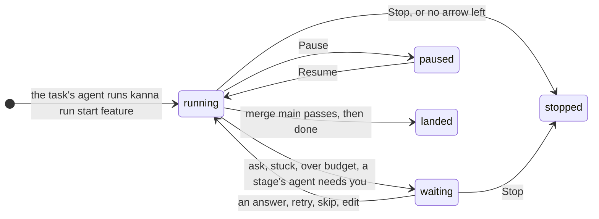
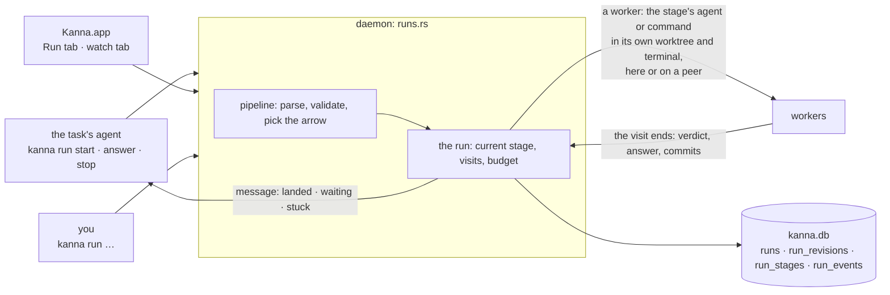
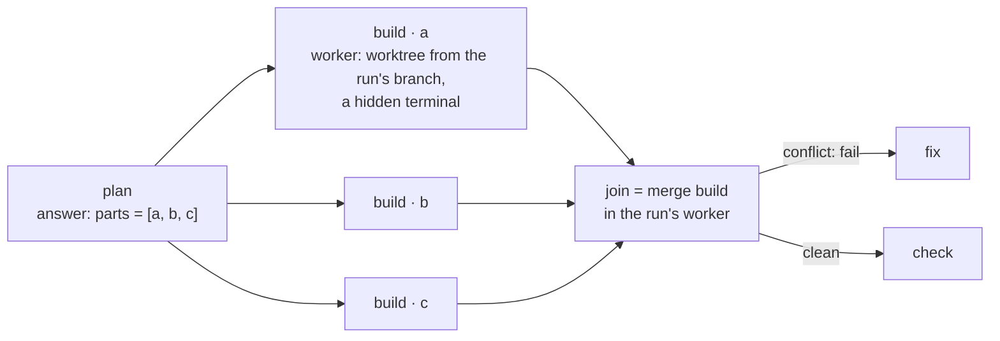
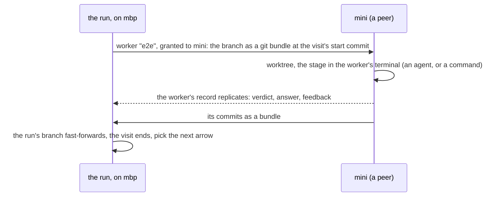

# Software factory

**Status:** designed, not built (the build tasks: [build order](software-factory-build-order.md)) · **Mockup:** [`references/mockups/pipeline.html`](../../references/mockups/pipeline.html) (Definition, A run on the Desk, waiting on you, Watching a stage, Runs compared; `#light`) · **Language:** [pipeline language](pipeline-language.md) · **Why this design:** [research](../research/software-factory.md) · **Builds on:** [tasks](tasks.md), [Shelf runners](shelf-runners.md), [task scripts](task-scripts.md), [agent messaging](agent-messaging.md), [database](database.md), the Stats tab (task "Stats tab on the Desk") and [code quality metrics](code-quality-metrics.md) (task "Code quality metrics")

A **pipeline** says how a change gets built once its spec and mockup are approved: which stages it goes through (plan, build, review, tests, your go-ahead, merge), who does each one (an agent, a command, you, git), and what happens when a stage fails (a bounded loop back to a fix). Any task's agent can **run** one: it stays the agent you talk to, docked on the left with its tabs on the right, and the pipeline builds the software under the hood, in agent sessions and commands you don't see unless you look. The daemon drives the run; a **Run** tab shows where it is; a **watch** tab shows the stage's agent at work. Every stage's time, turns, tokens, verdicts and your interventions are kept in `kanna.db`, so pipelines can be compared on the Stats tab and tuned.

## Contents

1. [What a run is](#1-what-a-run-is)
2. [Who drives it](#2-who-drives-it)
3. [Workers, fan-out, join and other machines](#3-workers-fan-out-join-and-other-machines)
4. [Seeing and steering a run](#4-seeing-and-steering-a-run)
5. [Metrics](#5-metrics)
6. [How it's built](#6-how-its-built)
7. [CLI](#7-cli)
8. [Rejected](#8-rejected)
9. [Build tasks](#9-build-tasks)
10. [Glossary](#10-glossary)

## 1. What a run is

- **Any task, no new kind.** A task is what it is ([tasks](tasks.md)): one agent in one worktree. The spec and mockup are made the way they are now: iterated in the task's chat until you approve them ([reference-driven design](../../.claude/skills/reference-driven-design/SKILL.md)). Then its agent starts a run (`kanna run start PIPELINE`, from its terminal), as the `kanna-tasks` skill says to for an approved spec or an understood bug; you ask the agent for the feature, and the agent builds it through the pipeline, or you tell it to. The pipeline starts at the plan, with the spec as its input; its one question for you is the last gate, before the change lands on main.
- **The task looks the same:** its agent docked on the left, its tabs on the right, its dot its own agent's status. The run adds tabs: the Run tab, and a watch tab when you want one ([4](#4-seeing-and-steering-a-run)).
- **The run works on a branch of its own,** `run/<task>-N`, from the task's branch as it is when the run starts, in **workers**: worktrees and hidden terminals of the run's ([3](#3-workers-fan-out-join-and-other-machines)). The task's worktree and the agent's conversation are left alone while it runs, so you can keep talking to the agent, and nothing two agents do lands in one worktree.
- **The request** is what `kanna run start` is given (`--request FILE` or text), else the task's first message; every agent stage gets it.
- **The run ends by handing back:** when the flow reaches `done`, the task's branch is fast-forwarded to the run's and the task's worktree moved to it (left as it is, with a note, if it has changes), and the task's agent is told as a [message](agent-messaging.md): `[message from run-7f3a] landed: 14 stages, 3h 02m …`. A `merge main` stage lands the change on main first. A run that stops anywhere else keeps its branch for the agent to look at, and says why.
- **A Shelf task's run outlives its agent's turn:** a [Shelf runner](shelf-runners.md) stops the agent when its turn ends, as it does now; the run goes on in its workers, and the message at the end wakes the task as any message does. By the time you move the task to the Desk, the run may have landed.
- **One run at a time per task,** and the budget stops a run that would exceed its sessions or time, as waiting on you.

## 2. Who drives it

- **The daemon, not an agent.** The task's agent starts a run, reads it (`kanna run show`), answers for you when you've told it to, and stops it; it never advances one. No agent sees the whole pipeline but through its stage's prompt and `{{STAGE.KEY}}` ([pipeline language §5](pipeline-language.md#5-inputs-and-outputs)); an `emits` stage proposes a revision that the daemon validates ([pipeline language §7](pipeline-language.md#7-changing-a-pipeline-while-it-runs)).
- **Driven by events, not a clock:** a stage ends when its agent's turn ends ([Shelf runners](shelf-runners.md#2-how-its-built): its own report, or idle for 3s; the daemon then reads the answer and quits the agent as a runner would), its command exits (the keeper's exit code), you answer, or its `within` passes. The runners' tick (every 2s) starts the next stage, so a run that was waiting moves within 2s of your answer.
- **Every visit runs in a worker,** and the run sees only visits ending: its verdict, answer and commits. Where the worker is (here, or a peer) changes nothing in the run's state machine, records or Run tab; every visit records its `machine`.
- **A restart of the daemon loses nothing:** the run's state is the rows; a stage mid-visit carries on (its agent still runs in the keeper's pty; a command too), and a visit whose terminal is gone is recorded `interrupted` and run again.
- **Several runs run at once** as their tasks do; within a run, one stage at a time, except a fan-out's instances.

## 3. Workers, fan-out, join and other machines

- **A worker** is a worktree of the run's (`.kanna-worktrees/<task>-run-N[-item]`) and a terminal in the daemon that nothing shows until you watch it: an agent stage's session runs there with the stage's prompt as its first message; a `run` stage's command runs there as [setup](task-scripts.md#2-setup) runs; a `merge` runs git there. The run's first worker carries from stage to stage; `each` and `xN` add one per item or attempt, `pipelines.workers` of them running at once (default 3). Workers take no Shelf runner, no Desk place and no row anywhere tasks show.
- **`each STAGE.KEY`** makes one worker per item, named `STAGE · ITEM`, branched from the run's branch at that commit, its agent given the stage's prompt, the request and its item as `# Your part`. A worker's turn ending ends its instance; one that asks you makes the run wait on you, its terminal the one to watch. **The next stage waits for every instance.** `merge STAGE` joins their branches into the run's (one merge commit per instance, in item order); a conflict is a `fail` with the conflicting files as feedback for a `fix` arrow, the run's worker left at the conflict. Joined workers' worktrees and branches go; what they said and did stays on the Run tab.
- **`xN by STAGE`** fans out the same way (`STAGE · attempt K`), scores each with the `run` stage named, keeps the winner's branch and ends the others, recording every score. **Budget:** each instance is a session; a list longer than the sessions left is refused before any worker starts, and the stage fails with that as feedback.

- **`on PLACEMENT`** ([pipeline language §3](pipeline-language.md#3-attributes)) runs one stage's worker on another of your machines: granted to that machine as a task is ([tasks across machines](machine-tasks.md)), its branch carried over as a git bundle as a transfer carries one, the stage run there, and the result back as the worker's replicated record and a bundle of its commits. A command stage needs only the repo's clone there; an agent stage needs the machine signed in to the agent ([agent sign-in](agent-sign-in.md)). The run itself never moves, and the worker shows on no machine's Shelf; its watch tab shows it over the link as any remote terminal.
- **The placement is a policy, as the machines spec says:** a name picks that machine, a role (`mac`, `e2e`) any machine declaring it with a free slot, `any` whichever asks first, `here` the run's own. Matching by capability beyond roles is [Kanna Cloud's](kanna-cloud.md#5-directory-and-relays). A stage whose placement is offline waits, and the run says so; `within` bounds the wait.
- **Why a whole stage, never a command over the link:** a task runs whole on one machine and crosses only at a turn's end; a stage visit is exactly that unit, from a commit to a turn's end or an exit code, so it travels as a worker with the transfer protocol as it is.
- **Until machines are built,** every placement resolves to this machine and `on` with any other name fails the check. What's built now is the worker boundary and the `machine` column; the remote worker is a Machines task ([build order](software-factory-build-order.md)). The first use is `e2e` on a second Mac, so an e2e run's private Kanna instance never shares a machine with the dev Kanna.

## 4. Seeing and steering a run

| Waiting on you | Watching a stage |
|---|---|
|  |  |

- **The Run tab** (`kanna open run`, a tab the task's agent opens when it starts a run): the pipeline as a graph with each stage's state and visit count, the run's numbers, the current revision, the stages in the order they ran with their verdicts, times, turns and tokens, and the workers now running. Clicking a visit opens what it left: its answer, the command's output, the diff of its commits.
- **The watch tab** (`kanna open run --watch`, or Watch on the Run tab): a terminal tab showing the current stage's worker as it works, its name the stage's (`review · codex`). It follows the run: when the stage changes it shows the new worker, and between stages it says so. You can type into it as into any agent; what you type is kept with the visit as an intervention. `--watch WORKER` pins one fan-out worker.
- **An `ask` goes two ways:** the task's agent gets it as a message and asks you in its chat, where you answer in words and the agent runs `kanna run answer`; and the Run tab shows a card with **Yes**, **No** and a note. The task shows needs you either way. Which you use is yours; both are recorded as the answer, with who gave it.
- **The Run tab's buttons** are the CLI's verbs ([7](#7-cli)): **Pause** finishes the current stage and starts no other; **Skip stage** ends the current visit as `pass` by you; **Retry stage** runs it again; **Edit pipeline** opens the run's revision in a code pane; **Stop** ends the run where it is. Each is recorded as an intervention.
- **On the Desk and the Shelf nothing changes:** one task, its own agent's status, the Run tab's badge (`5/9`) the only sign. The strip, the Desk view and `kanna task list` show the task as they do now; `kanna task list` adds the run's stage after the state (`idle · run: review 5/9`).
- **The agent you talk to presents the result** as any task does ([presenting](presenting.md)): when the run hands back, it opens the spec, the diff and the mockup, and tells you in its chat what landed and what the run cost.

## 5. Metrics

Every visit writes a row; everything below is a query over them, shown on the Run tab for one run and on the Stats tab's **Pipelines** section across runs, grouped by pipeline and revision (a pipeline's text hash), so a changed arrow is a new line to compare.

| Per visit | From |
|---|---|
| wall time, time waiting on you; the machine it ran on | the visit's events; its record |
| agent turns, tool calls, tokens in, out and cached, cost | the agent's session file at the turn's end (Claude's JSONL `usage`, Codex's `token_count` events); the cost from the agent when it reports one, else the pricing table in the repo's settings |
| verdict, feedback size, review findings by severity, failing tests | the verdict; the review's `findings` block; the command's failure lines |
| commits, files and lines changed | git, between the visit's start and end |
| your interventions | answers (yours or through the agent), pauses, skips, retries, edits, what you typed into a watch tab |
| guard before and after, rolled back; attempts and the winner | the stage's record |

| Per run | Is |
|---|---|
| time to land; active time | started to landed; the sum of visits |
| sessions, turns, tokens, cost | sums |
| rework loops | visits of any stage beyond its first, by stage |
| review findings; test failures | sums; `run` visits that failed |
| interventions | the sum, by kind |
| outcome | landed, stopped (why), stuck |
| bugs traced back; changed lines covered; quality delta | from [code quality metrics](code-quality-metrics.md): fix commits on main blamed to the run's merge (SZZ), lines its merge changed that a test executes, erosion and verbosity before and after, each sampled later and joined by the merge commit |

- **Compared by pipeline and revision:** runs, landed share, medians of the rest, and a dot per run over time, so a change to the pipeline shows as a step. A stage's times split by machine, so `e2e` on `mini` and on `here` compare. The Code quality metrics task's noise caveats (SZZ at F1 about 0.6) are shown with the column.
- **`kanna run show RUN --json` and `kanna stats pipelines --json`** give the same numbers to agents, so the planning agent asked "which pipeline lands faster" can answer.

## 6. How it's built

- **`crates/kanna-pipe`:** the language, a port of kojo's `factory_spec.py` ([research](../research/software-factory.md#1-kojo); kojo is MIT, and `NOTICE` records the port): parse, validate, `pick(stage, verdict, taken, stalled)`, `worst()` for the budget, revisions. Pure, tested on the example files and on every error.
- **`runs.rs` in the daemon** owns runs as `tasks.rs` owns tasks: `kanna run start` from a task's terminal makes the run's branch and first worker; a stage starts in a worker's terminal (an agent command built as a task's is, with the stage prompt written to the worker's `.kanna/tmp/stage-N.md` and passed as the first message; a command under the task-script timeout wrapper), the daemon watches for the visit's end, reads the answer from the session file, picks the next arrow, starts workers, joins, lands, hands back, and messages the task's agent through [agent messaging](agent-messaging.md) with the run as the sender.
- **A worker's terminal is a plain daemon terminal** with no pane: content without a view ([architecture §2](architecture.md#2-what-the-daemon-keeps-what-the-apps-keep)), so it has agent status, a turn's end, quit keys and resume like any terminal, and nothing draws it. The watch tab is a pane that views it; when the stage changes, the daemon points the pane at the new worker's terminal. Workers' terminals are stopped and started with the run's task.
- **Tables** in `kanna.db` ([database](database.md)), the daemon the only writer:

| Table | Columns | Doc |
|---|---|---|
| `runs` | `id` (`run-7f3a1c2e`), `task`, `repo`, `pipeline`, `revision_hash`, `branch`, `state`, `started_at`, `ended_at`, `outcome` | request, budget, counts |
| `run_revisions` | `run`, `n`, `at`, `by` (`file`, `stage:NAME`, `user`), `hash` | the text, the diff |
| `run_stages` | `id`, `run`, `stage`, `visit`, `instance`, `kind`, `agent`, `machine`, `started_at`, `ended_at`, `verdict`, `session`, `terminal`, `worktree`, `branch` | answer path, feedback, tokens, turns, cost, lines, findings, failures, guard, score, interventions |
| `run_events` | `id`, `run`, `at`, `what` (`started`, `stage`, `verdict`, `revision`, `paused`, `resumed`, `answered`, `skipped`, `retried`, `typed`, `stopped`, `landed`, `handed_back`), `by` | details |

- **Settings:** `pipelines.workers` (how many of a run's workers run at once, default 3), `pipelines.pricing` (per-model token prices for agents that don't report cost), `tasks.land` (the command that lands a branch when a plain merge isn't the repo's way), in the repo's `.kanna/config.json` ([settings](settings.md)). Pipelines and prompts in a cloned repo run only agents Kanna knows and commands in their worktrees, as `tasks.setup` does.
- **The skill:** `kanna-tasks` gets a section on building with the pipeline: start one once the spec and mockup are approved (or the bug reproduced), never before; open the Run tab; relay an `ask`; present what landed.
- **The app** draws the Run tab from a `run` message the daemon publishes (the graph from the revision's parsed form, the rows from `run_stages`), and the Stats section from `stats pipelines`.
- **Tested** by `kanna-pipe` unit tests (the parser against the two example files and each rule's error), `runs.rs` tests with the mock agent (a visit's answer read, the arrow picked, a loop bounded, a guard rolled back, a budget stopping a run), and e2e `pipeline_run` on a private instance: a fixture repo with a two-stage pipeline (mock agent, then a command that fails once and then passes), started from a task's terminal, the task's docked pane untouched and the Shelf showing one row throughout, the run landing and handing back, the message to the task's agent, the Run tab's data and a watch tab following a stage change, a fan-out of two workers joined, an `ask` answered from the CLI and through the agent, a revision emitted and one edited, a daemon restart mid-stage.

## 7. CLI

| Command | Does |
|---|---|
| `kanna run start PIPELINE [--request FILE\|TEXT]` | Start a run for the task the terminal is in, on a branch from the task's; prints the run's ID |
| `kanna pipeline list` · `kanna pipeline check NAME\|FILE` | The repo's pipelines, with their worst case; validate one, errors as `FILE:LINE: message` |
| `kanna run list [--all]` | The repo's runs: task, state, stage, how far, how long, outcome |
| `kanna run show [RUN] [--json]` | The run: its revision, visits with their numbers, workers |
| `kanna open run [RUN] [--watch [WORKER]]` | The Run tab; with `--watch`, a terminal tab showing the current stage's worker |
| `kanna run answer [RUN] yes\|no [NOTE]` | Answer the waiting `ask` |
| `kanna run pause\|resume\|skip\|retry\|stop [RUN]` | The Run tab's buttons |
| `kanna run edit [RUN]` | The run's current revision in a code pane; saving validates and applies it |
| `kanna run log [RUN]` | The run's events |
| `kanna stats pipelines [--json] [--days N]` | Runs compared by pipeline and revision |

RUN defaults to the run of the task the terminal is in.

## 8. Rejected

- **A pipeline task (`kanna task new --pipeline`) whose docked pane is the current stage:** the first design. It made two kinds of task, replaced the agent you talk to at every stage so there was no conversation to come back to, and showed the factory's insides as the task. The task's own agent using the pipeline keeps one kind of task, one conversation, and the factory behind a tab.
- **An agent as the orchestrator** (a planner that calls stages as subagents): the plan would live in one context window, nothing could be steered between stages, and every step's cost would be inside one session. The daemon keeps the graph, the records and the gates; agents do stages.
- **Headless agents** (`claude -p`, `codex exec`, as kojo runs them): nothing to watch, no resume, no typing into a stage. A worker is an interactive session in a daemon terminal, which the rest of Kanna already handles; only its pane is optional.
- **Fan-out instances as tasks on the Shelf:** one change would show as four rows, eat `shelf.runners` and the Desk's three places, and leave parts to tidy after the join.
- **A stage on another machine as a command over the link** (`kanna --host mini -- scripts/e2e-kanna.sh`): no terminal to watch, no worktree of its own, nothing to resume, and an agent stage couldn't run that way at all.
- **YAML or JSON pipelines:** the arrows are the point; a flow line reads as the diagram. kojo's grammar is proven on 30 factories.
- **A run that rewrites its own file:** revisions by a declared `emits` stage or by you, validated and bounded ([pipeline language §7](pipeline-language.md#7-changing-a-pipeline-while-it-runs)).
- **Test count and pass rate as quality:** all tests must pass to land; the quality columns are the Code quality metrics task's.

## 9. Build tasks

The tasks for the planner, in order, are in [software factory build order](software-factory-build-order.md).

## 10. Glossary

| Term | Meaning |
|---|---|
| **Pipeline** | A `.pipe` file in `.kanna/pipelines/` ([pipeline language](pipeline-language.md)) |
| **Run** | A task's agent building one change through a pipeline, from request to handed back |
| **Stage, visit** | One step of a pipeline; one time it ran |
| **Worker** | A worktree and hidden terminal of the run's, for a stage, a fan-out item, an attempt, or a stage on another machine; never a task |
| **Run tab, watch tab** | The run's graph, numbers and log; a terminal tab showing the current stage's worker |
| **Revision** | One version of a run's pipeline |
| **Intervention** | Anything you did to a run: an answer, a pause, a skip, a retry, an edit, what you typed into a watch tab |
| **Handed back** | The task's branch fast-forwarded to the run's, and its agent told |
| **Landed** | The run's branch merged on main by its `merge main` stage |
| **Placement** | Where a stage's worker runs (`on`): `here`, `any`, a machine, or a role |
