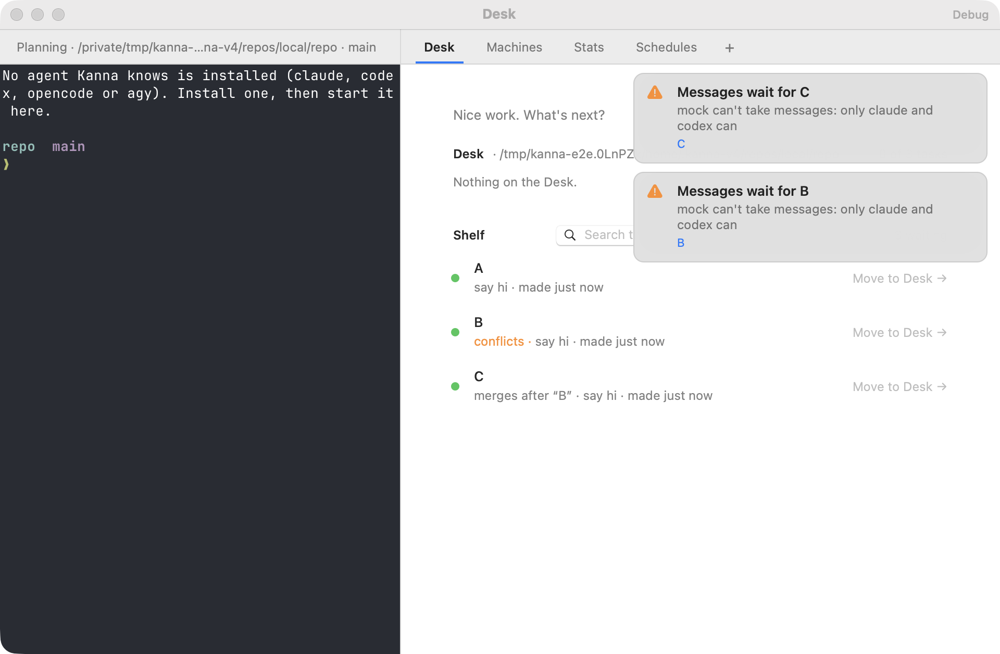
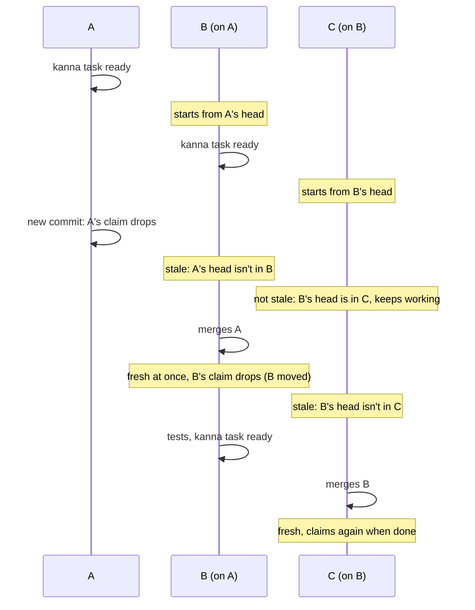
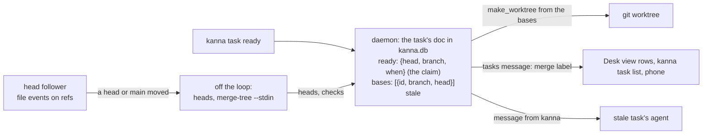

# Stacked tasks

**Status:** built · **Tested:** e2e `stacked_tasks`, daemon `tasks.rs` and `stacks.rs` tests · **Mockup:** [`references/mockups/ready-to-merge.html`](../../references/mockups/ready-to-merge.html) · **Builds on:** [blocked tasks](task-dependencies.md), [messages](agent-messaging.md)

A task is **ready** when the only thing left is to merge it: its agent says its work is finished at this commit, and Kanna sees it merges into main cleanly right now. A blocked task can start building on its blockers' claimed work without waiting for it to merge: its branch starts from theirs, it's **stacked** on them, and it **merges after** them. When a base moves on to a commit this branch doesn't have, the task is **stale** until it merges it.

- [Ready](#ready)
- [Starting stacked](#starting-stacked)
- [Stale](#stale)
- [Merging](#merging)
- [CLI](#cli)
- [How it's built](#how-its-built)

## Ready

Ready is for picking tasks for the Desk that need nothing but a quick merge. A row shows `ready` only while all three hold:

1. **Its agent claimed it at this exact commit:** `kanna task ready`, which the agent runs itself as soon as the work is finished, committed and its tests pass, before presenting it. The user's review, or their choosing when to merge, doesn't hold it up; waiting on the user for an answer to the agent's question, or for a check only they can make (a real device), does.
2. **It merges into main cleanly now,** checked by Kanna, again whenever main or the branch moves. A task behind main with no conflict is still ready: its agent runs the tests when it merges.
3. **It doesn't wait for another task to merge first:** it isn't stacked on unmerged work.

| Row | When |
|---|---|
| `ready` | claimed at its head, merges cleanly, no bases |
| `conflicts` | claimed at its head, no bases, but merging it into main conflicts. Tasks stacked on it keep going |
| `merges after "A"` | stacked on A, whose work isn't in main yet, claimed or not |
| `stale · behind "A"` | A's head isn't in this branch |
| nothing | not claimed, or claimed at a commit it has since moved on from, or not checked yet |

- **The claim records the task's head:** the commit its worktree is on. Refused with uncommitted changes to tracked files (they wouldn't reach the tasks stacked on it), for a task that hasn't started, and while a base's head isn't in the branch.
- **The claim drops by itself when its branch moves:** a new commit, a merge of main, a rebase. Kanna follows every claimed task's head through file events on the repo's refs. There's nothing to clear by hand.
- **After a conflict is fixed** the branch has moved, so the claim is gone; the agent claims again.
- **Rows don't say how far behind main a task is:** being behind doesn't stop a quick merge.
- **Shown** in `kanna task list` (STATE `ready`, `conflicts` or `stale`; last part `merges after "A"` or `behind "A"`), in `--json` (`merge`: `ready`, `conflicts`, `after`, `stale` or null; `ready`: true only for `ready`; `claim`: the claim's head, branch and when; `mainConflicts`: the files), on the task's row in the Desk view, and on the phone's Shelf.

## Starting stacked

A blocked task can start once each blocker is claimed and not stale, or Done; Shelf runners pick it up as usual. A blocker showing `conflicts` still counts: its claim stands, and the conflict is with main, not with the work stacked on it. Its worktree starts from:

| Blockers whose work isn't in main yet | Its branch starts from |
|---|---|
| none | main, as before |
| one | that blocker's claimed head |
| several | main, with each one's claimed head merged in |

- **Its bases** are the blockers it was built on whose work isn't in main yet. A blocker Done but not merged (a branch waiting on review) is a base too, if it was claimed when it was Done.
- **A blocker whose claim drops** (its branch moved) or that goes stale blocks again every task on it that hasn't started: Shelf runners skip it until the blocker is claimed again and not stale. A task that has started isn't stopped; it goes stale once the blocker's head isn't in its branch.
- **If the merges conflict,** nothing is left behind (worktree and branch are removed) and the task stays blocked, saying so: `blocked  its blockers' branches conflict`. It tries again when one of them is claimed at a new head.

## Stale

Stale is computed, never recorded by hand: a task is stale while the current head of one of its bases isn't in its branch. Merging the base clears it at once; the task is then simply not ready until its agent claims again.

- **Stale doesn't pass down a chain.** C is stale only when B's head isn't in C, not because B is. C can keep going, and won't start before B is claimed and fresh if it hasn't started yet.
- **A task that goes stale gets a message** ([`base-moved`](task-events.md)) from `kanna` naming the base that moved and what to do: merge it (`git merge COMMIT`), rerun the tests, `kanna task ready`. It's told once per base that moves; a base claimed again at a new commit tells it once more.
- **The claim is refused while stale:** `"A" isn't in this branch yet: merge it first (git merge COMMIT), rerun the tests, then run kanna task ready`.
- **Stale and claimed can hold together** (the base moved, this branch didn't): the row says `stale`, and the claim counts again once the base is merged in, which moves the branch and so drops it.
- **Shown** as `stale` in `kanna task list` (with what it's behind), `"merge": "stale"` and `"stale"` in `--json`, and on the row in the Desk view and on the phone.

## Merging

A stacked task shouldn't merge into main before its bases have. `kanna task merge` refuses it ([merge queue](merge-queue.md#2-merging-a-task)), and Kanna shows it:

- **`kanna task list`** says `merges after "A"` on a stacked task whose bases aren't in main, `--json` gives them as `"bases"` and `"merge": "after"`, and the Desk view's row and the phone show it. It's never `ready`, claimed or not.
- **The `kanna-tasks` skill** tells an agent not to merge its branch while `kanna task list` says it merges after another task.
- **Once a base merges into main,** Kanna drops it from the task's bases and tells the task ([`base-merged`](task-events.md)) that nothing it builds on is outside main any more, so it can merge once it's done. With no bases left it's an ordinary task: its row shows `ready` once it's claimed and merges cleanly.

## CLI

| Command | Does |
|---|---|
| `kanna task ready [TASK]` | Claim a started task's work finished at its head: all that's left is to merge. From its own terminal, TASK is that task. Says what the row shows: `ready`, `conflicts` with the files, `merges after`, or that the check hasn't run yet |
| `kanna task ready set`, `kanna task ready clear` | Gone: an error says to use `kanna task ready [TASK]` |
| `kanna task list` | STATE `ready`, `conflicts` or `stale`; last part `merges after "A"`, or `behind "A"` for a stale task |
| `kanna task start`, `pick` | Refused while a blocker is neither claimed and fresh nor Done, as before |

## How it's built

- **Kept in the task's row** in `kanna.db`, in its JSON doc, as `after` is: the claim under the key `ready` (head, branch, when), `bases` (each base's task ID, branch and the head this task has merged), `stale` (the bases whose head isn't in the branch). Events: `ready` (claimed), `unready` (`why`: `moved`), `stale` (with `behind`), `fresh`, `base merged`, `conflict`.
- **The label is worked out, not stored:** `stale` if any base's head is missing, else `after` if it has bases, else, if the claim's head is the tip the last check saw, `ready` or `conflicts`. The daemon puts it in the `tasks` message as `merge`, so the CLI, the Desk view and the phone read one answer.
- **A blocker is satisfied** when it's Done, or open, claimed and not stale. `waits` in the `tasks` message lists those that aren't.
- **Kanna follows the heads, it doesn't poll them.** For each repo with a started task ([task events](task-events.md) need it for main), a thread watches the repo's git folder for file events (FSEvents) and wakes the daemon only when a head can have moved: a branch under `refs/heads`, `packed-refs`, a worktree's `HEAD` or the main checkout's `HEAD`. Objects, logs, indexes and locks are ignored, and events within 200ms are taken together. Then, off the main thread, it reads each claimed, stacked or stale task's head once (its worktree's `HEAD`, or its branch once Done), so a task and the tasks stacked on it see the same head, and reads whether each base's head is in main and in the task's branch, and the daemon's loop applies it: a claimed task whose head moved loses its claim; the bases whose head isn't in the branch are its stale set (empty: fresh); a base in main is dropped. It also looks once when it starts following a repo (so at the daemon's start), and whenever FSEvents dropped events and asks for a rescan.
- **Merges for several bases** run in the new worktree, one `git merge` per base; on a conflict the merge is aborted and the worktree and branch removed.
- **Main** is the repo's main checkout's `HEAD`, as for `merged`. Squash and rebase merges hide a base's head from main: such a base stays, and the task says `merges after`, until the base is taken off with `kanna task edit`.

### The conflict check

Every unmerged task with a worktree is checked against main, claimed or not and stacked ones too, so a claim shows its answer at once and a stacked task shows `ready` the moment its last base lands, with no ref of its own moving. The check runs in the same look, off the loop, on any ref move:

1. `git worktree list --porcelain`: every task's tip in one process.
2. `git for-each-ref --merged=MAIN refs/heads`: the merged tips, which drop out.
3. Only the tasks whose (main, tip) pair differs from the last check go on, all in one `git merge-tree --stdin --name-only --no-messages -z`, one line `MAIN TIP` each.

- **Its cost**, measured on a scratch clone with 80 unmerged branches: one `merge-tree` per task took 57ms each, 4.6s in all; one `--stdin` process for all 80 took 1.6 to 2.8s. That's what a move of main costs; a commit on one task checks that one. The first two steps take 10 to 20ms each.
- **It writes nothing to the repo.** `merge-tree` writes the merged trees as objects (about 1,400 objects, 15MB, for 80 tasks), so it runs with `GIT_OBJECT_DIRECTORY` set to a throwaway folder and the repo's objects as an alternate, and the folder is removed afterwards.
- **Rows read the cache:** the last check per task, kept in the daemon's memory, so drawing the Desk view or `kanna task list` runs no git. Until a task's first check after the daemon starts, its row shows nothing.
- **Off the main path:** the look runs in `runtime::off_loop` as before ([the 20ms rule](daemon-runtime.md#2-rules)), and a move during a check runs another afterwards. The `main-conflicts` event reuses the batch's answer for a task whose tip matches, so it adds no second `merge-tree`.

## Rejected

- **Polling the heads:** most looks would find nothing moved, each costing a few `git` processes per task; file events cost nothing until a ref is written.
- **Ready guessed from an idle agent or green CI:** an agent stops for many reasons; only the agent knows its work is finished.
- **Rebasing stacked tasks onto their moved base for them:** a conflicted rebase in an agent's worktree is the agent's to resolve; Kanna tells it, the agent merges.
- **Refusing `git merge` with a hook:** Kanna would write into every repo's hooks and run on every ref update; showing `merges after` is enough while merges go through agents that read it.
- **`ready set` and `ready clear` kept beside `ready`:** a claim that drops by itself when the branch moves has nothing left to clear, and two ways to say ready meant one was recorded and never rechecked.
- **Ready recorded once, as before:** it went wrong whenever main moved or a stacked task was claimed early (12 of 80 tasks said ready while one was stacked). The claim stays recorded; the label is worked out each time.
- **Showing how far behind main a task is:** a task behind main with no conflict needs only a quick merge, which is what ready means; the number was noise on every row.
- **Kanna running the tests itself:** out of scope here; the agent runs them when it merges.
- **One `merge-tree` per task:** about twice as slow as one `--stdin` process on 80 tasks.
- **Stale passed down a chain:** C is told about B only when B's new head is missing from C, which is when C has something to merge.
