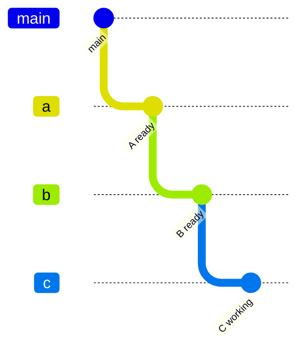
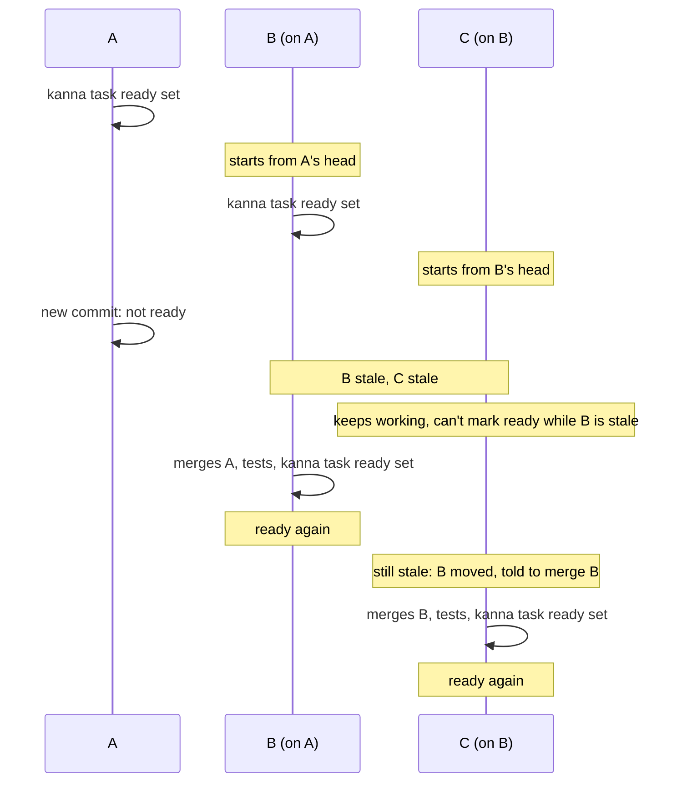
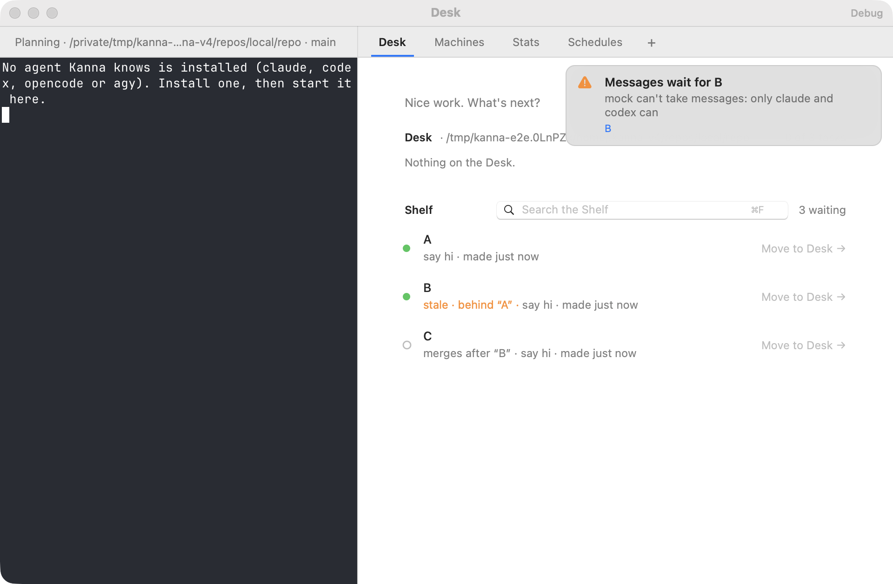
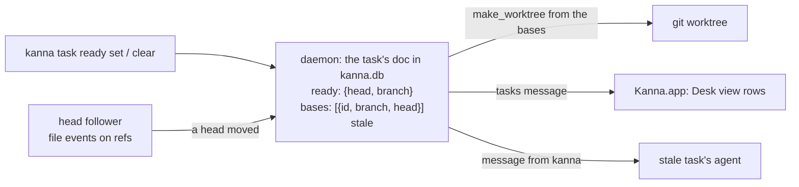

# Stacked tasks

**Status:** built · **Tested:** e2e `stacked_tasks` · **Builds on:** [blocked tasks](task-dependencies.md), [messages](agent-messaging.md)

A blocked task can start building on its blockers' work once that work is **ready** (built, its tests passing), without waiting for it to merge into main and be Done. Its branch starts from theirs: it's **stacked** on them. When a blocker's branch changes after it was ready, everything stacked on it is **stale** until it catches up.

- [Ready](#ready)
- [Starting stacked](#starting-stacked)
- [Stale](#stale)
- [Merging](#merging)
- [CLI](#cli)
- [How it's built](#how-its-built)

## Ready

A task's agent marks its own work ready once it's finished and its tests pass: `kanna task ready set`. You can mark or clear it too (`kanna task ready set TASK`, `kanna task ready clear TASK`). Kanna never guesses it from the agent's status or from git.

- **Ready records the task's head:** the commit its worktree is on. Refused with uncommitted changes to tracked files (they wouldn't reach the tasks stacked on it), and for a task that hasn't started.
- **It stops being ready when its branch moves:** a new commit, a merge of main, a rebase. Kanna follows every ready task's head through file events on the repo's refs.
- **Shown** as `ready` in `kanna task list`, `"ready"` in `--json`, and on the task's row in the Desk view.

## Starting stacked

A blocked task can start once each blocker is ready or Done; Shelf runners pick it up as usual. Its worktree starts from:

| Blockers whose work isn't in main yet | Its branch starts from |
|---|---|
| none | main, as before |
| one | that blocker's ready head |
| several | main, with each one's ready head merged in |

- **Its bases** are the blockers it was built on whose work isn't in main yet. A blocker Done but not merged (a branch waiting on review) is a base too, if it was ready when it was Done.
- **A blocker that stops being ready** (its branch moved, it went stale, or it was cleared) blocks again every task on it that hasn't started: Shelf runners skip it until the blocker is ready again. A task that has started isn't stopped; it goes stale.
- **If the merges conflict,** nothing is left behind (worktree and branch are removed) and the task stays blocked, saying so: `blocked  its blockers' branches conflict`. It tries again when one of them is marked ready at a new head.

## Stale

When a ready task's branch moves, it stops being ready, and every task stacked on it is marked stale, transitively down the chain. A stale task isn't ready either.

- **A stale task gets a message** from `kanna` saying which base moved and what to do: merge its branch, rerun the tests, `kanna task ready set`. A task stale only because its base is stale is told to wait, and gets another message once that base is ready again.
- **Staleness clears only with `kanna task ready set`,** which is refused while a base's head isn't in the task's branch (`"A" isn't in this branch yet: merge it first (git merge COMMIT)…`) or while a base is stale itself. So C can't clear its staleness before B has cleared its own.
- **Shown** as `stale` in `kanna task list` (with what it's behind), `"stale"` in `--json`, and on the row in the Desk view.

## Merging

A stacked task shouldn't merge into main before its bases have. Kanna doesn't merge branches, so it shows this rather than refusing a `git merge`:

- **`kanna task list`** says `merges after "A"` on a stacked task whose bases aren't in main, `--json` gives them as `"bases"`, and the Desk view's row shows it.
- **The `kanna-tasks` skill** tells an agent not to merge its branch while `kanna task list` says it merges after another task.
- **Once a base merges into main,** Kanna drops it from the task's bases and sends the task a message to merge main. With no bases left it's an ordinary task again.

## CLI

| Command | Does |
|---|---|
| `kanna task ready set [TASK]` | Mark a started task's work ready at its head; from its own terminal, TASK is that task |
| `kanna task ready clear [TASK]` | Clear it; tasks already stacked on it aren't affected |
| `kanna task list` | STATE `ready` or `stale`; last part `merges after "A"`, or `behind "A"` for a stale task |
| `kanna task start`, `pick` | Refused while a blocker is neither ready nor Done, as before |

## How it's built

- **Kept in the task's row** in `kanna.db`, in its JSON doc, as `after` is: `ready` (head, branch, when), `bases` (each base's task ID, branch and the head this task has merged), `stale`. Events: `ready`, `unready` (with `why`: `cleared` or `moved`), `stale` (with `behind`), `base merged`, `conflict`.
- **A blocker is satisfied** when it's Done, or open, ready and not stale. `waits` in the `tasks` message lists those that aren't.
- **Kanna follows the heads, it doesn't poll them.** For each repo with a task that's ready or stacked, a thread watches the repo's git folder for file events (FSEvents) and wakes the daemon only when a head can have moved: a branch under `refs/heads`, `packed-refs`, a worktree's `HEAD` or the main checkout's `HEAD`. Objects, logs, indexes and locks are ignored, and events within 200ms are taken together. Then, off the main thread, it reads each such task's head (its worktree's `HEAD`, or its branch once Done) and whether each base's head is in main and in the task's branch, and the daemon's loop applies it: a ready task whose head moved becomes unready; a task with a base not in its branch, or with a stale base, becomes stale (and unready); a base in main is dropped. It also looks once when it starts following a repo (so at the daemon's start), and whenever FSEvents dropped events and asks for a rescan.
- **Merges for several bases** run in the new worktree, one `git merge` per base; on a conflict the merge is aborted and the worktree and branch removed.
- **Main** is the repo's main checkout's `HEAD`, as for `merged`. Squash and rebase merges hide a base's head from main: such a base stays until its task is taken off with `kanna task edit` or the user marks the task ready on a main that contains its changes.

## Rejected

- **Polling the heads:** most looks would find nothing moved, each costing a few `git` processes per task; file events cost nothing until a ref is written.
- **Ready guessed from an idle agent or green CI:** an agent stops for many reasons; only the agent knows its work is finished.
- **Rebasing stacked tasks onto their moved base for them:** a conflicted rebase in an agent's worktree is the agent's to resolve; Kanna tells it, the agent merges.
- **Refusing `git merge` with a hook:** Kanna would write into every repo's hooks and run on every ref update; showing `merges after` is enough while merges go through agents that read it.
