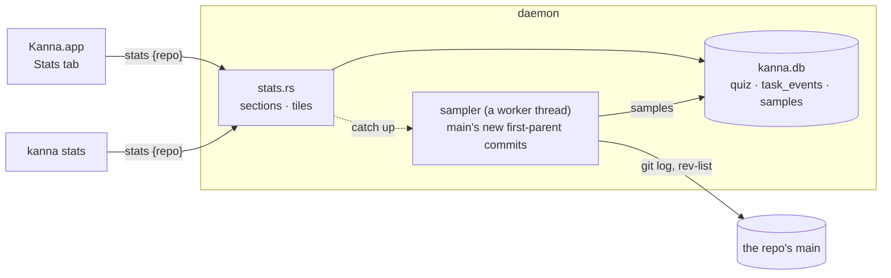

# Stats

**Status:** planned · **Mockup:** [`references/mockups/stats.html`](../../references/mockups/stats.html) · **Builds on:** [Desk view](desk-view.md), [Machines tab](machine-links.md#5-paths-the-machines-tab-and-offline), [database](database.md), [quiz](quiz.md) · **Next:** code quality metrics

**Stats** is a third fixed tab in the Desk view, after Desk and Machines: the project's numbers over the last 30 days. Each number is today's value over a small chart of the 30 days. Four sections: what you know of the code (from your quiz answers), what landed on main, how tasks moved, and a placeholder for code quality, which the next task fills. `kanna stats [--json]` prints the same numbers.

Agents write most of the code, so the numbers that matter are whether you keep up with it and how work flows through the Desk. Test counts and pass rates aren't here: every test has to pass, so they say nothing.

| Dark | Light | A new project |
|---|---|---|
|  |  |  |

*(From the mockup: `#picture`, `#picture,light`, `#picture,empty`.)*

## Contents

1. [The page](#1-the-page)
2. [The numbers](#2-the-numbers)
3. [Where they come from](#3-where-they-come-from)
4. [Adding a metric](#4-adding-a-metric)
5. [`kanna stats`](#5-kanna-stats)
6. [Tests](#6-tests)
7. [Rejected](#7-rejected)
8. [Glossary](#8-glossary)

## 1. The page

- **A fixed tab**, like Desk and Machines ([machine links §5](machine-links.md#5-paths-the-machines-tab-and-offline)): no close button, in Next and Previous Tab's order after Machines, ← and → when focused. Only in the Desk view; the active task has none.
- **The Desk's project**, on the machine its Desk is on: the app asks that machine's daemon. Counting a project across machines is a later task (Stats across machines).
- **Asked when shown** and every minute while it shows; nothing is asked while it's hidden. A reply that hasn't come yet leaves the last page drawn.
- **Every chart has a hover readout** for the day under the pointer: that day's value, and for made to done the tasks done that day. Each tile's accessibility label says its value and note, and each chart's says its 30 values.
- **Days are the daemon's local days**: today and the 29 before it.
- **Empty:** with no quiz answers the Quiz section says how to get some; a count with no events is a flat chart at 0; made to done with nothing done shows "—".

## 2. The numbers

| Section | Tile | Today's value | Chart | Why it's here |
|---|---|---|---|---|
| Quiz | Answers right | the share right of the answers in the last 30 days, "of N answers" | the same share as of each day (line) | how well you know the code agents are writing, and whether that's rising |
| | Misses to come back | misses no later answer asked again | the count at the end of each day (line) | what you got wrong and haven't relearned |
| | By kind, by area | share right per kind and per area, last 30 days (ranked bars) | | which kind of question and which part of the code you're weakest on |
| Main | Commits | commits that reached main today | per day (columns) | how much code lands |
| | Tasks landed | merges into main today | per day (columns) | how much work lands, counted the way it's delivered |
| Tasks | Made, Started, Ended | tasks made, first started and done today | per day (columns) | the flow through the Shelf and the Desk: made faster than ended means the Shelf grows |
| | Made to done | median time, last 30 days | a dot per task on the day it was done, the 7-day median as a line | how long a task takes from asking to finished |
| Code quality | (placeholder) | "Not measured yet" | | where the next task's metrics go |

- **A kind** is a quiz answer's `kind`. **An area** is the answer's file's first two folders (`crates/kanna-daemon`, `docs/specs`), or its one folder, or the file at the root. The five areas with the most answers show, the rest as Other, last.
- **A commit reached main** on the day of the first-parent commit on main that brought it: a plain commit brings itself, a merge the commits of its branch (not the merge itself).
- **First started**: a task's first `started` event; a restart doesn't count again. **Ended**: its `done` event.
- **Made to done**: from a task's `made` event to its `done` event, whether it was merged or not, counted on the day it was done. The chart's scale ends at the 90th percentile; longer tasks show as a caret at the top.

## 3. Where they come from



- **Quiz and task numbers are queries** of `quiz_answers` and `task_events` at each request: they're already rows, so storing them again would only let them disagree.
- **Main's numbers are samples**: a row per first-parent commit on main and metric, in a `samples` table, so a metric is computed once per commit and its history kept, whatever happens to the branches since.

**samples**: one row per (repo, commit, metric).

| Column | Type | Holds |
|---|---|---|
| `repo` | text | the project's main checkout |
| `commit` | text | a first-parent commit on main |
| `metric` | text | `commits`, `merged`, … |
| `at` | real | the commit's committer time: the day it counts for |
| `value` | real | the number |
| `doc` | JSON | the rest, by metric |

- **The sampler catches up** on a worker thread, off the daemon's main thread, when a `stats` request comes: for each metric, the first-parent commits on main (else `master`, else `HEAD`) in the last 30 days with no row for it, oldest first. The thread sends what it found back through the daemon's event loop (`Event::Sampled`), which writes the rows and answers. One catch-up per repo at a time: a request during one waits for it and gets the same answer.
- **Every sampled commit gets a row for every metric,** 0 when nothing applies, so a missing row always means "not sampled yet", and a new metric fills in its 30 days by itself.
- **It reads main without touching any checkout:** `git log --first-parent` and `git rev-list --count` on the main checkout's refs. A metric that needs the files will need its commit checked out in a worktree of the sampler's own in the build target ([build targets](build-targets.md)), never the user's checkout; that's the code quality task's to build.

## 4. Adding a metric

A metric is the daemon's: the app and the CLI draw whatever sections and tiles the reply has.

- **The metric:** an entry in `stats.rs`'s `METRICS`, `Metric { name, sample }`, with `sample(repo, commit) → (value, doc)`; `commit` has its ID, time and parents. Today's are `commits` (what the commit brought to main) and `merged` (1 for a merge). A metric that needs the commit's files adds that need to `Metric`.
- **The tile:** `{id, label, value, unit, note, span, chart}` in a section of the reply. `unit` is `%`, `s` (a duration, shown as 3h 33m) or none; `span` is the tile's width in sixths of a row (2, 3, 4 or 6). Charts are `line` (`values`, `max`), `columns` (`values`), `dots` (`points` of `{day, value, label}` and a median `line`) and `ranked` (`rows` of `{label, value, note}`), each with `what`, the hover readout's words; a new kind of chart is a new kind in the app's `StatsPage` and the CLI's printer.
- **The section:** `{id, title, note, tiles}`, with `empty` (the words to show with no tiles) and `placeholder` (drawn as a placeholder). `code` is in the reply now with `placeholder: true` and no tiles; the code quality task adds tiles to it and drops the flag.

The reply, the same as `kanna stats --json`:

```json
{"project": "/Users/u/work/kanna-v4", "days": ["2026-10-02", "…", "2026-10-31"],
 "sections": [
  {"id": "quiz", "title": "Quiz", "note": "what you know of the code, from your kept answers", "tiles": [
    {"id": "right", "label": "Answers right, last 30 days", "value": 79, "unit": "%", "note": "of 95 answers",
     "chart": {"kind": "line", "values": [null, "…", 79.3], "max": 100}}]},
  {"id": "main", "title": "Main", "tiles": [{"id": "commits", "label": "Commits", "value": 28, "note": "today · 616 in 30 days",
     "chart": {"kind": "columns", "values": [12, "…", 28]}}]},
  {"id": "code", "title": "Code quality", "placeholder": true, "tiles": []}]}
```

## 5. `kanna stats`

`kanna stats [--json]`: the stats of the project the terminal is in (its main checkout for a worktree), as text, a line a tile with a sparkline of its 30 days, or the reply as JSON.

```
Quiz          Answers right, last 30 days   79%  of 95 answers          ▅▅▅▆▆▆▆▆▆▆▆▆▇▇▇▇
              Misses to come back             6                          ▂▃▃▄▅▅▅▆▇▆▅▅▄▄
Main          Commits                        28  today · 616 in 30 days  ▃▂▅▄▄▂▃▁▃▆▄▃▅▂▁▇▃▃▄
```

## 6. Tests

- `stats.rs`: each number from a fixture db and repo (quiz answers across days and kinds, task events with restarts, a repo with plain commits and merges of task branches): the grade as of each day, misses asked again, areas and Other, commits a merge brought, first starts only, made to done; the sampler writes a row per metric per commit, fills a new metric's 30 days, and never runs git in a checkout's worktree.
- The CLI: the request, the text and the JSON.
- e2e `stats_tab` on a private instance with a fixture repo, quiz answers and task events: the tab after Machines, ⇧⌘] to it, its page's tiles and values against `kanna stats --json`, snapshots in light and dark.

## 7. Rejected

- **Test count and pass rate:** every test has to pass, so both say nothing.
- **Code quality in this task:** it needs research of its own (what predicts trouble in code agents write); this task leaves its section and the `Tree` sampling for it.
- **Sampling quiz and task numbers:** they're rows already; a sample could only drift from them.
- **Commits and merges read from `git log` at each request,** without samples: right today, but the code quality metrics need per-commit rows anyway, and this keeps one store and one sampler for both.
- **A score in the quiz itself:** the round still says only what you knew of its five questions ([quiz §2](quiz.md#2-rules)); the totals live here, where you go to look.

## 8. Glossary

| Term | Meaning |
|---|---|
| **Tile** | A number with its label, note and chart |
| **Sample** | A metric's value at one of main's commits, kept in `samples` |
| **Sampler** | The daemon's worker that walks main's new commits and writes samples |
| **Area** | The first two folders of the file a quiz answer is about |
