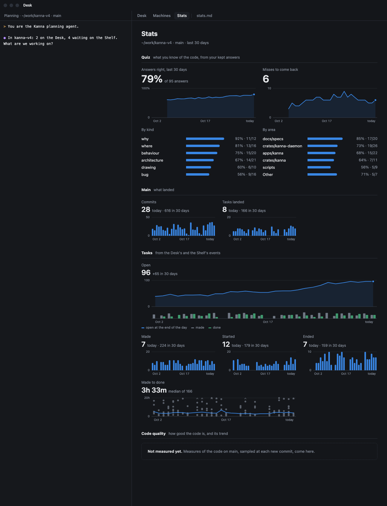
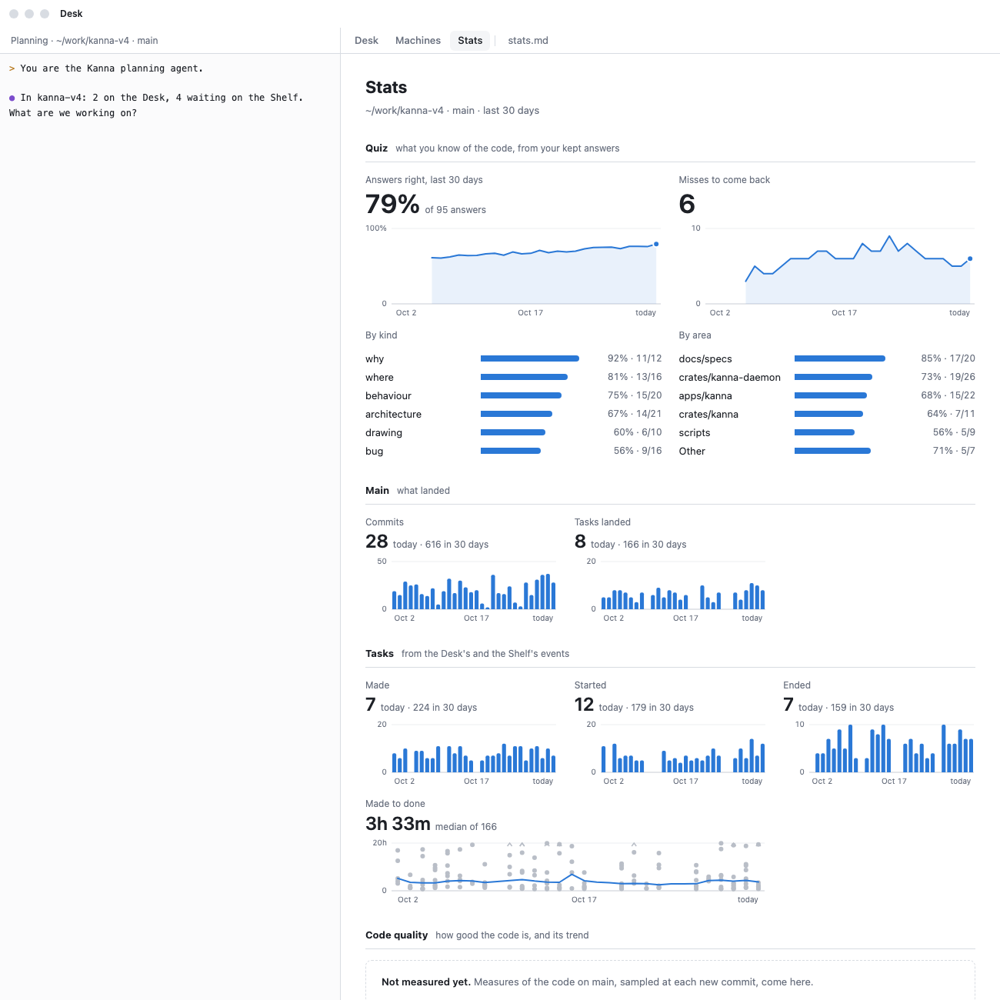
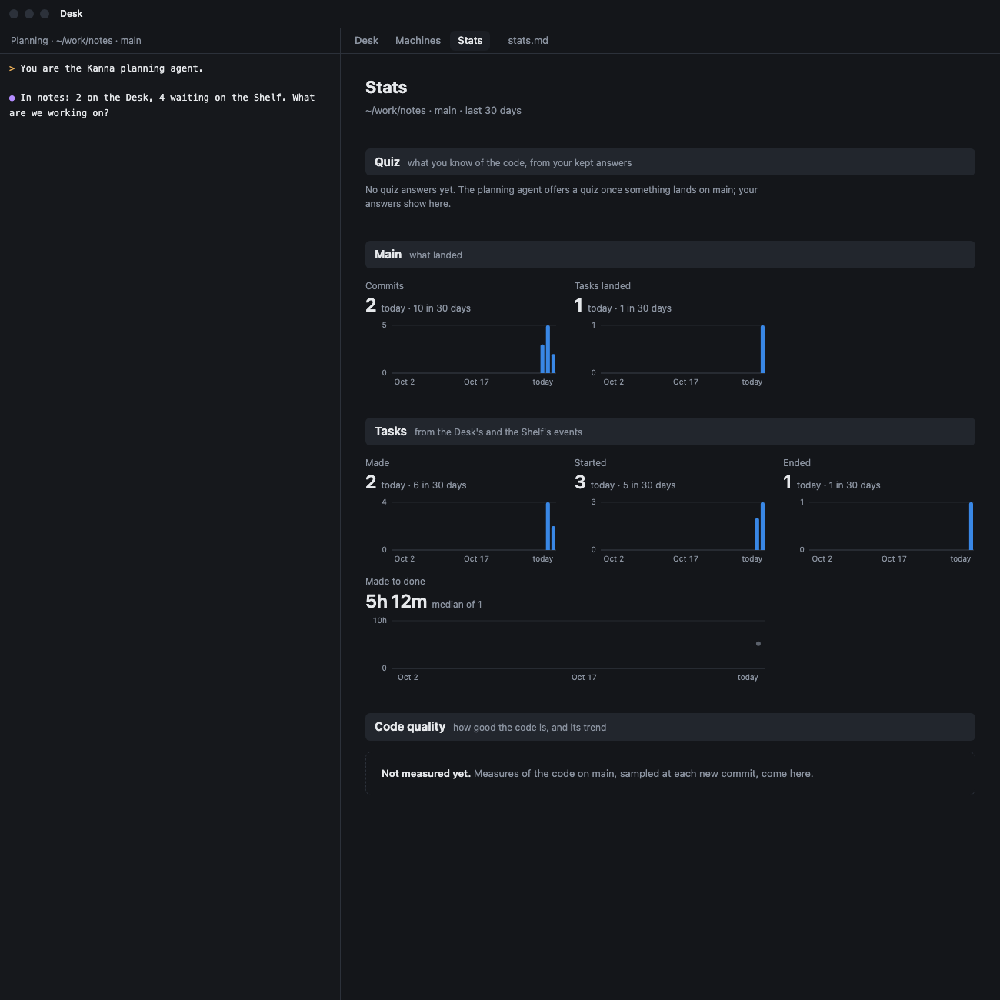
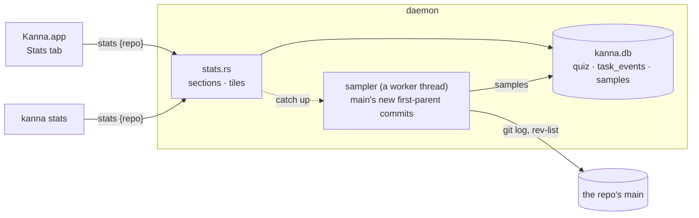

# Stats

**Status:** built · **Tests:** `stats.rs`, `StatsFormatTests`, e2e `stats_tab` · **Mockup:** [`references/mockups/stats.html`](../../references/mockups/stats.html) · **Builds on:** [Desk view](desk-view.md), [Machines tab](machine-links.md#5-paths-the-machines-tab-and-offline), [database](database.md), [quiz](quiz.md) · **Next:** [code quality metrics](code-quality-metrics.md), [agent stats](agent-stats.md)

**Stats** is a third fixed tab in the Desk view, after Desk and Machines: the project's numbers over the last 30 days. Each number is today's value over a small chart of the 30 days. Five sections: what you know of the code (from your quiz answers), what landed on main, how many tasks are open and how they moved, how agents spent their time ([agent stats](agent-stats.md)), and how good the code is ([code quality metrics](code-quality-metrics.md)). `kanna stats [--json]` prints the same numbers.

Agents write most of the code, so the numbers that matter are whether you keep up with it and how work flows through the Desk. Test counts and pass rates aren't here: every test has to pass, so they say nothing.

| Dark | Light | A new project |
|---|---|---|
|  |  |  |

*(From the mockup: `#picture`, `#picture,light`, `#picture,empty`.)*

## Contents

1. [The page](#1-the-page)
2. [The numbers](#2-the-numbers)
3. [Where they come from](#3-where-they-come-from)
4. [Adding a metric](#4-adding-a-metric)
5. [`kanna stats`](#5-kanna-stats)
6. [Tests](#6-tests)
7. [Rejected](#7-rejected)
8. [Glossary](#8-glossary)

## 1. The page

- **A fixed tab**, like Desk and Machines ([machine links §5](machine-links.md#5-paths-the-machines-tab-and-offline)): no close button, in Next and Previous Tab's order after Machines, ← and → when focused. Only in the Desk view; the active task has none.
- **The Desk's project**, on the machine its Desk is on: the app asks that machine's daemon. Counting a project across machines is a later task (Stats across machines).
- **Asked when shown** and every minute while it shows; nothing is asked while it's hidden. A reply that hasn't come yet leaves the last page drawn.
- **Every chart has a hover readout** for the day under the pointer: that day's value, for open also that day's made and done, and for made to done the tasks done that day. Each tile's accessibility label says its value and note, and each chart's says its 30 values.
- **Days are the daemon's local days**: today and the 29 before it.
- **Empty:** with no quiz answers the Quiz section says how to get some; a count with no events is a flat chart at 0; made to done with nothing done shows "—".

## 2. The numbers

| Section | Tile | Today's value | Chart | Why it's here |
|---|---|---|---|---|
| Quiz | Answers right | the share right of the answers in the last 30 days, "of N answers" | the same share as of each day (line) | how well you know the code agents are writing, and whether that's rising |
| | Misses to come back | misses no later answer asked again | the count at the end of each day (line) | what you got wrong and haven't relearned |
| | By kind, by area | share right per kind and per area, last 30 days (ranked bars) | | which kind of question and which part of the code you're weakest on |
| Main | Commits | commits that reached main today | per day (columns) | how much code lands |
| | Tasks landed | merges into main today | per day (columns) | how much work lands, counted the way it's delivered |
| Tasks | Open | tasks not done at the end of today, "+N in 30 days" (or −N, or no change) | the count at the end of each day (line), each day's made and done under it (paired bars) | whether the backlog is blowing up or converging |
| | Made, Started, Ended | tasks made, first started and done today | per day (columns) | the flow through the Shelf and the Desk: made faster than ended means the Shelf grows |
| | Made to done | median time, last 30 days | a dot per task on the day it was done, the 7-day median as a line | how long a task takes from asking to finished |
| Agents | see [agent stats](agent-stats.md) | | | how long agents worked and waited on you |
| Code quality | see [code quality metrics](code-quality-metrics.md) | | | how good the code on main is, and its trend |

- **A kind** is a quiz answer's `kind`. **An area** is the answer's file's first two folders (`crates/kanna-daemon`, `docs/specs`), or its one folder, or the file at the root. The five areas with the most answers show, the rest as Other, last.
- **A commit reached main** on the day of the first-parent commit on main that brought it: a plain commit brings itself, a merge the commits of its branch (not the merge itself).
- **Open**: every task made and not done, the Desk's and the Shelf's together, blocked ones too: a pick or a shelve moves a task, it doesn't shrink the backlog. At the end of a day means made before the next day starts and not done by then, so a task made and done the same day counts in that day's made and done but never as open. Its change is today's count less the count when the 30 days began, which is the window's made less its done. One line for every task, not split by place or state. The tile takes the section's whole row, first.
- **First started**: a task's first `started` event; a restart doesn't count again. **Ended**: its `done` event.
- **Made to done**: from a task's `made` event to its `done` event, whether it was merged or not, counted on the day it was done. The chart's scale ends at the 90th percentile; longer tasks show as a caret at the top.

## 3. Where they come from



- **Quiz and task numbers are queries** of `quiz_answers` and `task_events` at each request: they're already rows, so storing them again would only let them disagree. The task query reads each task's first `made`, `started` and `done`, for every task active in the 30 days or still open when they began; a task done with no `done` event (from before events were kept) counts as done at its last event.
- **Main's numbers are samples**: a row per first-parent commit on main and metric, in a `samples` table, so a metric is computed once per commit and its history kept, whatever happens to the branches since.

**samples**: one row per (repo, commit, metric).

| Column | Type | Holds |
|---|---|---|
| `repo` | text | the project's main checkout |
| `commit` | text | a first-parent commit on main |
| `metric` | text | `commits`, `merged`, … |
| `at` | real | the commit's committer time: the day it counts for |
| `value` | real | the number |
| `doc` | JSON | the rest, by metric |

- **The sampler catches up** on a worker thread, off the daemon's main thread, when a `stats` request comes: for each metric, the first-parent commits on main (else `master`, else `HEAD`) in the last 30 days with no row for it, oldest first. The thread sends what it found back through the daemon's event loop (`Event::Sampled`), which writes the rows and answers. One catch-up per repo at a time: a request during one waits for it and gets the same answer.
- **Every sampled commit gets a row for every metric,** 0 when nothing applies, so a missing row always means "not sampled yet", and a new metric fills in its 30 days by itself.
- **It reads main without touching any checkout:** `git log --first-parent`, `git rev-list --count`, and for metrics that need the files, the commit's blobs from git's object store ([code quality §3](code-quality-metrics.md#3-sampling)). Only coverage checks a commit out, in a worktree of its own.

## 4. Adding a metric

A metric is the daemon's: the app and the CLI draw whatever sections and tiles the reply has.

- **The metric:** an entry in `stats.rs`'s `METRICS`, `Metric { name, sample }`, where `sample` is `Sampler::Commit(fn(context, commit) → (value, doc))` (the context has the repo and its tasks' words by branch; `commit` has its ID, time, parents and subject) or `Sampler::Tree(fn(tree) → (value, doc))` for one that needs the commit's files. Main's are `commits` (what the commit brought to main) and `merged` (1 for a merge); code quality's are in [its spec](code-quality-metrics.md#3-sampling).
- **The tile:** `{id, label, value, unit, note, span, chart}` in a section of the reply. `unit` is `%`, `s` (a duration, shown as 3h 33m), `h` (hours, shown as 212h), `x` (a number to one decimal) or none; `span` is the tile's width in sixths of a row (2, 3, 4 or 6). Charts are `line` (`values`, `max`), `columns` (`values`), `flow` (a line of `values` over paired bars of `made` and `done`, with a legend), `dots` (`points` of `{day, value, label}` and a median `line`), `ranked` (`rows` of `{label, value, note}`) and `list` ([code quality §6](code-quality-metrics.md#6-interfaces)), each with `what`, the hover readout's words; a new kind of chart is a new kind in the app's `StatsPage` and the CLI's printer.
- **The section:** `{id, title, note, tiles}`, with `empty` (the words to show with no tiles) and `placeholder` (drawn as a dashed box).

The reply, the same as `kanna stats --json`:

```json
{"project": "/Users/u/work/kanna-v4", "days": ["2026-10-02", "…", "2026-10-31"],
 "sections": [
  {"id": "quiz", "title": "Quiz", "note": "what you know of the code, from your kept answers", "tiles": [
    {"id": "right", "label": "Answers right, last 30 days", "value": 79, "unit": "%", "note": "of 95 answers",
     "chart": {"kind": "line", "values": [null, "…", 79.3], "max": 100}}]},
  {"id": "main", "title": "Main", "tiles": [{"id": "commits", "label": "Commits", "value": 28, "note": "today · 616 in 30 days",
     "chart": {"kind": "columns", "values": [12, "…", 28]}}]},
  {"id": "code", "title": "Code quality", "tiles": [{"id": "erosion", "label": "Erosion", "value": 48.5, "unit": "%", "…": "…"}]}]}
```

## 5. `kanna stats`

`kanna stats [--json]`: the stats of the project the terminal is in (its main checkout for a worktree), as text, a line a tile with a sparkline of its 30 days, or the reply as JSON.

```
Quiz          Answers right, last 30 days   79%  of 95 answers          ▅▅▅▆▆▆▆▆▆▆▆▆▇▇▇▇
              Misses to come back             6                          ▂▃▃▄▅▅▅▆▇▆▅▅▄▄
Main          Commits                        28  today · 616 in 30 days  ▃▂▅▄▄▂▃▁▃▆▄▃▅▂▁▇▃▃▄
```

## 6. Tests

- `stats.rs`: the grade as of each day (a miss 40 days back still in day 0's window, a day with no answers in its 30 is empty), a miss counted until it's asked again and a miss asked again and missed standing for the old one, areas by two folders with Other last, first starts only and made to done with its 7-day median, open tasks from a fixed series of events in `kanna.db` (open from before the 30 days, picked and shelved, done two days back, a task made and done the same day, a done task with no `done` event, another repo's task) and their change up, down and none, an empty project and no code; the sampler on a fixture repo (a plain commit, a merge bringing two) writes a row per metric per commit and fills only what's missing; the command answers two requests with one catch-up and reads back from `kanna.db`.
- The Agents section's numbers: [agent stats §4](agent-stats.md#4-tests).
- `StatsFormatTests` (KannaWindows): figures, days, scales and tile places in rows of sixths, stacked when narrow.
- The CLI: `kanna stats` sends the repo and prints a line a tile, ranked rows under it and a section's words; `stats` is in `capabilities` and `commands`.
- e2e `stats_tab` on a private instance: a fixture repo with commits three and two days back and a merge today, four quiz answers, three tasks (two started, one done); `kanna stats --json` and the text against the expected numbers (open: 2, "+2 in 30 days", made 3 and done 1 today), the samples in `kanna.db`; then the app: Desk, Machines and Stats as the Desk view's fixed tabs, Next Tab from Machines to Stats, every tile's label and note as the reply has them and its figure, open across the whole row, each section's heading band in order, the code section ([code quality §7](code-quality-metrics.md#7-tests)), snapshots in dark and light (`target/e2e-kanna/stats_tab-*.png`), and Desk leaving the page. `machine_remote_task` steps Next and Previous Tab through all three fixed tabs.

## 7. Rejected

- **Test count and pass rate:** every test has to pass, so both say nothing.
- **Open split by place or state** (Desk, Shelf, blocked): a task moving between them isn't the backlog growing or shrinking, and one line reads at a glance.
- **A daily count of open tasks kept as rows:** it's made and done replayed, so it's worked out from `task_events` like the other task numbers.
- **Sampling quiz and task numbers:** they're rows already; a sample could only drift from them.
- **Commits and merges read from `git log` at each request,** without samples: right today, but the code quality metrics need per-commit rows anyway, and this keeps one store and one sampler for both.
- **A score in the quiz itself:** the round still says only what you knew of its five questions ([quiz §2](quiz.md#2-rules)); the totals live here, where you go to look.

## 8. Glossary

| Term | Meaning |
|---|---|
| **Tile** | A number with its label, note and chart |
| **Sample** | A metric's value at one of main's commits, kept in `samples` |
| **Sampler** | The daemon's worker that walks main's new commits and writes samples |
| **Area** | The first two folders of the file a quiz answer is about |
| **Open** | A task made and not done, wherever it is |
