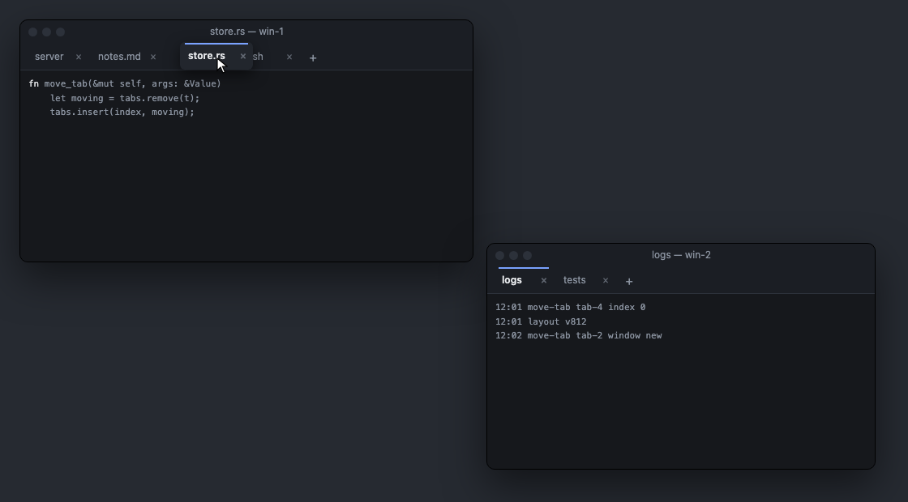
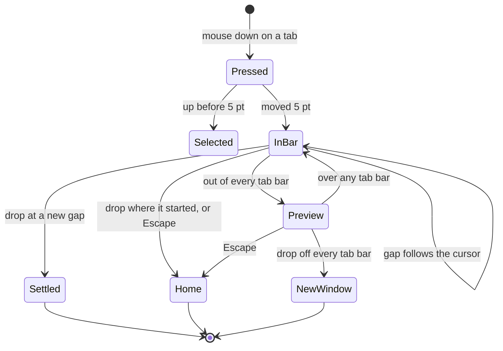
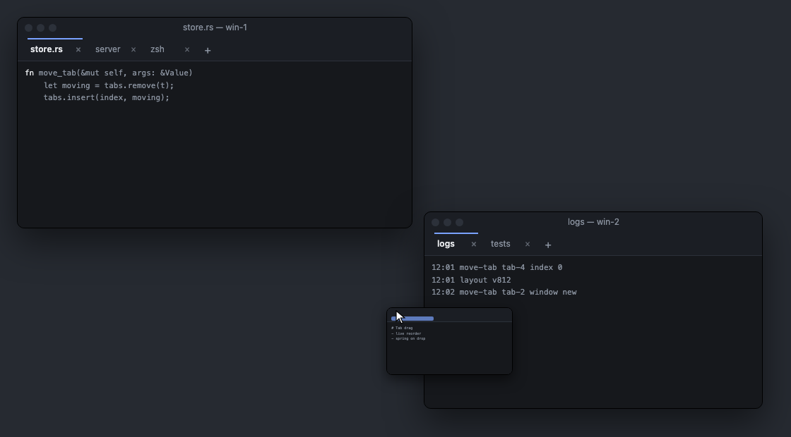
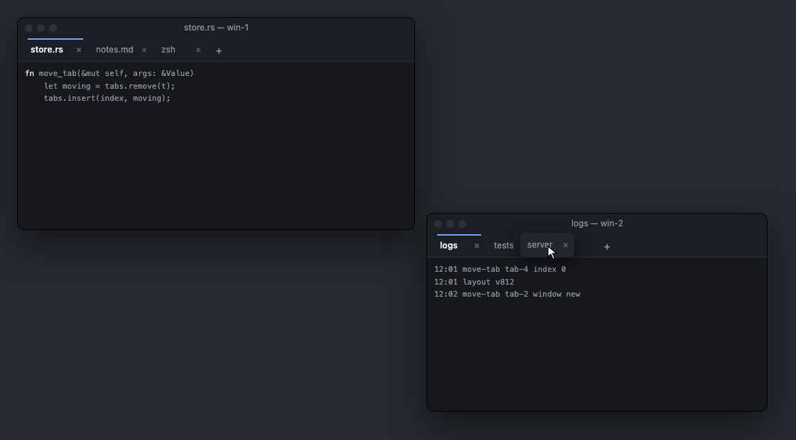

# Tab Drag

**Status:** built (2026-11-04) · **Part of:** [Windows](windows.md) · **Mockup:** [`references/mockups/tab-drag.html`](../../references/mockups/tab-drag.html) (its buttons play each drag)

Dragging a tab moves it the way Safari's and Chrome's tabs move: the tab follows the cursor and the other tabs slide aside to open the gap it will drop into, in its own window's tab bar or any other's. Pulled out of every tab bar it becomes a small preview of its window, and dropped anywhere off a tab bar it grows into a new window there. Only tabs move this way: the docked pane stays on its edge, and a pane's grip drag keeps its [drop hints](windows.md#3-windows-tabs-panes).

## Contents

1. [The drag](#1-the-drag)
2. [Rules](#2-rules)
3. [Motion](#3-motion)
4. [How it's built](#4-how-its-built)
5. [Checked by](#5-checked-by)
6. [Glossary](#6-glossary)

## 1. The drag

- **In a tab bar:** the tab rides along the bar's row under the cursor, held where it was grabbed and kept within the bar's tabs; the bar's other tabs and + slide aside to open its gap. Its own bar closes up behind it as soon as it leaves.
- **Out of the bar:** the tab folds into a preview of its window, about a third of its size, hanging from the cursor where the new window would open. The preview shows the tab's own panes in its window, whether or not the tab was selected.

- **Between windows:** over another window's tab bar the preview folds back into a tab and that bar opens a gap, live.

## 2. Rules

- **Starting:** a press on a tab that moves 5 pt starts the drag; less is a click, which selects it.
- **Which bar:** the bar of the window in front under the cursor, counting 14 pt above and below it. A window hidden behind another at that point doesn't count.
- **Which gap:** the gap moves past a neighbour when the dragged tab's centre passes the middle of the space the two share, measured on the bar with the dragged tab left out, so the gap never flickers between two places.
- **Dropping in a gap** sends `move-tab {tab, window | workspace, index}` at once (the index counted with the tab still in its own bar, as the daemon takes it) and the tab settles into the gap; the moved tab becomes its window's active tab.
- **Dropping off every tab bar**, over the desktop or over a window's panes, sends `move-tab {tab, window: "new"}`; the new window opens at the cursor (40 pt to its left, 12 pt above it), the size of the window the tab came from.
- **Nothing moves** when the drop is in the gap it started from, or after Escape: the tab slides home. The drag reports `dropped: false`.
- **The last tab** of a window can be dragged into another window or out to a new one; its old window closes.

## 3. Motion

| Movement | Duration | Curve |
|---|---|---|
| Tabs sliding aside, + following | 0.16 s | ease out |
| Tab folding into a preview and back | 0.18 s | ease out, following the cursor |
| Settling into a gap, sliding home | about 0.2 s | spring: stiffness 600, damping ratio 0.72 |
| New window growing from the preview | 0.24 s | ease out |

With **Reduce Motion** on (System Settings › Accessibility › Display), the drag behaves the same with none of these: gaps open and close at once, the tab turns into a preview and back in place, and a drop puts it straight into its gap or its new window. The tab and the preview still follow the cursor.

## 4. How it's built

- **`TabDrag`** (`apps/kanna/Sources/Kanna/Windows/TabDrag.swift`) is one drag: it holds the source window, the tab's index there, where it was grabbed, and the bar and gap it's over, and owns the ghost. `AppController.dragTab` makes one, tracks the mouse (`trackDrag`, which also returns on Escape) and drops it.
- **The ghost** (`TabGhost`) is a borderless panel above the windows holding two pictures: the tab (from the tab bar's drawing) and the window preview. For the selected tab the preview is the window's capture, taken when the drag starts. For any other tab it starts as the tab on a blank window; then each of the tab's panes is drawn off-screen at its size in the window, as [`kanna screenshot`](screenshot.md) draws a hidden pane, laid out by the tab's `root` (which the daemon lists with every tab), and set into the capture's pane area. It crossfades between them as it changes shape.
- **Gaps** belong to the tab bar: `TabBar.setGap({owner, hiding, width, index})` hides the dragged tab and lays the others out around a gap at `index`, animated or not. The bar keeps its gap when the daemon's layout rebuilds it, so a moved tab arriving under the ghost doesn't jump, and only the drag that set a gap clears it.
- **Settling** runs a spring on the ghost's frame from a timer on the main run loop's common modes (so it runs inside the mouse-tracking loop too), waits until the tab is in its new bar (up to a second), then clears the gaps and closes the ghost.
- **A new window** is shown at its final frame but transparent while the ghost grows to that frame; then it shows and the ghost goes. The window's terminals are never laid out at the preview's size.
- **Reduce Motion** is `NSWorkspace.accessibilityDisplayShouldReduceMotion`, read when a drag starts.

## 5. Checked by

`tab_drag` of `scripts/e2e/windows.sh`, on a private instance with `debug.drag` (which shows no ghost and runs without motion): reorder to the end and back to the front; dropping where it started, Escape (`cancel: true`) move nothing; to another window's tab and onto its +; tearing a tab off into a third window; dragging a window's last tab away closes it; a drop on another window's pane opens a new window. `drag_panes_tabs` covers the older drops. The motion itself is reviewed by eye against the mockup.

## 6. Glossary

| Term | Meaning |
|---|---|
| **Gap** | The open space in a tab bar where the dragged tab will drop. |
| **Ghost** | The floating copy of the dragged tab, or of its window's preview, that follows the cursor. |
| **Preview** | The small picture of the tab's window that the ghost becomes outside every tab bar. |
| **Tear off** | Dragging a tab off every tab bar into a new window of its own. |
