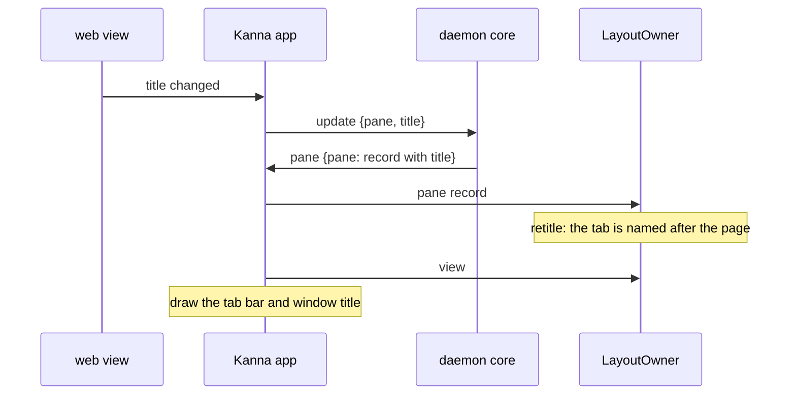

# Tab Names

**Status:** built · **Tested:** e2e `tab_names`, `cargo test -p kanna-mux` (owner tests on tab names) · **Builds on:** [windows](windows.md), [layout](layout.md), [app panes](app-panes.md)

A tab is named after what it shows instead of `Tab N`.

**Before:** every tab numbered, as in kmux.

**After:** the same four tabs, opened by ⌘T, `kanna open code store.rs --tab`, `kanna open md presenting.md --tab` and `kanna open web … --tab`.

## Contents

1. [Rules](#1-rules)
2. [How it's built](#2-how-its-built)
3. [Replaces kmux's numbered tabs](#3-replaces-kmuxs-numbered-tabs)

## 1. Rules

A tab is named after the pane it was made with (`kanna open --tab`, Desk tabs, ⌘T, +):

| The pane | The tab |
|---|---|
| has a name (`--name`, `rename-pane`) | that name |
| code or markdown | its file's name, no folder: `store.rs` |
| web | its page's title; its host until the title loads |
| anything else (a terminal from ⌘T or +) | `Tab N`, as before |

- **It follows the pane:** a web tab follows its page's title as you browse; a terminal's tab follows a later `rename-pane`.
- **Until it's renamed:** once the user double-clicks it or a client runs `rename-tab`, it keeps that name for good. The layout saves that it was renamed, so it survives a restart; a tab saved before this rule is treated as not renamed.
- **Splits:** a tab with several panes keeps the name of the one it was made with. When that pane closes or moves away, the tab takes the name of the first pane left in it, and with none `Tab N`.
- **Duplicates stay:** two `SKILL.md` tabs both say `SKILL.md`.
- **Control characters are dropped** from page titles and names, so a page can't put terminal escapes into `kanna workspace list`.

## 2. How it's built

The layout model decides, in Rust; the app only draws `tab.title`. Each tab keeps its number, the pane it's named after and whether it was renamed (all saved in the saved layout), and `Tab::retitle` runs after every layout step and pane update. A web pane's title comes from its view:

## 3. Replaces kmux's numbered tabs

kmux names every tab `Tab 1`, `Tab 2`, … on purpose ("listing pane names didn't scale", [kmux spec](https://github.com/tampopogk/kmux/blob/main/docs/kmux-spec.md)). In Kanna agents open most tabs (`kanna open code FILE --tab`), and a row of `Tab 9`s says nothing about them; one pane's name per tab does scale. The protocol cases' numbered tab titles aren't compared ([kmux reference](kmux-reference.md)).
