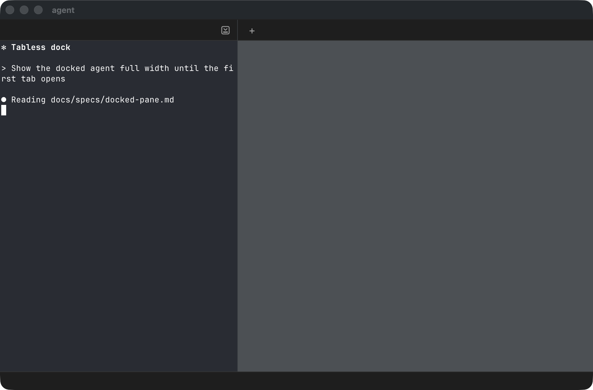
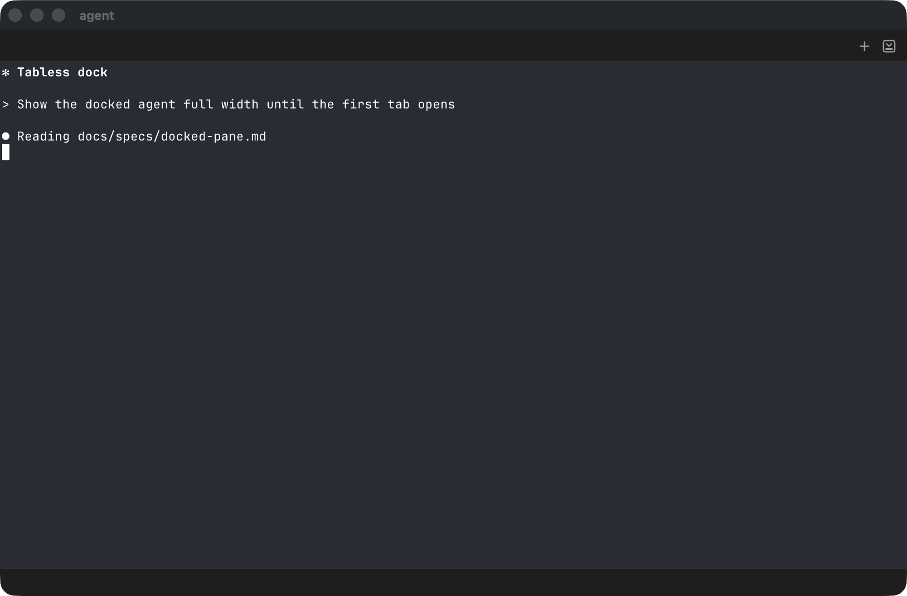
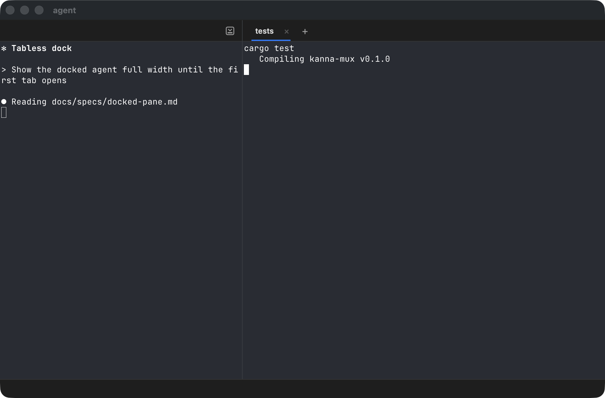
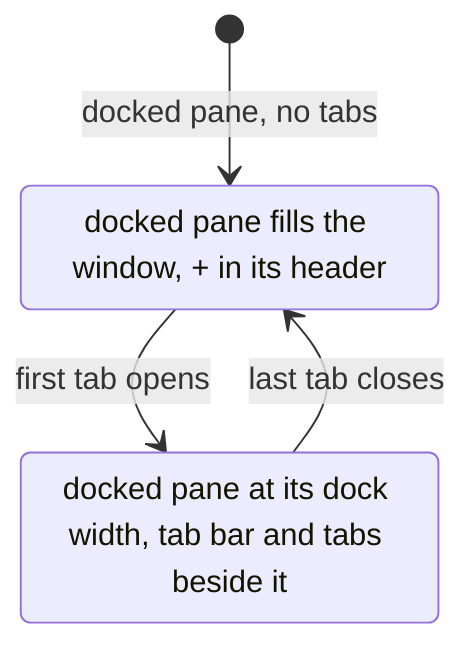

# Tabless Dock

**Status:** built (2026-10-28), in Kanna.app · **Changes:** [docked pane](docked-pane.md) · **Related:** [zoom](zoom.md), [Desk](desk.md), [presentation layers](presentation-layers.md)

A window with a docked pane and no tabs shows no tab area: the docked pane takes the whole window. The tab bar and the divider appear with the first tab and go away with the last. A new task's window used to be its agent at 2/5 beside an empty tab bar and a grey area where tabs would go.

| Before: a new task, no tabs | After: the same task | After: its first tab |
|---|---|---|
|  |  |  |

## Rules

- **No tabs, no tab area.** With no tabs, the docked pane fills the window (above the Shelf strip on a Desk) and there's no tab bar or divider.
- **The first tab brings it back.** The docked pane narrows to its dock width and the tab bar and divider return; closing the last tab widens it again. Its terminal reflows each time.
- **The dock width is kept.** It's the dock's width as before: 2/5, `kanna resize`, or what the user last dragged it to in this app. Showing the docked pane full width doesn't change it, and a drag still saves it.
- **New Tab:** ⌘T works as before. While the window has no tabs, the docked pane's header shows a + beside the park icon, which opens a new tab as the tab bar's + does. A docked window that isn't a Desk has no header otherwise; it shows one, with the +, while it has no tabs.
- **Zoom** is unchanged: zooming the docked pane with no tabs looks the same as not zooming it.
- **Where:** every window with a docked pane in Kanna.app: a task on the Desk, a docked window. The planner's Desk (the planning terminal beside the Shelf) is unchanged, and so is kmux.

## How it's built

- **Physical presentation only** ([presentation layers](presentation-layers.md)): the daemon, the layout and the dock's saved width don't change. The app draws a window whose view has a `dock` and an empty `tabs` the way it draws a zoomed docked pane: the docked pane on the whole window, no tab bar, no divider (`WindowController.arrange`).
- **The header's +** is the agent header's own button, shown only while the window has no tabs; it sends the same `open --tab` as ⌘T.
- **The Shelf holds a parked agent at the size it'll have:** full width for a task with no tabs, its dock width otherwise, so pulling it doesn't resize it.
- **Checked by** e2e `docked_pane`: a frozen docked pane pulled with no tabs fills the window, the header's + opens a tab, `kanna open --tab` puts it at 2/5, and closing the tab fills the window again; `shelf_zoom` and the desk scenarios pass unchanged.
