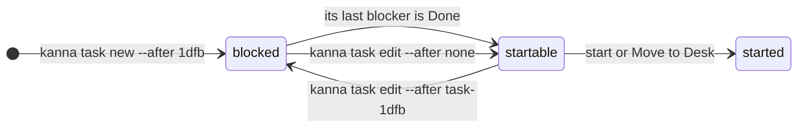
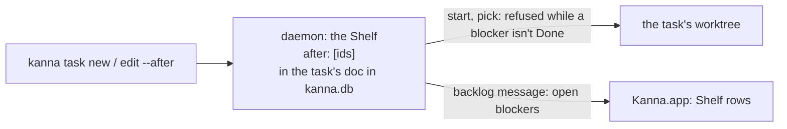

# Blocked tasks

**Status:** built · **Tested:** e2e `blocked_tasks` · **Mockup:** [`references/mockups/blocked-tasks.html`](../../references/mockups/blocked-tasks.html) (Screenshot command is done; or `#freed`) · **Builds on:** [tasks](tasks.md), [planning agent](planning-agent.md)

A task can wait for other tasks: it's **blocked**, and can't start until they're all Done.


## Blocked



- **A blocked Shelf row** has a dashed ring, an orange line naming what it waits for, and **Blocked** where Move to Desk usually is. Clicking the row, ↩ in search, `kanna task start` or `kanna task pick` is refused, and the note says what it waits for.
- **A blocked task can't start,** from the app or the CLI. To start it before its blockers are Done, take them off: `kanna task edit TASK --after none` (or name fewer), which the planning agent runs when you ask it to.
- **Done means Done in Kanna** (`kanna task done`, Done in the app, or its agent's pane closed), not merged. Kanna doesn't watch git for this.
- **When the last blocker is Done, the task becomes startable,** and nothing starts by itself. The row loses its badge, and `kanna task done` says which tasks it freed (`t13 "Diff viewer" can start now`), so the planning agent can offer to start them.
- **A task can't wait for itself,** directly or through others: making that loop is refused.
- **A started task starts from the repo's checkout** like any other. Work that builds on a blocker's starts once the blocker is merged and Done.

## Setting them

Only the planning agent, an agent, or you in a terminal set them, with the CLI. The app only shows them.

```sh
kanna task new "Release notes for 0.9" "…" --after 1dfb,c0ff
kanna task edit 3f9a --after 1dfb        # replaces the list
kanna task edit 3f9a --after none        # waits for nothing
```

- **TASK** is a task's ID as `kanna task list` shows it (`task-1dfb`), or any unique start of it (`1dfb`: [task IDs](task-ids.md)) or a running task's pane (`p158`), as `kanna task list` shows them. Kanna stores the task's ID.
- **A blocker must be a task that isn't Done.**
- **`kanna task edit` changes a Shelf task** that hasn't started yet.

## CLI

| Command | Does |
|---|---|
| `kanna task new NAME [MSG] [--after TASK,…]` | Make a task that waits for others |
| `kanna task edit TASK --after TASK,…\|none` | Change what a Shelf task waits for |
| `kanna task start TASK`, `kanna task pick TASK` | Refused for a blocked task, saying what it waits for |
| `kanna task list` | STATE is `blocked` for a blocked Shelf task, and its last part says `waits for task-1dfb, task-c0ff` |
| `kanna task done TASK` | Also names the tasks that can start now because of it |

## How it's built



- **Kept in the task's row** in `kanna.db` ([database](database.md)): `after`, a list of task IDs, in its JSON doc, so no new table or migration. An `edited` event records each change.
- **A blocker is open** while the daemon still has it, on the Shelf or running; any other task is Done. So a task freed by Done needs no event: the next `backlog` message (the Shelf's, pushed to the app) shows it startable, and the daemon pushes when a task's agent closes.
- **Start and Move to Desk check blockers first** (error `blocked`, with what it waits for). Neither applies to a task that has a worktree already, since blockers can't change once it has started.
- **The `backlog` message and `backlog list`** give each Shelf task its open blockers' IDs, names and panes. **`kanna task done`** reads the Shelf before ending the task and names those whose only open blocker it was.

## Rejected

- **Merged into main as "done":** Kanna would have to watch git, and squash or rebase merges hide it.
- **Starting a freed task by itself:** starting tasks is the user's call, as everywhere else in Kanna.
- **Start anyway:** a blocked task can't start; taking its blockers off is the explicit way.
- **Stacked tasks** (a task's branch made from another task's branch, like a stacked PR): while both run, the stacked one keeps having to rebase onto its base. Worth another look once Kanna works with PRs, as starting from a Done blocker's branch that's waiting on review.
