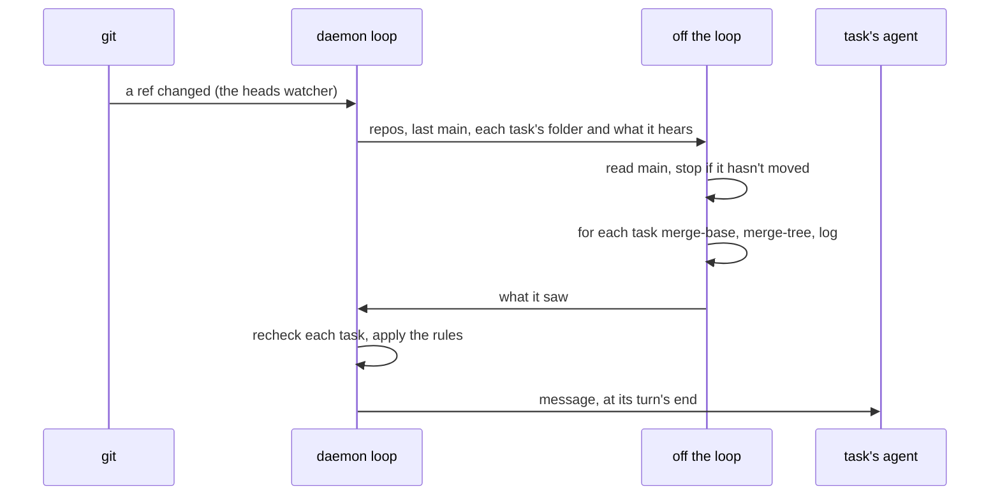
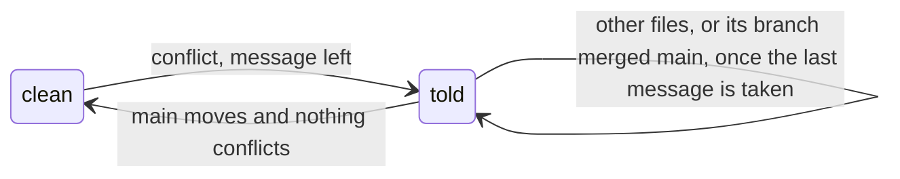

# Task Events

**Status:** built · **Tested:** `cargo test -p kanna-daemon` (task_events, tasks), e2e `task_events` · **Builds on:** [tasks](tasks.md), [agent messaging](agent-messaging.md), [stacked tasks](stacked-tasks.md) · **Replaces:** the planner's `merge-nudge` schedule

**A task hears when something it depends on changes.** The daemon sees the event, decides which tasks it matters to, and leaves each of those a message from `kanna`, which [agent messaging](agent-messaging.md) delivers at the end of their turn. A task has a set of events it hears, kept in the database. It can add to the set or take from it.

Without this, an ordinary task only learned main had moved when a schedule woke the planner, which ran `git merge-tree` for every task by hand. Now the daemon does it the moment main moves.

## Contents

1. [Events](#1-events)
2. [Main moving](#2-main-moving)
3. [One waiting](#3-one-waiting)
4. [Subscriptions](#4-subscriptions)
5. [Commands](#5-commands)
6. [How it's built](#6-how-its-built)
7. [Decisions](#7-decisions)
8. [Glossary](#8-glossary)

## 1. Events

| Event | Heard by default | Who gets it | Says |
|---|---|---|---|
| `main-conflicts` | yes | every started, unmerged task with a branch, not stacked, whose branch conflicts with main | `main conflicts with your branch in FILES: merge or rebase main, rerun your tests, then carry on with what you were doing.` |
| `main-moved` | no | every started, unmerged task with a branch that subscribed, stacked ones too | how many commits main has that its branch hasn't, and the latest 20 |
| `base-merged` | yes | a stacked task whose base landed in main | merge main; you're an ordinary task again, or what you still merge after |
| `base-moved` | yes | a stacked task whose base moved, went stale, or is ready again | merge it, or wait for it |

**Main** is the branch the repo's main checkout is on, as for [stacked tasks](stacked-tasks.md). Messages use its real name.

`base-merged` and `base-moved` are what the stacked-task ripple always sent, now under a name. Not hearing one stops the message only: the task still goes stale, and `kanna task ready set` still refuses it until it has merged.

## 2. Main moving

- **Watching:** the daemon's heads watcher ([stacked tasks](stacked-tasks.md)) follows every repo with a started task. Any ref moving makes it read main again.
- **A move** is main's branch at a new commit. The last one seen is kept per repo in the database, so a move made while Kanna wasn't running is caught when it comes back. The first look at a repo only records it. Switching the main checkout to another branch isn't a move.
- **The check** is `git merge-tree --write-tree --name-only --no-messages -z MAIN TIP`, run in the repo: it needs no worktree and leaves the task's alone. It compares commits, so uncommitted work isn't in it.
- **Skipped:** a task mid-rebase (no branch), a merged task, a task on another machine (no folder here).
- **Off the loop:** the git runs in `runtime::off_loop`, one task after another, and a move during a check runs another afterwards ([the 20ms rule](daemon-runtime.md#2-rules)).

## 3. One waiting

**At most one `main-conflicts` and one `main-moved` message waits per task,** as with [schedules](scheduler.md#1-a-schedule-firing). A move while one waits leaves no second one.

- **Not told twice.** A `main-conflicts` message remembers the files and the branch's merge base with main. Another move with the same files and merge base says nothing, until the branch merges main (its merge base moves) or the conflict goes away.
- **The ripple's events aren't limited.** Stacks only sends `base-merged` and `base-moved` when a task's state changes, each with its own instruction (wait, then merge), so none can be dropped.
- **Different events** wait side by side and arrive in one prompt, as any waiting messages do.

## 4. Subscriptions

- **The default set** is in the code. A task's row keeps only what it changed from that: events it added and events it dropped. A task that changed nothing hears a new default event when one ships.
- **It lasts** as long as the task, through stops, restarts and [moves to another machine](task-transfer.md).
- **It applies when the message would go:** a task that subscribes hears the next move, not one already past. A task that unsubscribes keeps any message already waiting.

## 5. Commands

| Command | Does |
|---|---|
| `kanna task subscribe EVENT [TASK]` | Hear EVENT. From a task's terminal, TASK is that task |
| `kanna task unsubscribe EVENT [TASK]` | Stop hearing EVENT |
| `kanna task events [TASK]` | What a task hears and every event message sent to it, with whether it's delivered |

The `kanna-tasks` skill says when an agent subscribes.

## 6. How it's built

- **`task_events.rs`:** the event names and defaults, a task's `Hears` and `Sent`, `look` (git, off the loop), and `step`, which decides what a task is told from what `look` saw. `step` is pure.
- **`Tasks`:** `follow` watches the repos, `listen` runs `look`, `listened` applies `step`, and `emit` is the one way an event's message leaves. It checks `Hears`, posts the message, and keeps `Sent`.
- **Storage:** `hears` and `sent` are in the task's `doc`; each message sent is a `task_events` row (`what` is `event`) with the event and the message's ID, which is what `kanna task events` lists. The last main is a `meta` row, `main:REPO`.
- **Sender:** messages come from `kanna`, as stacks' always have.

## 7. Decisions

- **`thread-resolved` isn't an event yet.** Markup's resolve events ("Markup: the agent hears when threads are resolved or reopened") aren't on main, and they go to whichever agent owns a doc's pane, planners included, held back 2s so an undo can cancel them. When they land they can take the `base-*` route: default on, one `emit` for each, no one-waiting rule.
- **`main-moved` reaches stacked tasks, `main-conflicts` doesn't.** A stacked task can't merge main's conflicts until its base lands, so it isn't told to. `main-moved` is only ever asked for.
- **Stopped tasks run for an event,** as for any message. That's what the schedule did.

### Rejected

- **A subscriptions table.** The task's `doc` already saves, moves and ends with the task.
- **The one-waiting rule on `base-moved`.** It would lose "ready again" behind a waiting "stale", and a stale task would never hear it could catch up.

## 8. Glossary

- **Event:** something a task can hear about. Unrelated to the daemon's `Event` enum and to the `task_events` table's history of a task, which records this among other things.
- **Merge base:** the newest commit both main and a branch have: where the branch last merged main, or started.
- **Stacked:** a task with bases, built on other tasks' unmerged work.
