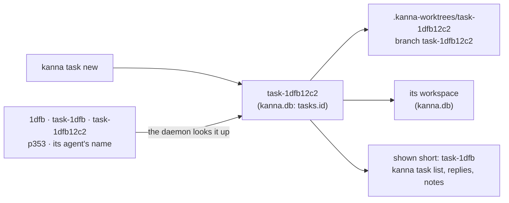
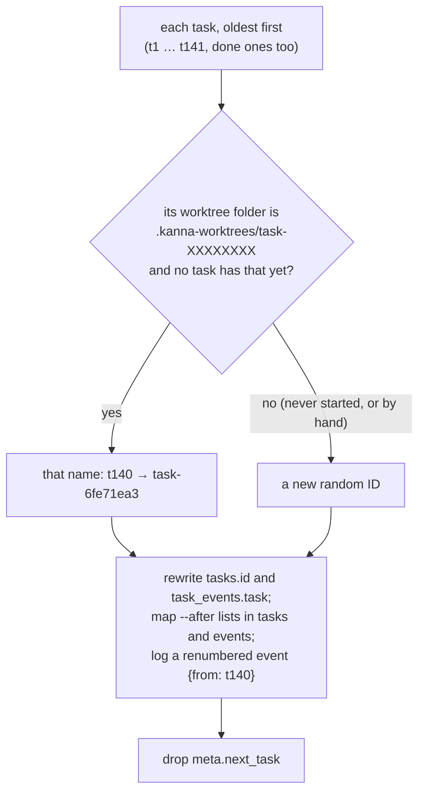

# Task IDs

**Status:** built · **Builds on:** [tasks](tasks.md), [database](database.md), [workspaces](workspaces.md)

**A task's ID is `task-` and 8 lowercase hex digits (32 bits), like `task-1dfb12c2`.** It used to be `t134`, side by side with tab IDs like `t215` in the listing; now a task can't be taken for a tab. The ID is made by `kanna task new`, so a task has it before it ever starts, and it names the task's worktree and first branch. **It's shown short, `task-1dfb`**: the first 4 hex digits, more only when another open task starts the same way.

- [The ID](#the-id)
- [Naming a task in a command](#naming-a-task-in-a-command)
- [The migration](#the-migration)

## The ID

- **Random, checked.** The daemon picks 32 random bits and keeps them only if no task in `kanna.db` has that ID (done ones too) and the repo has no `.kanna-worktrees/<ID>` folder or `<ID>` branch. There's no counter.
- **One name everywhere.** Starting a task makes `<repo>/.kanna-worktrees/<ID>` on branch `<ID>`; the agent renames the branch later ([tasks](tasks.md#4-naming)), the folder keeps the ID. The task's [workspace](workspaces.md) has the same ID.
- **Shown short, everywhere.** `kanna task list` shows it for Shelf and Desk tasks alike: a Desk row is no longer its agent's pane ID (`p353`). A docked pane that isn't a task still shows its pane ID.

| Open tasks | Shown as |
|---|---|
| `task-1dfb12c2`, `task-c0ffee00` | `task-1dfb`, `task-c0ff` |
| `task-1dfb12c2`, `task-1dfb9a00` | `task-1dfb1`, `task-1dfb9` |

- **Short like git's hashes.** A task shows as `task-` and its first 4 hex digits, or as many more as it takes to differ from every other open task (on the Shelf or a Desk), so every shown ID works as a command's TASK. The daemon makes the short form (`short` beside `id` in `tasks list`) and writes it in its own messages, such as the blocked note on the Desk; the CLI shows it in everything it prints. Full IDs stay in `--json`, `kanna.db`, `layout.json`, worktree folders and branches.

## Naming a task in a command

A command that takes a TASK (`kanna task start|stop|pick|shelve|edit|name|done|park|activate`, `--after`) takes any of:

| Reference | Example | Notes |
|---|---|---|
| Its ID | `task-1dfb12c2` | |
| Its agent's pane, ID or name | `p353`, `agent` | as before; checked before a start of an ID, so a pane named `cafe` stays that pane |
| A start of its ID, with or without `task-` | `1dfb`, `task-1dfb` | only open tasks (on the Shelf or a Desk); any case |

- **An ambiguous start fails** and lists the tasks it could be, by ID and name: `task-1d could be 2 tasks: task-1dfb12c2 "Search", task-1d0e44aa "Docs"; say more of its ID`.
- **The daemon does the lookup** (`tasks.rs`), for its own commands and for the CLI, which asks it (`tasks resolve`) before a `park`, `activate`, `done` or `name`: a Shelf task goes to the daemon's `Tasks` (the Shelf) by its ID, one on a Desk goes to the layout by its agent's pane.
- **Old IDs like `t134` name nothing.** No aliases: a clean break.

## The migration

Database migration 3 ([database](database.md)) renumbers every task in one transaction:

- **Blockers** that pointed at a task that no longer exists are dropped; foreign keys are checked at commit.
- **The `renumbered` event** keeps the old ID (`doc.from`). It's the only place it survives, and how a `backlog.json` from an older Kanna, imported later, skips the tasks the db already has; imported tasks are renumbered the same way.
- **Saved workspaces follow by themselves.** When the app attaches, the daemon's hello names each task's agent pane with its task ID ([workspaces](workspaces.md#5-saved-state)); a workspace whose task ID differs takes the new one, and its windows go with it. So the saved layout needs no migration of its own: the first attach after the upgrade renames `t134`'s workspace to its new ID.
- **Tested** on a copy of a real `kanna.db` (92 tasks, 605 events, 5 tasks' blockers: all carried over, 84 named after their worktree) and its `layout.json` (43 workspaces renamed, tabs unchanged): `KANNA_REAL_DB=… cargo test -p kanna-daemon a_real_db -- --ignored` and `KANNA_REAL_LAYOUT=… KANNA_REAL_TASKS=… cargo test -p kanna-mux a_real_layout -- --ignored`.
