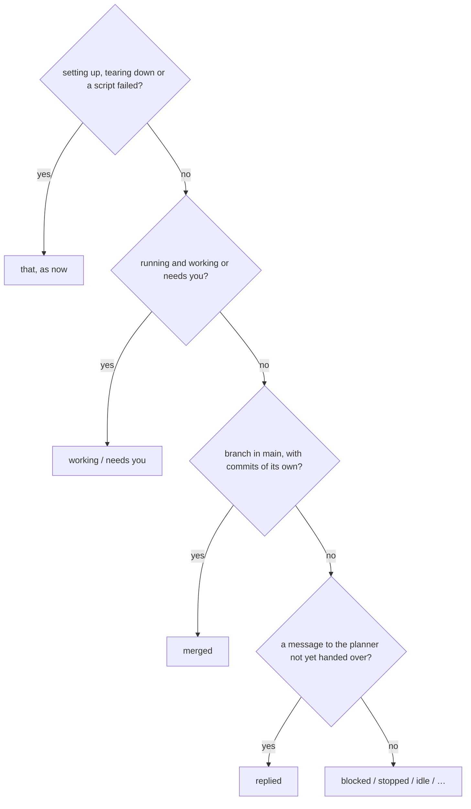
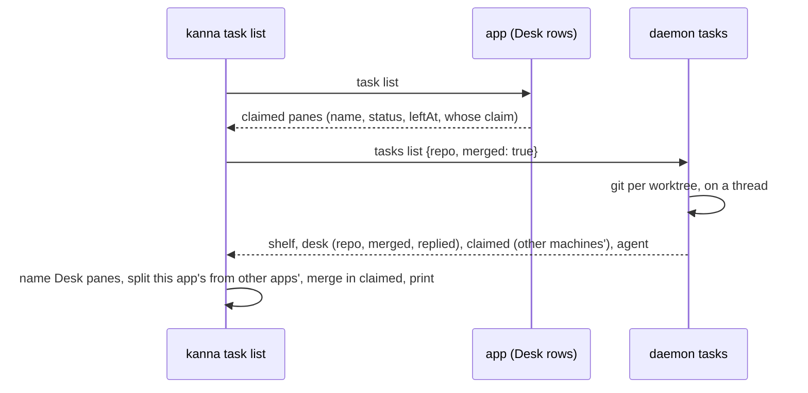

# Task list

**Status:** built · **Builds on:** [Desk](desk.md#5-cli), [tasks](tasks.md#7-cli), [blocked tasks](task-dependencies.md), [agent messaging](agent-messaging.md), [task scripts](task-scripts.md) · **Code:** `crates/kanna/src/commands/task.rs` (the text), `crates/kanna-daemon/src/tasks.rs` (`merged`, `replied`)

`kanna task list` is how the planning agent, and you, see what's on the Desk and what waits on the Shelf. The Desk is the app's ([app Desk](app-desk.md)): every task this machine's Kanna.app has on its Desk, wherever it runs. It reads the Desk first, then the Shelf, each under its own heading, with one short row per task, so the Desk's state reads at a glance. Its STATE says when a task's branch is already in main (`merged`) and when the task has said something to the planner that the planner hasn't had yet (`replied`), so a finished task never reads as one still to merge.

## Contents

1. [The output](#1-the-output)
2. [Rows](#2-rows)
3. [STATE](#3-state)
4. [Which tasks](#4-which-tasks)
5. [--json](#5---json)
6. [How it's built](#6-how-its-built)
7. [Rejected](#7-rejected)

## 1. The output

Run in the kanna repo, with Codex as one Shelf task's agent and every other task on the default:

```text
$ kanna task list
Desk
task-ffb6  Fix the flaky keeper take-back restart test  idle     just now
task-d1dc  Ink 1: threads with marks                    working  2m ago
task-66b7  Crash capture and restart                    merged   3h ago

Shelf
task-7804  Reload changed images in markdown            stopped
task-9387  Agent permission prompts setting             replied
task-2d07  Shelf history                                stopped  codex
task-3300  Desks are windows to ⌘` and the CLI          blocked  waits for "Next Window skips minimized windows"
task-aa69  Cloud 12: Build jobs and iOS from remote     blocked  waits for "Cloud 7: xcodebuild redirect to a build Mac"
```

With `--all`, every repo's tasks, and a row of another repo names it:

```text
$ kanna task list --all
Desk
task-ffb6  Fix the flaky keeper take-back restart test  idle     just now

Shelf
task-7804  Reload changed images in markdown            stopped
task-151a  send-key                                     stopped  ~/work/kmux
```

With `--include-done` and a QUERY, a third heading lists the done tasks of the same repos that match, newest first, each ending with when it was done, so an agent can check whether work was done already before it makes a task:

```text
$ kanna task list send enter --include-done
Shelf
task-7804  kanna send presses Enter                     stopped

Done
task-3c1a  kanna send submits in codex                           done 3d ago
```

Without a QUERY it lists the 5 tasks done last, a cheap look at what just finished, and says how many more there are:

```text
$ kanna task list --include-done
…

Done
task-41bb  Rate limiting                                         done 2h ago
task-3c1a  kanna send submits in codex                           done 3d ago
task-9e02  Shelf history                                         done 3d ago
task-77d0  Agent permission prompts setting                      done 4d ago
task-0b5e  Crash capture and restart                             done 5d ago
… 214 more done: add words to search them
```

### Desks across machines

The Desk lists every task this machine's app has on its Desk, also one running on another machine; such a row ends `on MACHINE`, as Other machines rows do, and its STATE is the one that machine published (`started`). Run on mbp, whose Desk has a task the Studio runs:

```text
$ kanna task list
Desk
task-ffb6  Fix the flaky keeper take-back restart test  idle     just now
task-ac2b  Port the stats page                          started  4m ago   on jeremys-mac-studio
task-d1dc  Ink 1: threads with marks                    working  2h ago
```

On the machine that runs it, the task is on another app's Desk, not that machine's: it lists under **Other Desks**, saying whose Desk it's on:

```text
$ kanna --host jeremys-mac-studio task list
Desk
(empty)

Shelf
task-7804  Reload changed images in markdown            stopped

Other Desks
task-ac2b  Port the stats page                          working  on mbp's Desk
```

Other Desks shows only when it has a row.

An empty Desk says so under its heading (`(empty)`); with a QUERY, a heading with no match is left out, and nothing matching says `no task matches "QUERY"`.

## 2. Rows

- **Columns:** the task's ID (shortened, [task IDs](task-ids.md)), its name, its STATE, then a tail of what else matters, in this order: its agent, its repo, what it waits for or when it was last active.
- **No column headings, no WHERE column:** the Desk and Shelf headings say where.
- **Agent only when it isn't the default:** a row whose agent isn't `tasks.agent` ([choosing the agent](tasks.md#6-choosing-the-agent)) names it (`codex`); a row on the default says nothing.
- **Repo only when it isn't the caller's:** never on the default list; with `--all`, a row of another repo shows its folder (`~/work/kmux`).
- **What it waits for, by name:** a blocked row says `waits for "NAME"`, several separated by commas, each by its ID instead when it has no name.
- **When it was last active:** Desk rows only (`2m ago`). A Shelf row doesn't say when it was made.
- **Order:** the Desk's tasks in the Desk's order, last claimed first, as the app adds them to its strip, wherever they run; the Shelf's in its own order. Making a task active reorders the app's strip but never reaches a daemon ([app Desk §2](app-desk.md#2-rules)), so the list doesn't follow it.
- **On another machine:** a Desk row of a task another machine runs ends `on MACHINE`, and its last active is when it was claimed. A task on another app's Desk ends `on NAME's Desk`, the app named by its machine ([machine links §4](machine-links.md#4-projects-desks-and-claims)).

## 3. STATE



- **`merged`:** the task's worktree has moved past the commit it started from (`kanna-base`, [task scripts](task-scripts.md)), and that commit is in the repo's main checkout's `HEAD` (`git merge-base --is-ancestor`), so the branch has nothing main lacks. A worktree too old to have `kanna-base` counts as moved when its `HEAD` reflog has a commit. A task with no worktree yet, or no commit, is never `merged`. Uncommitted changes don't count: what the planner needs is whether the work is in main.
- **`replied`:** the task sent the planner a message ([agent messaging](agent-messaging.md)) that hasn't been handed to it yet. The planner gets it at the end of its turn; until then the list says the task has something to say.
- **Working and needs you win:** a merged task that's still working says `working`, so it's never read as finished too early.

## 4. Which tasks

- **The caller's repo by default:** the repo the CLI runs in (its git common dir, as `kanna task new` finds it). Outside a git repo, every repo's.
- **`--all`:** every repo's, as the list was before.
- **QUERY** filters as before ([Shelf search](shelf-search.md#cli)).
- **`--include-done`:** done tasks too, from `kanna.db` ([database](database.md)), with `done` and `doneAt` in `--json`. With QUERY, every done task that matches; without it, only the 5 done last, and `moreDone` in `--json` says how many are left out: every task ever made would swamp an agent's context.

## 5. --json

The same object as before, filtered the same way (the caller's repo unless `--all`), with new fields:

| Field | On | Is |
|---|---|---|
| `merged` | each Shelf task and Desk task | `true` when STATE says `merged` |
| `replied` | each Shelf task and Desk task | `true` when a message to the planner waits |
| `agent` | the reply | the default agent (`tasks.agent`) of the caller's repo |
| `repo` | each Desk task | its repo, as Shelf tasks have |
| `machine`, `state` | a Desk task another machine runs | the machine, and the state it published, as in `elsewhere` |
| `otherDesks` | the reply | the tasks running here on another app's Desk, each with `desk`: whose (`mbp`) |

`tasks` is this app's Desk only: a task on another app's Desk is in `otherDesks`, and a task of this app's Desk that another machine runs is in `tasks`, not `elsewhere`.

## 6. How it's built



- **The daemon works out `merged`,** since it knows each task's worktree and runs where the repo is, also for a task on another machine. It does it only when asked (`merged: true`: the CLI's other `tasks list` calls, for IDs, don't), on a thread of its own, one thread per worktree, so the list isn't held up by git.
- **`replied`** is read from the messages not yet delivered whose recipient is `planner`.
- **This app's Desk, wherever it runs:** a claim on this machine's layout is this app's when it's `mac`; any other is a remote app's, named by its machine ([machine links §4](machine-links.md#4-projects-desks-and-claims)), and goes to `otherDesks`. A task another machine runs is on this app's Desk when its replicated record's `claim` is this machine's name: the daemon lists those as `claimed`, with `leftAt` the time of the claim's op, instead of in `elsewhere`, and the CLI places each among the local Desk rows by `leftAt`.

**Tested** by `commands/task.rs`'s `list_tests` (the layout, the agent and repo only where they differ, waits by name), `task_scripts.rs`'s `a_worktree_is_merged_once_its_own_commits_are_in_main`, `tests/cli.rs` (the caller's repo, `--all`, QUERY), `machines_shelf.rs`'s `a_task_on_this_app_s_desk_lists_under_its_desk_wherever_it_runs_and_the_machine_running_it_says_whose_desk` (two daemons: a task the Studio runs for mbp's Desk lists under mbp's Desk `on studio`, and under the Studio's Other Desks `on mbp's Desk`, text and `--json`), e2e `machine_remote_task` (with an app: vm's task on mbp's Desk is in vm's `otherDesks` with `desk` `mbp`, and in mbp's `tasks` with `machine` `vm`), and e2e `task_shelf` (a Desk task reads `replied` while its message to the planner waits, stays so after an unmerged commit, then `merged` once main merges it, and `--json` says `merged`).

## 7. Rejected

- **A `merged` check in the CLI:** the CLI may talk to another machine's Kanna, whose worktrees it can't see.
- **`merged` for any branch that's an ancestor of main:** a task that has started but not committed is one too, and would read as finished.
- **Column headings and a WHERE column under the section headings:** they repeated what the headings say.
- **Asking the app for its Desk:** it has the strip's exact order, but `task list` would then need the app running, and it isn't on a machine that only runs tasks. The claims are in the daemons already.
- **Another app's claims under this machine's Desk heading** (as before): the Studio listed mbp's tasks as its own Desk's, and mbp listed them under Other machines.
