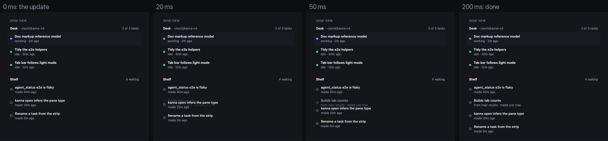
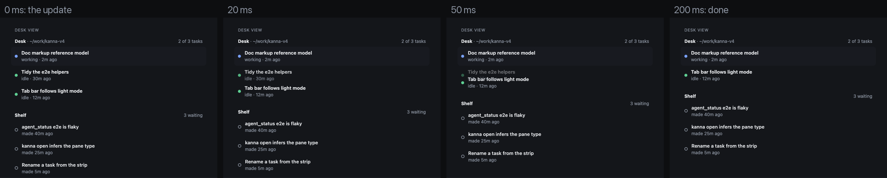
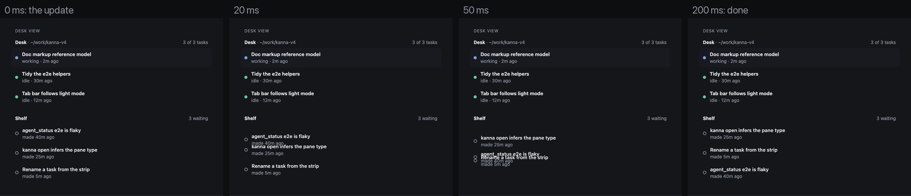
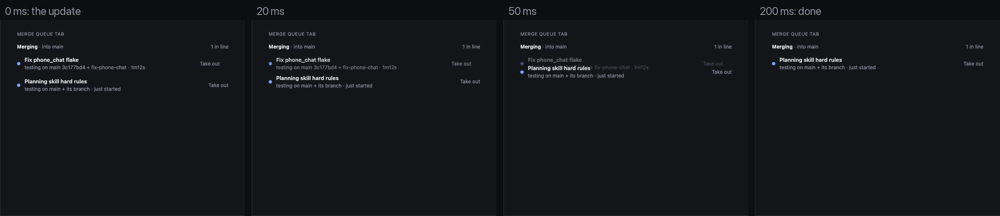
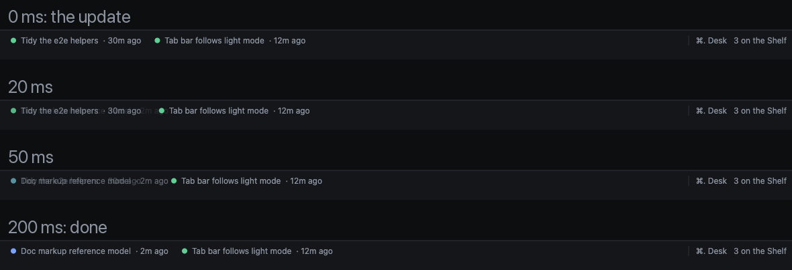
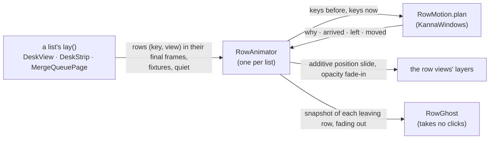

# Task row animation

**Status:** built · **Tested:** `RowMotionTests`, e2e `row_motion` · **Mockup:** [`references/mockups/task-row-animation.html`](../../references/mockups/task-row-animation.html) · **Part of:** [Desk view](desk-view.md), [Desk](desk.md#3-the-desks-tasks), [Merge queue tab](merge-queue-tab.md)

Tasks move by themselves now: the merge queue lands one, a Shelf runner starts one, one moves in from another machine. So when a task's row enters, leaves or changes place, it moves briefly instead of jumping, and you can see what just changed. One rule covers four lists on the Mac: the Desk view's Desk rows and Shelf rows, the strip under the active task, and the Merge queue tab's list. The phone's lists are unchanged.

| Arrive: a task comes onto the Shelf | Leave: a Desk task is Done |
|---|---|
|  |  |

| Change place: the Shelf's first row goes last | The queue: the first entry lands |
|---|---|
|  |  |

*(From the mockup, each frame at `#picture&case=arrive|leave|move|qland|switch&t=0|0.1|0.25|1`; the mockup plays them at real speed, or ten times slower.)*

## Contents

1. [Rules](#1-rules)
2. [How it's built](#2-how-its-built)
3. [Tests](#3-tests)
4. [Rejected](#4-rejected)
5. [Glossary](#5-glossary)

## 1. Rules

- **What moves.** A row arriving fades in while the rows below slide down to make room. A row leaving fades out while the rows below slide up. A row that changes place slides there. Headers and empty-state lines below a change slide with the rows.
- **Timing.** 0.2 s, ease-out `cubic-bezier(0.2, 0, 0, 1)`, no bounce, no scale, the same for all four lists (`RowMotion.duration`, `RowMotion.curve`).
- **A burst updates at once.** More than 3 rows arriving, leaving or changing place in one update (`RowMotion.most`) don't animate: 20 tasks moving over from another machine just appear. A row pushed along by another's arrival or leaving doesn't count as changing place.
- **So do these.** The first showing of a list (a launch, a relaunch, a new window), a list that has just been shown again (switching to its tab, ⌘. to the Desk view, a window coming back from behind others), and a Shelf search narrowing or clearing the list.
- **Reduce Motion** (System Settings › Accessibility › Display) turns it off: rows appear and disappear.
- **Nothing waits.** The list is in its final place the moment it updates; the motion is drawn over it. A click, a key or a drag acts on a row's final place, the list stays usable while it moves, and nothing waits for an animation to end.
- **Drag to the Shelf** keeps its own behaviour ([drag to the Shelf](desk-row-shelve.md)): updates during a drag don't animate, and the drop itself animates like any shelve, a leave from the Desk and an arrival on the Shelf.
- **Off screen costs nothing.** A list that's hidden, in a window that isn't visible or is wholly covered, doesn't animate, and a row outside the scrolled view doesn't either. No timers run: Core Animation draws the motion.
- **The Desk and the Shelf are one list.** The Desk view's rows are diffed as one sequence of keys, `desk/ID` and `shelf/ID`, so shelving a task is one leave and one arrival and the Shelf below slides with the Desk.

## 2. How it's built

- **`RowMotion`** (`KannaWindows/RowMotion.swift`) is the diff: given the keys a list showed and the keys it shows now, it returns the rows that arrived, left and moved, and why the update does or doesn't animate. Moved rows are those outside the longest run of kept rows still in their old order. No AppKit, so it's unit-tested.
- **`RowAnimator`** (`Windows/RowAnimator.swift`) is the one piece the four lists share. A list lays out its rows in their final frames, as before, then calls `update(container, rows:, fixtures:, quiet:)` before taking its old views out. The animator compares each kept key's last frame with its new one and adds an additive `position` animation from the difference to zero, fades each arrival's layer in, and puts a snapshot of each leaving row, a `RowGhost` that returns no hit, where the row was, fading out. A row already sliding starts from where it's drawn.
- **Stable identity.** Every row is keyed by the task's or entry's ID, so an update is a diff even when the list rebuilds the row's view (a status change does).

| List | Key | What changed |
|---|---|---|
| Desk view (`DeskView.lay`) | `desk/` pane ID, `shelf/` task ID | already kept rows by ID; now hands them, the headers, search field and empty lines to its animator before removing the old rows. A changed query, or a drag in progress, makes the update quiet |
| Strip (`DeskStrip.show`) | pane ID | rebuilt every item and removed the old ones first; now marks the old items retired, lays the new ones, animates, then removes the old |
| Merge queue tab (`MergeQueuePage.lay`) | queue entry ID | removed everything before laying out; now removes the old views after animating. It refreshes every 2 s while shown, and its list may be stale when the tab is shown, so the first list fetched after showing it catches up at once (`appeared(catchingUp:)`, `caughtUp()`) |

- **Shown again.** Each list calls `appeared()` from `viewDidUnhide` and `viewDidMoveToWindow`; its next update that changes rows doesn't animate.
- **Debug output.** `debug.desk` reports `motion`: for `deskView`, `strip` and `queue`, the last update that changed rows (`why`: `animated`, `first`, `quiet`, `hidden`, `reduce-motion` or `burst`; `arrived`, `left`, `moved`, how many rows `slid`, and a count of `updates`), and whether Reduce Motion is on. `debug.desk {still: true}` stands in for Reduce Motion, and `{still: null}` gives it back to the system setting.

## 3. Tests

- **Unit** (`RowMotionTests`): an arrival, a leave, a row changing place, rows pushed along not counted as moved, a swap, the strip's switch as a leave and an arrival, 3 changes animating and 4 not, 20 arriving as a burst, the first showing, Reduce Motion, a list off screen, a search, and nothing changed.
- **e2e** `row_motion` (`scripts/e2e/desk.sh`), in the Desk view and the strip:
  1. A new task arrives on the Shelf: the update animated, and its row, clicked at once, moves it to the Desk.
  2. A Desk task is Done: the update animated, the rows left are in order, and the row below, clicked at once, becomes active.
  3. The strip switches tasks: it ends in key order, the task that changed place slid, and clicking it at once makes it active.
  4. Five tasks made while the app is busy arrive in one update, which says `burst`.
  5. With Reduce Motion on, a task arriving says `reduce-motion`.

## 4. Rejected

- **A task flying between the Desk and the Shelf** as one continuous move, and **animating changes within a row** (working to idle, ready appearing): left out on purpose.
- **Waiting for an animation before acting:** a click during the motion would land where the row was drawn, not where it is.
- **A timer stepping the rows:** it would run on the main thread and keep running for lists nobody sees; Core Animation runs in the render server.

## 5. Glossary

| Term | Meaning |
|---|---|
| **Update** | One relayout of a list with a new set or order of rows |
| **Burst** | An update with more than 3 rows arriving, leaving or changing place |
| **Ghost** | The snapshot of a leaving row that fades out where it was; it takes no clicks |
| **Fixture** | A header, search field or empty-state line that slides with the rows but isn't counted |
