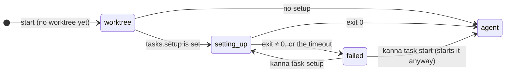
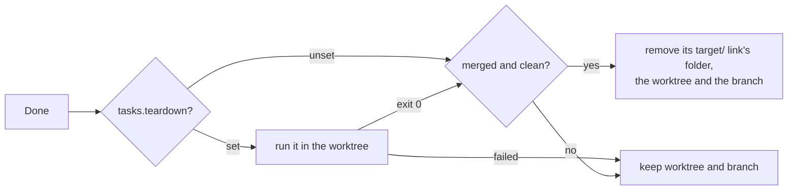

# Task scripts

**Status:** built · **Tested:** e2e `task_scripts`, `cargo test -p kanna-daemon` (settings, cleanup) · **Builds on:** [tasks](tasks.md), [settings](settings.md), [backlog runners](backlog-runners.md)

A repo says what a task needs before its agent starts (**setup**: install dependencies, copy `.env` files, borrow builds) and what to do once it's Done (**teardown**). Kanna runs them, so agents stop doing setup by hand, and a merged task's worktree and branch go away on Done instead of piling up.

## Contents

1. [Where they're set](#1-where-theyre-set)
2. [Setup](#2-setup)
3. [Teardown and cleanup](#3-teardown-and-cleanup)
4. [How it's built](#4-how-its-built)
5. [Rejected](#5-rejected)
6. [Glossary](#6-glossary)

## 1. Where they're set

```json
{ "version": 1, "tasks": { "setup": ".kanna/setup.sh", "teardown": "make clean", "timeout": 600 } }
```

- **`tasks.setup` and `tasks.teardown`** in the repo's `.kanna/config.json`, or yours (`~/.kanna-v4/config.json`) for repos without one ([settings](settings.md#3-keys)). Each is a shell command, run with your login shell (`$SHELL -lc`) in the task's worktree, so a script path such as `.kanna/setup.sh` is the worktree's copy.
- **`tasks.timeout`**, seconds (default 600), bounds each run.
- **Each run gets** the task's details in its environment:

| Variable | Is |
|---|---|
| `KANNA_TASK` | The task's ID (`task-1dfb12c2`) |
| `KANNA_TASK_NAME` | Its name |
| `KANNA_REPO` | The repo's main checkout |
| `KANNA_WORKTREE` | The task's worktree, where it runs |
| `KANNA_BRANCH` | The worktree's branch as it is now |
| `KANNA_BASE` | The commit the worktree was made from |

## 2. Setup



- **It runs in the agent's own terminal, before the agent,** so on the Desk you watch its output where the agent will be. When it succeeds, the agent starts there with its first message.
- **Once per worktree.** A resumed, restarted or stopped-and-started task doesn't run it again; a task that gets a new worktree does.
- **On failure the terminal says `setup failed (exit N)`** (or `setup timed out after Ns`) and exits, which stops the task, and `kanna task list` shows `setup failed (exit N)` until it runs again. `kanna task start` then starts the agent anyway, and `kanna task setup TASK` runs setup again: on a stopped task, then the agent; on a running one, in a terminal tab of the task named Setup.
- **`kanna task list` shows `setting up`** while it runs.

## 3. Teardown and cleanup



- **Done runs teardown,** after the agent and tabs close, before Kanna removes anything. Its output goes to the daemon's log. Stop and Move to Backlog don't run it.
- **Then Kanna cleans up a finished task:** when teardown succeeded (or there's none), the worktree has no changes (`git status` is empty: ignored files such as builds don't count), and its branch is merged into the repo's checked-out branch, Kanna removes the worktree (`git worktree remove`) and deletes the branch (`git branch -d`).
- **Otherwise both stay,** and the task's events and the daemon's log say why (`has changes`, `isn't merged into main`, `teardown failed (exit 2)`), so nothing unmerged is lost.
- **A worktree's `target/` can be a link** to a folder elsewhere, such as an external volume. Cleanup removes that folder as well as the link, so nothing is left behind there. It removes only what the top-level `target` link points to, and never follows links inside it: worktrees borrow from the main checkout (clones of its `target/<triple>/release`, links to its `target/ghosttykit` and `target/ghostty-vt`), and the main checkout's `target/`, including `target/.offline/`, is never touched. Only the task's own build folder is removed, with the link still pointing there and `target` not tracked by git: `ROOT/REPO/WORKTREE` under your `build.targets` ([build targets](build-targets.md)), or a folder whose path is in `kanna-target` in the worktree's git folder, written by whatever else made the link (such as the repo's setup). While its volume isn't mounted, only the link goes. Any other link, including one a branch commits, one into the repo's main checkout or another worktree, or one at a folder that holds one, is removed as a link only.

## 4. How it's built

- **Setup is part of the agent's command.** When the daemon starts a task in a worktree with no setup record and `tasks.setup` is set, it opens the agent's terminal with the setup run (under `perl -e 'alarm …'` for the timeout) before the agent's command. The run writes its exit code to `kanna-setup` in the worktree's git folder (`.git/worktrees/<name>/`), the record that it ran, and the terminal's command becomes the agent's resuming one, so a restart doesn't run setup again.
- **The base** is written to `kanna-base` in the same folder as the worktree is made, beside `kanna-setup` and `kanna-target`. They all go when the worktree does.
- **Teardown and cleanup run on a thread of the daemon** when a task is Done: when its agent's terminal closes (`kanna task done` on a running task) or it's taken off the backlog with a worktree. The result is a task event: `torn down` (with the exit code), then `cleaned up` or `kept` (with why).
- **The `target/` link's folder is removed with `remove_dir_all` on the link's own target,** which unlinks the links inside it rather than following them.

## 5. Rejected

- **Fixed files (`.kanna/setup`, `.kanna/teardown`) without settings:** a setting can be yours for repos you can't add files to, and can be a one-line command.
- **Setup in a separate tab before the agent opens:** a task has no tabs until its agent's terminal is open, and the agent's terminal is where you look on the Desk.
- **Removing an unmerged worktree on Done:** its commits would live only in the branch, and its uncommitted work nowhere.

## 6. Glossary

| Term | Meaning |
|---|---|
| **Setup** | A repo's command that prepares a new worktree before the agent starts |
| **Teardown** | A repo's command run on Done, before cleanup |
| **Cleanup** | Removing a finished, merged task's worktree, branch and build folder |
| **Git folder** | A worktree's own folder in the repo's `.git` (`.git/worktrees/<name>/`) |
