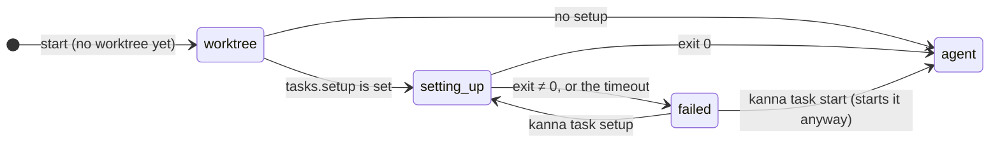
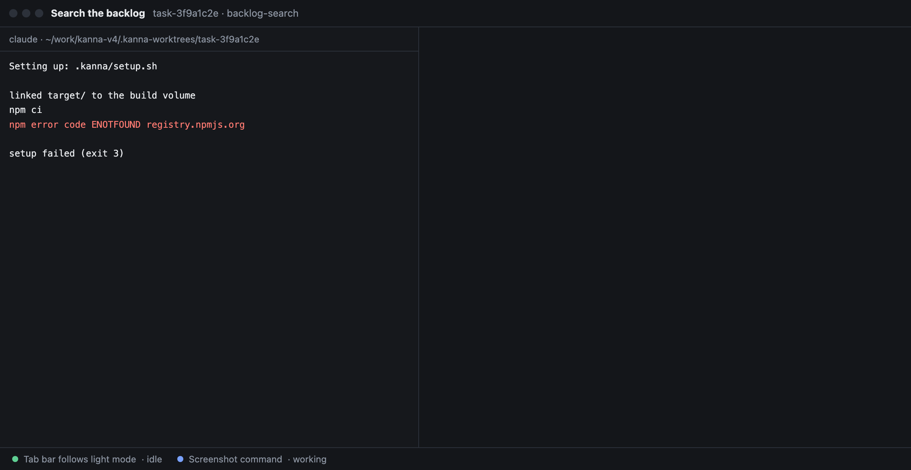
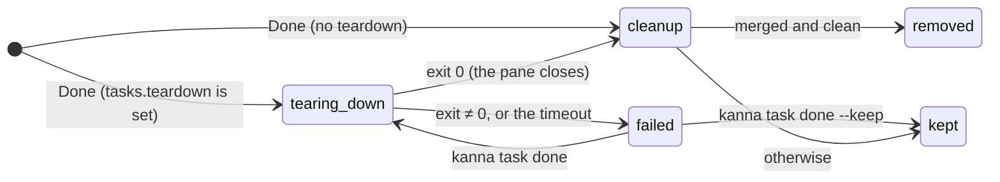
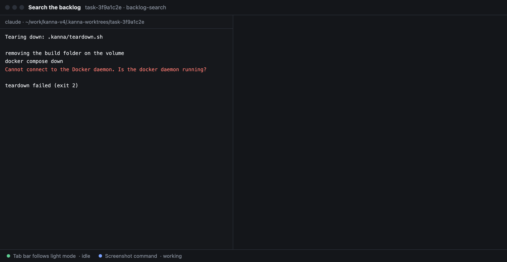

# Task scripts

**Status:** built · **Tested:** e2e `task_scripts`, `cargo test -p kanna-daemon` (settings, scripts, cleanup) · **Mockup:** [`references/mockups/task-scripts.html`](../../references/mockups/task-scripts.html) (`#setupFailed`, `#teardownFailed`, …) · **Builds on:** [tasks](tasks.md), [settings](settings.md), [Shelf runners](shelf-runners.md)

A repo says what a task needs before its agent starts (**setup**: install dependencies, copy `.env` files, borrow builds) and what to do once it's Done (**teardown**). Kanna runs them, so agents stop doing setup by hand, and a merged task's worktree and branch go away on Done instead of piling up.

## Contents

1. [Where they're set](#1-where-theyre-set)
2. [Setup](#2-setup)
3. [Teardown and cleanup](#3-teardown-and-cleanup)
4. [How it's built](#4-how-its-built)
5. [Rejected](#5-rejected)
6. [Glossary](#6-glossary)

## 1. Where they're set

```json
{ "version": 1, "tasks": { "setup": ".kanna/setup.sh", "teardown": "make clean", "timeout": 600 } }
```

- **`tasks.setup` and `tasks.teardown`** in the repo's `.kanna/config.json`, or yours (`~/.kanna-v4/config.json`) for repos without one ([settings](settings.md#3-keys)). Each is a shell command, run with your login shell (`$SHELL -lc`) in the task's worktree, so a script path such as `.kanna/setup.sh` is the worktree's copy.
- **`tasks.timeout`**, seconds (default 600), bounds each run.
- **Each run gets** the task's details in its environment:

| Variable | Is |
|---|---|
| `KANNA_TASK` | The task's ID (`task-1dfb12c2`) |
| `KANNA_TASK_NAME` | Its name |
| `KANNA_REPO` | The repo's main checkout |
| `KANNA_WORKTREE` | The task's worktree, where it runs |
| `KANNA_BRANCH` | The worktree's branch as it is now |
| `KANNA_BASE` | The commit the worktree was made from |

## 2. Setup





- **It runs in the agent's own terminal, before the agent,** so on the Desk you watch its output where the agent will be. When it succeeds, the agent starts there with its first message.
- **Once per worktree.** A resumed, restarted or stopped-and-started task doesn't run it again; a task that gets a new worktree does.
- **On failure the terminal says `setup failed (exit N)`** (or `setup timed out after Ns`) and exits, which stops the task, and `kanna task list` shows `setup failed (exit N)` until it runs again. `kanna task start` then starts the agent anyway, and `kanna task setup TASK` runs setup again: on a stopped task, then the agent; on a running one, in a terminal tab of the task named Setup.
- **`kanna task list` shows `setting up`** while it runs.

## 3. Teardown and cleanup





- **Done runs teardown in the agent's own pane:** the task's tabs close, its agent ends, and teardown runs where the agent was, so you watch it as you watched setup. `kanna task list` shows `tearing down`. Stop and Move to Shelf don't run it.
- **When it succeeds, the pane closes and the task is Done.** When it fails, the task isn't Done: it stays where it is, its pane showing the output and `teardown failed (exit N)` (or `teardown timed out after Ns`), and `kanna task list` says so. `kanna task done` runs it again; `kanna task done --keep` ends the task without it, keeping its worktree and branch; `kanna task start` brings the agent back.
- **With no pane to run in** (the agent's pane was closed by hand), teardown runs in the background as the task goes, its output in the daemon's log.
- **Then Kanna cleans up a finished task:** when the worktree has no changes (`git status` is empty: ignored files such as builds don't count) and its branch is merged into the repo's checked-out branch, Kanna removes the worktree (`git worktree remove`) and deletes the branch (`git branch -d`).
- **Otherwise both stay,** and the task's events and the daemon's log say why (`has changes`, `isn't merged into main`), so nothing unmerged is lost.
- **Only the worktree and branch.** Whatever the repo's setup made elsewhere is its teardown's to remove: `git worktree remove` removes a link in the worktree, not what it links to. Kanna's own repo's teardown removes the task's build folder ([build targets](build-targets.md#3-removing-a-task)).

## 4. How it's built

- **Setup is part of the agent's command.** When the daemon starts a task in a worktree with no setup record and `tasks.setup` is set, it opens the agent's terminal with the setup run (under `perl -e 'alarm …'` for the timeout) before the agent's command. The run writes its exit code to `kanna-setup` in the worktree's git folder (`.git/worktrees/<name>/`), the record that it ran, and the terminal's command becomes the agent's resuming one, so a restart doesn't run setup again.
- **Teardown replaces the agent's command.** On Done the daemon closes the task's tabs, ends the agent, and restarts its pane with the teardown run, which writes its exit code to `kanna-teardown` beside `kanna-setup`. When the pane exits, the daemon reads it: 0 closes the task, which makes it Done; anything else gives the pane back the agent's resuming command, for `kanna task start`.
- **The base** is written to `kanna-base` in the same folder as the worktree is made. The records all go when the worktree does.
- **Cleanup runs on a thread of the daemon** once the task is Done. The result is a task event: `torn down` (with the exit code), then `cleaned up` or `kept` (with why).

## 5. Rejected

- **Fixed files (`.kanna/setup`, `.kanna/teardown`) without settings:** a setting can be yours for repos you can't add files to, and can be a one-line command.
- **Setup in a separate tab before the agent opens:** a task has no tabs until its agent's terminal is open, and the agent's terminal is where you look on the Desk.
- **Removing an unmerged worktree on Done:** its commits would live only in the branch, and its uncommitted work nowhere.
- **Teardown in the background:** when it broke, nothing showed it; in the agent's pane you watch it, and a failure keeps the task open.
- **Removing what a worktree's `target/` links to:** where a repo keeps builds is the repo's business, and its teardown knows it.

## 6. Glossary

| Term | Meaning |
|---|---|
| **Setup** | A repo's command that prepares a new worktree before the agent starts |
| **Teardown** | A repo's command run on Done, before cleanup |
| **Cleanup** | Removing a finished, merged task's worktree and branch |
| **Git folder** | A worktree's own folder in the repo's `.git` (`.git/worktrees/<name>/`) |
