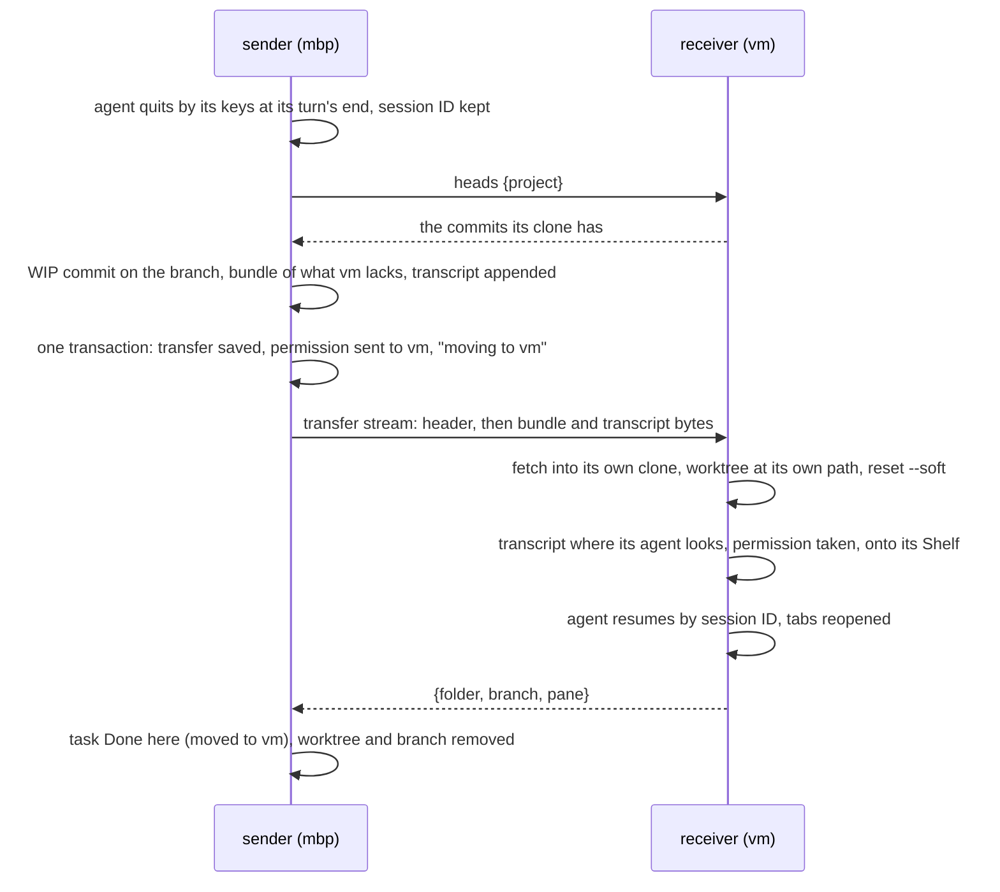
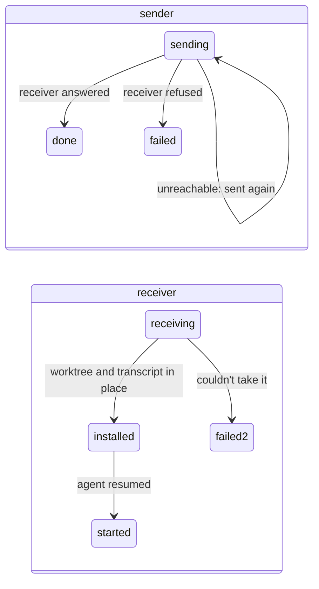

# Task Transfer

**Status:** built (slice 11) · **Tested:** `cargo test -p kanna --test machines_transfer` (two daemons with different home folders, mock claude and codex), `-p kanna-daemon transfer:: moving:: replica` · **Part of:** [tasks across machines §3](machine-tasks.md#3-transfer) · **Model:** [fleet-transfer](../../references/prototypes/fleet-transfer/README.md)

A task on one machine's Shelf moves to another of your machines at its turn's end and carries on there: its branch, its uncommitted work, its agent's conversation and its tabs.

## Contents

1. [Moving a task](#1-moving-a-task)
2. [What moves](#2-what-moves)
3. [The receiver](#3-the-receiver)
4. [Durable on both ends](#4-durable-on-both-ends)
5. [Interfaces](#5-interfaces)
6. [Limits](#6-limits)

## 1. Moving a task

```sh
kanna task move task-3f9a vm
```



- **Only a Shelf task moves,** one that has started (it has a worktree). A Desk task is refused (`on_desk`: shelve it first); a task that never started runs wherever a runner takes it, so it's refused too (`not_started`; `--on` says where it may run).
- **At a turn's end:** a stopped task moves as it is. A running agent that isn't in the middle of a turn is quit by its keys first (`Tasks::end_agent`), keeping its session ID, and its terminals hung up; one that's working is refused (`busy`).
- **Claude and Codex only:** their conversations resume by session ID from any folder. Another agent is refused (`agent`).
- **Nothing changes before the receiver answers `heads`:** an unreachable or refusing machine (no clone of the project) leaves the task exactly as it was.

## 2. What moves

| Part | How |
|---|---|
| The branch | a WIP commit of everything in the worktree (`git add -A`, ignored files excepted) on the branch's tip, made with `commit-tree` and `update-ref`; a git bundle of the branch less the commits the receiver's clone has (its branches, remote branches and tags); a full bundle when they share none |
| The transcript | byte for byte, from where the agent keeps it: Claude's `$CLAUDE_CONFIG_DIR` (else `~/.claude`) `/projects/<worktree path, every non-alphanumeric a dash>/<session>.jsonl`, Codex's `$CODEX_HOME` (else `~/.codex`) `/sessions/YYYY/MM/DD/rollout-…-<session>.jsonl`; no lock files, auth, databases or whole agent homes |
| The record | name, first message, agent, `after`, `on`, birth, who made it, the session ID |
| The tabs | the task's workspace's panes but its agent: type, path, cwd, url, command, line, diff args; paths inside the worktree are rewritten to the receiver's |

- **Packing twice doesn't stack WIP commits:** a branch whose tip is already a `kanna: work in progress of TASK` commit is reset onto its parent first.
- **The WIP commit never reaches origin:** the receiver undoes it, and the sender removes its branch once the receiver has the task.
- **No push:** the branch goes over the link, so a repo with no remote works too, and no machine needs to reach origin.
- **No path rewriting:** both agents resume a session by ID from another folder, the old paths staying in the history (checked 2026-10-21 with Claude Code 2.1.305 and Codex 0.163, and by the [model](../../references/prototypes/fleet-transfer/README.md) in both directions between a Mac and Linux).
- **v2's lessons:** copy the transcript from where the agent really keeps it (v2 copied a lock file and lost the transcript without noticing), never move a running agent, and test that the conversation carries on, not only that the transfer completed.
- **The permission goes with it:** in the same transaction that saves the transfer, the sender hands its permission to start the task to the receiver (`sent`, the next epoch; [tasks §2](machine-tasks.md#2-owners-and-grants)), so neither runs it twice. Its Shelf row says `moving to vm` meanwhile.

## 3. The receiver

- **Its own clone, its own paths:** the project's clone here (matched by project identity), a worktree `.kanna-worktrees/TASK` on the task's branch. If either name is taken by something else, it's `TASK-SENDER` and `BRANCH-SENDER`.
- **The dirty tree comes back staged:** `reset --soft` to the commit before the WIP one, and the index's tree is checked against the WIP commit's.
- **The transcript goes where this machine's agent looks** for that worktree's sessions; on a Mac, both the worktree's path and its real path, since `/var` is `/private/var`.
- **It carries on:** the task goes onto this Shelf with its folder and session (`moved`, from the sender), is started as any stopped Shelf task is (`claude --resume ID`, `codex resume ID`), its tabs open beside its agent, and then it answers.
- **A move back** to a machine the task left works the same: the old copy there is Done, the worktree and branch names are free again, and the permission comes at a newer epoch.

## 4. Durable on both ends



- **A `transfers` table** on each daemon holds each transfer's state and what it needs to go on (`id`, `task`, `role` out or in, `peer`, `state`, `doc`).
- **The sender keeps the task until the receiver answers,** and sends the same transfer (same ID, the bundle and transcript kept in `transfers/out/`) every 3 s while the receiver can be reached, after its own restart too. A receiver that's away is asked again on the [away schedule](machine-tasks.md#2-owners-and-grants).
- **The receiver takes a transfer once:** one it has `installed` resumes the task; one `started` answers again without doing anything. So a reply lost on the way, or a receiver that stopped before answering, ends with one copy.
- **A refusal calls it off:** the sender takes its WIP commit back off (the changes stay staged), takes its permission back, and its Shelf row says `didn't move to vm: WHY`.

## 5. Interfaces

| Command | Does |
|---|---|
| `kanna task move TASK MACHINE` | `tasks {action: "move", task, to}`: replies `{task, to, folder, branch, pane}` once the receiver carries on, or `{task, to, waiting: true, why}` when it can't be reached yet; errors `on_desk`, `not_started`, `agent`, `busy`, `no_session`, `no_transcript`, `moving`, `not_found`, `unreachable`, `refused` |

| Between daemons | |
|---|---|
| `replica {action: "heads", project}` on a `sync` stream | `{heads: [sha]}` of the clone here, or `no_clone` |
| a `transfer` stream | a header line `{id, size, args}`, then `size` bytes (the bundle, then the transcript, their sizes in `args`); the receiving node writes them to `transfers/in/ID.in`, hands the daemon `replica {action: "transfer", id, file, peer, …args}`, and writes its reply as one line. An app's certificate is refused (`not_a_daemon`); at most 4 GB |

`KANNA_TRANSFER_EXIT=installed` makes a receiver exit before it answers, for the durability test.

## 6. Limits

- Claude's and Codex's transcripts only: not Claude's per-session folder (subagents, large tool results), compacted history beyond the one file, attachments, or opencode and agy.
- Ignored files (builds, `node_modules`), Git LFS objects and submodules don't move; the repo's `tasks.setup` runs on the receiver as for any first start there.
- One task at a time per move; the CLI moves a Shelf task, not a Desk one, and the app has no gesture for it yet.
- A forged epoch from a paired machine isn't checked beyond the peer log's admission, as for grants: your machines trust each other.
