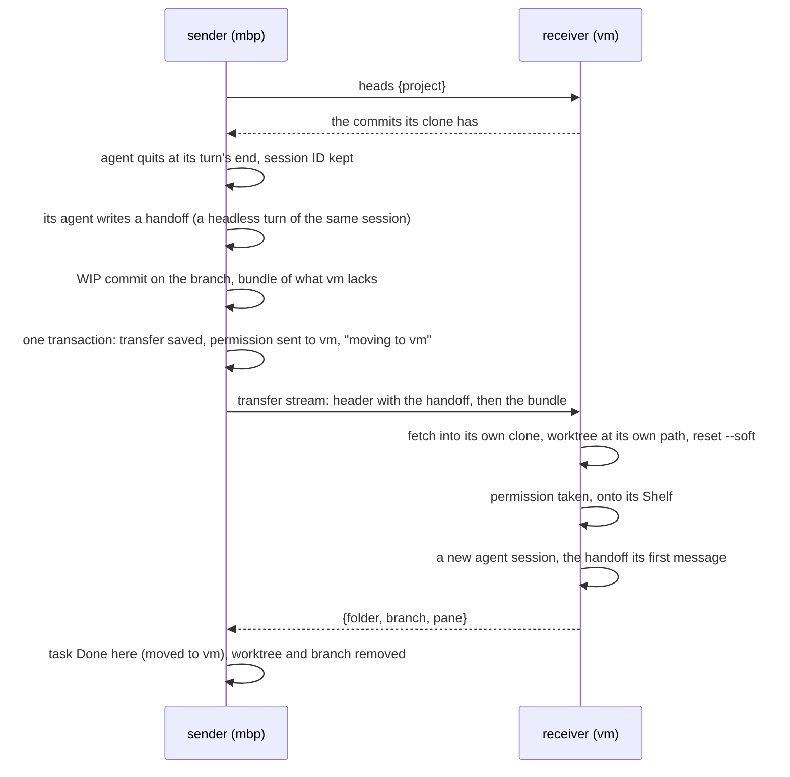
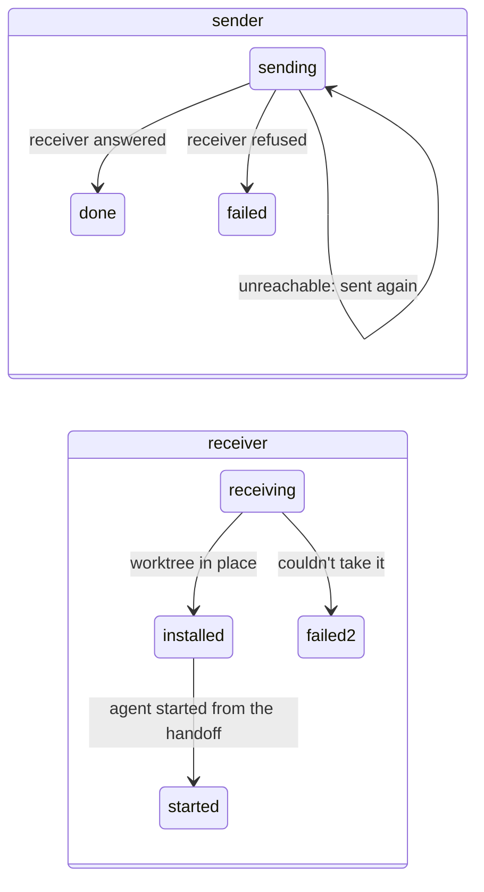

# Task Transfer

**Status:** built (slice 11) · **Tested:** `cargo test -p kanna --test machines_transfer` (two daemons with different home folders, mock claude and codex: a move each way, a receiver gone before it answers, a refusal, an agent that writes no handoff), `-p kanna-daemon transfer:: moving:: replica` (each case of §3's branch rules); real claude and codex moved from a MacBook Pro to a Mac Studio, each carrying on from its handoff to finish the task's second step there (2026-11-03) · **Part of:** [tasks across machines §3](machine-tasks.md#3-transfer) · **Model:** [fleet-transfer](../../references/prototypes/fleet-transfer/README.md)

A task on one machine's Shelf moves to another of your machines at its turn's end and carries on there: its branch and its uncommitted work go, and a new agent there starts from a handoff the old one wrote before the move, which also says what tabs were open. No tab moves (decided with the user, 2026-11-03). The conversation itself doesn't move (decided with the user, 2026-11-02; §4 says why).

## Contents

1. [Moving a task](#1-moving-a-task)
2. [What moves](#2-what-moves)
3. [The receiver](#3-the-receiver)
4. [The handoff](#4-the-handoff)
5. [Durable on both ends](#5-durable-on-both-ends)
6. [Interfaces](#6-interfaces)
7. [Limits](#7-limits)

## 1. Moving a task

```sh
kanna task move task-3f9a vm
```



- **Only a Shelf task moves,** one that has started (it has a worktree). A Desk task is refused (`on_desk`: shelve it first); a task that never started runs wherever a runner takes it, so it's refused too (`not_started`; `--on` says where it may run).
- **At a turn's end:** a stopped task moves as it is. A running agent that isn't in the middle of a turn is quit first (`Tasks::end_agent`), keeping its session ID, and its terminals hung up; one that's working is refused (`busy`).
- **Claude and Codex only, for now:** the handoff is written in a headless turn of the agent's own session, which needs its session ID and a one-shot mode (`claude -p --resume`, `codex exec resume`). Another agent is refused (`agent`); one with such a mode is a line in `handoff_args`.
- **Nothing changes before the receiver answers `heads`:** the receiver is asked first, so an unreachable or refusing machine (no clone of the project) leaves the task exactly as it was, its agent still running. A task whose session isn't known, or whose agent writes no handoff, stays here, stopped, with nothing committed.
- **While it's moving it doesn't start here:** `kanna task start`, `pick` and a message for it are refused or wait (`moving`), until the receiver answers or refuses.

## 2. What moves

| Part | How |
|---|---|
| The branch | a WIP commit of everything in the worktree (`git add -A`, ignored files excepted) on the branch's tip, made with `commit-tree` and `update-ref`; a git bundle of the branch less the commits the receiver's clone has (its branches, remote branches and tags); a full bundle when they share none |
| The record | name, first message, agent, `after`, `on`, birth, who made it, the task's base (the commit its worktree started from) |
| The handoff | the text the sender's agent wrote, and Kanna's list of the tabs that were open (§4) |

- **Packing twice doesn't stack WIP commits:** a branch whose tip is already a `kanna: work in progress of TASK` commit is reset onto its parent first.
- **The WIP commit never reaches origin:** the receiver undoes it, and the sender removes its branch once the receiver has the task.
- **No push:** the branch goes over the link, so a repo with no remote works too, and no machine needs to reach origin.
- **v2's lessons:** never move a running agent, and test that the work carries on on the receiver, not only that the transfer completed.
- **The permission goes with it:** in the same transaction that saves the transfer, the sender hands its permission to start the task to the receiver (`sent`, the next epoch; [tasks §2](machine-tasks.md#2-owners-and-grants)), so neither runs it twice. Its Shelf row says `moving to vm` meanwhile.

## 3. The receiver

- **Its own clone, its own paths:** the project's clone here (matched by project identity), and the worktree `.kanna-worktrees/TASK` on the task's branch.
- **The dirty tree comes back staged:** `reset --soft` to the commit before the WIP one, and the index's tree is checked against the WIP commit's. The task's base is recorded for the worktree, as on the sender.
- **The agent runs from this machine's path:** an agent named by an absolute path that isn't here runs by its program's name.
- **It carries on:** the task goes onto this Shelf with its folder (`moved`, from the sender), its agent starts a new session with the handoff as its first message (§4), and then it answers. No tab opens beside it. If its agent can't be started, the task stays here, stopped with why, and the receiver still answers, so only one machine has it.
- **On the sender it's away, not done:** its row there has the place `done`, but `kanna task list` shows it under Other machines, and under Done only once its record says it's done, with the time it finished. `kanna task done` on the sender changes nothing and says which machine runs it: `task-3f9a runs on vm, so nothing changed: end it there with kanna --host vm task done task-3f9a`. Kanna doesn't forward it: a peer gets no way to end your tasks beyond the `--host` it already has.
- **A move back** to a machine the task left works the same: the old copy there is Done, its worktree and branch were removed, and the permission comes at a newer epoch.

**A branch or worktree the receiver has already** (from an earlier run of the task, or an earlier transfer) is checked before anything is written, and nothing of the receiver's is overwritten:

| The receiver has | Then |
|---|---|
| the task's branch is this clone's default branch, or the one its main checkout is on | refused: `B is this clone's own branch, not a task's` |
| nothing of that name | a new worktree on a new branch at the WIP commit |
| the branch, at the task's commit before the move or behind it | fast-forwarded to the WIP commit, and a worktree made on it |
| the branch, not containing the task's base | refused: `this clone's branch B (at X) isn't this task's: it doesn't contain the task's base Y` |
| the branch, containing the base but neither behind nor at the task's commit | refused: `this clone's branch B has diverged from the task's: it's at X, the task at Y, and neither contains the other` |
| the branch checked out in another folder | refused, with git's reason, and the branch put back |
| `.kanna-worktrees/TASK`, a worktree of this clone on the task's branch, clean, at or behind the task's commit | reused: fast-forwarded, then `reset --soft` |
| that worktree already holding exactly what was sent (a transfer taken twice) | reused as it is |
| that worktree with changes of its own | refused: `… has uncommitted changes of its own, which taking the task would overwrite` |
| that folder on another branch, or not a worktree of this clone | refused: `… is there on OTHER, not B: it isn't this task's worktree` |

A refusal leaves the receiver's refs and files as they were (the fetched commits stay unreferenced), and the sender calls the move off (§5).

## 4. The handoff

- **Written before every move:** after the agent quits, the sender runs one headless turn of the same session in the worktree (`claude -p --resume ID PROMPT`, `codex exec resume ID PROMPT`), asking for a handoff: the goal and where it stands, decisions and why, what's done and what's left, the next step, open questions, the key files. It may take 5 minutes; without one (it failed, timed out or wrote nothing) the task doesn't move.
- **The new agent's first message** says the task moved here from the sender, names the branch and the commit (its uncommitted work staged), gives the task's first message, then the handoff. Kanna adds the branch and SHA itself rather than asking the agent for them. The task keeps its first message; its session is the new one.
- **Kanna adds the workspace:** a last section, `The workspace on MBP`, lists the task's tabs but its agent, as the sender had them: terminals by folder and what they ran, docs, files with their line, diffs with their arguments, web pages. Paths in the worktree are given relative to it; others are named as the sender's. The new agent opens again what it needs (`kanna open --tab`); nothing is reopened for it.
- **It's kept** in the worktree as `.kanna/tmp/handoff.md`, outside git, for you and the agent to read again.

**Why the tabs are described, not moved:** the tabs that matter are files in the worktree, which the agent can open again, and a terminal can't move with what it was running anyway. Reopening tabs meant rewriting paths and checking each one the peer sent (no command, nothing outside the worktree, only http pages, only safe diff arguments); a list in the handoff needs none of that. The cost: you open again the tabs you want, or the agent does.

**Why a handoff and not the conversation:** an earlier version copied the agent's transcript to where the receiver's agent looks and resumed it by session ID, with the handoff as a fallback ([model](../../references/prototypes/fleet-transfer/README.md)). It was dropped for the handoff alone:

- **Transcripts are each agent's private format:** where Claude and Codex keep them, how a path becomes a folder name, and what a resume needs can change with any release. A handoff is text Kanna controls.
- **The copy was lossy anyway:** Claude's per-session folder (subagents, large tool results) didn't move, so "the same conversation" was already partial.
- **Less to go wrong and to test:** no transcript search, install or `/private/var` duplicate, no 30-second watch for a resume that failed, one way to start on the receiver.
- **The cost:** the new agent knows only what the handoff says. Files the old one read, tool output and approaches it dropped are gone unless written down, and it rereads files to rebuild context, as after a compaction. Moves also cost one agent turn each.

## 5. Durable on both ends



- **A `transfers` table** on each daemon holds each transfer's state and what it needs to go on (`id`, `task`, `role` out or in, `peer`, `state`, `doc`).
- **The sender keeps the task until the receiver answers,** and sends the same transfer (same ID, the bundle kept in `transfers/out/`) every 3 s while the receiver can be reached, after its own restart too. A receiver that's away is asked again on the [away schedule](machine-tasks.md#2-owners-and-grants).
- **The receiver takes a transfer once:** one it has `installed` starts the task; one `started` answers again without doing anything; one still `receiving` when it restarted is taken again from the bytes sent again, the worktree from before reused by §3's rules. So a reply lost on the way, or a receiver that stopped before answering, ends with one copy.
- **A refusal calls it off:** the sender takes its WIP commit back off (the changes stay staged), takes its permission back, and its Shelf row says `didn't move to vm: WHY`.

## 6. Interfaces

| Command | Does |
|---|---|
| `kanna task move TASK MACHINE` | `tasks {action: "move", task, to}`: replies `{task, to, folder, branch, pane}` once the receiver carries on, or `{task, to, waiting: true, why}` when it can't be reached yet; errors `on_desk`, `not_started`, `agent`, `busy`, `no_session`, `moving`, `not_found`, `unreachable`, `refused`, `failed` (its agent wrote no handoff) |

| Between daemons | |
|---|---|
| `replica {action: "heads", project}` on a `sync` stream | `{heads: [sha]}` of the clone here, or `no_clone` |
| a `transfer` stream | a header line `{id, size, args}`, then `size` bytes, the bundle; the receiving node writes them to `transfers/in/ID.in`, hands the daemon `replica {action: "transfer", id, file, peer, …args}`, and writes its reply as one line, `{folder, branch, pane}`. An app's certificate is refused (`not_a_daemon`); at most 4 GB. `args` has `task` (`task-` and 8 hex digits, else refused), `branch` (a valid branch name), `pre`, `wip`, `base`, `handoff` (required, with Kanna's list of tabs at its end), `epoch` and the record |

`KANNA_TRANSFER_EXIT=installed` makes a receiver exit before it answers, for the durability test.

## 7. Limits

- The conversation doesn't move, only its handoff (§4); claude and codex only.
- Ignored files (builds, `node_modules`), Git LFS objects and submodules don't move; the repo's `tasks.setup` runs on the receiver as for any first start there.
- One task at a time per move; the CLI moves a Shelf task, not a Desk one, and the app has no gesture for it yet.
- A forged epoch from a paired machine isn't checked beyond the peer log's admission, as for grants: your machines trust each other. What a peer sends is still checked where it becomes a path or a command: task IDs and branch names. The handoff is only ever text for the agent to read.
- The handoff costs one agent turn per move.
- Claude asks whether to trust a folder it hasn't trusted, and the worktrees of a project it trusts are trusted with it. So the first task moved to a project that has never had a Claude task on the receiver starts at that question and waits for you there.
