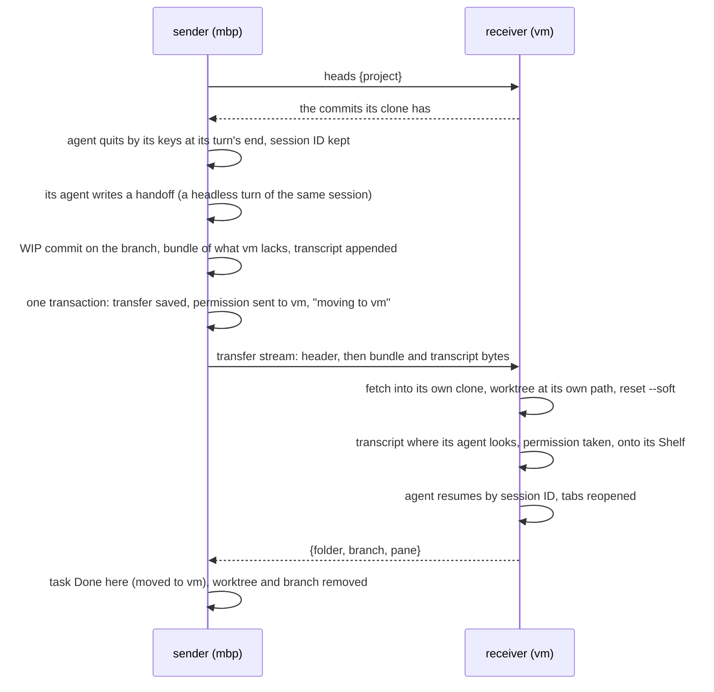
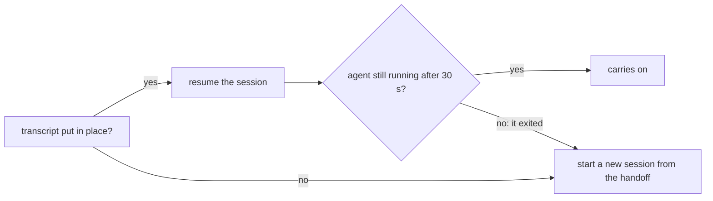
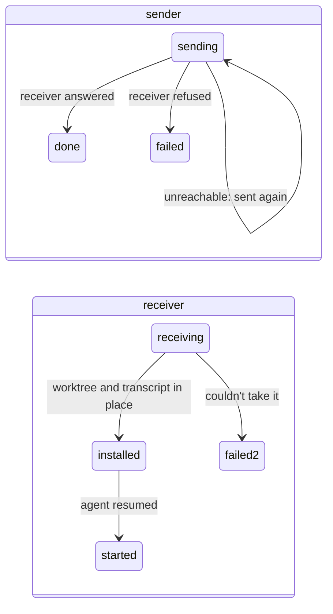

# Task Transfer

**Status:** built (slice 11) · **Tested:** `cargo test -p kanna --test machines_transfer` (two daemons with different home folders, mock claude and codex: a move each way, a receiver gone before it answers, a refusal, both handoff fallbacks), `-p kanna-daemon transfer:: moving:: replica` (each case of §3's branch rules) · **Part of:** [tasks across machines §3](machine-tasks.md#3-transfer) · **Model:** [fleet-transfer](../../references/prototypes/fleet-transfer/README.md)

A task on one machine's Shelf moves to another of your machines at its turn's end and carries on there: its branch, its uncommitted work, its agent's conversation and its tabs. Resuming the agent's own session is the normal path; a handoff its agent wrote before the move is the fallback.

## Contents

1. [Moving a task](#1-moving-a-task)
2. [What moves](#2-what-moves)
3. [The receiver](#3-the-receiver)
4. [The handoff fallback](#4-the-handoff-fallback)
5. [Durable on both ends](#5-durable-on-both-ends)
6. [Interfaces](#6-interfaces)
7. [Limits](#7-limits)

## 1. Moving a task

```sh
kanna task move task-3f9a vm
```



- **Only a Shelf task moves,** one that has started (it has a worktree). A Desk task is refused (`on_desk`: shelve it first); a task that never started runs wherever a runner takes it, so it's refused too (`not_started`; `--on` says where it may run).
- **At a turn's end:** a stopped task moves as it is. A running agent that isn't in the middle of a turn is quit by its keys first (`Tasks::end_agent`), keeping its session ID, and its terminals hung up; one that's working is refused (`busy`).
- **Claude and Codex only:** their conversations resume by session ID from any folder. Another agent is refused (`agent`).
- **Nothing changes before the receiver answers `heads`:** the receiver is asked first, so an unreachable or refusing machine (no clone of the project) leaves the task exactly as it was, its agent still running. A task whose session or transcript can't be found after its agent quit stays here, stopped.
- **While it's moving it doesn't start here:** `kanna task start`, `pick` and a message for it are refused or wait (`moving`), until the receiver answers or refuses.

## 2. What moves

| Part | How |
|---|---|
| The branch | a WIP commit of everything in the worktree (`git add -A`, ignored files excepted) on the branch's tip, made with `commit-tree` and `update-ref`; a git bundle of the branch less the commits the receiver's clone has (its branches, remote branches and tags); a full bundle when they share none |
| The transcript | byte for byte, from where the agent keeps it: Claude's `$CLAUDE_CONFIG_DIR` (else `~/.claude`) `/projects/<worktree path, every non-alphanumeric a dash>/<session>.jsonl`, Codex's `$CODEX_HOME` (else `~/.codex`) `/sessions/YYYY/MM/DD/rollout-…-<session>.jsonl`; no lock files, auth, databases or whole agent homes |
| The record | name, first message, agent, `after`, `on`, birth, who made it, the session ID, the task's base (the commit its worktree started from) |
| The handoff | the text the sender's agent wrote (§4) |
| The tabs | the task's workspace's terminals, docs, code, diffs and web pages but its agent, whose paths are inside the worktree: type, path, cwd, url, line, diff args; the receiver rewrites the paths to its worktree's, and reopens terminals as shells in their folder, without the command they ran |

- **Packing twice doesn't stack WIP commits:** a branch whose tip is already a `kanna: work in progress of TASK` commit is reset onto its parent first.
- **The WIP commit never reaches origin:** the receiver undoes it, and the sender removes its branch once the receiver has the task.
- **No push:** the branch goes over the link, so a repo with no remote works too, and no machine needs to reach origin.
- **No path rewriting:** both agents resume a session by ID from another folder, the old paths staying in the history (checked 2026-10-21 with Claude Code 2.1.305 and Codex 0.163, and by the [model](../../references/prototypes/fleet-transfer/README.md) in both directions between a Mac and Linux).
- **v2's lessons:** copy the transcript from where the agent really keeps it (v2 copied a lock file and lost the transcript without noticing), never move a running agent, and test that the conversation carries on, not only that the transfer completed.
- **The permission goes with it:** in the same transaction that saves the transfer, the sender hands its permission to start the task to the receiver (`sent`, the next epoch; [tasks §2](machine-tasks.md#2-owners-and-grants)), so neither runs it twice. Its Shelf row says `moving to vm` meanwhile.

## 3. The receiver

- **Its own clone, its own paths:** the project's clone here (matched by project identity), and the worktree `.kanna-worktrees/TASK` on the task's branch.
- **The dirty tree comes back staged:** `reset --soft` to the commit before the WIP one, and the index's tree is checked against the WIP commit's. The task's base is recorded for the worktree, as on the sender.
- **The transcript goes where this machine's agent looks** for that worktree's sessions; on a Mac, both the worktree's path and its real path, since `/var` is `/private/var`.
- **The agent runs from this machine's path:** an agent named by an absolute path that isn't here runs by its program's name.
- **It carries on:** the task goes onto this Shelf with its folder and session (`moved`, from the sender), is started as any stopped Shelf task is (`claude --resume ID`, `codex resume ID`), its tabs open beside its agent, and then it answers. If its agent can't be started, the task stays here, stopped with why, and the receiver still answers, so only one machine has it.
- **A move back** to a machine the task left works the same: the old copy there is Done, its worktree and branch were removed, and the permission comes at a newer epoch.

**A branch or worktree the receiver has already** (from an earlier run of the task, or an earlier transfer) is checked before anything is written, and nothing of the receiver's is overwritten:

| The receiver has | Then |
|---|---|
| nothing of that name | a new worktree on a new branch at the WIP commit |
| the branch, at the task's commit before the move or behind it | fast-forwarded to the WIP commit, and a worktree made on it |
| the branch, not containing the task's base | refused: `this clone's branch B (at X) isn't this task's: it doesn't contain the task's base Y` |
| the branch, containing the base but neither behind nor at the task's commit | refused: `this clone's branch B has diverged from the task's: it's at X, the task at Y, and neither contains the other` |
| the branch checked out in another folder | refused, with git's reason, and the branch put back |
| `.kanna-worktrees/TASK`, a worktree of this clone on the task's branch, clean, at or behind the task's commit | reused: fast-forwarded, then `reset --soft` |
| that worktree already holding exactly what was sent (a transfer taken twice) | reused as it is |
| that worktree with changes of its own | refused: `… has uncommitted changes of its own, which taking the task would overwrite` |
| that folder on another branch, or not a worktree of this clone | refused: `… is there on OTHER, not B: it isn't this task's worktree` |

A refusal leaves the receiver's refs and files as they were (the fetched commits stay unreferenced), and the sender calls the move off (§5).

## 4. The handoff fallback



- **Written before every move:** after the agent quits, the sender runs one headless turn of the same session in the worktree (`claude -p --resume ID PROMPT`, `codex exec resume ID PROMPT`), asking for a handoff: the goal and where it stands, decisions and why, what's done and what's left, the next step, open questions, the key files. Its reply travels in the transfer. It may take 5 minutes; without one (it failed or timed out) the task still moves, with no fallback.
- **Used only when the conversation can't follow:** the transcript can't be put in place on the receiver, or the resumed agent exits within 30 s of starting. Resuming stays the normal path.
- **The new agent's first message** says the task moved here from the sender and why its conversation didn't come, names the branch and the commit (its uncommitted work staged), gives the task's first message, then the handoff. Kanna adds the branch and SHA itself rather than asking the agent for them. The task keeps its first message; its session becomes the new one.
- **The handoff turn is part of the conversation** that moves, so a resumed agent knows it wrote one.

## 5. Durable on both ends



- **A `transfers` table** on each daemon holds each transfer's state and what it needs to go on (`id`, `task`, `role` out or in, `peer`, `state`, `doc`).
- **The sender keeps the task until the receiver answers,** and sends the same transfer (same ID, the bundle and transcript kept in `transfers/out/`) every 3 s while the receiver can be reached, after its own restart too. A receiver that's away is asked again on the [away schedule](machine-tasks.md#2-owners-and-grants).
- **The receiver takes a transfer once:** one it has `installed` resumes the task; one `started` answers again without doing anything; one still `receiving` when it restarted is taken again from the bytes sent again, the worktree from before reused by §3's rules. So a reply lost on the way, or a receiver that stopped before answering, ends with one copy.
- **A refusal calls it off:** the sender takes its WIP commit back off (the changes stay staged), takes its permission back, and its Shelf row says `didn't move to vm: WHY`.

## 6. Interfaces

| Command | Does |
|---|---|
| `kanna task move TASK MACHINE` | `tasks {action: "move", task, to}`: replies `{task, to, folder, branch, pane}` once the receiver carries on, or `{task, to, waiting: true, why}` when it can't be reached yet; errors `on_desk`, `not_started`, `agent`, `busy`, `no_session`, `no_transcript`, `moving`, `not_found`, `unreachable`, `refused` |

| Between daemons | |
|---|---|
| `replica {action: "heads", project}` on a `sync` stream | `{heads: [sha]}` of the clone here, or `no_clone` |
| a `transfer` stream | a header line `{id, size, args}`, then `size` bytes (the bundle, then the transcript, their sizes in `args`); the receiving node writes them to `transfers/in/ID.in`, hands the daemon `replica {action: "transfer", id, file, peer, …args}`, and writes its reply as one line, `{folder, branch, pane}` and `lost` when the handoff was used. An app's certificate is refused (`not_a_daemon`); at most 4 GB. `args` has `task` (`task-` and 8 hex digits, else refused), `branch` (a valid branch name), `pre`, `wip`, `base`, `session`, `transcriptName`, `handoff`, `tabs`, `epoch` and the record |

`KANNA_TRANSFER_EXIT=installed` makes a receiver exit before it answers, for the durability test.

## 7. Limits

- Claude's and Codex's transcripts only: not Claude's per-session folder (subagents, large tool results), compacted history beyond the one file, attachments, or opencode and agy.
- Ignored files (builds, `node_modules`), Git LFS objects and submodules don't move; the repo's `tasks.setup` runs on the receiver as for any first start there.
- One task at a time per move; the CLI moves a Shelf task, not a Desk one, and the app has no gesture for it yet.
- A forged epoch from a paired machine isn't checked beyond the peer log's admission, as for grants: your machines trust each other. What a peer sends is still checked where it becomes a path or a command: task IDs, branch names, transcript names, and tabs (no commands, paths only inside the worktree, web pages only http and https).
- The handoff costs one agent turn per move.
