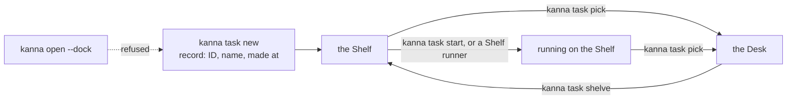

# Every task starts on the Shelf

**Status:** built · **Changes:** [docked pane](docked-pane.md), [each app's Desks](app-desk.md), [CLI caller](cli-caller.md), [CLI](cli.md), [tasks](tasks.md), [Desk](desk.md), [Desk view](desk-view.md) · **Decided with the user:** 2026-10-30

Every task is made on the Shelf, with a record and a creation time in `kanna.db`; moving it to the Desk is a separate step (`kanna task pick`). Before this, `kanna open … --dock` docked a pane straight onto a Desk as a task with no record, no ID and no creation time. That made two kinds of Desk task, and everything that reads a task (the Desk view's oldest-first order, history, Move to Shelf) had to handle the kind without a record.

So `open --dock` is gone. A docked pane comes only from a task: `kanna task new`, then `kanna task pick` (to the Desk) or `kanna task start` (running on the Shelf).

## Contents

1. [The one way in](#1-the-one-way-in)
2. [Rules](#2-rules)
3. [How it's built](#3-how-its-built)
4. [What it cost](#4-what-it-cost)

## 1. The one way in

## 2. Rules

- **Only the daemon docks a pane,** when it starts a task: `open {dock, frozen, task}`. An `open` with a dock is refused (`not_a_task`) unless it names the task the daemon is starting just then, so a client can't dock one by naming a task either.
- **The CLI has no `--dock` or `--frozen` on `open` or `markup`.** Typing them is a usage error that says what to do instead: `a docked pane is a task's agent: make a task with kanna task new, then kanna task pick or kanna task start`.
- **Every Desk task has a record,** so the daemon's `tasks` notice lists every Desk task with its `madeAt`, and the [Desk view](desk-view.md#2--and-pull-back) sorts by that alone.
- **Move to Shelf moves only a task:** the daemon no longer mints a record for a docked pane without one. `kanna task shelve PANE` on a pane that isn't a task's agent says `no running task "PANE"`.
- **A task's agent is always frozen,** so `move --dock` now refuses every pane: a task's agent with `frozen`, any other pane with `not_a_task`.
- **Planning and quiz agents aren't docked panes:** a Desk's planner (`planner`) and a Quiz window's agent (`lead`) are opened their own ways, and are unchanged.

## 3. How it's built

- **The core refuses it.** `kanna-mux`'s `open` refuses a dock without a `task`, and asks its `TaskBook` whether that task is starting (`starting(task)`). The daemon's book answers from the tasks it's launching; with no book (kanna-mux's own tests) a `task` is enough.
- **The CLI** turns `--dock` and `--frozen` on `open` and `markup` into the usage error above, so the old spelling gets a pointer rather than `unexpected argument`. kanna's `open` help is kmux's without them; `kmux_reference` lists them as kmux's own options and checks kanna refuses them.
- **The daemon** drops `mint_for`: Move to Shelf needs a running task's record.
- **The app** sorts the Desk's tasks by their place in the daemon's notice (`DeskOrder.byAge`), with no case for a task without one. A task just moved to the Desk sorts last for the moment between the app placing its pane and the daemon's notice listing it.
- **Checked by** `open_docks_only_a_task_s_agent` (kanna-mux), the CLI's `every_command_works_through_the_daemon_and_the_app` (a real task picked onto the Desk; `open --dock` and a raw docked `open` refused), `kanna_has_none_of_kmuxs_own_options_and_refuses_them`, `DeskOrderTests`, and the e2e scenarios that used to dock by hand, which now make tasks (`desk_task` in `scripts/e2e-kanna.sh`): `docked_pane`, `desk_tasks`, `layout_restored`, `clipboard`, `dock_keeps_focus_through_tabs`, `move_to_shelf`, `path_last_in_front` and `pane_sizes`.

## 4. What it cost

- **What users type:** `kanna open --dock` and `--frozen` are gone; the user agreed.
- **Unfrozen docks are gone in practice.** The layout still knows a dock that isn't frozen, but nothing makes one, so moving a dock to the other edge, dragging it and undocking it aren't reachable any more. `docked_pane` checks the frozen behaviour instead.
- **Tests got heavier.** A test that wants a docked pane makes a git repo and a task. Its agent is any command, with ` #` after it so the first message the daemon appends is a shell comment.
- **No migration.** A record-less docked pane left in a layout from before this change still shows on its Desk, sorted last, until its window closes; it can't be moved to the Shelf.
