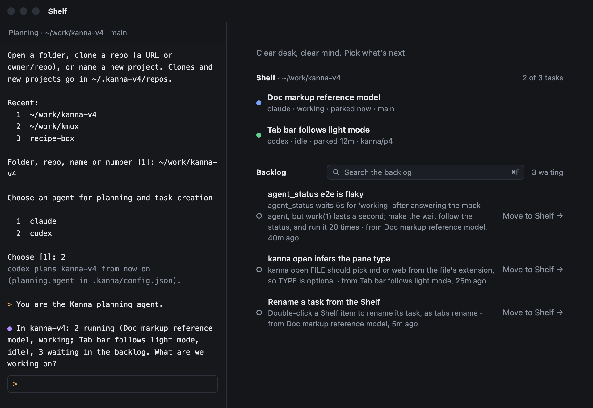
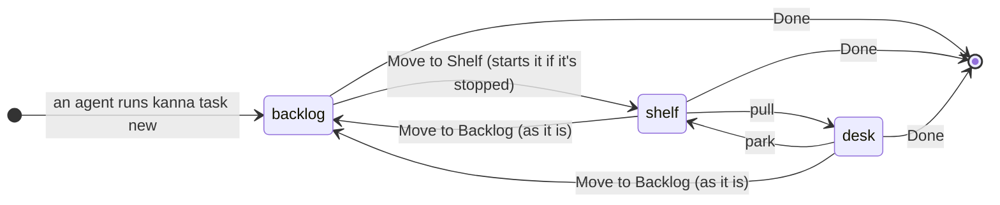
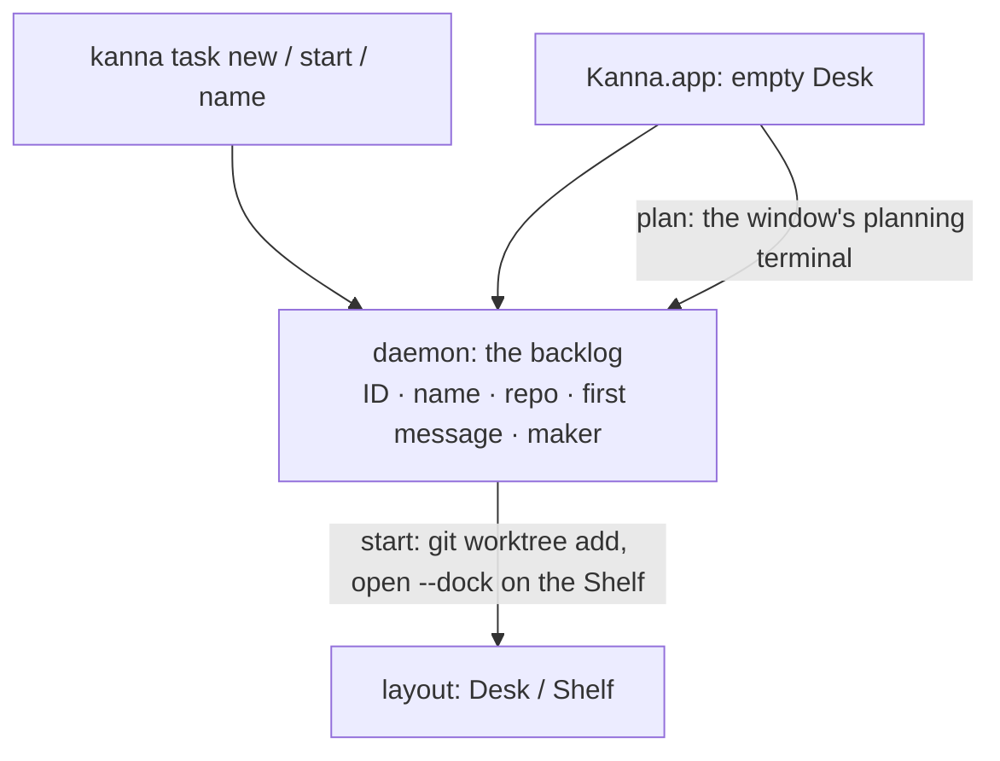

# Tasks

**Status:** built · **Mockup:** [`references/mockups/desk.html`](../../references/mockups/desk.html) (Simulate: no tasks; park to see the backlog; `kanna task new` in an agent's pane) · **Builds on:** [Desk](desk.md) · **From:** Kanna v2's tasks (a worktree per task) and v3's (a task belongs to a repo, and waits until it's pulled)

A **task** is one agent's work in one repo. Agents make tasks: they add them to the repo's **backlog**, and you move the ones you want to the Shelf, where each gets its own agent, branch and worktree. There's no form: you tell the window's [planning agent](planning-agent.md) what you want, and it makes the tasks.

## Contents

1. [What a task is](#1-what-a-task-is)
2. [How tasks are made](#2-how-tasks-are-made)
3. [The backlog](#3-the-backlog)
4. [Naming](#4-naming)
5. [Stop, Done, or back to the backlog](#5-stop-done-or-back-to-the-backlog)
6. [CLI](#6-cli)
7. [How it's built](#7-how-its-built)
8. [Open questions](#8-open-questions)
9. [Glossary](#9-glossary)

## 1. What a task is

- **One repo.** A task belongs to the repo it was made in, so it can later be sent to another machine or person with that repo.
- **A name and a first message.** In the backlog, that's all a task is.
- **Running and place are separate.** A task is in one place (the backlog, the Shelf, a Desk) and either **running** (its agent alive) or **stopped** (no agent; a new backlog task, or one stopped, its worktree, branch, conversation and tabs kept). `kanna task start` and `kanna task stop` change only whether it runs; Move to Shelf, Move to Backlog and pull change only where it is, except that Move to Shelf starts a stopped task.
- **Started, it runs in its own worktree `<repo>/.kanna-worktrees/<NAME>` on branch `<NAME>`, made from the repo's checked-out commit, and an agent there that gets the first message. NAME is the task's ID (`task-3f9a1c2e`, [task IDs](task-ids.md)), made with the task and checked against the repo's worktrees and branches; the agent renames the branch once it knows the work ([4](#4-naming)). The repo's `info/exclude` keeps `.kanna-worktrees/` and each worktree's `.kanna/tmp/` (an agent's scratch files, such as [code tour](code-tour.md) docs) out of git.
- **Every task works in a worktree.** All development happens in one, never in the repo's own checkout.
- **A new worktree runs the repo's setup** (`tasks.setup`) in the agent's terminal before the agent starts, once per worktree ([task scripts](task-scripts.md#2-setup)).
- **Kanna is git-based: a task needs a git repo.** In a folder that isn't one, making a task is refused; Kanna never runs `git init` itself. An agent sets the repo up with you (in a new, empty project, the planning agent does), and a repo with no commits yet works: its first task's branch starts empty (`git worktree add --orphan`), so the task's first commit is the project's. Kanna never commits for you.
- **The Shelf holds three per repo**: the one on the Desk and two on the Shelf, running or stopped. Any number run in the backlog.

## 2. How tasks are made

- **By an agent:** `kanna task new "NAME" "FIRST MESSAGE"` adds a task to the backlog of the repo it runs in. The **planning agent**, the one Kanna starts in a window's [planning terminal](planning-agent.md), makes them as you plan with it, and a task's agent splitting off its own work does too.
- **By you, by hand:** the same `kanna task new` in the repo, in any terminal.
- **Only these two.** The app never starts a blank task: every task is made with the CLI or by an agent, and started from the backlog (Move to Shelf, or `kanna task start` to run it there). There's no Start a task button or menu item.
- **A window with nothing in it** starts on the Shelf with its planning terminal (pictured above), where Kanna starts the planning agent: when Kanna opens with nothing, on File → New Desk (⌘N, in `~`), and on `kanna PATH` when no Desk is on PATH's project ([new Desk](new-desk.md)).
- **`kanna PATH` brings forward the project's Desk** when one is open (`kanna .` in a repo, a subfolder or one of its worktrees): it's the key window, its planning terminal or task focused, and the CLI says `brought forward w4 on ~/work/app`. Only with none does it open one (`opened w11 on …`). One project, one Desk; ⌘N still always opens a new one.
- **No New Instance.** kmux's Kanna → New Instance (a whole second Kanna with its own daemon, keeper and state) isn't in Kanna's menu: working on another project is what a Desk is for. Instances stay as a developer and testing tool (dev builds, `kanna --instance`), not a user feature ([build channels](build-channels.md)).
- **A new or empty project** (an empty folder, or not a git repo yet): the planning agent helps you decide what it is, sets it up (`git init` and a first commit only when you agree), and turns the plan into backlog tasks, with Kanna's `kanna-new-project` skill.

## 3. The backlog

- **The empty Desk lists it** under the Shelf: each task's name, its first message, and the task that made it.
- **Move to Shelf** puts a task on the Shelf, starting it if it's stopped: it makes the worktree and starts the agent with the first message. When the Shelf holds three, it's refused until one goes back to the backlog or is Done.
- **`kanna task start` runs a task where it is**: a backlog task gets its worktree and agent and stays in the backlog, running, so you can start several and move them to the Shelf later. `kanna task list` shows each one's state: working, idle, needs you, or stopped.
- **Oldest first.** A Desk's Shelf strip shows how many wait.
- **Search it** with ⌘F on an empty Desk, by name or first message: [backlog search](backlog-search.md).
- **A task can wait for others:** blocked, it can't start until they're Done ([blocked tasks](task-dependencies.md)).
- **Backlog tasks run by themselves,** a few at a time, and Kanna stops each when its agent's turn ends ([backlog runners](backlog-runners.md)).

## 4. Naming

- **A task's name is the one its maker gave it** with `kanna task new`, kept when it starts. Every task is made by an agent or with the CLI, so every task has a name from the start, and its agent doesn't name it. `kanna task name` renames one when you ask, running or waiting in the backlog; a backlog task starts with its new name, even one renamed while it starts. The app has no rename for a backlog task: it's the CLI's.
- **A backlog task's first message never changes.** Only its name can. To change what it says, make a new task and take the old one off with `kanna task done`: the agent that starts it gets the words it was made with, and its history says what it was asked.
- **It learns how from Kanna's skills.** [`kanna-tasks`](../../.agents/kanna-skills/skills/kanna-tasks/SKILL.md) names its branch, writes backlog first messages that stand alone and leaves starting tasks to you. The planning agent has its own, keyed on being told it's the planner ([agent setup](agent-setup.md#2-how-an-agent-knows-its-in-kanna)): [`kanna-planning`](../../.agents/kanna-skills/skills/kanna-planning/SKILL.md) (say what's running and waiting, plan with you, make backlog tasks, start or end them only when you ask, never write code), and [`kanna-new-project`](../../.agents/kanna-skills/skills/kanna-new-project/SKILL.md) for a folder that's empty or not a repo yet (decide what it's for, `git init` and a first commit only when you agree, then the first tasks). [`kanna-markup`](../../.agents/kanna-skills/skills/kanna-markup/SKILL.md) answers [review comments](doc-markup.md).
- **Agents in any repo have the skills** once you agree to [agent setup](agent-setup.md).
- **The agent renames its branch** with `git branch -m NEW` in its worktree, from `task-3f9a1c2e` to a short name for the work. The worktree's folder keeps its name: the agent and its terminals are in it.

## 5. Stop, Done, or back to the backlog

- **Stop ends a task's agent and terminals and leaves it where it is** (`kanna task stop`): on the Shelf, a Desk or in the backlog. Nothing closes: its agent's pane and terminals stay, exited, its other tabs stay with their comments, and the shown tab, focus and zoom stay, as do its worktree and branch. Starting it again (`kanna task start`, or Move to Shelf) runs its agent in that pane, resuming its conversation ([which agents resume](#which-agents-resume)), and reruns the terminals that were running when it stopped. A stopped task still takes its place on the Shelf.
- **Its agent quits as you'd quit it:** Stop, Done and a [backlog runner](backlog-runners.md#2-how-its-built) type its quit keys, and keep the session it says as it exits when the task has none of its own; it's hung up only if it has no keys or doesn't quit in 5s.
- **A task presents its work:** before its turn ends, its agent sets up its tabs to show what it changed and why, and that's what you see when you pull it ([presenting](presenting.md)).

- **Done ends the task:** its agent and tabs close, or it leaves the backlog.
- **Done quits the agent, runs the repo's teardown in its pane, then cleans up a merged task:** the task is Done once teardown succeeds (if it fails, the task stays, its pane saying why); its worktree and branch go when its branch is merged and the worktree has no changes; otherwise they stay, and its events say why ([task scripts](task-scripts.md#3-teardown-and-cleanup)).
- **Move to Backlog puts a task back** (Task menu, or `kanna task defer`), freeing its place on the Shelf: it leaves its Desk or the Shelf and waits in the backlog again, under its old ID if Kanna started it.
- **It stays as it is there,** running or stopped. A running agent carries on with whatever it was doing, and its tabs stay as they were.
- **Moving it to the Shelf again brings it back as it is:** the same agent and tabs, with no restart (a stopped one starts).
- **If its agent's pane closed meanwhile,** starting it opens a new agent in its worktree (a new worktree only if that's gone too), and the agent comes back to its conversation.

### Which agents resume

Kanna gives an agent a session ID of its own when it starts, if the agent takes one, and keeps it with the task; otherwise it resumes the latest session in the task's worktree, through the agent's own flag where that flag is the folder's, or by reading the agent's records by folder. Each task has its own worktree, so the folder's latest session is the task's. Once the agent has started, its pane's command is the resuming one, so `kanna restart` on it comes back to its conversation (claude refuses a session ID that already has one).

| Agent | Started with | Resumed with | A task Kanna didn't start |
|---|---|---|---|
| claude | `claude --session-id UUID 'FIRST'` | `claude --resume UUID` | `claude --continue` (the folder's latest), until a stop finds the ID it says |
| codex | `codex --yolo --no-daemon 'FIRST'` (it takes no ID) | `codex --yolo --no-daemon resume ID`, the one it said as it quit, else `resume --last` (the folder's latest: codex filters by folder) | the same |
| copilot | `copilot --yolo --session-id UUID -i 'FIRST'` | `copilot --yolo --session-id UUID` | the latest session in `~/.copilot/session-state/*/workspace.yaml` whose `cwd` is the folder (`copilot --continue` isn't the folder's) |
| opencode | `opencode --prompt 'FIRST'` (it takes no ID) | `opencode --session ID`, the latest top-level session in `~/.local/share/opencode/opencode.db` whose `directory` is the folder (`--continue` is the repo's, shared by its worktrees) | the same |
| antigravity | `agy --dangerously-skip-permissions -i 'FIRST'` (it takes no ID) | `agy --dangerously-skip-permissions --conversation ID`, the one it said as it quit, else `--continue` (the folder's last conversation) | the same |

**Tested** by e2e `real_agent_tasks` for claude and codex: the real agents run as tasks against a local mock model (`tools/agent-harness`), come back to their conversation after `kanna restart` on their first start, and after Move to Backlog, Stop (by their quit keys) and Start, the mock sees their next message carry the first, with no second start. Copilot and antigravity only talk to their own services, and opencode (which could use the mock as a provider) isn't covered yet, so only their command lines are tested (`backlog.rs`).

An agent not in the table starts again with its first message, its conversation lost; so do copilot and opencode when no session of theirs is found for the folder. Copilot, opencode and antigravity take the first message as a flag (`-i`, `--prompt`), not an argument.

- **Done on a backlog task that's still running** ends its agent and tabs too.

## 6. CLI

| Command | Does |
|---|---|
| `kanna task new NAME [FIRST-MESSAGE] [--agent CMD] [--after TASK,…]` | Add a task to this repo's backlog (the agent defaults to `$KANNA_AGENT`, else `claude`, and starts without asking permission); `--after` makes it wait for others ([blocked tasks](task-dependencies.md)) |
| `kanna task edit TASK --after TASK,…\|none` | Change what a backlog task waits for |
| `kanna task start TASK` | Run a task where it is: a backlog task gets its worktree, agent and first message and stays in the backlog; a stopped task's agent comes back, resuming its conversation |
| `kanna task stop [TASK]` | End a task's agent and hang up its terminals, leaving it where it is with its tabs as they are (default: the one you're in) |
| `kanna task shelve TASK [--window WINDOW]` | Move a backlog task to the Shelf (or onto that Desk), starting it if it's stopped; refused when the Shelf holds three |
| `kanna task name [TASK] NAME` | Rename a task (default: the one you're in), running or in the backlog (`task-3f9a`); a backlog task starts with the new name |
| `kanna task list [QUERY]` | Every task: ID, name, where (a Desk, the Shelf, the backlog), state (working, idle, needs you, or stopped), repo; with QUERY, only those whose name or first message has every word ([backlog search](backlog-search.md#cli)) |
| `kanna task defer [TASK]` | Move a task back to the backlog as it is, running or stopped (default: the one you're in) |
| `kanna task done [TASK]` | End a task, or take it off the backlog |
| `kanna agents [status]` | Whether your agents are set up for Kanna, and whether this Kanna has newer skills ([agent setup](agent-setup.md)) |
| `kanna agents setup [--ask]` | Install Kanna's skills and Claude's sandbox entry (`--ask`: say what and ask first) |
| `kanna agents update [--ask] [--force]` | Bring the skills up to this Kanna's, merging your changes (`--force`: Kanna's over yours) |
| `kanna agents remove` | Take back what Kanna installed |

`park` and `pull` are the [Desk's](desk.md#5-cli).

## 7. How it's built

- **The daemon keeps the backlog** in `kanna.db` ([database](database.md)), with every task from made to done and each change of its place or state as an event, so agents add tasks with or without the app.
- **The daemon opens planning terminals** (`backlog` `plan`): it makes the command (the context limit, agent setup, the planner script, then your shell) and opens it as the window's planner in its folder ([new Desk](new-desk.md#3-how-its-built)).
- **A running task is its docked agent pane**, as on the [Desk](desk.md): its name is the pane's name, its repo the pane's folder.
- **Only a task's agent docks.** `kanna move PANE --dock` refuses any pane that isn't docked (`not_a_task`), so a task starts only by starting one and the limit holds.
- **A task's agent is frozen** ([docked pane](docked-pane.md#2-rules)): the daemon opens it with `open --dock --frozen`, so it stays in its dock, and nothing is dropped, swapped or docked in its place, which would make another pane the task.
- **A task running in the backlog is parked, not closed:** starting a backlog task opens its agent docked straight into the backlog, outside the limit, and a task moved there keeps its window. The layout keeps its workspace (agent docked, tabs, its windows) in the backlog, saved with the rest, so its panes keep running and survive a relaunch; the Shelf, the limit and `pull` skip it. Its backlog entry names its agent's pane, and moving it to the Shelf clears the mark.
- **Moving a task to the Shelf** checks the limit, runs `git worktree add` if it has no worktree, opens the agent docked straight onto the Shelf in that folder with the first message (or releases its window from the backlog, starting a stopped agent), names the pane, and drops the backlog entry.
- **Stopping** closes nothing: it hangs up the task's running terminals, marking each to run again, then its agent's (SIGHUP to its process group), keeping the panes exited, saved with the rest ([presenting](presenting.md#3-how-its-built)). **Starting a stopped task** restarts the agent's pane with the command that resumes it ([which agents resume](#which-agents-resume)), so it keeps its ID and place, then the marked terminals with their own commands and folders.
- **One table per agent** in the daemon (`AGENTS` in `backlog.rs`) says how to start it without asking permission, how to pass the first message, how to name a new session, how to resume one, how to resume the folder's latest, and where to find its sessions by folder. The lookup runs when a task starts again, not before: while the agent runs, its session may not be written yet.
- **An ID is never handed out twice.** A new task's ID is saved as it's made, so a restart can't reuse one, and a task keeps it from made to done. IDs name tasks only; worktrees and branches get their own random names, so a lost `kanna.db` or another Kanna on the same repo can't collide with them.
- **A task's agent doesn't ask permission.** Starting one adds the agent's own flag for that (`claude --dangerously-skip-permissions`, `codex --yolo`, `copilot --yolo`, `agy --dangerously-skip-permissions`; opencode has none) unless its command already says how to ask (`--permission-mode`, `--ask-for-approval`/`-a`, `--allow-all`/`--allow-all-tools`, `--mode`). The planning agent and the quiz agent start the same way. The task works in its own worktree, and you watch it on the Desk. The backlog keeps the command as written.
- **A Codex task runs in its own terminal:** starting one adds `--no-daemon`, so Codex runs its session itself rather than in its shared background server, which runs every session's commands and hooks with the environment of whichever terminal started it. With the flag, Codex's commands and hooks get the task's `$KANNA_PANE` and `$KANNA_SOCKET`, as Claude's do.

## 8. Open questions

1. **Task IDs that travel:** IDs ([task IDs](task-ids.md)) are random 32 bits, checked only on this machine; sending tasks elsewhere may want longer ones.
2. **Codex, opencode and antigravity take no session ID up front:** they resume the folder's latest session, which is the task's while each task has its own worktree. If one starts to take an ID, it moves to the ID like claude and copilot.
3. **Codex saves its last reply a moment after showing it:** in its own terminal (`--no-daemon`) it writes the reply to its session about a second after it appears, and a stop within that second (SIGHUP, then SIGKILL a second later) loses the reply: started again, it shows the question and "Conversation interrupted". [Backlog runners](backlog-runners.md) wait for the turn to end and quit codex with its own keys; `kanna task stop` still hangs up; `real_agent_tasks` waits for the reply to be saved.

## 9. Glossary

| Term | Meaning |
|---|---|
| **Task** | One agent's work in one repo, shown on a Desk |
| **Backlog** | A repo's tasks off the Shelf: a name and a first message each, and the agent of each one started there or moved back running |
| **Running / stopped** | Whether a task's agent is alive; separate from where the task is |
| **Repo** | The git repository a task belongs to |
| **Worktree** | A second checkout of the repo, in `.kanna-worktrees/`, on the task's own branch |
| **Agent setup** | Kanna's skills in your home folder for Claude and Codex, and Claude's sandbox letting agents reach Kanna; installed and updated when you agree ([agent setup](agent-setup.md)) |
| **First message** | What the agent is told when its task starts |
