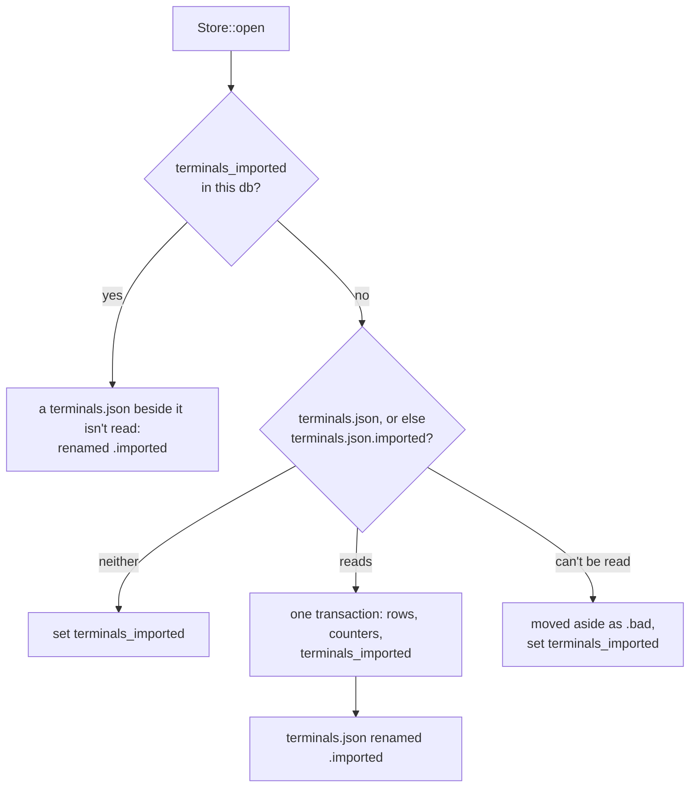

# Terminal Records

**Status:** built · **Builds on:** [the database](database.md), [durable panes](durable-panes.md), [restarting the daemon](daemon-restart.md)

Each terminal's record, and the pane, terminal and pty counters, live in `kanna.db`. Screen snapshots stay as files in `terminals/`.

A record is the only link from a pty to its pane, which makes it lasting state like a task's row. `terminals.json` predated the db and was never moved, so a task's `terminal` column and the layout named a pane in one file while its pty was recorded in another. A bad `terminals.json` had nothing to restore from; `kanna.db` has `kanna.db.bak`.

## Contents

1. [The table](#1-the-table)
2. [Writing](#2-writing)
3. [The import](#3-the-import)
4. [Starting without a db](#4-starting-without-a-db)
5. [Recovery](#5-recovery)
6. [Downgrades](#6-downgrades)
7. [Tested by](#7-tested-by)

## 1. The table

**terminals** (migration 29): one row per terminal the daemon keeps.

| Column | Type | Holds |
|---|---|---|
| `id` | text, key | the pty's ID (`pty-52`), or `term-41` for one older than ptys' own IDs |
| `pane` | text, unique | the pane that shows it (`term-41`) |
| `keeper` | text, unique | the ID the keeper knows the pty by |
| `state` | text | `running` or `exited` |
| `doc` | JSON | `name`, `cmd`, `cwd`, `exitCode`, `pid`, `cols`, `rows`, `hungUp` |

`meta` holds `terminal_counters`, `{pane, terminal, pty}`, and `terminals_imported` once this db has had its one import.

## 2. Writing

- **Every save is a db write:** the same moments as before, from the daemon's main loop: each change, a stop (`hang_up_all`, `shutdown`), and an exit.
- **Rows that changed:** the store remembers what it last wrote, deletes the rows that went, upserts the ones that differ, and writes the counters, all in one transaction. A change that touches no record writes nothing.
- **An exit before its ack:** the exit is committed, then acknowledged to the keeper. If the commit fails the ack is skipped, so the keeper keeps the exit and the next daemon gets it with its code.
- **A failed write** is logged. The next change writes everything that still differs.
- **One file, separate transactions:** a task's row, the layout and the records still commit apart. Sharing a WAL means a power loss drops the newest commits in order, and all three restore from one copy.

## 3. The import

- **Once per db:** the mark is written with the rows, so a crash before the rename leaves the file beside a db that has it, and the next start only renames it.
- **Versions 1 to 3:** read as the store always did. `content_ids::migrate` runs first and rewrites a version 1 or 2 file with terminal IDs, renaming the layout and tasks to match. A version 1 file's screens are renamed to their terminal IDs.
- **After `Db::open`:** the import runs after the start's `kanna.db.bak` is taken, so that first copy has no records. A db restored from it has no mark, and the import runs again from `terminals.json.imported`.
- **A failed import** stops the daemon with the file left in place. Running on would write records that the next start's import overwrites.

## 4. Starting without a db

**The daemon refuses to start if it can't keep its records.** `Db::open` returns an error when `kanna.db` can't be made, and the daemon logs `can't keep the records in FOLDER` and exits 1, as it does when it can't keep the terminals' folder. This replaces running with tasks in memory.

- **Why refuse:** in memory, every task made and every pty's pane would be gone at the next restart, with only a log line to say so, and the layout and tasks on disk would be out of reach meanwhile. A daemon that won't start is visible, and nothing is lost: the keeper holds the programs, and the next daemon takes them back.
- **When it happens:** rarely. The daemon has already written `daemon.lock` to the same folder, so it takes a folder that stopped being writable, or a filesystem error.

## 5. Recovery

`kanna.db.bak` is as new as the last daemon start, and [the database](database.md)'s recovery restores records with everything else.

- **Ptys started since that start** aren't in the copy. They come back as new panes, and panes whose run changed since then are dropped. Their tasks lose the pane, and those tasks' docs lose their comment targets (`no pane`), until `kanna markup DOC --to PANE` points them again.
- **No copy at all:** the import from `terminals.json.imported` gives back the records as they were when it was imported.
- **IDs skip ahead:** a restored db's counters are old, and a doc may still name a pane made after them. So a db that was lost starts the terminal and pty counters 1000 further on, and a new pane doesn't take the ID of one that went.

Having the keeper hold each pty's pane ID would close the gap, since it outlives any copy of the db. That changes the keeper's protocol, so it isn't done here.

## 6. Downgrades

An older daemon doesn't read `terminals`, and a db with a higher version isn't touched at all: it moves `kanna.db` aside as `kanna.db.newer`, finds `kanna.db.bak` newer too, and starts a new db from `backlog.json.imported`, or empty. This holds for every migration, and this one adds a loss:

- **Tasks and layout** are lost to that daemon, until `kanna.db.newer` is moved back by hand.
- **Terminals:** it finds no `terminals.json`, so it takes back every pty the keeper holds as a new pane with no name. No program stops.
- **Coming back:** the older daemon's `terminals.json` is imported into the db it made, which has no mark. Terminals made after the move are only in `kanna.db.newer`.

## 7. Tested by

- `crates/kanna-daemon/tests/restart.rs`: `a_terminals_json_is_imported_with_its_ptys_running_in_the_keeper`, a db with no records and a `terminals.json` with a restarted pane, a side pane and an exited one: pane IDs, pty IDs, pids, screen and exit code unchanged, counters continue, a file found later isn't read. The rest of that file and `shutdown.rs` read their records from `kanna.db`.
- `store.rs`: versions 1 to 3, a bad file, once per db, only changed rows and unknown keys kept, a db lost and a db restored skipping IDs. `db.rs`: a db that can't be made is refused.
- e2e `daemon_restart`, `task_pane_keeps_comments`, `task_history` (a corrupt db at restart).
