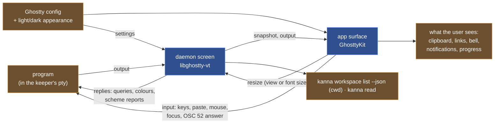

# Terminal Behaviour

**Status:** built ([plan](../plans/mux-build.md) track C) · **Builds on:** [the app link](app-link.md) · **Reference:** kmux, and Ghostty's macOS app where kmux does nothing · **Related:** [terminal links](terminal-links.md)

Everything a terminal pane does in kmux works in Kanna.app, although the pty lives in the daemon and not in the app. kmux's own handling is small: it loads Ghostty's config, keeps a shell's folder (OSC 7) as the pane's cwd, and leaves the rest to Ghostty. Kanna does the same, and where kmux does nothing (bells, notifications, cursor shapes, link checks) it does what Ghostty's macOS app does.

## Contents

1. [The program's state in the daemon, the user's in the app](#1-the-programs-state-in-the-daemon-the-users-in-the-app)
2. [The config](#2-the-config)
3. [What each behaviour does](#3-what-each-behaviour-does)
4. [The app's terminal views](#4-the-apps-terminal-views)
5. [Debug mode](#5-debug-mode)
6. [Decided](#6-decided)
7. [Not done; checked by](#7-not-done-checked-by)
8. [Glossary](#8-glossary)

## 1. The program's state in the daemon, the user's in the app

A terminal has two copies of its screen: the daemon's (libghostty-vt, always there) and the app's surface (GhosttyKit, only while shown). Each behaviour belongs to the copy that is there when it's needed:

- **The daemon** answers the program and remembers what must outlive the app: queries (including colours), modes, the cwd, the scrollback, what `read` returns. So a program gets the same answers with the app closed, and a relaunched app gets the same screen back.
- **The app's surface** does what a person sees or touches: drawing, the selection, keys and IME, the mouse, the clipboard, links, the bell, notifications, progress. It runs Ghostty's own code for these, with Ghostty's rules, and its replies to the program are dropped (the daemon answered already), except for what only it can say: keys, paste, mouse and focus reports, and the answer to an OSC 52 read, which go to the pty as `input`.



## 2. The config

The app loads Ghostty's config as kmux does (`ghostty_config_load_default_files`, then the files they include, then `finalize`), so a Kanna terminal looks and behaves as the user's Ghostty does. Ghostty's `reload_config` (⌘⇧, by default) reloads it; a conditional theme (`theme = light:…,dark:…`) follows the app's light/dark appearance:

```mermaid
sequenceDiagram
    participant M as macOS
    participant A as Kanna.app
    participant G as GhosttyKit
    participant D as daemon
    participant P as program
    P->>D: ESC[?2031h (report scheme changes)
    M->>A: appearance → dark
    A->>G: set color scheme dark (app and every surface)
    G->>A: CONFIG_CHANGE (the dark theme's config)
    A->>D: settings {foreground, background, palette, scheme: dark, …}
    D->>D: every screen: default colours, scheme
    D->>P: ESC[?997;1n (only to programs that asked)
    P->>D: OSC 11 ? (background colour)
    D->>P: OSC 11 ; rgb:… (from the dark theme)
```

**`settings`** ([app link](app-link.md#2-messages)) carries the foreground, background, cursor colour, the 256-colour palette, the scheme, the cursor style and blink, and the grapheme width method. The daemon keeps the last one in `terminals/settings.json` (0600), so a restarted daemon answers colour queries the same way before the app is back, and applies it to every screen, new or restored (default colours, cursor and mode defaults, scrollback limit). The cursor colour isn't readable from a config, so the app takes it from a live surface's defaults.

## 3. What each behaviour does

| Behaviour | kmux | Kanna | Checked by |
|---|---|---|---|
| Colour queries (OSC 4, 10, 11, 12), DECRQSS cursor style | Ghostty's pty answers from the theme | the daemon answers from `settings`, with or without the app | kanna-vt tests, `terminal_behaviour.rs`, `terminal_colours` |
| Light/dark | Ghostty's theme switch | the same, and the daemon reports the scheme to programs that set mode 2031 | `terminal_behaviour.rs`, `terminal_colours` |
| Shell folder (OSC 7) | the pane's cwd: `list`, restart, restore | the daemon parses it (`file://` on this host, or `kitty-shell-cwd://`) and sets the pane's cwd: `list`, `restart` | `terminal_behaviour.rs`, `cwd_title` |
| Title (OSC 0/2) | not shown | kept on the surface (`onTitle`, for the tabs should they want it); not shown | `cwd_title` |
| Copy, paste, selection, bracketed paste | Ghostty's | Ghostty's; ⌘C/⌘V, the selection clipboard is the app's own | `clipboard` |
| OSC 52 | read only during input events (so in effect never), write allowed | Ghostty's rules: `clipboard-read` (ask), `clipboard-write` (allow), with a sheet when asked; plus Ghostty's unsafe-paste check | `clipboard` |
| Mouse reporting, selection, scrolling | Ghostty's | Ghostty's; reports go to the pty as `input` | `mouse_keys_focus` |
| Keys, IME, kitty keyboard | Ghostty's | Ghostty's ([4](#4-the-apps-terminal-views)); the program's keyboard mode is in the snapshot, so it survives a relaunch | `mouse_keys_focus` |
| Focus reporting (mode 1004) | Ghostty's | the surface reports focus in and out; the mode is in the snapshot | `mouse_keys_focus` |
| Cursor shapes, link hover | Ghostty's macOS app sets them; kmux doesn't | the app sets the mouse cursor Ghostty asks for and a pointer over a link | by hand (`debug.terminal` reports `hoveredLink`) |
| ⌘-click a link | Ghostty's fallback opener: anything | web, mail and plain documents only ([terminal links](terminal-links.md)) | KannaLinks tests, `links_bell_notify` |
| Bell | nothing | Ghostty's `bell-features`: system beep, the Dock's attention request | `links_bell_notify` |
| Desktop notifications (OSC 9, OSC 777) | nothing | Ghostty's (`desktop-notifications`, its rate limit), posted with UserNotifications | `links_bell_notify` |
| Progress (OSC 9;4) | nothing | kept on the surface (`onProgress`) | `links_bell_notify` |
| Font size (⌘+, ⌘−, ⌘0) | the surface's grid changes, and its pty with it | the surface asks the daemon for the new grid (`resize`), as a view resize does | `resize_arrange`, `font_size_scrollback` |
| Synchronized output (mode 2026) | Ghostty's | Ghostty's; a snapshot taken mid-update ends it after Ghostty's timeout | by hand |
| Scrollback | Ghostty's `scrollback-limit` (10 MB default) | the daemon keeps 10 MB, no line limit; `read --lines` | kanna-vt tests, `font_size_scrollback` |
| Search | none | none, as kmux | — |
| Dropping files, images or text | Ghostty's: file paths, shell-escaped and space-separated, or the text, pasted | the same, plus what Ghostty drops: a file promise (a screenshot's thumbnail, Mail, Photos) is saved and an image with no file (a browser's) is written as a PNG, both in `$TMPDIR/kanna-drops`, and its path pasted, so an agent in the pane gets the image. A drop is a paste: bracketed paste and the unsafe-paste question apply as for ⌘V, and a path with a control character in its name is written as `$'…'` with `\xHH` escapes, so no name can run a command | KannaDrop tests, `chrome_and_drops` (`debug.drop`) |

## 4. The app's terminal views

- **Typed text goes out as key events.** Committed text is sent as the key event's text, as Ghostty's app does; `ghostty_surface_text` is the paste path and would wrap every keystroke in bracketed-paste markers. A lone control character is reported without Control, function-key private-use characters aren't text, and text starting with a control character or DEL is dropped so the encoder works from the key code (Shift+Return reaches kitty-keyboard programs as `CSI 13;2u`).
- **The clipboard follows Ghostty's rules**, not kmux's; the app only supplies the clipboard and the confirmation sheet.
- **Focus follows the first responder**, not key-window status, so a pane keeps its focused cursor across reparenting. `ghostty_surface_set_occlusion` with visibility false stops the renderer updating at all, so `KANNA_IGNORE_OCCLUSION=1` (the test scripts) keeps hidden windows drawing.
- **`screenshot` and `debug.snapshot` capture with `CGWindowListCreateImage`**, drawing terminals hidden from Ghostty first, so an occluded window's come out legible ([screenshot](screenshot.md#3-how-its-built)).
- **Keeping the surface right across a snapshot** (the Ghostty fork, `kanna4`): loading a snapshot replaces the surface's terminal, so the fork keeps what belongs to the surface and not to the program: whether it's focused and visible (focus reports stay correct), the config's cursor style and colours (unless the program chose its own), and the image limits. A widening resize keeps the scrollback inside its byte limit, so a snapshot after it loads whole. A font size change asks the host for a new grid instead of resizing the surface's own terminal, which only the daemon's resize may do.
- **Surfaces** are made when a pane is first shown and kept while it's in the layout ([windows](windows.md#4-terminal-views)). An exited surface stays, showing its last screen, until the pane's program starts again: then the app gives the pane a new surface and attaches it as a new pane's, keeping the pane's place, focus and keyboard. The old one can't be reused: Ghostty closes an exited surface on a typed key instead of sending it, and it keeps the old program's modes (mouse reporting, keyboard protocol, bracketed paste). The app knows the program started again when a `snapshot` comes after `exited`; on reconnecting it forgets the exits, since the daemon sends `exited` again after each snapshot of a pane that's still exited.

## 5. Debug mode

`KANNA_DEBUG=1` turns on the `debug.*` commands and puts a small **Debug** label at the right of each window's title bar; the terminals work as usual, on the system clipboard, so a Kanna someone uses can run with it.

`KANNA_TEST_EFFECTS=1`, which only `scripts/e2e-kanna.sh` sets, makes a surface act on nothing outside the app: the clipboard is a private pasteboard (`dev.kanna.debug.<pid>`), and links, bells and notifications are recorded, not opened, rung or posted; confirmation sheets are answered no. It's one variable for all of these, since each would reach the user's desktop from a test. The app reads it; the daemon doesn't need it.

`debug.terminal {pane, clipboard?, action?, zoom?, click?, appearance?}` sets them up and reports the surface: grid and cell size, title, hovered link, selection, background colour, clipboard, links with their decisions, what was opened, bells, notifications, progress, settings and focus.

## 6. Decided

| Decision | Chosen | Why |
|---|---|---|
| Who answers the program | the daemon, for everything it can; the surface only for keys, mouse, focus, paste and OSC 52 reads | one answer, the same with the app closed |
| Clipboard reads | Ghostty's `clipboard-read` (ask), not kmux's input-event check | kmux's check refuses every OSC 52 read; Ghostty's asks the user, and the config can allow or deny |
| Bell, notifications, cursor shapes, links | as Ghostty's macOS app | kmux does nothing for them; Ghostty's app is the reference for terminal behaviour |
| Links | web, mail and plain local documents; every other scheme, and anything that could run code, refused | terminal output is untrusted; a confirmation is one click from running a handler the program chose |
| Scrollback | 10 MB, no line limit | the limit can't be read from a config through libghostty's API, and every snapshot crosses the app link and is saved; 10 MB is Ghostty's default |
| Titles | kept, not shown | kmux doesn't show them; the tabs can |
| Surfaces | made when a pane is first shown, kept while it's in the layout | focus, mouse and keyboard modes are the surface's, and a tab switch shows a live screen |

## 7. Not done; checked by

**Not done:** OSC 5522 (kitty's clipboard protocol) gets only part of its replies; kitty graphics aren't in a snapshot, so images go when the app relaunches; an empty OSC 7 is ignored; a title isn't shown again after a relaunch until the program sets it.

**Checked by** `crates/kanna-vt/tests/terminal.rs` (colour answers, scheme reports, cursor defaults, title and cwd changes, snapshots after widening), `crates/kanna-daemon/tests/terminal_behaviour.rs` (colour queries from the app's theme, also after a restart; scheme reports; the shell's folder in `list`), `apps/kanna/Tests/KannaLinksTests` (every link rule), `apps/kanna/Tests/KannaDropTests` (escaping dropped paths), and of `scripts/e2e-kanna.sh`: `terminal_colours` (theme and light/dark, with screenshots), `cwd_title`, `clipboard` (⌘V in a pane and in a docked one, OSC 52, selection), `system_clipboard` (with `KANNA_DEBUG=1` and no `KANNA_TEST_EFFECTS`, the surface reads the system clipboard and ⌘V pastes it, without writing it), `mouse_keys_focus` (kitty keys, mouse and focus reports after a relaunch), `font_size_scrollback`, `links_bell_notify` (links, bell, notifications, progress), `chrome_and_drops` (dropped files and images), `task_restart_typing` (typing into an agent's pane after its task stops and starts again, also across a daemon restart).

## 8. Glossary

| Term | Meaning |
|---|---|
| **Surface** | One terminal view's Ghostty terminal in the app (GhosttyKit): it draws the screen and handles keys, mouse, selection and clipboard. |
| **Settings (terminal)** | What the app's Ghostty config says about colours, scheme, cursor and graphemes, sent to the daemon so it can answer programs. |
| **OSC** | Operating System Command: an escape sequence a program writes to set or ask for something (title, folder, colours, clipboard, links, notifications). |
| **OSC 52** | The escape sequence a program uses to read or write the clipboard. |
| **Light/dark scheme** | Which of a conditional theme's two halves applies; follows the app's appearance and is reported to programs that ask (mode 2031). |
