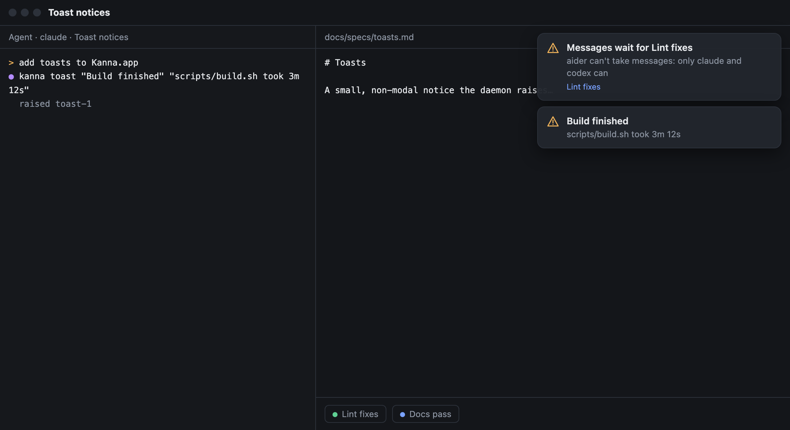
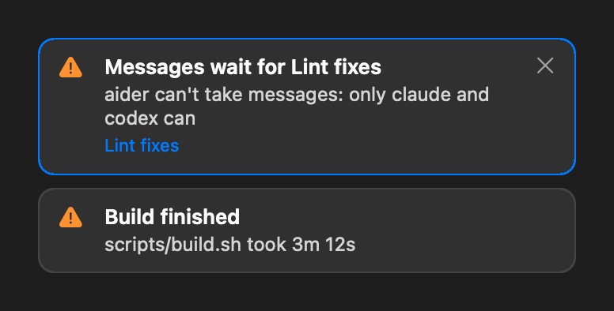
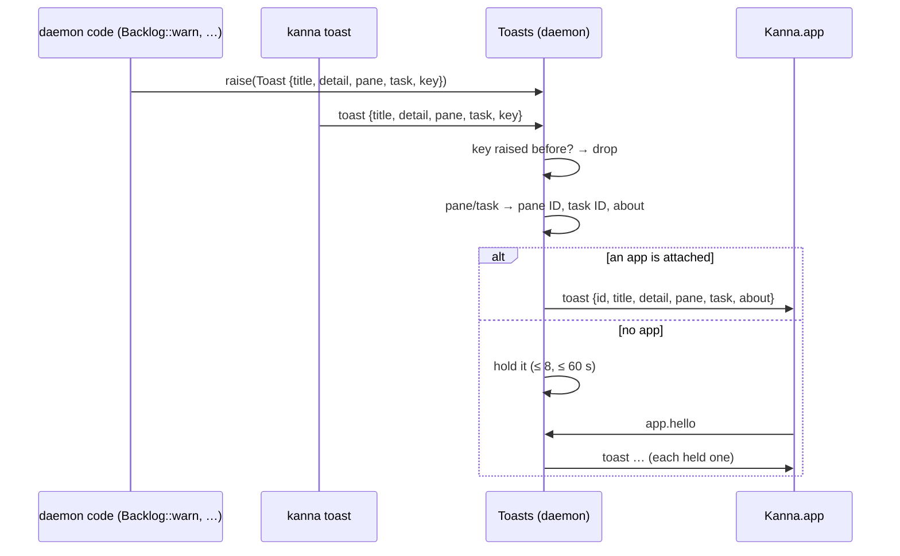

# Toasts

**Status:** built · **Tested:** e2e `toasts`, `agent_messaging`, `crates/kanna/tests/cli.rs`, `toasts.rs` unit tests · **Mockup:** [`references/mockups/toasts.html`](../../references/mockups/toasts.html) (or `#picture-stack`) · **Builds on:** [app link](app-link.md), [Desk](desk.md)

A **toast** is a small, non-modal notice in Kanna.app: a title, a line of detail, and optionally the pane or task it's about. The daemon raises them for warnings that would otherwise only reach its log; `kanna toast` raises one from the CLI.

The app's own drawing (`debug.toasts png`), dark; [`toasts-light.png`](toasts-light.png) is the mockup in light:

## How it looks and behaves

- **Where:** the front window (the key window, else the Desk the app shows), below the title bar's tab row on the right, 340 points wide. It moves to whichever window becomes key, and stays top-right as the window resizes.
- **Stacking:** newest on top, at most 4; a fifth fades the oldest.
- **Fading:** after 6 seconds, or 8 when it's about a pane or task, it fades out over 0.4 s. While the pointer is on it, it doesn't fade; leaving it gives it at least 2 more seconds.
- **Clicking** a toast about a pane or task shows it and closes the toast; clicking one about nothing just closes it. × (shown on hover) closes it.
- **Text:** the title is one line, the detail at most two, cut with …; control characters become spaces. The daemon cuts a title at 120 characters and a detail at 400.
- **The line under the detail** names what it's about: the task's name, else the pane's name or ID.
- **It never takes focus** or keys: the window's first responder stays where it was.

## What a click shows

| The toast is about | A click |
|---|---|
| a pane of a task on the Shelf (or on a Desk) | brings that task onto the front Desk (as clicking it on the Shelf does) and focuses the pane |
| a pane of a planning terminal | shows that planner's Desk and focuses the pane |
| a task in the backlog, running or stopped | moves it to the Shelf (`backlog shelve`, starting it if it's stopped), then brings it onto the Desk and focuses its agent; if the Shelf is full, the Desk's note says why |
| a pane in a plain window | focuses it |

## Raising one

- **In the daemon,** `toasts::Toasts::raise(Toast)` (`crates/kanna-daemon/src/toasts.rs`) is the one way in, for any warning. It returns the toast's ID and whether an app got it, or nothing if its key was raised before.
- **A key raises it once** for the daemon's life: a later toast with the same key, from the daemon or the CLI, is dropped. The caller picks the key; a warning that should come back after its cause clears uses a new key.
- **The pane and the task are resolved** when it's raised: a pane by name or ID (`not_found` if there's none), a task by ID, a unique start of it, or its pane. A pane that is a task's agent also gets its task; a running task also gets its agent's pane.
- **With no app attached** a toast is held, at most 8 and for 60 seconds, and sent when an app says hello. Older ones are dropped.
- **The app link message** is the notice `toast {id, title, detail, pane, task, about}` ([app link](app-link.md#2-messages)); `detail`, `pane`, `task` and `about` may be null. The app replies nothing.

## The CLI

`kanna toast TITLE [DETAIL] [--pane PANE] [--task TASK] [--key KEY]` (protocol: `toast {title, detail?, pane?, task?, key?}`) prints `raised toast-3`, `raised toast-3; no app is attached, …` or `already raised a toast with key KEY`. Tests and scripts use it; agents may too.

`debug.toasts` (with `KANNA_DEBUG=1`) lists the app's toasts with their frames, and takes `hover: ID` (with `on: false` to leave), `click: ID` (with `close: true` for ×) and `png: NAME`, a picture of the stack drawn from its layers, saved in the state folder.

## Its first user: messages that wait

In [agent messaging](agent-messaging.md), a message waits when its recipient can't take it: an agent other than claude or codex, a Claude without a messaging socket, a Codex not attached to its app-server. `Backlog::warn` logs `kanna-daemon: warning: the messages for PANE wait: WHY` when the pane's reason is new, and calls the Backlog's `on_warn` hook, which `main.rs` points at the toasts:

| Field | Value |
|---|---|
| title | `Messages wait for NAME`: the recipient task's name, else the pane |
| detail | WHY, e.g. `copilot can't take messages: only claude and codex can` |
| pane | the recipient's pane, so the toast also names its task, and a click shows it |
| key | `messages:PANE:WHY`: one toast per pane and reason for the daemon's life, though the log line comes again after a delivery clears the warning |

Tested in e2e `agent_messaging` (a message to a copilot task raises one toast, and only one).
