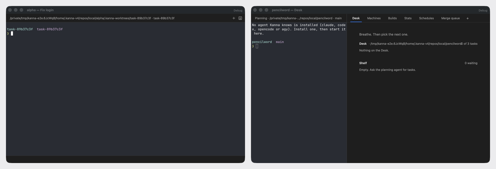
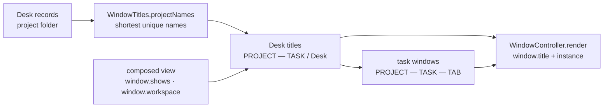

# Window Titles

**Status:** built · **Tested:** e2e `window_titles`, `swift test` (`WindowTitlesTests`) · **Builds on:** [Desk](desk.md), [each app's Desks](app-desk.md), [tab names](tab-names.md), [workspaces](workspaces.md)

A Desk window's title starts with its project's name, so with several projects open the windows can be told apart in the title bar, the Window menu, Mission Control and ⌘\`.

**Before:** every Desk in the Desk view titled `Desk`, and a Desk with a task active titled with only the task's name.

**After:** two projects' Desks side by side, one with a task active and one in the Desk view.

## 1. Rules

| The window | Its title |
|---|---|
| a Desk with a task active | `PROJECT — TASK` |
| a Desk in the Desk view | `PROJECT — Desk` |
| a task's own window (`open --window new` from the task, `kanna window assign`, a tab torn off its Desk) | `PROJECT — TASK — TAB NAME` |
| a free window | as before: its lead's name, or `TAB NAME — win-N` |

- **PROJECT is the Desk's folder name:** the repo's main checkout (`kanna`, `pencilword`), or the folder itself when it isn't a repo; the home folder is `~`.
- **Two Desks of one name differ by their path:** when two open Desks on different folders would show the same name, each takes one more folder from its path until they differ. Projects live at `~/.kanna-v4/repos/OWNER/REPO`, so two repos of one name show as `tampopogk/kanna` and `someone/kanna`. Only the Desks that clash grow; the others keep their short name. A remote machine's Desk on the same path as a local one shows its machine instead, `studio:kanna`.
- **Two Desks on the same folder** show the same name: they are the same project.
- **TASK** is the task's name, as on the strip; **TAB NAME** is the shown tab's name ([tab names](tab-names.md)).
- **The rest stays:** the instance suffix (` · staging-test`) and the Debug label in a debug build.
- **Everything that lists windows** reads the window's title: the Window menu, Mission Control, ⌘\` and the Dock's window list show the same text.
- **Mac app only:** the phone has no window titles.

## 2. How it's built

The app builds every title in one pass over the composed view, before the windows render (`AppController.windowTitles`). The project's folder comes from the Desk's record (`DeskRecord.project`, the folder its planner moved it to), not from the active task, so a Desk in the Desk view has a name too.

- **A task's window** is a non-Desk window whose `workspace` is the workspace a Desk `shows`; the app only shows a task's windows while its task is active on a Desk, so the Desk that shows it is always there.
- **Names are computed together** (`WindowTitles.projectNames` in KannaWindows, a pure function with unit tests) so a clash is seen across every open Desk.

## 3. Rejected

- **OWNER from the git remote:** reading each repo's remote costs a git call per Desk, and fails for folders that aren't repos or have no remote. Every project already sits at `repos/OWNER/REPO`, which its origin decides, so the path gives `OWNER/REPO` with no git call, and it tells any two folders apart.
- **The task first (`Fix login — kanna`):** Mission Control and the Dock truncate a long title at its end, which would cut off the project, the part that tells the windows apart.
