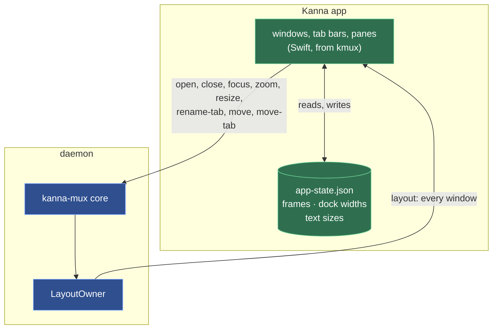
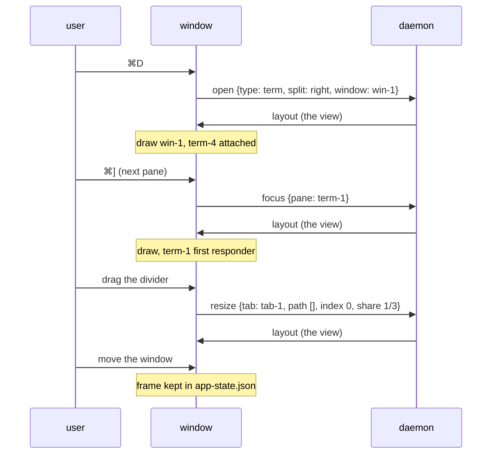

# Windows, Tabs and Splits

**Status:** built ([plan](../plans/mux-build.md) M4, track A) · **Builds on:** [layout](layout.md) · **Reference:** [kmux's spec](https://github.com/tampopogk/kmux/blob/main/docs/kmux-spec.md) §3–§6 · **Related:** [menus](menus.md), [docked pane](docked-pane.md), [zoom](zoom.md)

Kanna.app's windows behave as kmux's: any number of windows, each with a tab bar and the active tab's splits; menus, shortcuts, clicks and drags as kmux's. The views are ported from kmux's app (`WindowController`, `TabBar`, `PaneView`, `Dragging`, `Shortcuts`); what changes is that the layout comes from the daemon and their actions go to it.

## Contents

1. [Views draw the daemon's layout; actions go to it](#1-views-draw-the-daemons-layout-actions-go-to-it)
2. [What the app keeps](#2-what-the-app-keeps)
3. [Windows, tabs, panes](#3-windows-tabs-panes)
4. [Terminal views](#4-terminal-views)
5. [Debug commands](#5-debug-commands)
6. [Checked by](#6-checked-by)
7. [Glossary](#7-glossary)

## 1. Views draw the daemon's layout; actions go to it

The views never keep a copy of the layout. The daemon sends the `layout` view of every window after every change ([layout](layout.md)), and the app draws it with its own physical state laid over it. A user action is one of two kinds:

| Kind | Examples | Goes to |
|---|---|---|
| **A command** | a click into a pane; select, rename, reorder or tear off a tab; focus, zoom, next or previous pane, tab or window; move a pane; drag a split's divider; Split Right / Down, New Tab, New Window, new web, markdown and iOS panes, Close Pane, × on a tab, Close Window, the red button | the daemon, as the CLI's commands (`focus`, `zoom`, `resize`, `rename-tab`, `move`, `move-tab`, `open`, `close`) |
| **Physical** | a window moved or resized; the docked pane's divider dragged; ⌘+ and ⌘− in a markdown, code or diff pane | the app alone: kept in `app-state.json` ([2](#2-what-the-app-keeps)) |

Commands go through the daemon because the layout is the task's, not an app's: a task arranges its tabs with the app closed, and every client sees the same layout ([presentation layers](presentation-layers.md)). While a click's `focus` is on its way, the app draws the clicked pane focused, so a view sent before the daemon had it doesn't move focus back.

## 2. What the app keeps

| State | Kept | Laid over the view |
|---|---|---|
| Window frames | by window ID; a window goes back to its frame if that is still on a screen, and a new one cascades from the frontmost | `frame` |
| The docked pane's width, when dragged | by workspace (a lead's by its window), with the layout's width it was dragged from, so it outlives the agent's terminal starting again | `dock.width`, `lead.width`, a Shelf agent's `width`, while the layout's width is still the one it was dragged from |
| Text size | by pane, for markdown, code and diff panes (1 isn't kept) | the pane's view opens at it |
| Its Desks and Shelf | each Desk's ID (`d1`, …), project, the workspace it shows and its planner; the Shelf's order and parked times; the next Desk number ([each app's Desk and Shelf](app-desk.md)) | the app composes a Desk window from them |

`app-state.json` is in the daemon's state folder (`$KANNA_STATE_DIR`, or the socket's folder), saved half a second after a change and on quit, written atomically with mode 0600; `--fresh` starts without it and `KANNA_NO_STATE=1` neither reads nor writes it. Entries for panes, workspaces and windows the daemon no longer has are dropped when the app attaches.

The `layout` view is `{key, windows: [{id, title, tab, tabs: [{id, title, panes}], focused, zoomed, root, lead, workspace}], workspaces: [{id, where, dock, parkedAt, windows, panes, title, tab, tabs, focused, zoomed, root}]}`: every window and every workspace, their tabs and panes, the tree to draw (the zoomed pane alone when zoomed; nothing when the docked pane is) with each split's shares and pane types, and a workspace's docked pane (`{pane, type, edge, width, name}`). The app adds its Desks, as windows with `desk`, `dock`, `shows`, `planner` and `project`, and the Shelf strip, from its own records. It's what to draw, not what a client sees (`list` shows names and fractions).

## 3. Windows, tabs, panes

- **Windows:** each window of the model is an `NSWindow` with a `WindowController`. Windows that leave the model close; new ones open cascading from the frontmost; a saved window goes back to its frame if that is still on a screen. The title is the active tab's: `store.rs — win-1`. When a window becomes key, it becomes the model's key window (`focus {window}`); when the model's key window changes (a new pane, ⌘\`, `kanna focus`), it's brought forward, or with `--bg` just behind the front app's window. The red button closes the window and its panes. The app stays open with no windows, and the Dock icon then opens a terminal in a new window. Quitting leaves every terminal running.
- **Tabs:** each is named after the pane it was made with until it's renamed ([tab names](tab-names.md)). A click selects (a move of 5 pt first starts a drag); a double-click renames (Enter or clicking away saves, Escape cancels; keyboard focus stays in the field while it's open); a drag drops the tab at a gap in any window's tab bar or, outside every window, into a new window there. Right-click: Move Tab to New Window, Close Tab.
- **Panes:** a pane shows a focus outline only in the key window and only with more than one pane in its tab, its exit code (`exited (3)`) or failure (`failed: …`), and a grip drawn only under the mouse. Dragging a divider snaps to ¼ ⅓ ½ ⅔ ¾ within 1.5 %, keeps both panes at least 80 px, and shows both shares (`1/4 | 3/4`). Dragging the grip docks the pane on the nearest edge of another pane, swaps it with one (the middle 40 %), moves it into a tab or onto + (a new tab), or, outside every window, into a new window there, with kmux's hints. A click focuses the pane under it; keyboard input follows the model's focused pane.
- **Light and dark:** the window's own parts follow the app's appearance as it changes: a colour given to a layer is resolved for the view's current appearance and given again when it changes, since a layer keeps the colour it was handed.
- **Menus and shortcuts:** [menus](menus.md).

## 4. Terminal views

A terminal's surface is made the first time its pane is on screen, and stays (attached to the daemon, drawing its output) until the pane leaves the layout, so switching tabs shows a live screen at once; a terminal in a tab never shown since launch keeps the size its pty has. A Desk window also holds, hidden and attached, the agent of each of its project's tasks on the Shelf or running in the backlog, at the size it would have on the Desk, so it runs at that size ([pane sizes](pane-sizes.md)). Web, markdown and iOS views start when the daemon says `start` ([app panes](app-panes.md)) and are placed when shown. How the surfaces behave: [terminal](terminal.md).

## 5. Debug commands

With `KANNA_DEBUG=1`; the daemon passes them to the app, turning a top-level `pane` name into its ID; nested ones are resolved by the app ([app link](app-link.md#3-rules)).

| Command | Does |
|---|---|
| `debug.key {key, pane?}` | a key press (`cmd+shift+d`, `cmd+]`, `return`, `left`, a letter) in the key window, or in `pane`'s terminal: with ⌘, ⌃ or ⌥ the window and then the main menu get it as a key equivalent first, as AppKit does; otherwise (or if nothing takes it) the window's first responder |
| `debug.click {tab, clicks?}`, `{pane, at?: [x, y]}`, `{…, button}` | clicks a tab (2 clicks: rename) or a point in a pane (from its top left). In a `--bg` app the click goes to the view under the point as it would in the key window. `button` 3 or 4 is the mouse's back or forward button; `button: 1` doesn't open the right-click menu (it would block) but answers its items: `{menu: [titles]}`, empty on a terminal whose program takes the mouse, as a right-click there opens no menu |
| `debug.drag {pane, to}`, `{tab, to}`, `{divider: pane, at}` | kmux's: a drag replayed along scripted points, with no hint shown; `to` is `{pane, x, y}` (fractions from the top left), `{tab}`, `{plus: window}` or `{outside: true}`; `divider` is the divider after that pane, moved to `at` of the pair |
| `debug.menu` | every menu item: `{menu, item, shortcut}` |
| `debug.view` | the view the app draws: the daemon's `layout` with the app's physical state laid over it ([2](#2-what-the-app-keeps)) |
| `debug.pinch {pane, steps?}` | a trackpad pinch over a markdown pane; the zoom after each step |
| `debug.drop {pane, files \| image \| text}` | a drop on a terminal: file paths, a PNG or TIFF file's data, or text, as a drag would bring them |
| `debug.stats` | the app's pid and memory footprint |
| `debug.snapshot {window?, path?, marker?}` | any window (default: the key one), with each pane's `notice`, the window's tab titles and the tab bar's drawn colour |
| `debug.text {pane?}` | also the surface's `columns` and `rows` |

## 6. Checked by

`crates/kanna-mux` owner tests (`view`, a divider's `resize`, `auto` splits) and `windows_tabs_ui`, `resize_arrange`, `drag_panes_tabs`, `chrome_and_drops` of `scripts/e2e-kanna.sh`: menus and shortcuts split, tab, zoom, cycle and close; clicks select, rename and focus; dividers snap; `auto` follows the pane's shape; Ghostty's split navigation and font size; frames come back; the app outlives its last window; panes and tabs dragged everywhere; the tab and pane menus; every window drawn with its tab bar and dividers; the tab bar's colour in dark, light and dark again.

## 7. Glossary

| Term | Meaning |
|---|---|
| **Key window** | The window in front: shortcuts and menus act on it, and so do kmux protocol requests with neither a `window` nor a caller; the layout model's and AppKit's follow each other. A CLI command never falls back to it: with no target it acts on its caller, or is refused ([the CLI acts on its caller](cli-caller.md)). |
| **Tab bar** | The row of tabs under each window's title bar, with × and +. |
| **Divider** | The line between two panes of a split; dragging it moves the split between them. |
| **Grip** | The handle at the top of a pane, seen only under the mouse; dragging it moves the pane. |
| **Drop hint** | The highlight showing where a dragged pane or tab will land. |
| **View (of the layout)** | What the app draws: every window with its tabs and the tree on screen, from the layout model. |
