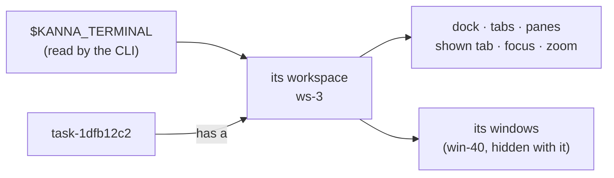
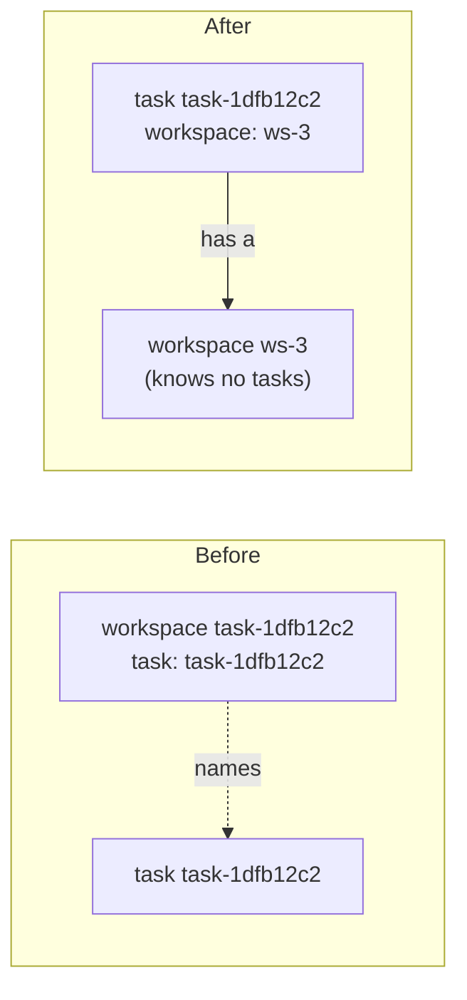

# kanna workspace list

**Status:** built · **Builds on:** [workspaces](workspaces.md), [presenting](presenting.md), [task IDs](task-ids.md), [CLI](cli.md) · **Replaces:** `kanna list`

**An agent presenting its work needs to see its own workspace:** its tabs, the panes in each, which tab is shown, what's focused and whether it's zoomed, as the user will see it when they pull the task. `kanna workspace list` prints that, for the caller's pane (`$KANNA_TERMINAL`, which every Kanna terminal has), with no argument. `kanna list` goes: nobody read its text, and it had no clear purpose.



- [A task has a workspace](#a-task-has-a-workspace)
- [The output](#the-output)
- [What changes](#what-changes)
- [kmux](#kmux)
- [Decisions](#decisions)

## A task has a workspace



- **A workspace has an ID of its own,** `ws-1`, `ws-2`, …, made by the layout. The dash keeps it from being read as a window (`win-1`).
- **The task's record names its workspace** (a `workspace` key in its `doc` in `kanna.db`, so no migration). The daemon sets it from the workspace a start makes, and keeps it right from each listing, by the workspace its agent is docked in. The layout knows nothing of tasks: no `task` field, no lookup by a task's ID; the daemon turns a task given to `window assign` into its workspace.
- **A workspace can have no task,** as a docked agent's (`kanna open --dock`) does.
- **Replies** name the workspace by its ID; the daemon adds the task and its name (`task`, `name`) when one has it: `opened term-5 in ws-3 (task-1dfb, on the Shelf), tab-9: running`.

## The output

`kanna workspace list`, from a task's agent or any pane of its workspace:

```text
ws-3 (task-1dfb, Fix login), in the backlog
  dock: term-407 (Fix login)  left 2/5  frozen
  focus: diff, zoomed
  *tab-211 "diff"  diff
   tab-212 "login.md"  file-5:1/2 | term-6:1/2
  win-40
    focus: term-9
    *tab-30 "Tab 1"  term-9
```

`*` is the shown tab. From a pane in a free window, it's that window; from a pane with no window (Kanna.app closed), it says so.

```text
*win-45  free
  focus: notes
  *tab-247 "notes"  notes
```

`kanna workspace list --all`: every window, then every workspace as above, then free windows and panes in no window.

```text
Windows
 win-40  ws-3 (task-1dfb, Fix login)'s window
*win-45  free

Workspaces
ws-3 (task-1dfb, Fix login), in the backlog
  …
ws-5, a Desk's planner
  dock: term-280  left 2/5
  focus: term-280

Free windows
win-45
  focus: notes
  *tab-247 "notes"  notes

Unplaced panes
term-500 (logs)
```

A Desk is the app's, so it isn't listed; a planner is a workspace like any other.

`--json` prints the daemon's list reply: the caller's workspace, or with `--all` everything, as `kanna list --json` did (windows, panes, workspaces), with each workspace's shown tab, focus, zoom and its windows' tabs added. e2e scenarios and `tests/cli.rs` read `kanna workspace list --all --json`.

## What changes

| Where | Change |
|---|---|
| kanna-mux | workspaces get `ws-N` IDs and lose `task`; the list reply gives each workspace its shown tab, focused and zoomed pane, and its hidden windows' tabs (`hiddenWindows`); the saved layout is version 3 (version 1 and 2 layouts load, their task-named workspaces given `ws-N` IDs, their windows following) |
| daemon | a task's `doc` names its workspace, set when it starts and from each listing; replies add the task and its name |
| CLI | `workspace list [--all] [--json]`; `list` goes |
| Skills | kanna-tasks "Present your work" ends with `kanna workspace list`; kanna-quiz finds its window with it |
| e2e, tests | `kanna workspace list --all --json` |
| Specs | this; [workspaces](workspaces.md) (the model, IDs, replies), [database](database.md), [CLI](cli.md), [commands](commands.md); the old `kanna list` output spec is removed |

## kmux

The same change goes to kmux ([kmux subtree](kmux-subtree.md)), so the CLI stays kmux's: `kmux list` goes, `kmux workspace list [--all]` joins `new`, `hide`, `show` and `close`, read from `$KMUX_PANE`, and kmux's workspace IDs become `ws-1` (its saved `s1` IDs still load). A kmux branch and PR, as the subtree says.

## Decisions

| | Decided | Why |
|---|---|---|
| `kanna list` | removed | no skill or script read its text; e2e read `--json` |
| Context | the caller's pane, read from `$KANNA_TERMINAL` by the CLI | every Kanna terminal has it, as `open` already uses it |
| Task and workspace | a task has a workspace; the layout doesn't know tasks | a workspace is presentation, a task is work; one can exist without the other |
| IDs | `ws-1`, `ws-2` | apart from task IDs; can't be read as a window |
| Everything | `--all`, also for scripts (`--all --json`) | one command, not a second one for dumps |
| kmux | backported | kanna's CLI is kmux's |
